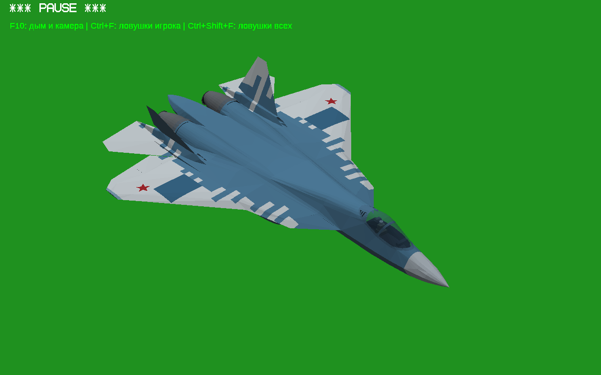

## 6 ноября 2026 — подтверждённые артефакты впуска Су-30СМ исправлены отдельно

Кандидат IntakeArtifacts: reports/su30sm-intake-artifacts/STATUS.json, draft436127550, Actions42167924281 SUCCESS, источник9753077. ФинальныйDNM6fd0f298; предыдущаяVisualPolish1a10 и CURRENT_VERSION5+IntakeFix17dd сохранены. Только5SRF в одномDNM, всеузлы/STA/окраска/яркость и1156другихфайловигры побайтно прежние. Убраны внутренние перекрытия проходов и передние дубли компрессоров, правильные глубокие компрессоры сохранены. Внешнийкорпус защищён по исходнойповерхности:746оригинальныхгранейточные. Проба без защиты с боковым отверстием отклонена; не братьстарые032/5a/1698/ECDкандидаты.2925новыхтреугольниковдоказаноподмножествомисходных,0новыхвырожденных,201поза0scopedcontacts. NativeWin64Wine:11основных+21камера=32сравнения/видео/Gцикл; кадры реально открыты. Все3ZIP повторноскачаны/SHA/CRC, скачанныеSourcesстроговоспроизвелиSHA, прежниеSources/движок/GLB/лицензиисохранены. Старое mainwheel/IntakeDuctstow-пересечение и фасеточные полосы остаются. CURRENT_VERSION не переключать автоматически; нужна пользовательская визуальная оценка. Подробно changes/su30sm-intake-artifacts/WORK_STATUS.md.

## 6 ноября 2026 — точечная визуальная доводка Су-30СМ завершена отдельно

Поставка VisualPolish: reports/su30sm-visual-polish/STATUS.json; draft436099010, Actions42162588062 SUCCESS, исходныйкоммит6a68463. Game/Sources/Report повторноскачаны SHA/CRC, обаDNMточнособраныизскачанныхSources. 1155прочихфайловигрыипрежниеисходникипобайтносохранены. Рабочаякопия /workspace/ysflight-dev/su30sm-visual-polish, модель1a10d466/cockpit59e8226d. Двернойсдвиг70→30мм,фонарь43°,тормоз50°/согласованныйпривод,утоплены2внутреннихконусныхпика,устраненынаружныедублистенокканалов. Всеуглыфотографическиеприближения,не заводскиечисла. Окраска/колёса/стойки/лепесткисохранены. 4nativeWin64цикла/15сравнений/201поза0scopedcontacts. Фасеточныеследы истарыйmaingear/ductstow-overlapостаются. CURRENT_VERSION5+IntakeFixнеизменен,непереключатьавтоматически. Подробно changes/su30sm-visual-polish/WORK_STATUS.md. Исторические6/7непереносились.

## Су-30СМ: продолжение геометрии ниш/створок завершено отдельно

Поставка кандидата: reports/su30sm-gear-bays-repair/STATUS.json, draft435097963; Sources/Game/Report скачаны и SHA/CRC проверены, Actions42017042257 SUCCESS. DNM08e5e8fc, только один изменённый файл игры;1156 прочих файлов и8068 прежних файлов Sources точные. Полное продолжение/ссылки: changes/su30sm-gear-bays-repair/WORK_STATUS.md. CURRENT_VERSION №5+IntakeFix сохранён, не переключать автоматически. Родной Win64 G-цикл и20 сравнений,201 расчётное положение; заявленная матрица новых препятствий0. Старые главные колёса всё ещё пересекают IntakeDuct в части убранного движения; не заявлять весь самолёт идеальным. Геометрия заморожена для визуальной приёмки. Не переносить6/7.

## 5 ноября 2026 — поставка двух крышек завершена

Отдельный кандидат Task1 готов: draft434249450, tag personal-su30sm-test5-shutter-fix-20261104. Доставка завершилась успешно в Actions41882717840; Game/Sources до этого собраны в41881978070 с точным SHA проверенной модели. Все три ZIP повторно скачаны: SHA/CRC прошли. Из1157 игровых файлов изменён только runtime/aircraft/su30sm.dnm; в DNM изменены только MainWheelBayShutter_Left/Right.srf. Все узлы/STA/родители и1156 остальных файлов точные. CURRENT_VERSION №5+IntakeFix и её runtime сохранены для отката.

Ссылки/SHA: reports/su30sm-test5-shutter-fix/STATUS.json. Проверка скачанного: download-verification.json. Отчёт/PNG/видео — REPORT_RU.md и Report ZIP. Конкретный результат: в201позе Fuselage_0_4 контактов0, неподдержанных/вырожденных/самопересекающихся треугольников0. Остались54 прежние пары/позы IntakeDuct/GearDoor/DoorSeat/WheelFairing, новых пар/поз0. Нельзя утверждать, что вся система шасси исправлена. Прочие детали и анимации не менять без следующего запроса.

Важное ограничение исходников: сырой --retriangulate на другом исполнителе дал другую триангуляцию; строгая проверка остановила её выпуск. Поставка использует source-data/validated-layout-*.json, именно проверенную промежуточную поверхность, и точно воспроизводит её сборку в DNM. Исправленный алгоритм действительного контура сохранён в surface.py; после нового --retriangulate нужны новые проверки. Игровая геометрия после её проверки не менялась. Sources содержит исходную baselineDNM, необходимые editableSRF/layout, весь прежний движок/GLB/историю/лицензии. Исторический большой промежуточный DNM до refinement4 отдельно не включён; его происхождение/SHA записаны.

Пользовательская приёмка ещё не получена. Релиз оставлен DRAFT; ссылки требуют входа владельца в GitHub. Не менять имена/метаданные релиза без необходимости: PATCH без явного tag_name сбрасывает имя draft. Старые архивы не удалялись и не заменялись.

## 4 ноября 2026 — отдельный кандидат: только две MainWheelBayShutter

Пользователь разрешил Task1 исправления геометрии MainWheelBayShutter_Left/Right. Код changes/su30sm-test5-shutter-fix, отчёт reports/su30sm-test5-shutter-fix/REPORT_RU.md. Основа5+IntakeFix сохранена в CURRENT_VERSION для отката. Меняются только2SRF, все узлы/анимации/прочие файлы игры точные. 201поза: Fuselage_0_4 контактов0, неподдержанная поверхность0, вырожденных/самопересечений0. Осталось54 прежних пары/позы с IntakeDuct/GearDoor/DoorSeat/WheelFairing; новыхпар/поз0. Не считать всю систему шасси исправленной. Реальный циклG0→1→0/OpenGL64Wine и matchedPNG просмотрены,32бит повторно не запускался. Полные ограничения в отчёте. НовыйDRAFT отдельный, пользовательскаяприёмка ожидается. Не переносить6/7.

## 4 ноября2026 — точечная правка воздухозаборников №5

Основа остаётсяGame5, без6/7. Пользователь требует ИСКЛЮЧИТЕЛЬНО убрать чёрную постороннюю пластину в впуске. Диагностика: временное скрытиеGearWell_Right убирает её, скрытиеIntakeDuct_1/MainBayFixedSkin_Right неубирает. Причина — передняя вертикальная стенка ниши GearWell_Left/Right,z≈-.39, пересекающая канал. Удалены только перекрывающие грани (148слева,150справа, включаяобратные). Все вершины/прочиеблокиграней/остальныемеши/узлы/трансформы/состояния/иерархия точные. Двигатель(Fuselage7/13,IntakeDuct,сопла) полностью НЕИЗМЕНЁН. Не применять решения6/7 и не удалять компрессоры. fix.py фильтрует готовые блокиPCK, не пересоздаёт оставшиесяграни. Код5f07c37, changes/su30sm-test5-intake-fix. Исторический источникстенкиgear4.py205..213 не переписывался.

Draft434090938/tagpersonal-su30sm-test5-intake-fix-20261104, Actions41855913937 SUCCESS. Все3ZIPскачаны/SHA/CRCпрошли. Повторно сравнены ВСЕ файлыGameZIP сGame5: отличается толькоruntime/aircraft/su30sm.dnm. АктуальныйSHA/точныеудалённыеграни/ссылки reports/su30sm-test5-intake-fix/STATUS.json. ВстроенныйSU30SM_TEST_MANIFEST5 и SOURCE_DOWNLOADS5 сохранены согласноусловиювсеостальныефайлыточные; актуальныйаудитисходниковфикса — отдельныйReport/SourcesZIP. Полныйдвижок3/история/лицензии сохранены. Визуальнаяпроверка OpenGL64Wine до/послеfront-close:пластиныисчезли, двигательсохранён. Windows32повторнонепроверялся, EXEпобайтнототже. Новый runtime /workspace/ysflight-dev/active-su30sm-test5-intake-fix/runtime, CURRENT_VERSION/CURRENT_RUNTIMEзакреплены. НеправленыйGame5 сохранён. Не добавлять улучшений сверхэтогозапроса.

## 4 ноября 2026 — полный откат на Су-30СМ тест5

Пользователь отверг6/7 и явно выбрал5. CURRENT_VERSION.json/md теперь закрепляют полныйGame5 (SHA 31d22516a2a8a62661681618585519c8a7ac33f4dc4211bf46aa58d83cd9bc67). Чистый runtime извлечён из проверенногоZIP5 в /workspace/ysflight-dev/rollback-su30sm-test5/runtime. Все5SHA модели совпали; ZIPCRC прошёл. Тесты6/7 исторические, не продолжать от них и не смешивать их правки с5. Не считать5 окончательно принятой моделью: это выбранная точка отката. Старые архивы/источники сохранены.

## 4 ноября 2026 — Су-30СМ тест7 завершён

Продолжать Су30 от reports/su30sm-test-7/STATUS.json, changes/aircraft-su30sm-test7. Код8b4e678. Draft434030950 / personal-su30sm-test7-20261104 оставитьDRAFT; CURRENT_VERSION/старыеархивынеменять. Пользователь отверг6 по множеству скриншотов; не считать модель принятой.

Главная реальная причина чёрных прямоугольников: gear4 вырезал и верх крыла в призмах ниш. Восстановлены336исходныхгранейизsource-stage4, толькоX±1.03..2.4/Z-3.38..-.41/Y>.025. Цветоваяформула4 сохранена, repair-input/upper-wing-repair.srf включён вSources/baseline7. extract_top.py поясняетпроисхождение, полнаяисторияисточников4сохранена. ФинальныйtailPNGпросмотрен: большойчёрныйпрямоугольникисчез.

Добавленные диски вIntakeDuct убраны; дополнительно исходные Fuselage7/13 внутренности передz-1.45 удалены, одинаковыйизогнутыйканалотz-.41до-1.40. ФинальныйfrontPNGпросмотрен: обе стороныбезторчащеговентилятора.1300непрозрачныхгранейфонаряпревращенывстеклоalpha42, сохранивпрофиль/нижнийпояс/поперечныерамы. Длинныеосновныедвериразделены: передняя, задняя закрывающаяся после проходаколеса, короткаяоткрытаяуверхастойки(z<-2.9). Первая попытказакрытияпересекаластойку; исправлено, последняяFCL9поз0контактоввыбранныхпар. Тормоз: изподвижнойпанели выделеннеподвижныйзаднийхвост, длинаподвижной2,455м; угол/привод6сохранены. Обратныегранирулей/стабилизаторовдобавлены. Никакогосглаживания, прочиесамолёты/EXEсохранены. Форма/кинематикапо-прежнемуигроваяреконструкция, невсезаводскиеразмерыизвестны.

ДополнительныереальныеSu30SMфото полученычерезCommonsAPI (вебпоисковыхинструментовнет),двеJPEGскачаныиVIEWED вlab/reference.jpg/reference2.jpg; URLreferences.json. Фотоне перераспространять. Финальныестатическиефото7переснятыпослепоследнегоредактированияканала.3видеомеханизмовпрошлиG/Alt+5/B передпоследнейизолированнойправкойканала, самианимациипотомнеизменялись. Не подменятьфинальныеPNGраннимиreview.

Actions41847602521 package+Windows32 SUCCESS, строго5SHAвоспроизведены; модельснимковсовпадаетсZIP. WindowsPE32летал49,2с/2G/F1,скринVIEWED. Все3ZIPскачаны, SHA/CRCпрошли; GameSOURCE_DOWNLOADSверный, Sources содержитполныйдвижок3, GLB4, baseline6+repairinput7+refine7. Лаборатория /workspace/ysflight-dev/su30sm-test-7/final-downloads. Пользовательскаяприёмкаожидается.

## 4 ноября 2026 — Су-30СМ, тест №6 завершён

Последний отдельный Су30: reports/su30sm-test-6/STATUS.json, changes/aircraft-su30sm-test6; исходный код60a9bc8, уборка неиспользуемых зависимостей107bc93. Продолжать отGame6. Draft433962216 / personal-su30sm-test6-20261104 оставить DRAFT. Старые архивы и CURRENT_VERSION сохранены.

Пользователь дал3фото: тормозсбоку, открытыйфонарь/шассиспереди, днище/шассивполёте. Требует геометрию, особенно толщину килей, окраску НЕменять. В6 поперечная толщина килей/рулей выше корня44%прежней с переходомвкорень, YZконтур/высотасохранены; фонарь55→43°. Закрытые меши фонаря и цвета всех граней корпуса/килей/фонаря строго сохранены, Rнормалей нет. CockpitDNM обновлён темижеузламифонаря/фюзеляжа. DAT/коллизии/list/EXE/прочие самолёты неизменены.

Тормоз60→65°вокругоси, наклонзаднейкромкиоколо52°. Опора: основаниеотшарнира(0,-.22,-.42), настворке(0,-.476923,-1.72);21положение, проушины. Обшивка гондол, створки и стенки ниш перестроены по общим нижним сечениям вместо рваного контура. MainWheelBayShutter5 сохранён с новой поверхностью; передняя задняя широкая створка разделена на2противоположные. RigidWheelFairing5 сохранён. Цвета заменённых панелей берутся по прежнему правилу окраски4/5, другие поверхности не перекрашены. Кинематика/форма — визуальная реконструкция пофото, не заводская измереннаямодель.

Полные игровые циклы Alt+5/B/G прошли,3видео;9позиций шасси, выбранные пары0контактов/ошибка жёсткихщитков0. Фото final-photos/final-bottom/final-brake-open, до5before5/before-brake5. Важно: MODELPOSE третьеполе — flap, не тормоз; fixture CTLSPOIL1 сбрасывается управлением. Для статического полного тормоза BRAKE_OPEN теперь4×BTNFUNC:SPOILEREXTEND+3,5с, влоге строгоspoiler1. Только последние кадры вошли в отчёт. Не использовать ранние review/частичныекадры. Нет полногоаудитавсехповерхностей или гарантиизаводскойточности.

Workflow41838636093 package+Windows32 SUCCESS: все5SHA совпали при воспроизведении, остальные самолёты/EXE неизменны. PE32 фактически43,3с/2G/F1, скринпросмотрен. Все3ZIPскачаны, SHA/CRCпрошли; SourceZIP содержит полныйдвижок3,GLB4,baselineDNM5,актуальныйrefine6 и прежнююисторию/лицензии. SHA DNМ91936d3849bbf0000583c946fdf11dfe6311363a05274bbc38a0f283e738e139. Лаборатория /workspace/ysflight-dev/su30sm-test-6/final-downloads. Пользовательскаяприёмка ожидается.

## 4 ноября 2026 — Су-30СМ, тест №5 завершён

Последний отдельный тест Су30: [отчёт](reports/su30sm-test-5/README.md), точные URL/SHA в reports/su30sm-test-5/STATUS.json; код 67ff51a. Draft433727284, tag personal-su30sm-test5-20261104 оставить DRAFT. Продолжать следующую работу Су30 от Game5, старые архивы и CURRENT_VERSION не менять.

Пользователь уточнил вертикальные кили и дефекты снизу с выпущенным шасси. Нейтральные кили сохранены после сопоставления с присланной схемой Су30СМ и инструкцией Звезда7314, C18/C26: явного основания сужать контур нет. Исправлена наклонная ось рулей, прежняя глобальная Y отводила верх оси примерно на9,4см. Нейтральная геометрия рулей не изменена. Не выдавать эти материалы за заводские рабочие чертежи.

Удалены независимый сдвиг большого щитка вниз на0,75м и телескопические поддержки теста4. WheelFairing/Brace теперь жёсткие дочерние WheelCarrier, не вращающегося колеса. MainWheelBayShutter — отдельная закрывающая нишу панель: открытие100°, закрыта при g0/g1. Семь створок пересобраны в замкнутые панели8мм по нижней исходной огибающей, без перекрывающихся заплат. Не возвращать эксперимент180° или старый независимый щиток. Сглаживание выключено. Движок/другие самолёты/камера/фонарь/сопла сохранены.

Адресная FCLвыборка9позиций выбранных пар0контактов, ошибка жёсткой связи0; полный аудит всего самолёта не заявлен. Реальный игровой G цикл0..1..0, рули Z/C/X -1..1, активный полёт. Фото до/после, солнечное днище и2видео в HTML. Workflow41823849278 package+Windows32 SUCCESS, PE32 фактически летал42,2с/2G/F1, скрин просмотрен. Все3ZIP скачаны обратно, SHA/CRC совпали; полный движок3, исходныйGLB4, базовыйDNM4 и конвертер5 проверены внутриSources. МодельSHA7f3853718373cb38146d5cb95abee7c6531ff4ffd263819e2e2a78c1323ab15e. Реплика Actions строго совпала по5файлам. Лаборатория /workspace/ysflight-dev/su30sm-test-5/final-downloads. Пользовательская приёмка и заводская точность механизма не заявлены.

## 4 ноября2026 — Су-30СМ, тест№4 завершён

[Отчёт с17кадрами/6видео](reports/su30sm-test-4/README.md), точныеURL/SHA в reports/su30sm-test-4/STATUS.json. Код c9dc785, канонизация e6013f1, детали в changes/aircraft-su30sm-test4/WORK_STATUS.md. Draft433529453 / personal-su30sm-test4-20261104 оставить DRAFT. Старые версии/архивы и CURRENT_VERSION сохранены.

Пользователь прислал цветовой лист HobbyMasterHA9506 и размерный общий вид Су-30СМ, затем явно РАЗРЕШИЛ менять нос. По размерным стрелкам: база8,34→5,57м, колея4,40→4,10м, размах14,3866→14,70м, высота6,360315м. Длина21,935м сохранена (на листе21,9м). В нечёткой таблице есть противоречия, заводское происхождение листа не подтверждено. Не увеличивать кили: белые законцовки уже дают полную высоту!

Ниши/створки перестроены от исходной геометрии, передняя нишаz1,99..4,16; верхнее креплениеY+.05,z2,17; сложенное колесо0,.08,3,72. Передние створки — две короткие и одна задняя, а не две длинные пластины. Главные щитки с направляемой траекторией/телескопическими креплениями, шов2мм с закрытой нишей за ним. Экспериментальные MainBaySeat удалены: не возвращать. Последняя FCLвыборка6позиций: выбранные передние створки/шина/стойки, главные щитки/шины/стойки/фиксированные панели, передняя шина/ниша/интерьер —0контактов; полный аудит всех деталей не заявлен. Новый тонкий приёмник носа, собственная серо-голубая окраска, сглаживание0. Камера/прозрачный фонарь/тормоз/сопла сохранены. Разноцветные пользовательские скрины — Ctrl+Shift+F9 диагностические цвета, не потерянные материалы.

Движок/EXE/DLL неизменённые3. Полный соответствующий движок в SourcesZIP/sources/su30sm-test3/engine, конвертер/GLB4 в su30sm-test4; CURRENT_ENGINE.txt объясняет путь. Пайплайн4 полностью отGLB воспроизведён Actions, все5SHA точные. Внутренняя задняя панель потребовала канонизации Delaunayтриангуляции/кромок: изменён лишь порядок, цветные поверхности имеют симметрическую разность0м², все узлы/состояния точные. Nativeкадры до канонизации геометрически эквивалентны, доказательство CANONICALIZATION.json. STRICTSHA не ослаблен.

Workflow41777330614 package+Windows32 SUCCESS. Реальный PE32i386 загрузилполёт/2G/F1, работал39,2с; скрин просмотрен. Все3ZIP скачаныобратно иSHA/CRC проверены, SOURCE_DOWNLOADS/модель/путьполныхисходников проверены внутриZIP. Лаборатория /workspace/ysflight-dev/su30sm-test-4/final-downloads. Старые engine1/2/3 не менялись. Интерьер/кинематика/динамика пока игровые; пользовательская приёмка впереди.

## 3 ноября 2026 — Су-30СМ, тест №3 завершён

[Отчёт/фото/видео](reports/su30sm-test-3/README.md), авторитетные URL/SHA: reports/su30sm-test-3/STATUS.json. Код bbf986c, changes/aircraft-su30sm-test3; продолжение в WORK_STATUS.md. Draft433034614 / personal-su30sm-test3-20261103 оставить DRAFT. Один ZIP32/64, прежние самолёты сохранены, CURRENT_VERSION не менялся.

Нос Fuselage_0_5 точно сохранён. Пользователь разрешил инструкцию Звезда7314 Су30СМ вместо ненайденных размерных чертежей: не заявлять заводскую точность. Главная причина чёрных выступов фонаря — GearWell_Nose доY1.71 по envelopeстекла; теперьY≤.43 под полом, noseclosedC0,.08,6.25. Реальные прозрачный фонарь/Alt5, обзормышью/двойнойSPACE/F1послезума проверены. Шасси: длиннаястворка+колёсныйщиток, исправленынайденныеконтакты; closure щитка строить в closedWORLDXZ, не влокальнойпроекцииперевёрнутогоколеса. Ниша/телескопическийприводтормоза271, размертормозасохранён. Углублённыевходы/горловиныдвигателей, перекрытиесопел×1.24, радиус1:1.195 — игровоеограничение, не заводское. Синее пламя. Сглаживание0. Оружиеотключеновдвижкепопросьбепользователя.

Workflow41688279878 package+Windows32 SUCCESS; PE32i386 фактически загрузилполёт/2G/F1 иоставалсяжив41.1с. Все3ZIP скачаныобратно иSHA/CRC проверены; SourceURLвGame совпадаетсSTATUS. Лаборатория /workspace/ysflight-dev/su30sm-test-3/final-downloads. Полные источники/лицензии/история сохранены. Не возвращатьранниеварианты3изreview/corrected; финальныекадры/проверкивreports3. ДинамикаСу27, интерьер/кинематикаигровые, полногоаудитавсехвнутреннихдеталейнет. Исходникиengine1послесбороквосстановлены;engine2нетронут.

## 3 ноября 2026 — Су-30СМ, тест №2 завершён

[Отчёт/ссылки](reports/su30sm-test-2/README.md), авторитетные URL/SHA: reports/su30sm-test-2/STATUS.json. Release432779163 / personal-su30sm-test2-20261103, оставить DRAFT. Один ZIP32/64, остальные самолёты №1 сохранены. Сглаживание выключено полностью, 32пары сопел зеркально одинаковы, регулируются1:1.35; нет прежних внешних коробок шасси. Фонарь прозрачный42/255, глаз(0,1.18,5.55), интерьер6мешей; обязателен cockpit.CacheTransformation(). ЛКМ/ПКМ — общий обзор во всех самолётах, двойнойПробел сбрасываетH/P/Zoom, F1 после внешнего зума тоже даёт нормальный вид. Пробел в кабине теперь не стреляет.

Workflow41651101991 package+Windows32 success, реальный полёт/2G/F1 после26zoom, скрин рассмотрен. Все3финальныхZIP скачаны иSHA/CRC проверены, Game source-link совпал сSTATUS. Лаборатория /workspace/ysflight-dev/su30sm-test-2/final-downloads; код changes/aircraft-su30sm-test2; подробный WORK_STATUS.md там же. engine2 теперь отдельная копия, старые source1исходники восстановлены изегоSourcesZIP. Точные модельные5SHA совпали приActionsвоспроизведении. Фабричная кинематика/полный нулевой аудит внутренних контактов не заявляются; динамикаСу27, интерьерпростой. Пользовательская приёмка впереди. CURRENT_VERSION не менялся.

## Дополнение 3 ноября 2026 — Су-30СМ, отдельная проверка №1

Завершена адаптация пользовательского su-30sm.glb: HappyMexicano7, CC BY 4.0, 418250 треугольников, 94 меша без децимации. [Финальный отчёт и скачивание](reports/su30sm-test-1/README.md), авторитетные SHA/URL в reports/su30sm-test-1/STATUS.json. Release432469264, tag personal-su30sm-test1-20261103, оставить DRAFT с прежним статусом Су34. CURRENT_VERSION не менялся; игра от production17, старые aircraft сохранены побайтно.

Полные собственные шасси/ниши/створки, класс210 со101позицией; исходное сглаживание через V ... R nx ny nz и поддержку движка; сопла класс270 с21состоянием и ограничением радиуса1.20, пламя112/113. Финальный аудит119мешей/4створок/15движущихся частей:101положение, непредусмотренных пересечений0. Native Wine64: Gцикл, сопла/форсаж, фото11видов+инверсия,360видео. Windows x86 действительно запущена и прошла команды шасси: отдельный windows-result.json/PNG/log в ReportZIP. Это проверка запуска/команд; геометрия проверена отдельно.

ВАЖНО для32бит: не регистрировать идентичный su30sm_coarse.dnm, иначе двойная полная модель исчерпывает2GB. air_su30sm.lst содержит4поля, на всех дистанциях используется полный vis. В collision SRF было788210вершин, из них нужны138; удалены только неиспользуемые, все272треугольника точные. Никакого сокращения видимой геометрии. Ярлык Play_Su30SM.bat использует config-su30/option.cfg с OPENDEMO FALSE и отдельный user-su30; без этого новая Windows запускает демо и сценарий ждёт меню. Начальный вид приближен26командамиVIEWZOOM.

Лаборатория /workspace/ysflight-dev/su30sm-test-1. Финальные проверенные ZIP: final-downloads/; runtime синхронизирован из финального GameZIP. Старые probe/rejected версии не поставлять. Код changes/aircraft-su30sm-test1; полный соответствующий engine + исходныйGLB + прежняя история в SourcesZIP. Материалы PBR адаптированы к OpenGL1, динамика от Су27; шасси/обтекатели — игровая адаптация, не заводская кинематика.

Прямая загрузка uploads.github.com из облака401; Actions github.token работает. Источник теперь уже есть в SourcesZIP, повторно передавать GLB не нужно. Временный пакетpacket.zip и ACKтег удалены после проверки. Последняя сборка/проверка — workflow su30sm-test1; windows_only позволяет проверять упаковку без повторной геометрии. Для изменения draft сохранять tag_name явно и не полагаться на постоянство untagged URL: брать URL из свежегоSTATUS/релиза. Последняя ссылка внутриGame SOURCE_DOWNLOADS проверена поSTATUS; есть стабильный каталог отчёта.

## Дополнение 3 ноября 2026 — личный тест №17, оставшаяся щель МиГ-29

Пользователь прислал новый крупный скрин и уточнил: МиГ-29, не Су-57. №16 не закрывал именно оставшийся задний проём. [Отчёт с парными кадрами](reports/personal-playtest-17/README.md), код changes/aircraft-personal-test17, лаборатория /workspace/ysflight-dev/aircraft-test-17. Источник game16; CURRENT_VERSION не менять.

Причина: низкий боковой взгляд попадал через заднюю незакрытую часть ниши на MainBayCeiling. Это видно в checks/mig-slit-before; pick.py подтверждает лучи430,500/520→MainBayCeiling, а после→MainBayRearClosureL. Добавлены2 небольших собственных расширения задних створок, поверхность между внешним контуром EngineL/R и нижним контуром Source_reargeardoor. Рабочий Z=-2.30..-1.56,60сечений. Все прежние mesh packs и nodes/states точные №16, новые2узлаCLA210; основная оболочка/исходные створки/стойки/шины не переделывались.

Панели следуют исходным задним створкам, но в начале открытия имеют малые дополнительные смещения по clearance-fit.json: g.01..065 максимум(+5см наружу,+2см вверх,+3см вперёд); g.075..13(-1см внутрь), линейные заходы/выходы. Это игровая адаптация, не точная заводская конструкция. build_models.py→fix_rear_closure.py использует записанные значения, а не поиск fit_motion.py.

Финальные rear-verified/mig-verified/parent-verified логи:401положение, пересечений0 новых частей скорпусом/мотогондолами/передними створками/возвратнымиполосками; шасси/колёса против препятствий0; внутренние фасеты новойпанели против парнойзаднействорки0. В parentcheck общийстык исключён уменьшением малыхфасетов на1%, это не тест полного общего края. Все старые occlusion-поверхности сохранены+добавлены непрозрачные детали, старые проверки скрытияколёс не выдавать зановую отдельную25-direction трассировку. Последний native G-цикл checks/mig-verified-gear прошёл. Кадры checks/mig-final-closed подходят финалу: геометрия закрытого/half/open положений не менялась при последних малых правках ранней траектории g<.13. Win64/Wine/OpenGL; x86Windows напрямую не запускалась.

Важно: много rejected/probe вариантов в лаборатории! Широкая .34..source панель, parentedширокая,145°fold,полныйконтур-2.38..-1.5, постоянные+4смX/-2.5смY и ранние clearance(+2смX,+4смY)/(+5смX,+2смY) имели коллизии. НЕ поставлять. Финал только опубликованный fix_rear_closure.py+clearance-fit.json с+3смZ в первомсмещении. Runtime hardlinked16 кроме отдельных двух моделейМиГ иСу57; не редактировать другиефайлы без unlink.

Release432310154, tag personal-fighters-test17-20261103, prefix untagged-df24eb96e3e9d1eebca9, оставитьDRAFT из-за прежнего статусаСу34. Сборка через Actions: прямой gh upload ранее401. Workflow personal-test17 воспроизводитМиГ от game16, проверяетrawSHA, сохраняет остальныесамолёты иEXE, загружаетGame/Sources/Report и скачиваетобратно дляSHA/CRC. STATUS.json послеуспеха авторитетен. Су57 вgame17 остаётся исходнымgame16, незавершённые split-двери излабораторногоruntime не включать. Остальныеобщиезадачи5самолётов не считатьвыполненными этимпатчем.

## Дополнение 3 ноября 2026 — личный тест №16 (МиГ-29) и предпросмотр Су-57

Пользователь сузил текущую работу до дырки/уголка МиГ-29 и просмотра промежуточного Су-57. [Отчёт и кадры](reports/personal-playtest-16/README.md), код changes/aircraft-personal-test16, лаборатория /workspace/ysflight-dev/aircraft-test-16. База №15, CURRENT_VERSION не меняется.

МиГ: MainBayOuterWalls — верхний запас уменьшен15мм→0.1мм внутри обшивки, нижнее сопряжение перекрыто1мм; MainBayAftCap±1 — нижний выступ обрезан поY=.035. Только3 фиксированных mesh packs; исходные наружные оболочки, все узлы/состояния и остальные moving meshes точные №15. Нативные парные кадры before/after в перевёрнутом полёте, финальный реальный G-цикл и active прошли. audit_mig и check_return_lips401положений без новых пересечений; закрытые шины0видимых по25направлениям. Это проверки конкретных деталей, не гарантия всего самолёта. Приёмка пользователя впереди.

Игра №16 содержит ТОЛЬКО изменение МиГ. Су-57 и остальные самолёты/EXE сохранены №15. Промежуточный split_su57.py создаёт две основные половины на сторону; кадры su57-preview-open/half/closed опубликованы. Этот вариант НЕ включать в игру до проверки движения/контактов; прежний check_split выдаёт контакты и ещё требует правильной интерпретации штатных сопряжений/иерархии. Не называть его готовым.

Черновик release432263427, tag personal-fighters-test16-20261103, prefix untagged-bc9294b1fed8fd086a57. Сохранять DRAFT: прежний статус Су-34. В packages полная32-битная игра от ZIP15 и полные исходники15+test16 с baseline/model-source. Поставка не содержит эксперимент Су57, но source содержит его скрипт и baseline как отдельно отмеченный preview. Win64/Wine/OpenGL проверен; Windows x86 непосредственно не запускалась.

Форсаж проверен в коде fsafterburnervisual.h: equipped+activated+active+fuel+throttle>.01, скорости в условии нет. NASA https://www.grc.nasa.gov/www/k-12/airplane/turbab.html подтверждает разницу сухого режима и дополнительного сгорания в форсажной камере. Огонь на сухом режиме не добавлен. Су30СМ лишь предварительно рекомендован, новый самолёт не добавлять без отдельного задания. Все остальные запросы об общем аудите5машин остаются незавершёнными и не должны считаться выполненными этим МиГ-патчем.

## Дополнение 1 ноября 2026 — тест городской карты №1

По просьбе пользователя сделан небольшой опыт FlightGear/OSM2City → существующий YSFlight, без субагентов и без смены основной игровой сборки. [Отчёт и игровые кадры](reports/city-scenery-test-1/README.md), [карта-дополнение](downloads/Belfast_City_Test_1_Addon.zip), [конвертер и исходные данные](downloads/Belfast_City_Test_1_Sources.zip). Участок Белфаста 2,6×2,6 км около Belfast City Airport. Исходник FGMEMBERS-SCENERY/EGAA-EGAC-fg-CustomScenery зафиксирован на 2ae5b8555ac38d69481b393d8791de4b8e357f4f; GPL2 и OSM attribution сохранены.

Проверена загрузка поля BELFAST_CITY_TEST в реальном Win64/Wine/OpenGL и три кадра. В поставке есть непроверенный отдельным запуском полёт Cessna (180м,50м/с). BTG аэропорта настоящий; окружающий TerrMesh25м приближён по высотам дорог и оснований зданий, без полноценного DEM. Видны дефекты сопряжения дорог/поверхности, редкая старая застройка, простые цвета, резкий край. Нет деревьев, фасадов, водоёмов, достопримечательностей или потоковой загрузки. 116 пространственных блоков — упаковка геометрии, а не готовая система streaming/LOD. Не выдавать за готовую качественную карту России. Лаборатория /workspace/ysflight-dev/city-scenery-test-1. Старые game/runtime файлы hardlinked, существующие файлы не редактировать на месте. Текущая основная версия самолётов не изменена.

# Передача проекта следующему помощнику

## Дополнение 31 октября 2026 — личный тест №15

От полной №14 исправлены семь новых отмеченных мест на Су-27/Су-34/Су-47/МиГ-29 и проверены управляющие поверхности пяти машин. [Отчёт с парными фото и двумя видео](reports/personal-playtest-15/README.md), код `changes/aircraft-personal-test15`. Исходный коммит `b737156`; workflow `41170578464`. Новый release `429728766`, tag `personal-fighters-test15-20261031`, **ОСТАВИТЬ DRAFT**: статус прав Су-34 тот же. Префикс загрузки `untagged-a573322757d8a83a3f62`. CURRENT_VERSION не менялся. Приёмка пользователем впереди.

- Все четыре исходные наружные оболочки байт-в-байт №14. Су-57, сопла/струя и движок сохранены. Су-27: только перекрытие тонкого стыка ConformalMainBayLiner внутри исходной оболочки (нижний/верхний запас1мм); не возвращать увеличение верха за исходную кожу — оно выступало через крыло. Су-34: расширенную основную Wheel-створку2.662м больше не вращать вокруг старой оси2.58м. Новая ось совпадает с внешней кромкой, закрытый лист не менялся.
- FG Су-27/МиГ и Су-34: удалён дрейф удалённой оси при интерполяции глобальных p-Rp. Геометрия переведена в локальные координаты оси, POS=ось, STA толькоR. Для Су-34 уточнены наклонные оси flap/slat по кромкам. Су-47 исправлена ось SlatL/R; его локальные другие поверхности не переделаны. У FG также исправлены локальные оси фонарей и воздушных тормозов. 60 поверхностей: нейтральные координаты<10мкм, топология/материалы сохранены. Проверка 3-state должна применять0→1 и0→2 как native bipolar, а НЕ1→2.
- Су-47: квадрат был InnerFuselageSeal, треугольник — OpaqueInternalHull (а НЕ IntakeBacks!). Спрятаны/подогнаны только вспомогательные внутренности, исходный Hull точный. Сечение скрытой грубой оболочки убрано в Z.05..4.05; recessed floor остаётся внутри SourceHull, backing уменьшен/углублён.
- МиГ: края ниши и MainBayInnerLiner подогнаны; лишняя передняя перегородка убрана. Видимое закрытое колесо удалось воспроизвести при h90/270,p-46; строго сбоку/снизу его НЕ было видно. Внутренняя return-крышка закрывает этот вид: собственная сегментированная игровая адаптация MainBayReturnStripL/Rxx, уходящая во внутреннюю направляющую до начала движения стойки. Не выдавать её за точную заводскую конструкцию. Исходные наружные Source_fwd/reargeardoor и все старые210 состояния стоек/шин точно №14, это проверено. Контроль:2816 точек четырёх шин×25 направлений, видимых0. Полный native G-цикл финального МиГ прошёл.
- Return-полоски ДОЛЖНЫ иметь ЛОКАЛЬНУЮ геометрию около своего центра, STA translation=center. При старом глобальном p-Rp они дрейфовали при интерполяции и пересекали колесо/корпус. Closed контур вычисляется по триангулированному Source_fwdgeardoor приY.04; истинные точки изломов включены, координатыZ округлены6dec, полоски короче10мкм пропускаются (иначе пустой BVH). Нормальное закрытое сопряжение с Source-cover вg0 записано отдельно, в движении нежелательных пересечений0.
- FCL401: Су-27 шасси/новые кромки0; Су-34 шасси/створки/оболочка0; МиГ шасси/ниши/новое перекрытие0 и перекрытие/фиксированные детали0 вне закрытого сопряжения. Су-34 старые контакты сомкнутых стыков снижены851→78, все оставшиеся — подмножество №14 и толькоg≤.065; не утверждать глобально «вообще ни одного контакта». Полностью открытые створки теперь свободны. Полный clean-rebuild и run_checks.py прошли локально. Игровые проверки Win64/Wine/OpenGL1, EXE32 неизменён; Windows x86 не запускалась.
- Лаборатория `/workspace/ysflight-dev/aircraft-test-15`; авторитетный воспроизводимый результат `clean-rebuild/runtime/aircraft`, expected.json. МНОГО отброшенных опытов restore_seams, fit_mig_inner_covers, upright gear, sliding floors, folding lips и ContinuousIntake в лаборатории: НЕ поставляются, НЕ возвращать. Финальный pipeline только build_models.py из опубликованного changes15. Никаких больших внешних коробок или изменения воздухозаборников. Полная source-поставка наследует все источники/авторов14, Sources/манифесты/ссылки обновлены. Игра и отчёт отдельными ZIP.

## Дополнение 30 октября 2026 — личный тест №14

Последняя личная сборка — №14, от полной №13. Пользователь отметил сквозной вид под крылом над задней частью основной ниши **Су-34**. Целевой ракурс сзади-сбоку, камера примерно45°; дополнительный другой борт300°. Не путать с ближним серым оперением ракеты на строгом виде сбоку90° — его закрывать/удалять не надо.

- [Отчёт, крупные парные кадры, видео и отдельные ZIP](reports/personal-playtest-14/README.md), [URL/SHA](reports/personal-playtest-14/STATUS.json), [локальная проверка скачивания](reports/personal-playtest-14/DOWNLOADED.json). Workflow41110488346 успешен: обе DNM воспроизведены точно, повторены FCL/сохранность/проверка внутренних каналов. Все три ZIP скачаны обратно, SHA/CRC/состав проверены.
- Добавлены только две собственные перегородки Su34RearBayInnerWallL/R: X=±1.52, Z=-4.05..-1.47, нижний крайY=-.42, верхний — исходная оболочка-.006. Они соединяют заднюю часть ниши с мотогондолой и закрывают просматриваемую обратную сторону. Старые mesh packs и узлы/состояния полностью сохранены. Движок, все остальные файлы aircraft/ (в том числе Су-27 №13) точно №13; исправление струи/тени №12 не менялось.
- Первые экспериментальные большие стенки по периметру ниши и восстановление исходных фасетов в лаборатории НЕ исправляли именно эту отметку и в поставку не вошли. Финальный преобразователь только `changes/aircraft-personal-test14/fix_su34.py`. Не возвращать отсечение низа перегородки по старому нижнему контуру оболочки: именно там был разрыв стыка, и такая стенка не перекрывала просвет. При этом наружные воздухозаборники не переделывать.
- FCL:401 положение всех узлов класса210 против новых перегородок, пересечений0. Нет пересечений с InsideIntakeL/R и Source_prop_1/2_slow (каналы и компрессоры). Настоящий цикл выпуска/уборки прошёл; совпадающие камеры до/после с выпущенными/убранными шасси просмотрены. Контрольные небольшие области:96→0 и70→0 светлых пикселей просматриваемой обратной стороны. Ближние штатные кромки и крепления вокруг отметки остаются видимыми; не удалять их как будто это оставшийся просвет. Вспомогательная трассировка: для ракурса45° старый пиксель(682,505) попадает в SourceAirframe X≈1.398 за новой стенкой; оставшиеся треугольники(717,515)/(726,510) попадают в X≈3.512/3.527 перед стенкой — это ближняя обшивка, её сохраняем.
- Лаборатория `/workspace/ysflight-dev/aircraft-test-14`; public converter/checks в changes/aircraft-personal-test14. Полный source ZIP с корнем sources/: test14/baseline/su34.dnm, baseline/uncut-su34.srf, model-source/, прежние конвертеры/YFT и полный движок сохранены. Автор fantazer_rnd / DEVBenSon/FiveM-Plane-Pack сохранён, YTD отсутствует.
- Игровые проверки Win64/Wine; Win32 EXE неизменный №13, Windows x86 напрямую не запускался. **Не публиковать черновик429375659**, права Су-34 не выяснены. Старые архивы/черновики сохранить. CURRENT_VERSION не переключён, приёмка №14 впереди. Новый самолёт не авторизован.

## Дополнение 30 октября 2026 — личный тест №13

Последняя личная сборка — №13, от полной №12. Пользователь указал сквозной серый просвет над фиолетово-розовыми основными створками в диагностической окраске; **самолёт Су-27**. Не путать с пересечением разноцветных деталей: главный дефект именно видимый фон через нишу.

- [Отчёт, фото до/после, видео и отдельные ZIP](reports/personal-playtest-13/README.md), [URL/SHA](reports/personal-playtest-13/STATUS.json), [локальная проверка скачивания](reports/personal-playtest-13/DOWNLOADED.json). Workflow41101247106 успешен: обе DNM воспроизведены байт-в-байт, проверка401 положения повторена. Все три ZIP скачаны обратно, SHA/CRC/состав проверены.
- Добавлены только две собственные внутренние стенки ConformalMainBayLinerL/R: контур исходной оболочки AC и объём движения основных колёс/стоек/торк-связей, положительные Y части траектории стержневых створок. Нижний/верхний край ограничен оболочкой исходного Су-27. Не возвращать первый вариант стенки строго по контуру створок: пересекал убранное колесо; расширить по траектории. Не возвращать нижний край ниже исходной оболочки: мог выступать снаружи. Финальные вершины/центры граней не выходят за верхнюю/нижнюю исходную оболочку по проверенным отсчётам.
- Все старые mesh packs и узлы/состояния Су-27 точно №12. Движок (включая исправление тень/струя №12) и все остальные файлы aircraft/ точно №12. Другие самолёты не менялись. FCL:401 положение,28 узлов класса210 против2 новых стенок, пересечений0. Настоящий игровой цикл выпуска/уборки прошёл. Парные низкие ракурсы обоих бортов с выпущенными/убранными шасси, диагностика и обычная окраска, просмотрены. Измеренный фон в целевых областях: справа471→0 пикселей, слева477→0.
- Лаборатория `/workspace/ysflight-dev/aircraft-test-13`; конвертер `changes/aircraft-personal-test13/fix_su27.py`, проверки audit.py/verify_gap.py. Полный source ZIP с корнем sources/: test13/baseline/su27.dnm, upstream/Su-27.ac, model-source/, все прежние исходники и полный двигатель сохранены. Авторство FGUK/FGMEMBERS и лицензии сохранены.
- Игровые проверки Win64/Wine; Win32 EXE неизменный №12, Windows x86 напрямую не запускался. **Не публиковать черновик429320349**, права Су-34 не выяснены; старые черновики/архивы сохранить. CURRENT_VERSION не переключён, приёмка №13 впереди. Новый самолёт ещё не авторизован.

## Дополнение 30 октября 2026 — личный тест №12

Последняя личная сборка — №12, от полной №11. **Пользователь уточнил реальный дефект: тень самолёта закрашивает струю в местах экранного перекрытия. Это НЕ тень самого газа и НЕ проблема яркости.** Прежняя №11 эту причину не исправляла.

- Исправлен `YSFLIGHT/src/core/fssimulation.cpp`: наземная тень рисуется перед прозрачными самолётами/эффектами, при включённой прозрачности используется разделение непрозрачного/прозрачного проходов и для старого TRSPLATER FALSE. Глубина корпуса не отключена, струя повторно поверх корпуса не рисуется. Геометрия/механизмы всех машин и ВСЕ файлы aircraft/ точно №11.
- [Отчёт, парные снимки и отдельные ZIP](reports/personal-playtest-12/README.md), [URL/SHA](reports/personal-playtest-12/STATUS.json), [проверки скачивания](reports/personal-playtest-12/DOWNLOADED.json). Workflow41094328335 успешен. Все три архива скачаны обратно: SHA/CRC/состав проверены, source ZIP имеет `sources/` корень, новые тесты и полный движок включены.
- Реальные проверки: пять самолётов × три камеры до/после; настоящее включение газа/форсажа, затем диагностическая пауза/поза 3 м над AOMORI для экранного перекрытия струи/тени. Не принимать это за тест посадки на этой высоте. Дополнительно Су-34 TRSPLATER FALSE совпал с исправленным стандартным режимом. Парные кадры просмотрены. Пиксельная проверка требует восстановления свечения минимум в двух ракурсах каждой машины, сохранения чёрной тени вне газа и неизменности видимой синей обшивки (изменённых пикселей0). Результаты в CHECKS.json.
- **Сохранять этот тест для будущих изменений:** `changes/aircraft-personal-test12/check_shadow_overlap.py` и `verify_overlap.py`; before — известная сломанная №11, after — проверяемый новый движок с той же позой/геометрией. Не подменять before новой исправленной сборкой: тогда тест восстановления свечения будет лишён своей исходной контрольной картинки. Полные PNG сохранены в отчёте. Новые модели добавлять к матрице проверок по мере появления.
- Лаборатория `/workspace/ysflight-dev/aircraft-test-12`, Win32/64 собраны, игровые проверки Win64/Wine/OpenGL1; Windows x86 напрямую не запускался. **Не публиковать черновик429274288**, права Су-34 не выяснены; авторство/исходники/YFT сохранены, YTD отсутствует. Старые архивы/черновики оставить. CURRENT_VERSION не переключён, пользовательская приёмка впереди. Новый самолёт пока не авторизован, Су-35С только предложен.

## Дополнение 30 октября 2026 — личный тест №11

Последняя личная сборка — №11, от полной №10. Пользователь уточнил: три скриншота относятся к Су-34; также проверены все пять самолётов с выпущенными/убранными шасси и промежуточным ходом. Следующий самолёт не выбран, Су-35С только предложен.

[Отчёт, фото/видео и отдельные ZIP](reports/personal-playtest-11/README.md), [URL/SHA](reports/personal-playtest-11/STATUS.json), [локальная проверка скачивания](reports/personal-playtest-11/DOWNLOADED.json). Workflow41089660611 успешен, все три ZIP скачаны и проверены SHA/CRC/состав. Исходники в ZIP имеют корневую папку `sources/`.

Су-34: внутренняя облицовка подогнана внутри донорской оболочки на обеих сторонах; добавлены перекрывающие внутренние кромки ниш, нижняя стенка передней ниши поднята над створкой. Внешняя исходная обшивка и все прежние узлы/состояния анимации сохранены точно; остальные четыре DNM байт-в-байт №10. Не возвращать внешние каналы воздухозаборников, отвергнутые пользователем.

GL1: газ классов2/110/111 исключён из непрозрачной тени, аддитивное свечение с восстановлением GL-состояния. Связь с соплом из №10 сохранена. Win32/64 собраны. Настоящие игровые циклы шасси и газа/форсажа всех пяти прошли; кадры/видео просмотрены. Су-34: 401 положение выбранных движущихся деталей против оболочки, створок, внутренних кромок — пересечений0. Проверки Win64/Wine; Windows x86 напрямую не запускался. GL2/D3D не поставляются. Гарантии отсутствия любых багов эти проверки не дают.

Лаборатория `/workspace/ysflight-dev/aircraft-test-11`, конвертер/патч `changes/aircraft-personal-test11`. Автор fantazer_rnd / DEVBenSon/FiveM-Plane-Pack сохранён; YFT и прежние конвертеры в полном закрытом архиве, YTD отсутствует. **Не публиковать черновик429225685**: права Су-34 не выяснены. Старые черновики оставить закрытыми. CURRENT_VERSION не переключён, пользовательская приёмка впереди.

## Дополнение 30 октября 2026 — личный тест №10

Последняя личная сборка — **№10**, сделана из полной №9 по просьбе пользователя исправить привязку струи к соплу. Приёмка пользователем впереди, CURRENT_VERSION не переключён. Не начинать заново с №9/старых лабораторных моделей.

- [Один ZIP: игра Windows 32-bit + двухстраничный PDF + фото + видео](https://github.com/i7885784-lang/igraYS-Flight-Simulator/releases/download/untagged-82304e90ed8acb5e8e10/YSFlight_Test_10_All_In_One.zip); SHA-256 `aa901aaf4fb159ce5b0c2a0babf8a3e21156489218ad952d28327339c12cf4a4`. На телефоне открыть `REPORT.pdf`; на ПК `Play.bat` или `Game/ysflight32_gl1.exe`.
- [Полные исходники](https://github.com/i7885784-lang/igraYS-Flight-Simulator/releases/download/untagged-82304e90ed8acb5e8e10/YSFlight_Personal_Test_10_Sources.zip); SHA-256 `3b1a7e3eab48999ab9fb68597514cc9b437d1687174584c3aed571a9bf5e8c8e`. Включены весь движок, новый заголовок `fsexhaustprofile.h`, конвертер №10, пять входных DNM №9, прежние конвертеры и первичный YFT; YTD отсутствует.
- [Краткий отчёт с фото](reports/personal-playtest-10/README.md), [изменения движка/конвертер](changes/aircraft-personal-test10/). Струя десяти двигателей Су-27/МиГ-29/Су-34/Су-47/Су-57 меняет ширину, центр и начало по движущейся внутренней выходной кромке. У Су-57 сохраняется TVC. Все остальные поверхности и все узлы/состояния анимации точно сохранены из №9; внешняя форма воздухозаборников не менялась.
- Проверки: скомпилированная C++ таблица против реальных кромок, 201 положение каждого сопла; максимум ошибки привязки 0,246 мм, минимум запаса до кромки 21 мм. Пять настоящих игровых циклов газа/форсажа и отдельное отклонение Су-57 прошли; одинаковая камера до/после, фото и 48-секундное видео просмотрены. Win64/Wine; поставляемый Win32 EXE собран, но Windows x86 напрямую не запускался. Это визуальная геометрия, не CFD.
- Workflow 41047289638 успешно воспроизвёл все модели/заголовок и проверил архивы; оба затем скачаны и проверены локально. [Машиночитаемая проверка](reports/personal-playtest-10/DOWNLOADED.json).
- **Не публиковать черновик 428680624**: права на Су-34 не выяснены, полная игра/геометрия только для личного доступа владельца. Старый черновик №9 также оставить закрытым. Источник fantazer_rnd / DEVBenSon/FiveM-Plane-Pack сохранён. Для скачивания требуется вход владельца в GitHub.

## Дополнение 30 октября 2026 — личный тест №9

Последняя выданная личная сборка — **№9**, сделанная из полной №8. Это отдельный тест, ещё не пользовательская приёмка; указатель CURRENT_VERSION.md не переключён. Не начинать следующие правки заново со старой лабораторной модели.

- [Игра Windows 32-bit, закрытый черновик](https://github.com/i7885784-lang/igraYS-Flight-Simulator/releases/download/untagged-ccc806bb5a1a6e04336f/YSFlight_Personal_Test_9_32bit.zip). SHA-256: `672e4f3fab464b1802cd741d57169899c16c753b15422d09769e686f504f2f16`.
- [Полные исходники](https://github.com/i7885784-lang/igraYS-Flight-Simulator/releases/download/untagged-ccc806bb5a1a6e04336f/YSFlight_Personal_Test_9_Sources.zip). SHA-256: `59cf22d5ab24936eaabee9480aab958c9872f356ed5471e669b4d1d8a6b6ab63`.
- [Краткий отчёт, парные кадры с одинаковой камерой, два видео](reports/personal-playtest-9/README.md). [Воспроизводимый конвертер и патч](changes/aircraft-personal-test9/).
- Су‑34: резина основных колёс 13→30 см, исходные наружные диски сохранены; согласованный ход тележки/стойки и внутреннего угла ниши. **Не менять наружную форму воздухозаборников.** Промежуточные выступавшие каналы отвергнуты пользователем и исключены. В готовом варианте облицовка утоплена внутрь, исходные компрессоры и передняя обшивка сохранены. При любых следующих правках переснимать ТОТ ЖЕ ракурс и сравнивать с прежним.
- МиГ‑29: стенки и потолок ниш закрывают сквозной вид. Пять самолётов: новая собственная струя, видимые внутренности сопел, уменьшенное и плавное раскрытие на форсаже. В меню добавлены недостающие быстрые тесты; диагностика Ctrl+Shift+F9 сохранена.
- Hosted workflow `41002116649` воспроизвёл все десять DNM байт-в-байт, применил патч полного движка и проверил оба архива; анонимный доступ к черновику/файлам возвращает 404. Оба архива затем скачаны и проверены локально. Запуски игры и видео — Win64/Wine, Win32 GUI EXE собран, но Windows 10 x86 напрямую не проверялся.
- Геометрия Су‑34 остаётся с невыясненными правами: **не публиковать черновик релиза 428645456**. Источник fantazer_rnd / DEVBenSon/FiveM-Plane-Pack и полная цепочка YFT→DNM сохранены, YTD не включён.

Историческая передача ниже сохраняется.

Обновлено 26 октября 2026 года. Это рабочая память по важным решениям из
переписки и опубликованным результатам, а не дословная копия всего чата.
Если новые слова пользователя расходятся с этим файлом, следовать новым словам.

**Сначала [CURRENT_VERSION.md](CURRENT_VERSION.md): текущая основа — Су-57,
тест №2.** Не начинать разработку заново со старой v8.6.2 или отвергнутого
первого Су-57. Указатель основы, окончательная цель игры и степень готовности
отдельных функций — разные вещи.

## 1. Что мы делаем и куда хотим прийти

Проект вырос из YSFlight Airshow: доступная авиационная игра с полётами в
группе и узнаваемыми самолётами. Это развитие существующего YSFlight на C++,
а не новый симулятор с нуля. Визуальное направление — аккуратный low-poly,
близкий к YSFlight, но с более убедительными пропорциями и деталями.

Главный интерес пользователя постепенно сместился от управления ведомыми к
**интересной авиационной песочнице с собственной группой**. Летать рядом с
другими самолётами, близко пристраиваться, видеть их манёвры и чувствовать
взаимодействие ему интереснее, чем просто постоянно лететь вперёд.

Игрок должен чувствовать себя главным и влиять на происходящее, при этом
не обязан рисовать маршруты, программировать шоу или заранее сочинять себе
каждое задание. Пользователь также заинтересовался возможностью самому быть
ведомым. Роль ведущего или ведомого и степень инициативы ИИ ещё нужно
согласовывать для конкретной механики.

Обсуждались своя пилотажная группа наподобие «Стрижей», тренировки,
выступления и авиашоу. Возникло противоречие: обязательный сюжет с конечным
выступлением может закончиться, а бесконечный полёт без смысла быстро
надоедает. **Окончательное решение этого противоречия не утверждено.**
Не выдавать карьеру, календарь тренировок, процедурные миссии или полностью
самостоятельный ИИ-командир за согласованное техническое задание.

Старые команды, строи и прикрытие — полезные работающие наработки и опыт.
Они **не обязаны определять будущую игру**. Пользователь прямо предупредил,
что предстоят серьёзные изменения и часть старых механик может не пригодиться.
Не удалять их заранее; оценивать пользу по новой согласованной задаче.

## 2. Как пользователь общается и как с ним работать

Пользователь пишет по-русски, часто голосом или с опечатками. Разбирать смысл
по контексту; не превращать каждую опечатку в отдельный вопрос. Объяснять
простыми словами, кратко и без лишнего технического жаргона.

Несколько опорных формулировок из переписки:

> «не переделывай код надо пасаветыватся»

> «помни главное визуал»

> «смотри каждвй резултат на 360»

> «чтобы мы это делали именно на этом. Ну, от начала этой версии, чтобы не потерялось»

> «вообще ничего не удаляй»

Это означает:

- Если он спрашивает мнение, предлагает обсудить или говорит «это был вопрос»,
  сначала ответить и обсудить. Не начинать молча переделку кода.
- После «делай» выполнять согласованную работу в отдельной тестовой версии.
  Не останавливаться на обещании или плане.
- При большом изменении сначала своими словами объяснить понимание задачи,
  особенно если пользователь именно этого просит.
- На просьбу «быстрее» сокращать лишние действия, но не подменять результат
  непроверенным обещанием «идеально». Показывать конкретный прогресс.
- Не объявлять пользовательскую оценку фотографий приёмкой всей игры.
- Иногда пользователь просил субагентов для оценки; это не требование
  автоматически запускать их для каждой задачи.

## 3. Рабочий цикл и выдача результата

1. Прочитать текущую основу, этот файл и отчёт относящейся к задаче версии.
2. Сформулировать конкретную проблему и ожидаемое поведение. При обсуждении
   ограничиться обсуждением; при разрешённой работе сделать отдельную копию.
3. Изменить её, проверить результат в игре и исправить найденные дефекты.
4. Проверки должны соответствовать задаче. Для самолёта — ракурсы и механизмы;
   для ведомых — время, траектории, разные строи и количество самолётов.
5. Подготовить понятный фотоотчёт, а для движений — видео. Объяснить, что стало
   лучше, что хуже, какие ограничения остались. Не раздувать число одинаковых
   проверок ради красивого количества.
6. Выложить отчёт и самостоятельный ZIP на GitHub, проверить ссылки и архив.
   Пользователь часто не видит вложения прямо в чате: нужны ссылки скачивания.
7. Сохранять старые результаты. Менять указатель текущей основы после
   согласования следующей версии, не перезаписывая прежние архивы.

Целевая поставка — **Windows 10, 32 бита**, GUI `ysflight32_gl1.exe`, запуск
после полной распаковки без обязательного терминала. Не выдавать Win64
лабораторный EXE за требуемую игру. Внутри нового ZIP не нужно складывать
много самостоятельных старых игр; история хранится отдельно в GitHub.
Ранее пользователь просил оставлять текущую и предыдущую версии, а сейчас
отдельно запретил удалять что-либо из репозитория. Эти требования совместимы.

Отчёты должны позволять увидеть самолёт целиком: камера не слишком далеко
и не обрезает нос/крылья. Масштаб выбирается по задаче; старые просьбы о 5×
или 9× не являются универсальной постоянной камеры для всех будущих видео.
Подписывать схемы и принудительные проверочные позы отдельно от живого полёта.

## 4. Что уже сделано — коротко

| Наработка | Что имеется | Где посмотреть |
|---|---|---|
| Полёт группой | Строи, интервалы, команды, прикрытие и перестроения; несколько итераций исправлений | [v8.6](reports/v8_6/), [v8.6.2](reports/v862/) |
| Возвращение ведомых | Серия экспериментов с поворотом, сближением, торможением и уступанием | [LAB867](reports/lab867/REPORT.md), [предыдущие опыты](reports/lab866/REPORT.md) |
| Прямолинейная группа | Кнопка «Тест», 0–4 самолёта того же типа, настройки высоты/строя, осмотр из кабины, ровная зелёная карта | [Отчёт и 10 сценариев](reports/straight-test/REPORT.md) |
| Су-27 и МиГ-29 | Low-poly внешний вид, фонари, шасси, поверхности, сопла; ряд исправлений дефектов | [Самолётный тест №6](reports/su27-mig29-test-6/REPORT.md) |
| Су-57 | Пересобранная геометрия теста №2, анимации, источник и лицензия | [Текущая версия](reports/su57-test-2/REPORT.md) |
| Су-34 | Обсуждение и визуальные референсы | [Материалы](design/su34-su57-references-v3/README.md) |

Это список имеющихся наработок, **не список обязательных механик будущей игры**.
Прямолинейные самолёты намеренно не реагируют на игрока: это было условие
эксперимента, а не образец желаемого умного ИИ. Карта выглядит бесконечной,
но технические ограничения координат YSFlight сохраняются.

Пример актуальной модели в игре:

[Спереди](reports/su57-test-2/views-front.png) ·
[Сверху](reports/su57-test-2/views-top.png) ·
[Сравнение геометрии до/после](reports/su57-test-2/comparison-orthos.png).

## 5. История требований к ведомым и известные неудачные подходы

Это контекст прошлой работы. Перед переносом в новый режим проверить,
нужно ли такое поведение именно там; не включать его автоматически.

- При потере ведомого оставшиеся должны постепенно занимать освободившиеся
  места, без постоянных дыр. Назначение мест должно быть устойчивым.
- В обычном прикрытии команда относится ко всем имеющимся ведомым. Пользователь
  отверг дополнительный выбор «из шести только два прикрывают».
- Верхняя группа прикрытия должна уплотняться относительно своего центра,
  не занимая физическое место игрока внизу. Симметричное заполнение центра
  двумя самолётами допустимо с сохранением заданного интервала.
- Требовалась настраиваемая высота прикрытия в меню строя; обсуждались 30–50 м.
  Это не окончательный неизменный стандарт высоты. Уступание игроку должно
  работать при разных настройках, проверки предлагались через каждые 10 м.
- При резком подъёме игрока в верхнюю группу самолёты должны безопасно уходить
  в стороны. В обсуждавшемся поведении после этого они продолжают прямой полёт,
  а возвращаются по команде «собраться»; не путать с вечным автосопровождением.
- Стартовый полёт должен быть ровным. Был дефект постоянного опускания носа
  и последующего падения; пользователь позднее подтвердил улучшение.
- Истребители не должны маневрировать как пассажирские самолёты: медленные
  развороты, второй заход и затянутое занятие места раздражали пользователя.
- Отвергнуты лишнее выравнивание после поворота перед новым доворотом,
  каскадное уступание всем соседям и чрезмерно длинные обходы.
- Во время сближения хотелось энергичного поворота/разгона, заранее начатого
  торможения, одновременной коррекции курса и высоты при свободном пути.
  Уступать при прогнозе опасного сближения, а не при каждом соседстве.
- Не допускать отдельного постоянно опаздывающего самолёта (обсуждался №3).
  Анализировать его собственную траекторию и причины ожидания.
- При «разлететься» из колонны не должно быть непонятной очереди подъёмов,
  спусков и ожиданий перед боковым расхождением.
- Допускаются разные решения для разных строев; универсальный алгоритм
  не является самоцелью. Сравнивать несколько строев, не только колонну.
- Турбулентность пользователь прямо исключил: её в игре нет, не добавлять
  декоративную имитацию как будто это уже существующая механика.

Инерция, ограничение манёвра и безопасность нужны, но не должны превращаться
в оправдание долгого ожидания. Время сборки, промахи мимо места, минимальные
дистанции и траектории — более полезное доказательство, чем одна оценка «быстрее».
Числа из старого отчёта относятся к его сценарию, а не ко всем самолётам и режимам.

## 6. Требования к внешнему виду и чему научили прошлые ошибки

Главный приоритет в работе над моделями — узнаваемость и внешний вид в игре.
Нужен аккуратный low-poly, не просто больше полигонов. Проверять реальные
пропорции по фотографиям: строго спереди, сверху и сбоку, затем круговой
осмотр сверху и снизу. Красивый один ракурс не подтверждает форму целиком.

Повторявшиеся дефекты, которые нельзя игнорировать:

- сквозные отверстия, исчезающие детали, неверные нормали и пересекающиеся
  поверхности; просветы за креслом, под кабиной и в механизмах;
- слишком большой или криво состыкованный нос, неправильная форма/высота
  фонаря, неверные крыло и кили; первый Су-57 был отвергнут именно по форме;
- ракеты друг в друге, несоразмерные пилоны и подвески, висящие без креплений;
- шасси проходят через сплошной корпус; створка открывается в стороне от
  реального колеса; стойка не соединена с корпусом; неправильные точки контакта;
- плохо посаженное стекло и фонарь, которые выпирают или оставляют щели;
- светящийся низ самолёта вместо реакции на солнце; яркость материала не
  должна маскировать ошибки освещения;
- воздушный тормоз Су-27 слишком близко к кабине, без опоры; тормозной крюк
  нельзя выпускать вместе с шасси по умолчанию.

Для шасси проверять закрытое, открытое и промежуточные положения в обе стороны,
согласование створок/стоек/ниш и контакт всех колёс с землёй. Ниша должна
иметь настоящий вырез в обшивке, стены и потолок, а не чёрную накладку поверх.
Для сопел — внутреннюю поверхность и отсутствие щелей при отклонении.

Не переносить особенности одного самолёта на другой: Су-57 не получает
спинной тормозной щиток Су-27. Анимации и аэродинамика здесь игровые;
не называть их подтверждённой профессиональной схемой настоящего самолёта.

Первоначально обсуждались кнопки запуска и детальная кабина. Позднее
пользователь сосредоточился на внешнем виде; текущие модели сразу готовы
к полёту, новой полноценной кликабельной панели нет. Не включать заново
ручной запуск двигателей без отдельного запроса. Су-34 пока не считать
готовым добавленным самолётом только потому, что есть референсы.

## 7. Техническая карта: где что лежит

### В опубликованном репозитории

| Путь | Назначение |
|---|---|
| [CURRENT_VERSION.md](CURRENT_VERSION.md), [JSON](CURRENT_VERSION.json) | Точная текущая основа, архив и SHA-256 |
| [downloads/](downloads/) | Полные игры, PDF и архив исходников |
| [reports/](reports/) | Настоящие кадры, видео, отчёты и результаты конкретных версий |
| [validation/](validation/) | Машиночитаемые проверки поставок и сценариев |
| [changes/](changes/) | Патчи движка и исходники отдельных изменений; не накладывать все подряд |
| [design/](design/) | Референсы и концепции; не считать их кадрами работающей игры |
| [Снимок C++ и библиотек](downloads/YSFlight_Su57_Test_2_Engine_Source.zip?raw=true) | Изменённые YSFLIGHT/src и public/src для продолжения серьёзных изменений |
| [Проверка снимка](validation/su57-test-2-engine-source.json) | Число файлов, размер, SHA-256 и ограничения проверки |
| [Изменения самолётного теста №6](changes/aircraft-test-6/) | Предыдущие правки Су-27/МиГ-29 и механизмов |
| [Патч первого Су-57](changes/su57-test-1/native.patch) | Поддержка Су-57 в C++; уже включена в снимок движка |
| [Тест №2](changes/su57-test-2/) | Текущие готовые файлы Су-57, проверки, съёмка, упаковка |
| [Исходники геометрии](changes/su57-test-2/model-source/) | Конвертер, исходная AC3D-модель, шаблон DAT, лицензия |

### В полной игровой сборке

`aircraft/aircraft.lst` регистрирует самолёты. `aircraft/su57.dat` задаёт игровые
параметры; `.dnm` — геометрию, иерархию и состояния анимаций;
`su57_coarse.dnm` — дальнюю модель (в текущем тесте совпадает с основной);
`su57coll.srf` — форму столкновений; `su57cockpit.srf` — отдельную геометрию
первого лица (в текущем тесте пустая). Аналогичные файлы есть для `su27`/`mig29`.
`aircraft/su57-source/` содержит исходники новой модели. Эти пути относятся
к распакованной игре, не к корню GitHub.

### В исходниках C++ из нового архива

- `YSFLIGHT/src/autopilot/fsformationautopilot.*` — сопровождение в строю;
  `fsformationsafety.cpp` — проверки сближения/уступания.
- `src/core/fsairshow.*` — состояние и события расширения Airshow;
  `src/core/fssimulation.cpp` — интеграция с симуляцией и режимами.
- `src/gui/fsmenu.cpp`, `fsmissionmenu.cpp` — главное меню, тестовый режим.
- `src/core/fssu27.h` — общий для детализированных самолётов код фонаря,
  запуска/готовности и связанных взаимодействий. Историческое имя Su27
  не означает, что код используется только Су-27.
- `src/vehicle/fsairplaneproperty.cpp` — свойства самолёта и применение
  анимационных состояний. Для текущего Су-57 классы 180–185 — поверхности
  крыла, 186–187 — корневые, 188–189 — кили, 190–191 — стабилизаторы,
  192–193 — сопла. Оси и знаки сверять с фактической моделью и драйвером.
- `src/main/fsmain.cpp` — название программы; строка Test 1 в окне EXE
  не означает, что в архиве старая геометрия: тест №2 менял данные модели.
- `src/ui/fsrunloop.cpp` — игровой цикл и ввод.

Пути `src/...` после первого пункта также отсчитываются от `YSFLIGHT/`.

### Генерация, проверка и материалы Су-57

В [model-source](changes/su57-test-2/model-source/) `build_model.py` — сборка
модели; `ac_reference.py` — чтение AC3D; `mesh.py`/`dnm.py` — запись геометрии;
`rig.py`, `gear_v3.py`, `helpers.py` — узлы и механизмы;
`baseline_su57.dat` — шаблон параметров. Нужны Python 3, NumPy и SciPy.
Запуск `python build_model.py` создаёт `runtime/aircraft/` рядом с исходниками.
Пять полученных файлов отдельно пересобраны и совпали с поставкой побайтно.

В каталоге теста: `verify_su57.py` — проверки; `capture.py`, `orbit.py`,
`real-cycle.py`, `live_controls.py`, `video_su57.py` — съёмка и сценарии;
`projections.py` — геометрические проекции; `package_game.py` — ZIP;
`report2.py` — отчёт/PDF. Эти лабораторные сценарии пока имеют абсолютные
пути и внешние зависимости: не обещать запуск одним кликом после клонирования.

## 8. Восстановление окружения и границы воспроизводимости

Основной GitHub: https://github.com/i7885784-lang/igraYS-Flight-Simulator

Ветка публикации: **ysflight-center-download**. Для просмотра передавать
ссылку именно с этой веткой. В прежнем окружении локальная ветка называлась
`work`, публикация выполнялась `git push origin HEAD:ysflight-center-download`.
Не применять force push и не откатывать историю при обычной работе.

Новый архив исходников добавлен при передаче проекта, чтобы существенные
изменения не зависели только от прежней машины. В нём 1576 файлов исходников
движка и библиотек, лицензии, манифест SHA-256, пример MinGW32 toolchain и
инструкция. Это **снимок изменённого дерева**, а не чистый upstream. Патчи
старых версий поверх него повторно не накладывать. CRC архива проверен;
полная чистая сборка в новом окружении при передаче не выполнялась.

Upstream: [captainys/YSFLIGHT](https://github.com/captainys/YSFLIGHT) и
[public](https://github.com/captainys/public). У проекта есть свой CMake и
нужны библиотеки CaptainYS; простое скачивание самого свежего upstream
не гарантирует соответствия нашей версии. Начинать с сохранённого снимка.

В прежней среде использовались CMake Release, MinGW-w64 i686 POSIX для
Win32 и отдельная Win64 сборка для Wine. Не копировать старый CMakeCache
как переносимую конфигурацию. Пример сборки и флаги лежат в README архива;
наличие компилятора, библиотек и имя цели проверять в новой среде.

Старые локальные ориентиры (не ссылки на файлы в новом клоне):
`/workspace/ysflight-work/aircraft-lab3/YSFLIGHT` — изменённый код;
`aircraft-lab3/public` — библиотеки; `build32`, `build64` — рабочие сборки;
`/workspace/ysflight-work/su57-lab2` — последняя лаборатория, WORK_LOG.md,
готовый runtime, media и проверки. Xvfb/Wine, GUI-helper, валидационный EXE
и старые сценарии не входят автоматически в окружение нового ChatGPT.

Запуск игры на Windows 10 x86 пользователем и проверки Win64/Wine различать.
У текущего Су-57 36 проверок и 48 осмотренных ракурсов; это не доказательство
отсутствия любых дефектов или точности настоящей аэродинамики. Не смешивать
производственный EXE с диагностическим, а живое видео — с принудительными позами.

## 9. Авторство, лицензии и последняя точка остановки

Су-57 №2 использует геометрию [ShFsn/Su-57](https://github.com/ShFsn/Su-57),
`Models/Su-57.ac`, commit `e7015f490233e78c59331f01cfbab7c5edf584b3`, GPL-3.0.
Это открытая основа с нашей адаптацией под YSFlight: не называть всю геометрию
написанной нами с нуля. Лицензия и оригинал включены в исходники и игровой ZIP.
Остальные компоненты сохраняют собственные лицензии и уведомления.

**Последняя согласованная основа — переделанный Су-57, тест №2.** Пользователь
очень положительно оценил фотографии; прямо сказал, что ещё не играл.
Следующая большая задача геймплея пока не назначена. Сейчас выполняется
передача контекста, а не скрытая переделка игры. После чтения контекста
продолжать с новой конкретной задачей пользователя, не придумывать её за него.

Для дальнейшего обновления памяти: фиксировать дату, принятое решение,
ссылку на новую версию, что реально проверено и что сказал пользователь.
Сохранять этот исторический контекст; не превращать каждую старую идею
в вечное обязательное требование.

## Тёмные каналы — итоговый отчёт
# Завершённая проверка

Два искусственных IntakeDuct заменены внутренними матовыми вогнутыми экранами. Исходная обшивка, механизмы и все анимационные узлы точные. Итог c5c9ead3; база6fd0f298 и stableCURRENT5 сохранены. 201 расчётная поза без контактов новых экранов с проверенным движущимся шасси.

Реально запущена Win64 OpenGL игра под Wine. 42 пары до/после, 5 MP4, 11 успешных групп съёмки. Точная пересборка модели проверена,1156 других файлов игры точные. Остаток: узкий серый край исходной облицовки местами виден, фасеточность старых панелей сохранена. Не утверждать абсолютную чистоту всей модели.

Отчёт reports/su30sm-dark-channel/REPORT_RU.md и index.html. По запросу пользователя Game ZIP/ссылка не публикуются. Не продолжать расширение геометрии без нового запроса.

## Су-30СМ: BaySeams отдельный кандидат

## Активный новый запрос: швы ниш/створок, раздельные x86/x64

Продолжать отдельнуюкопию su30sm-bay-seams отDarkChannel c5c9ead3. Кандидатea3d9ced,12SRF,всеузлы/STA/родителиточные,каналы/Fuselage/сопла/физикасохранены.201поза0новыхпар/поз,804убраны,4426унаследованныхконтактовостаются. ИгроваяWin64проверкапрошла,Win32WoW64падаетдоначалаигры;архитектураPE32настоящая,ноневыдаватьзапуск32зауспешный.19парPNGs/4MP4/PDF24стр;фасеточныеполосыичастьшвовостаются. Поставказавершена:STATUS.jsondraft436324142/Actions42197058298SUCCESS;5активовскачаныSHA/4ZIPCRC;скачанныеSourcesсобралиea3d;скачанныйx64реальнозапущен3ракурса. x86запускНЕподтверждён;необъявлятьвсёисправленным. Кодchanges/su30sm-bay-seams, labSTATE_NOW.md. ПользовательявноПОТРЕБОВАЛдвеотдельныеWindowsx86/x64сборки;этоотменяетпрежнийзапретссылкинаигру. СтабильнуюCURRENT5иновыеисторическиебазыберечь.

Подробно changes/su30sm-bay-seams/WORK_STATUS.md и reports/su30sm-bay-seams/REPORT_RU.md. CURRENT_VERSION5 и DarkChannel не заменялись. Архитектуры раздельные, x64 фактически проверен, x86 только PE32 без подтверждённого запуска. Остаточные фасеточные полосы/часть швов и прежние контакты сохранены; полной готовности всей геометрии не заявлять.
