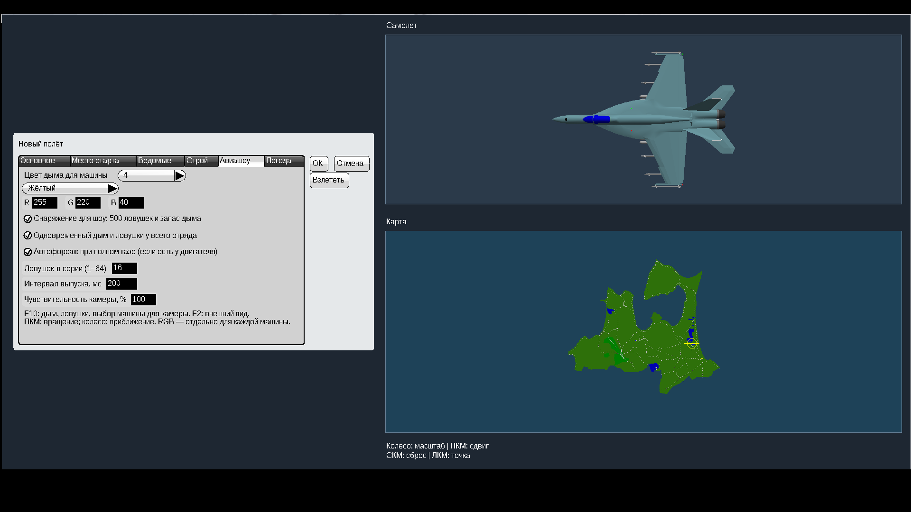
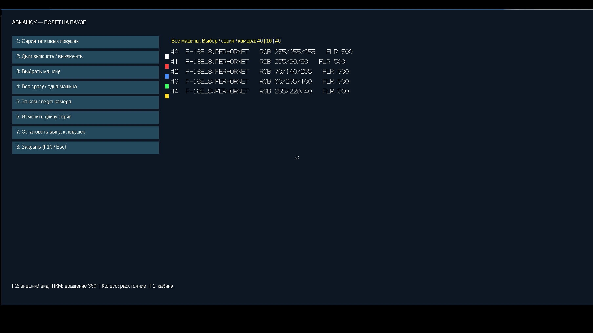
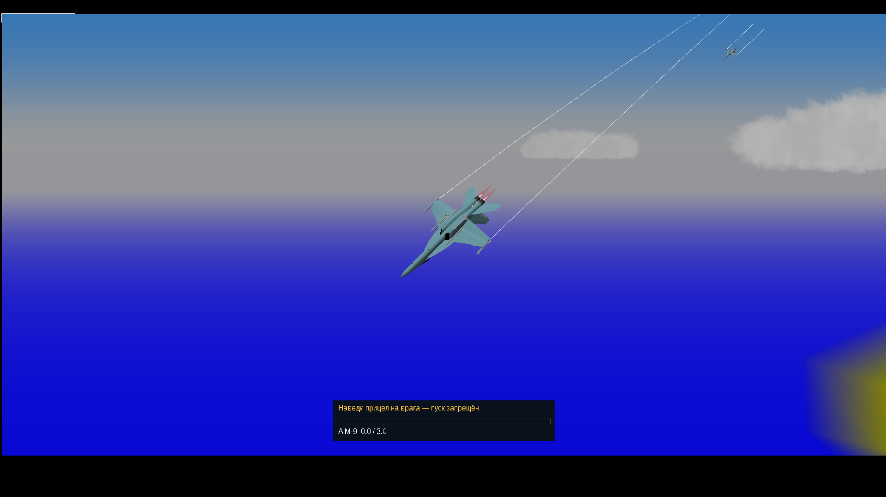
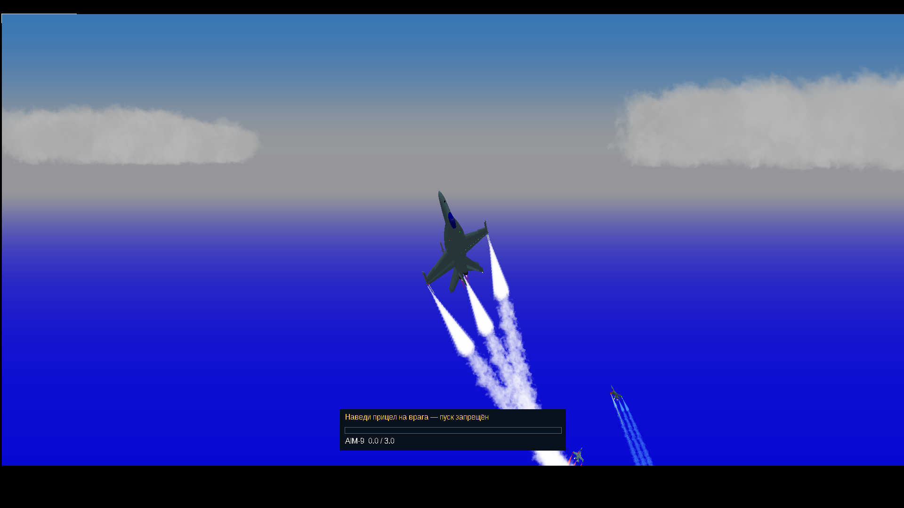

# YSFlight v8 — строи и авиашоу

Для **Windows 10, 32 бита**. Развиваем ведомых, красивые строи и показательные полёты. Раздел «Миссии» убран с главного экрана.

**[Скачать полную v8 «Авиашоу» — ZIP](downloads/YSFlight_UI_v8_Airshow_32bit.zip?raw=true)**

Полностью распакуйте архив **в новую папку**, откройте **YSFlight_UI_v8_Airshow_32bit** и двойным нажатием запустите **ysflight32_gl1.exe**. Старую рабочую папку сохраните. Не запускайте EXE из ZIP или backup.

## Как попробовать

1. **Новый полёт → Ведомые**: выберите количество и модели. Для начала удобно взять 2–4 одинаковых F-18E. Они стартуют рядом с вами в воздухе.
2. **Строй**: отметьте настройку строя и выберите колонну, клин или другой вариант.
3. **Авиашоу**: выберите игрока или номер ведомого и его цвет дыма. Есть палитра и собственные значения RGB. Здесь же настраиваются серия ловушек, интервал выпуска и чувствительность камеры.
4. После взлёта **F10** — управление авиашоу. Можно включить дым, выпустить ловушки всем отрядом или одной машиной и выбрать ведомого для камеры. **Enter → центр круга** также открывает это меню.
5. **F1 → F2** — внешний вид. **Правая кнопка + движение мыши** вращает камеру, **колесо** приближает и отдаляет. **F1** возвращает в кабину.

Подробная инструкция — **READ_ME_RU.txt** внутри игры.

## Что добавлено

- **Защита ведомых**: оценка земли впереди, скорости снижения и запаса выравнивания. Ведомые продолжают снижаться за ведущим, но прерывают опасное снижение и возвращаются в строй после выхода. Убрано перевёрнутое пикирование при обычном догонянии.
- **Предотвращение столкновений** при сближении и перестроении, защита от чрезмерного торможения, более спокойное управление вертолётами. На безопасной высоте сохранено прежнее управление строем.
- **Форсаж у игрока**: на подходящих реактивных самолётах включается при полном газе, если отмечена соответствующая галочка. Он использует штатную тягу и топливо. У вертолётов и двигателей без форсажа длинного пламени нет.
- **Дым каждого цвета отдельно для каждой машины**. Дым изначально выключен; включается в F10.
- **Настраиваемые серии тепловых ловушек**: 1–64, интервал 100–2000 мс, всем одновременно или выбранной машине. Галочка снаряжения для шоу даёт 500 штатных ловушек и запас дыма.
- **Камера на 360°**, приближение, чувствительность и наблюдение за выбранным ведомым. Настройки сохраняются с полётом; история и обычный круг команд сохранены.

F10 заменяет штатную камеру-призрак и переназначается через **«Управление / Клавиши»**. Другие пользовательские назначения F10 сохраняются; в этом случае используйте центр круга Enter.

## Что проверено

На отдельной Win64 GL1 сборке тех же исходников в Wine проверены снижение четырёх ведомых с 200 до примерно 35 м, выход из резкого снижения, разворот с восемью ведомыми и восстановление строя, пересечение путей, строй вертолётов, общий и индивидуальный выпуск ловушек, цвета, собственный форсаж, вращение камеры и запись дыма. Это практические проверки отдельных сценариев, без гарантии отсутствия любых аварий.

Оба игровых EXE собраны как **PE32/i386**, без новых сторонних DLL. **Запуск готового 32-битного EXE на вашей Windows 10 нужно проверить вам.** GL2 здесь только собран. На слабом компьютере начните с небольшого отряда и коротких серий ловушек.

Модели, карты и штатная физика остаются YSFlight. Для отката используйте старую рабочую папку либо **backup_previous_menu**. Исходные EXE 2018 года сохранены в **backup_original_exe**. Интерфейс написан на **C++**, переводы находятся в **.uitxt**.

## Файлы и скриншоты

- [Полные исходники, сборка и проверки](downloads/YSFlight_UI_v8_Airshow_Sources.zip?raw=true).
- [Контрольные суммы](downloads/SHA256SUMS_v8_Airshow.txt).
- [Предыдущая v8 для отката](downloads/YSFlight_UI_v8_32bit.zip?raw=true) · [v7](downloads/YSFlight_UI_v7_32bit.zip?raw=true) · [v6](downloads/YSFlight_UI_v6_32bit.zip?raw=true).

