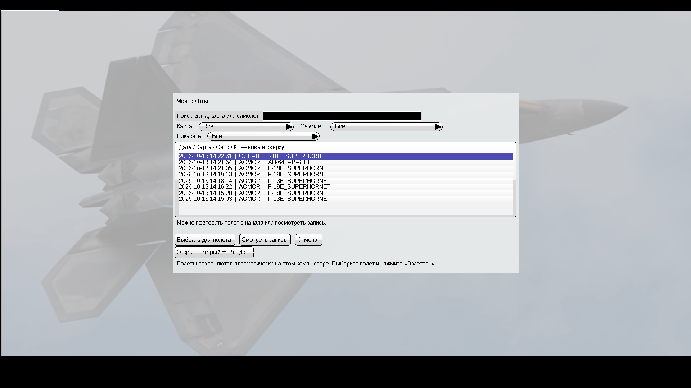
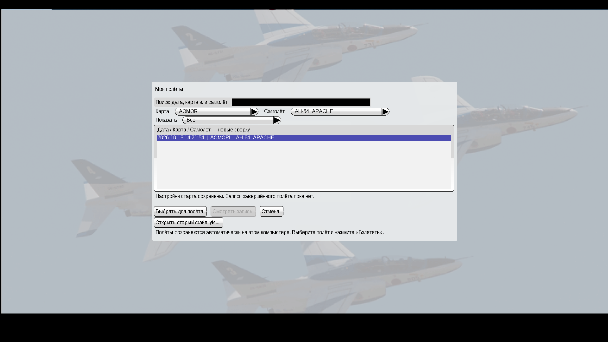

# YSFlight v6 — история полётов

Для **Windows 10, 32 бита**. Обычный запуск YSFlight двойным нажатием EXE.

**[Скачать игру v6 — ZIP](downloads/YSFlight_UI_v6_32bit.zip?raw=true)**

## Запуск

Полностью распакуйте архив в **новую папку**, откройте **YSFlight_UI_v6_32bit** и запустите **ysflight32_gl1.exe**. Старую рабочую папку сохраните. Не запускайте EXE прямо из ZIP или папок backup.

## Что изменилось

- Каждый новый обычный полёт автоматически получает сохранённые настройки старта и отдельную запись после завершения. Повторные попытки остаются отдельными полётами.
- **Повторить полёт** начинает последний запущенный полёт с теми же начальными условиями, без вопроса «Удалить текущий полёт?».
- Кнопка ручного сохранения убрана. **Мои полёты** показывает историю: новые сверху, дата, карта и самолёт, поиск и фильтры карты/самолёта/наличия записи.
- **Выбрать для полёта → Взлететь** запускает выбранный старый полёт с начала. **Смотреть запись** открывает его запись. Старые файлы `.yfs` можно открыть отдельной кнопкой.

История находится в **Документы\YSFLIGHT.COM\YSFLIGHT\FlightHistory** и остаётся при установке новой версии в другую папку на том же компьютере. Старые записи автоматически не удаляются. Для переноса на другой компьютер скопируйте всю папку FlightHistory после закрытия игры.

Во время полёта запись обновляется раз в минуту; обычное завершение и закрытие окна сохраняют финальную запись. При аварийном закрытии может потеряться последняя минута записи. Настройки старта уже сохранены до взлёта. Прошлые несохранённые полёты восстановить нельзя; имеющийся `prevflight.dat` переносится как настройки старта с датой переноса.

Код интерфейса написан на **C++**, переводы надписей находятся в **.uitxt**. Русский/английский язык и управление мышью/стрелками из v5 сохранены.

## Проверки и откат

Оба новых EXE собраны для **PE32 / i386**. На отдельной Win64 GL1 сборке в Wine проверены автосохранение, сохранность после перезапуска, просмотр записи, выбор и запуск старого полёта, поиск и фильтры, запись при закрытии окна, обработка ошибки записи. Начальные файлы повторного одиночного полёта и группы с восемью ведомыми совпали полностью с предыдущими попытками.

**Готовые 32-битные EXE нужно проверить на вашей Windows 10.** GL2 собран, но здесь не запускался. Подробная инструкция и ограничения — **READ_ME_RU.txt** в архиве. D3D9/nownd остаются оригинальными, без новых функций.

Для отката закройте игру и запустите старую рабочую папку v5. В **backup_previous_menu** также сохранены EXE и языки v5. Оригинальные файлы 2018 года сохранены в **backup_original_exe**. История при откате остаётся на диске, но v5 не показывает её новым списком.

## Файлы

- [Исходники v6, сборка, проверки и резервные копии](downloads/YSFlight_UI_v6_Sources.zip?raw=true).
- [Контрольные суммы v6](downloads/SHA256SUMS_v6.txt).
- [Предыдущая игра v5](downloads/YSFlight_UI_v5_32bit.zip?raw=true) · [Исходники v5](downloads/YSFlight_UI_v5_Sources.zip?raw=true).
- [Игра v4](downloads/YSFlight_UI_v4_32bit.zip?raw=true) · [Игра v3](downloads/YSFlight_UI_v3_32bit.zip?raw=true) · [Игра v2](downloads/YSFlight_UI_v2_32bit.zip?raw=true).

## Скриншоты отдельной тестовой Win64 сборки

