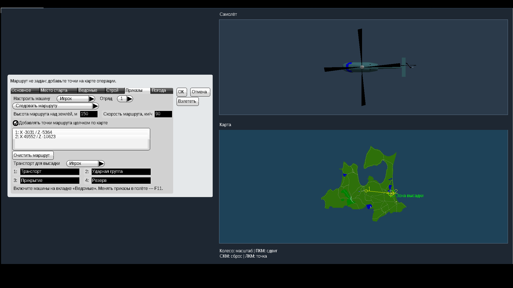
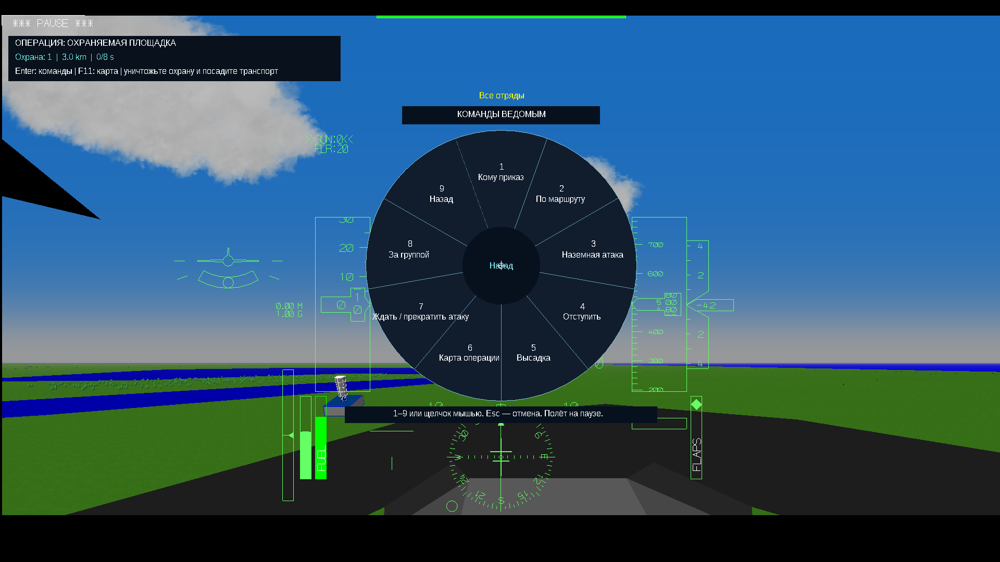
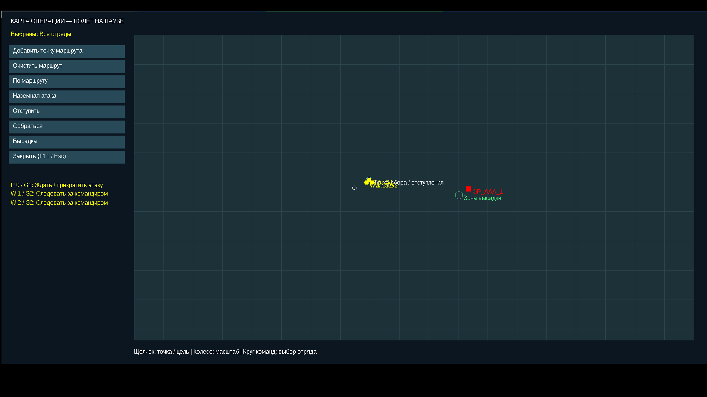
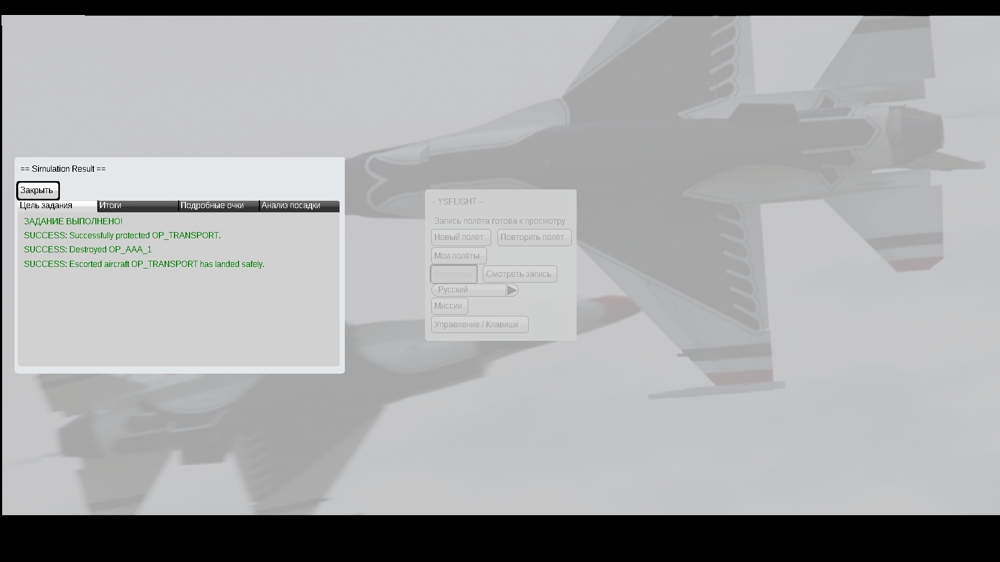

# YSFlight v8 — миссии и командование отрядами

Для **Windows 10, 32 бита**. Добавлен игровой раздел **«Миссии»** и первая лёгкая операция **«Охраняемая площадка»**: уничтожить зенитку и доставить транспортный вертолёт на посадочную площадку. Есть победа, поражение, запись и повтор попытки.

**[Скачать полную игру v8 — ZIP](downloads/YSFlight_UI_v8_32bit.zip?raw=true)**

Полностью распакуйте архив **в новую папку**, откройте **YSFlight_UI_v8_32bit** и двойным нажатием запустите **ysflight32_gl1.exe**. Старую рабочую папку сохраните. Не запускайте EXE из ZIP или папок backup. Подробная инструкция — **READ_ME_RU.txt** внутри игры.

## Как начать

1. Главное меню → **Миссии → Подготовить операцию**.
2. Для первого прохождения оставьте UH-60 и двух AH-64. Все начинают рядом в воздухе. На вкладке **«Приказы»** можно назначить каждой машине группу, задачу и маршрут.
3. После взлёта **Enter → щелчок по центру круга → Кому приказ → Ударная группа → Наземная атака**. Ведомые уничтожат зенитку штатными ракетами.
4. **Enter → центр → Высадка**. Транспорт долетит и сядет автоматически. Приказ можно отдать заранее: пока охрана жива, он подождёт в исходном районе. Для победы транспорт должен стоять в зоне высадки 8 секунд.
5. **F11** открывает карту операции. **Backspace → 0** отключает автопилот, если хотите пилотировать сами.

## Что добавлено

- Четыре группы с собственными названиями. Получатель приказа: весь отряд, группа или отдельная машина.
- Маршруты до 16 точек на машину, высота и скорость; ожидание, наземная атака, отступление, следование другой группе и высадка. Прежние команды строя, рассредоточения, сбора и воздушной атаки учитывают выбранного получателя.
- Карта F11: положение своих машин, зенитки, района сбора и зоны высадки. Можно выбирать цель, добавлять маршрут и менять приказ во время полёта. Колесо меняет масштаб. Это схема позиций, без изображения местности.
- Охрана — настоящий штатный объект AAA; ракеты, расход боекомплекта, повреждения и модели остаются YSFlight.
- Ведомые по умолчанию стартуют **рядом с вами в воздухе**, даже без дополнительных настроек строя. Раздельные аэродромные точки включаются отдельной галочкой. Совместное наземное руление не реализовано.
- Сохранение групп, маршрутов и миссии в прежней истории полётов. Повтор восстанавливает исходную попытку.

Для десантной доставки подходят UH-60, UH-60J и V-107. Автоматической наземной атаке вертолёта нужны управляемые ракеты В-З. Неподходящий транспорт и пустой начальный маршрут блокируют старт с объяснением. Для начала доступна **одна готовая миссия**; остальные сценарии будут добавляться позже.

## Проверено

На отдельной Win64 GL1 сборке тех же исходников в Wine выполнено полное прохождение: зенитка уничтожена реальными AGM, транспорт сел и выдержал 8 секунд, все три вертолёта живы, появился результат «Задание выполнено». Также проверены поражение от огня зенитки, повтор миссии, маршруты и приказы группе/одной машине, сохранение, запись и прежний трёхсекундный захват AIM-9.

Оба игровых EXE собраны как **PE32/i386**, без новых сторонних DLL. **Готовые 32-битные EXE на вашей Windows 10 нужно проверить вам.** GL2 здесь только собран. Все сочетания самолётов, погоды и вооружения не проверялись. Технические результаты и записи проверок включены в исходники.

История и назначения клавиш хранятся в папке пользователя YSFlight. Для отката запустите старую рабочую папку; файлы v7 также находятся в **backup_previous_menu**, исходные EXE 2018 года — в **backup_original_exe**. Прежние возможности v7 сохранены.

Интерфейс написан на **C++**, переводы надписей — в файлах **.uitxt**.

## Скачать другие файлы

- [Исходники v8, сборка, проверки и резервные копии](downloads/YSFlight_UI_v8_Sources.zip?raw=true).
- [Контрольные суммы v8](downloads/SHA256SUMS_v8.txt).
- [Предыдущая рабочая игра v7](downloads/YSFlight_UI_v7_32bit.zip?raw=true) · [Исходники v7](downloads/YSFlight_UI_v7_Sources.zip?raw=true).
- [v7 с учебным полётом для захвата ракетами](downloads/YSFlight_Lock_Test_32bit.zip?raw=true) · [Только учебный полёт](downloads/YSFlight_Lock_Training.zip?raw=true).
- [Игра v6](downloads/YSFlight_UI_v6_32bit.zip?raw=true) · [Игра v5](downloads/YSFlight_UI_v5_32bit.zip?raw=true) · [Игра v4](downloads/YSFlight_UI_v4_32bit.zip?raw=true).
- [Игра v3](downloads/YSFlight_UI_v3_32bit.zip?raw=true) · [Игра v2](downloads/YSFlight_UI_v2_32bit.zip?raw=true).

## Скриншоты отдельной проверочной Win64 сборки

