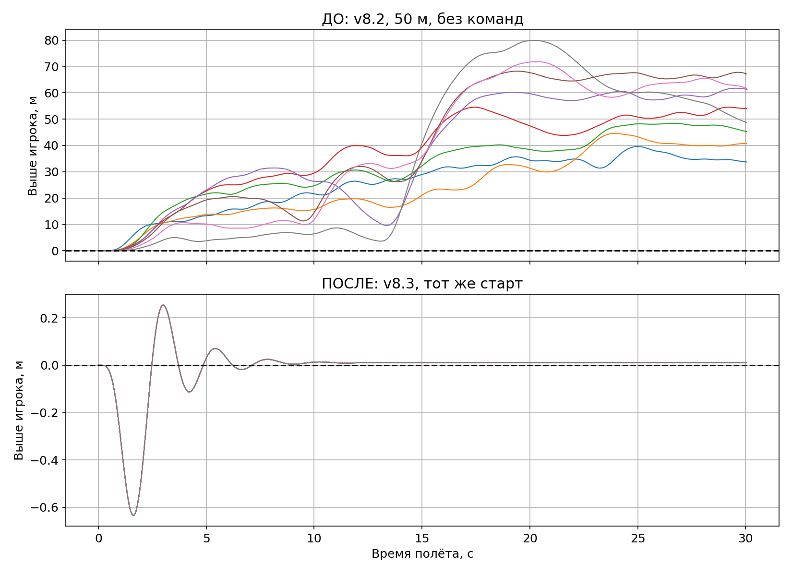
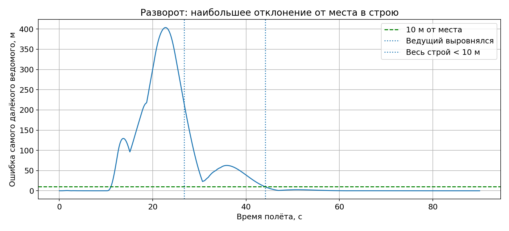

# YSFlight v8.3 — быстрый сбор ведомых

Для **Windows 10 x86, 32 бита**. Полная игра с картами и моделями.

**[Скачать игру v8.3 — ZIP](downloads/YSFlight_v8_3_32bit.zip?raw=true)**

Распакуйте целиком в новую папку и дважды нажмите **ysflight32_gl1.exe**. Заголовок окна: **Airshow v8.3**. Старую рабочую папку сохраните для отката; предыдущие изменённые файлы включены в `backup_v8_2`.

- Исправлен самовольный уход ведомых выше игрока в плотном строю.
- Гибридное следование: сразу реагировать, затем одновременно догонять свои места с ускорением и воздушным тормозом.
- Колонна разлетается по очереди, возвращается одновременно. «Собраться» отзывает всех сразу.
- Новая дистанция по умолчанию — **50 м**. Для неё создайте **новый полёт**: «Повторить» сохраняет старые настройки.
- Убрано блокирующее ожидание центрирования джойстика при управлении мышью/клавиатурой. Сохранён запуск оконного EXE без CMD.

**[Проверки: графики, кадры игры и результаты](reports/v8_3/ПРОВЕРКИ.md)** · [Скачать отчёт с картинками](downloads/YSFlight_v8_3_Report.zip?raw=true)

## Управление

| Действие | Клавиши |
|---|---|
| Серия из 16 ловушек у игрока | **Ctrl+F** |
| Серия из 16 ловушек у всех | **Ctrl+Shift+F** |
| Меню дыма | **F10** |
| Команды ведомым и выбор строя | **Enter** |
| Внешняя камера выбранного самолёта | **F2** |
| Вращение / расстояние камеры | **ПКМ / колесо** |
| Кабина | **F1** |

В F10: **1** — дым, **2** — следующая машина, **3** — всем / выбранному, **4 / F10 / Esc** — продолжить полёт. Щёлкните имя справа для выбора самолёта; его цветной квадрат переключает индивидуальный цвет дыма. Настройка действует сразу. Кнопок ловушек в меню больше нет.

Для большого запаса ловушек включите оборудование авиашоу до вылета. На этой же вкладке можно изменить длину и интервал серии; 16 — значение по умолчанию. Текущие пользовательские назначения клавиш сохраняются; F10 также можно переназначить в настройках.

## Исходники и ограничения проверок

[Исходники v8.3](downloads/YSFlight_v8_3_Sources.zip?raw=true) · [SHA256](downloads/SHA256SUMS_v8_3.txt) · [Изменения кода](changes/v8_3.patch)

Автоматические полёты выполняются в Win64-сборке тех же исходников под Wine. Выдаваемые EXE собраны для **PE32/i386, Windows GUI** и проверены при упаковке. Запуск новой версии на настоящей Windows 10 x86 проверяет пользователь. Проверки охватывают конкретные сценарии; все модели и любые манёвры не проверены.

[Разбор твоего видео: 20 кадров](reports/video-review-2026-10-20/README.md) · [Предыдущая v8.2](downloads/YSFlight_v8_2_32bit.zip?raw=true) · [Остальные версии](downloads)
