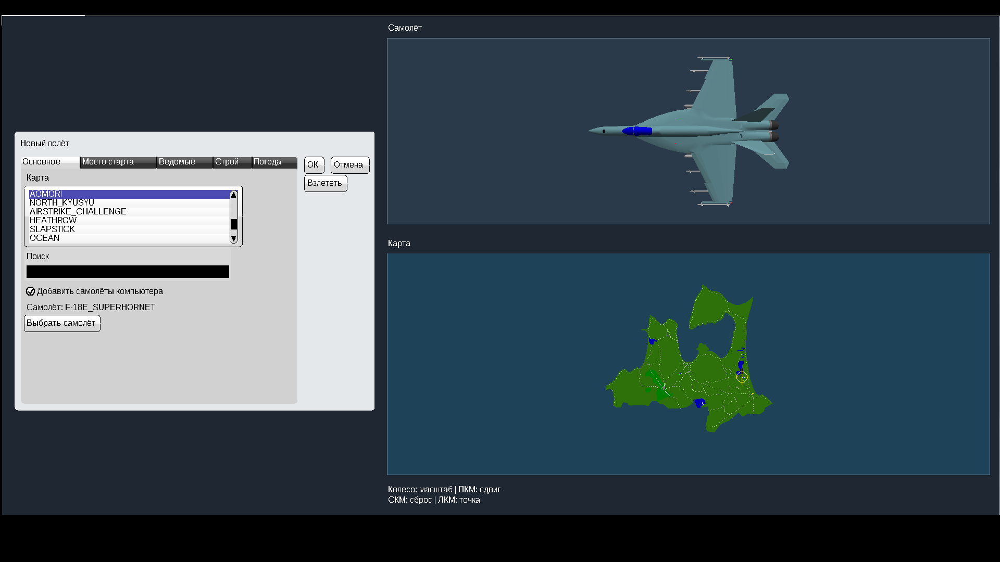
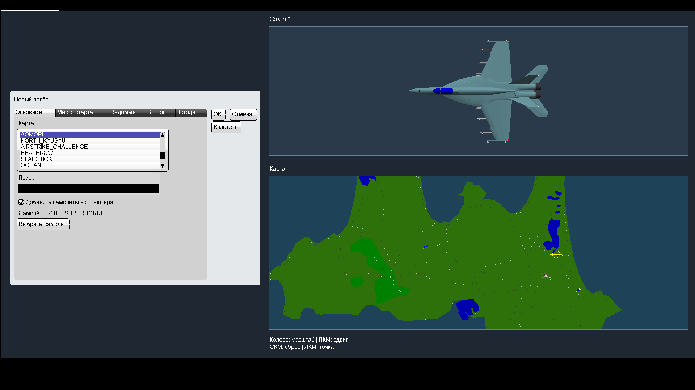
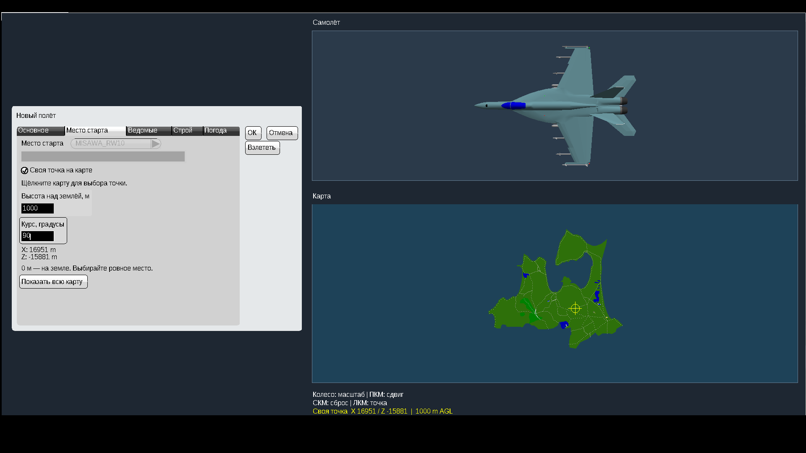

# YSFlight — интерфейс и своя точка старта, v3

Для Windows 10, 32 бита. Тот же YSFlight, обычный запуск двойным нажатием EXE.

**[Скачать игру v3 — ZIP](downloads/YSFlight_UI_v3_32bit.zip?raw=true)**

## Запуск

1. Закройте игру, сохраните старую рабочую папку.
2. Полностью распакуйте ZIP в **новую папку**.
3. Откройте **YSFlight_UI_v3_32bit** и дважды нажмите **ysflight32_gl1.exe**.
4. Если начался демополёт, нажмите Esc для возврата в меню. Язык выбирается на главном экране.

## Карта и самолёт

Самолёт показан крупнее в отдельной верхней области; карта расположена под ним. Над картой:

- **Колёсико** — приближение/отдаление к указателю мыши, только для карты.
- **Зажать ПКМ и перетащить** — перемещение карты.
- **Нажать колёсико** — показать всю карту. Также есть кнопка сброса во вкладке Место старта.
- **ЛКМ** — установить свою точку старта (жёлтая метка).

Шрифт стал крупнее, списки и подписи — контрастнее. Для удобного просмотра лучше развернуть окно.

## Место старта

После выбора карты щёлкните нужное место. Во вкладке **Место старта** введите высоту в **метрах над местностью**: **0** — стоять на земле, **1000** — начать на высоте 1000 м. Диапазон 0..20000 м; учитывается необходимый просвет для шасси. Курс задаётся в градусах: 0 — север, 90 — восток. Нажмите **Взлететь**. При запросе центровки нажмите Пробел. Для самолёта старт в воздухе сразу идёт с начальной скоростью; управление и физика остаются обычными.

Для готового аэродрома снимите **Своя точка на карте** и выберите позицию из прежнего списка. Выбор другой карты сбрасывает свою точку. Высота считается от местности, а не от крыш и палуб: при высоте 0 выбирайте ровный свободный участок суши. Автоматический строй для своей точки отключён, чтобы игрок не перемещался обратно на полосу. Своя точка доступна в обычном **Новом полёте**; специальные задания и сетевые режимы сохраняют свои правила.

## Проверки и откат

Оба новых EXE — PE32 / Intel i386. Проверены сборка, архив, резервные копии, неизменность моделей/карт/настроек и расчёты карты. В отдельной 64-битной проверочной сборке с теми же изменениями в Wine проверены масштаб/перемещение/сброс карты, неизменный размер самолёта при увеличении карты, выбор точки, запуск на земле и на 1000 м, повтор полёта и обычный старт MISAWA_RW10.

В игровом ZIP только 32-битные EXE. Конечную новую версию на Windows 10 x86 нужно проверить на вашем компьютере. GL2 с физическим GPU, все карты/модели и старты вертолётов в воздухе здесь не проверялись. Оригинальные D3D9/nownd оставлены без новых меню.

Самый простой откат — вернуться к старой рабочей папке. В **backup_previous_menu** сохранены два EXE и языковые файлы предыдущей версии v2; закройте игру и скопируйте их в основную папку с заменой. Оригиналы 2018 года сохранены в **backup_original_exe**. Подробности — в **READ_ME_RU.txt** внутри ZIP.

## Другие файлы

- [Исходники v3, инструкции сборки и результаты проверок](downloads/YSFlight_UI_v3_Sources.zip?raw=true).
- [Контрольные суммы v3](downloads/SHA256SUMS_v3.txt).
- [Предыдущая рабочая версия v2](downloads/YSFlight_UI_v2_32bit.zip?raw=true).
- [Исходники v2](downloads/YSFlight_UI_v2_Sources.zip?raw=true).
- [Первая версия с меню по центру](downloads/YSFlight_Center_32bit_TEST.zip?raw=true).

## Скриншоты проверочной сборки

Эти снимки сделаны на отдельной 64-битной сборке для проверки интерфейса.

