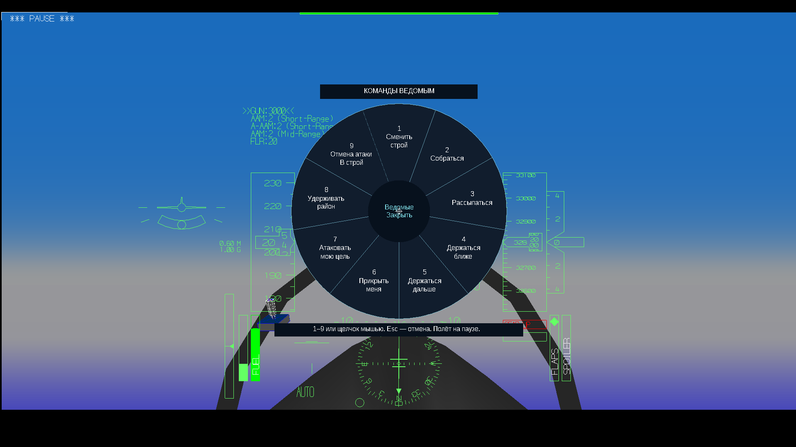
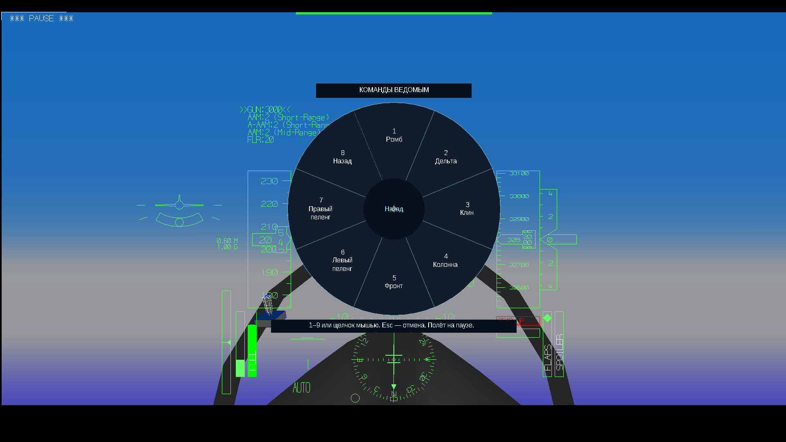
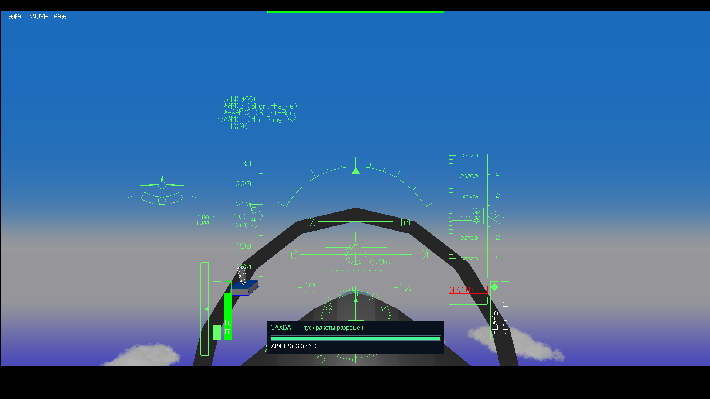

# YSFlight v7 — круг команд и захват ракетами

Для **Windows 10, 32 бита**. YSFlight запускается обычным двойным нажатием EXE.

**[Скачать полную игру v7 — ZIP](downloads/YSFlight_UI_v7_32bit.zip?raw=true)**

Полностью распакуйте архив в **новую папку**, откройте **YSFlight_UI_v7_32bit** и запустите **ysflight32_gl1.exe**. Старую рабочую папку сохраните. Не запускайте EXE прямо из ZIP или папок backup.

## Круг команд — Enter

Создайте полёт с ведомыми и нажмите **Enter**. Выберите сектор мышью или цифрой; **Esc** отменяет выбор. Во время выбора одиночный полёт временно ставится на паузу. После выбора восстанавливаются прежняя пауза и положение мыши. Клавишу круга можно переназначить в **Управление / Клавиши**.

- Семь вариантов строя: ромб, дельта, клин, колонна, фронт и два пеленга.
- Собраться, рассыпаться, держаться ближе или дальше.
- Прикрыть ведущего, атаковать выбранный вражеский самолёт, прекратить атаку и вернуться.
- Удерживать район. После уничтожения назначенной воздушной цели ведомые возвращаются в строй.

Ведомые возвращаются к своим местам после манёвра ведущего своим ходом. Сбор после резкого разворота занимает время. Приказы «Рассыпаться», «Удерживать район» и «Атаковать» остаются в силе до отмены; обычный поворот их не отменяет.

Команды получает своя группа, отдельные союзные самолёты не захватываются в неё. Для первой проверки создайте **новый полёт с ведомыми**: старые самостоятельные патрули без данных о принадлежности к группе могут не определяться как ведомые. Круг предназначен для одиночного полёта; сетевой режим сохраняет прежнее радиоменю.

## Ракеты «воздух–воздух»

В игре уже есть **AIM-9, AIM-9X и AIM-120**. Их модели, наведение и физика сохранены.

Выберите установленную ВВ-ракету, держите вражеский самолёт перед носом **три непрерывные секунды**. Индикатор внизу экрана заполнится и станет зелёным: **«ЗАХВАТ — пуск ракеты разрешён»**. После этого можно стрелять. Потеря цели или смена ракеты сбрасывает отсчёт; пауза его не увеличивает. Раннее нажатие не тратит ракету и не откладывает пуск на потом.

Наличие вооружения зависит от выбранной машины и её комплектации. Союзные цели не захватываются. Задержка — игровое подтверждение захвата, без моделирования всех приборов настоящей ракеты.

## Прежние функции и откат

История полётов, повтор с прежними начальными условиями, русский/английский язык, управление мышью/стрелками, настройки клавиш и интерфейс v6 сохранены. История остаётся в **Документы\YSFLIGHT.COM\YSFLIGHT\FlightHistory**. В игровом архиве нет тестовой истории или профилей.

Для отката закройте игру и запустите старую рабочую папку v6. Копии двух EXE, языков и карты v6 также лежат в **backup_previous_menu**; оригинальные EXE 2018 года сохранены в **backup_original_exe**.

## Проверки

Оба новых EXE собраны как **PE32 / i386**, без новых сторонних DLL. На отдельной Win64 GL1 сборке тех же исходников в Wine проверены круг, команды восьми ведомым, сохранение принадлежности к группе, разворот и сбор, захват и расход всех трёх ВВ-ракет, запрет раннего пуска, сброс при потере цели, смене ракеты и пауза.

**Запуск готового 32-битного EXE на вашей Windows 10 нужно проверить вам.** GL2 собран, здесь не запускался. Звук уведомления также проверьте у себя. Подробности — **READ_ME_RU.txt** в архиве и результаты проверок в исходниках. D3D9/nownd оставлены оригинальными, без новых функций.

Интерфейс написан на **C++**, надписи переведены в **.uitxt**.

## Файлы

- [Исходники v7, сборка, проверки и резервные копии](downloads/YSFlight_UI_v7_Sources.zip?raw=true).
- [Контрольные суммы v7](downloads/SHA256SUMS_v7.txt).
- [Предыдущая рабочая игра v6](downloads/YSFlight_UI_v6_32bit.zip?raw=true) · [Исходники v6](downloads/YSFlight_UI_v6_Sources.zip?raw=true).
- [Игра v5](downloads/YSFlight_UI_v5_32bit.zip?raw=true) · [Игра v4](downloads/YSFlight_UI_v4_32bit.zip?raw=true) · [Игра v3](downloads/YSFlight_UI_v3_32bit.zip?raw=true) · [Игра v2](downloads/YSFlight_UI_v2_32bit.zip?raw=true).

## Скриншоты отдельной тестовой Win64 сборки

