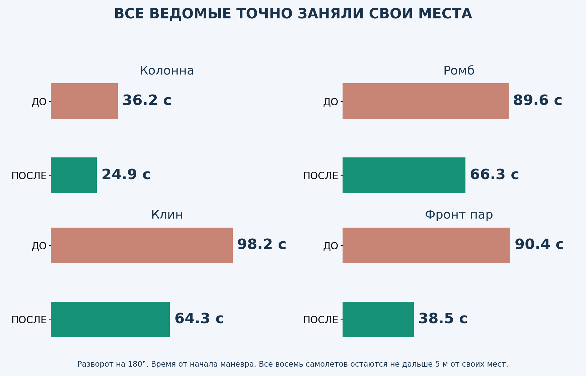
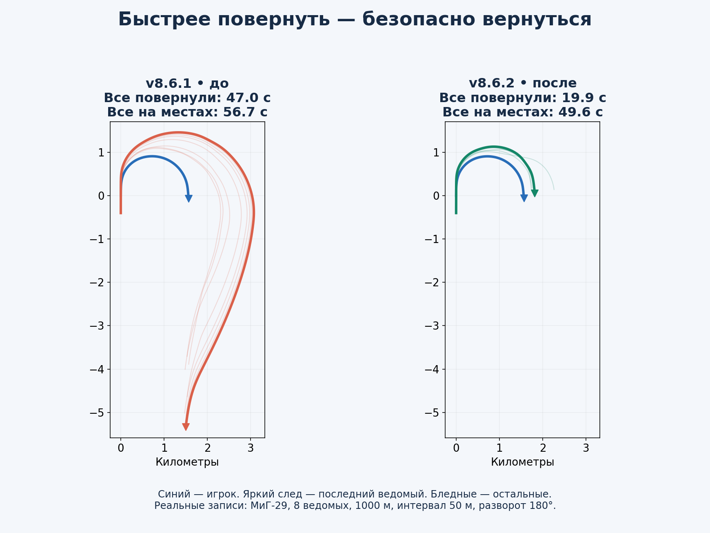
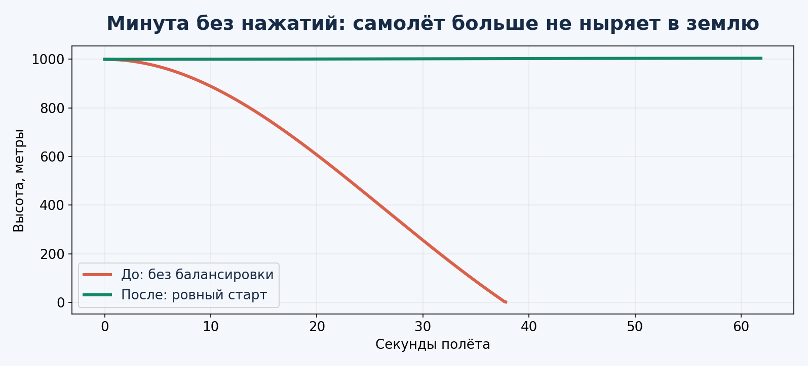
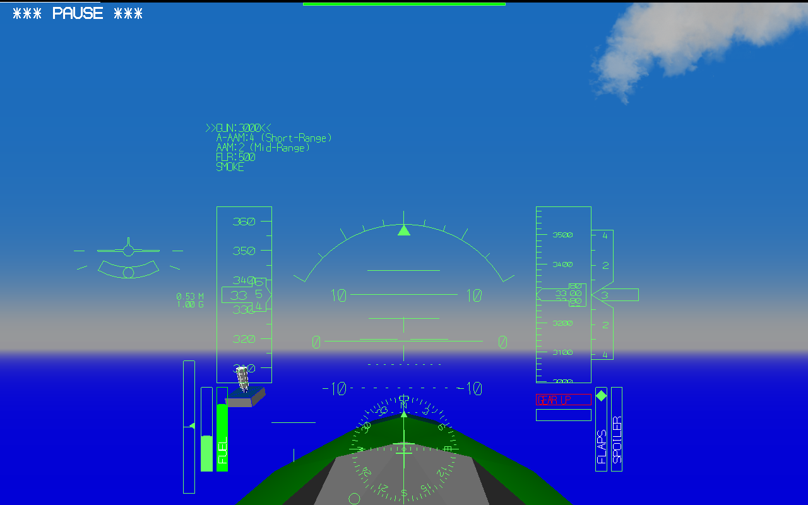
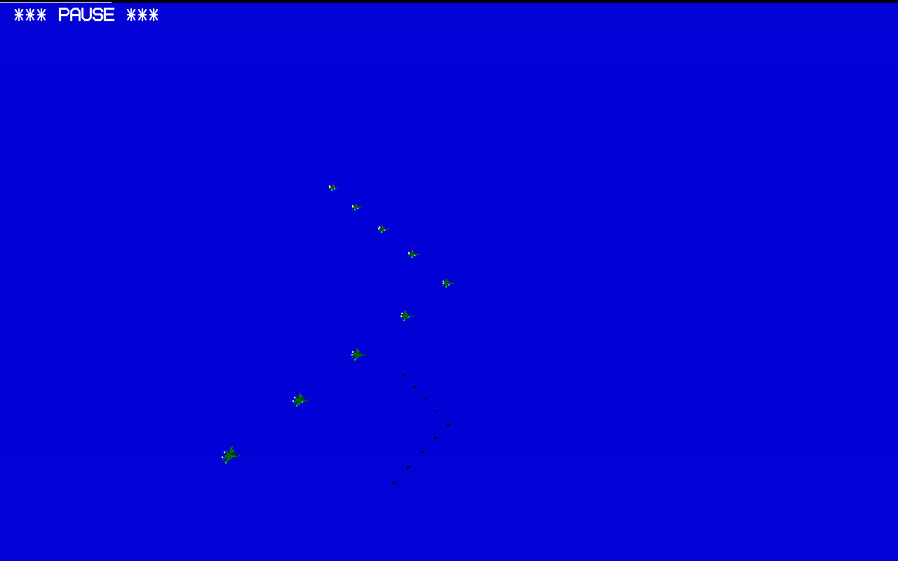

# YSFlight Airshow v8.6.2 — быстрее повороты, ровнее старт

**[Текущее задание: заменить модели Су-27 и МиГ-29](docs/aircraft-model-upgrade/TASK_PROMPT.md)** · [Памятка по лицензиям и будущему интерфейсу](docs/THIRD_PARTY_LICENSE_PLAN.md)

**Новому помощнику: [полный контекст проекта, требования и техническая карта](PROJECT_HANDOFF.md).**

> **Текущая основа для всех следующих правок: [Су-57, тест №2](CURRENT_VERSION.md).** [Скачать игру](downloads/YSFlight_Su57_Test_2_32bit.zip?raw=true). Новый помощник: начни с этого раздела.

**[Су-57 — переделанная модель №2: сравнение сверху/спереди, осмотр 360°](reports/su57-test-2/REPORT.md)** · [Скачать Windows 32-бит](downloads/YSFlight_Su57_Test_2_32bit.zip?raw=true)

**[Су-57 — предыдущий тест №1, фото и видео](reports/su57-test-1/REPORT.md)** · [Скачать Windows 32-бит](downloads/YSFlight_Su57_Test_1_32bit.zip?raw=true)

**[Новый отдельный режим «Тест»: полёт рядом с прямолинейной группой, вид из кабины](reports/straight-test/REPORT.md)** · [Скачать игру для Windows 10 x86](downloads/YSFlight_Straight_Test_32bit.zip?raw=true)

**[LAB867 — быстрее занимать места: четыре строя, фото и видео](reports/lab867/REPORT.md)**. Частная тестовая копия; рабочая игра v8.6.2 и предыдущая LAB866 сохранены. 147 полётных проверок пройдены.

[▶ Новая логика — четыре строя](reports/lab867/after-flight.mp4) · [▶ Схема с крупными номерами](reports/lab867/clear-comparison.mp4) · [Скачать отчёт и все видео](downloads/Airshow_LAB867_Report_and_Video.zip?raw=true)

**[Более быстрое возвращение ведомых: тесты и видео LAB866](reports/lab866/REPORT.md)** — тестовая копия, рабочая v8.6.2 сохранена.

**[Более быстрое возвращение ведомых: тесты и видео LAB865](reports/lab865/REPORT.md)** — тестовая копия, рабочая v8.6.2 сохранена.

**[Исправление большого обхода: приближённое видео и отчёт LAB864](reports/lab864/REPORT.md)** — тестовая копия, рабочая v8.6.2 сохранена.

**[Тесты следующей версии: отчёт и видео](reports/lab863/REPORT.md)** — это предварительная проверка, игровое обновление ещё не выпущено.

**[Скачать полную игру — Windows 10, 32 бита](downloads/YSFlight_v8_6_2_32bit.zip?raw=true)**

Распакуй всю папку в новое место и дважды нажми **ysflight32_gl1.exe**. Альтернатива — **ysflight32_gl2.exe**. CMD/BAT и установка библиотек не нужны. Старую рабочую папку пока сохрани.

## Истребители быстрее поворачивают

МиГ-29, 8 ведомых, разворот 180°: все сменили курс за **47.0 → 19.9 с**. Полностью заняли свои места за **56.7 → 49.6 с**. Синий след — игрок. Обе картинки в одном масштабе.

## Ровный старт без провала носа

Перед ровным стартом в воздухе рассчитываются триммер, угол носа и тяга. Это начальная балансировка: управление остаётся ручным, высота не фиксируется после манёвров. На 1000 м в минутном тесте отклонение составило примерно +4 м. Наземный старт не меняется.

## Проверки строёв и старых функций

**37 полётов с разворотами**, 1–8 ведомых и все 10 строёв с восемью ведомыми: без потерь, все вернулись на места. Минимальный записанный промежуток — **21.2 м**. Отдельно: **18 проверок** прикрытия, разлёта, потерь, уступления дороги, ESC и автопаузы; **6 проверок старта**; **1400 проверок геометрии**. Это результаты указанных сценариев, а не гарантия для любых манёвров на всех моделях.

Проверяла штатную физику Windows x64-сборкой того же кода под Wine. Выдаваемые EXE — PE32/i386, Windows GUI, без тестовых команд. Запуск на настоящей Windows 10 x86 нужно проверить тебе.

## Только новая и предыдущая версия

Внутри игрового ZIP оставлена только **backup_v8_6_1** для отката. Не запускай EXE из резервной папки: для отката скопируй её содержимое в корень игры с заменой файлов. Более старые резервные версии из нового ZIP убраны. Модели, карты, звуки, языки и настройки сохранены.

[Отчёт с картинками](reports/v862/ПРОВЕРКИ.md) · [Отчёт ZIP](downloads/YSFlight_v8_6_2_Report.zip?raw=true) · [Исходники и записи проверок](downloads/YSFlight_v8_6_2_Sources.zip?raw=true) · [SHA256](downloads/SHA256SUMS_v8_6_2.txt) · [Изменения кода](changes/v862.patch)

[Предыдущая рабочая v8.6.1](downloads/YSFlight_v8_6_1_32bit.zip?raw=true) · [Её отчёт](reports/v861/ПРОВЕРКИ.md)
