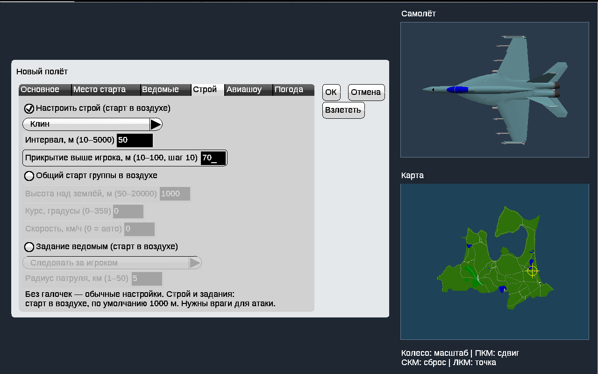
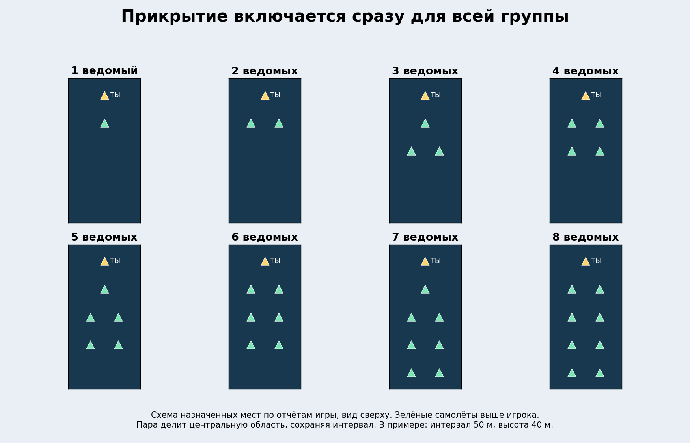
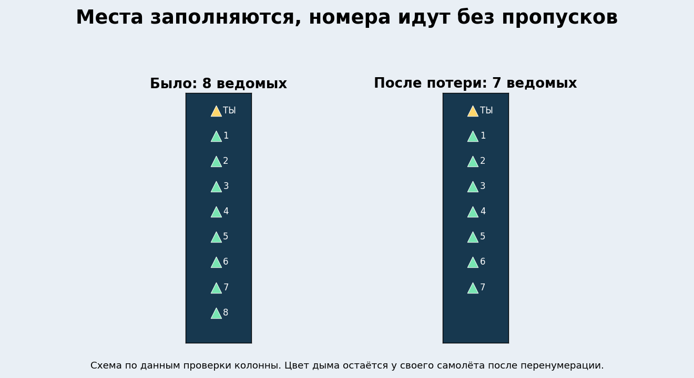
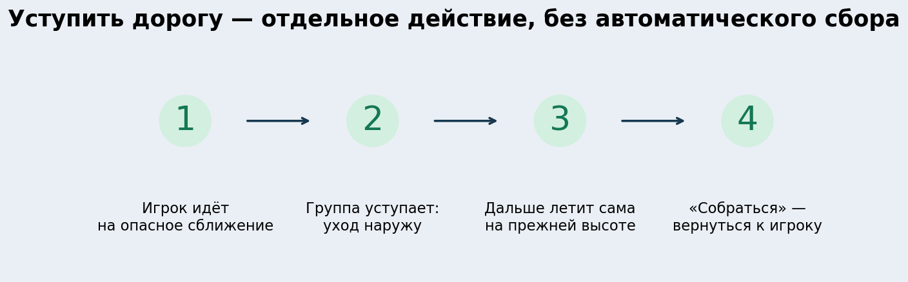
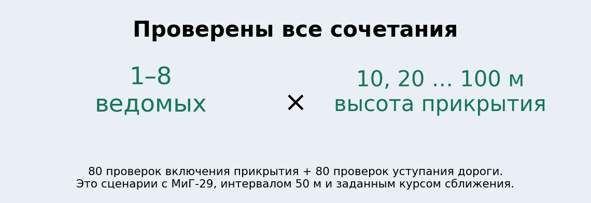
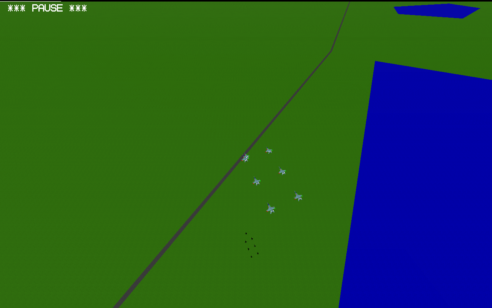

# YSFlight Airshow v8.6.1 — новая ветка от v8.6

**[Скачать полную игру — Windows 10, 32 бита](downloads/YSFlight_v8_6_1_32bit.zip?raw=true)**

Распакуйте в новую папку **YSFlight_v8_6_1_32bit**, дважды нажмите **ysflight32_gl1.exe**. Альтернатива — **ysflight32_gl2.exe**. Старую v8.6 сохраните.

## Высоту выбираешь сам

От **10 до 100 м**, шаг 10 м, по умолчанию **40 м**. Сохраняется вместе с полётом.

## Одно нажатие — вся группа

**Enter → 6** включает прикрытие для всех твоих ведомых. Дополнительного меню выбора количества нет. Верхняя группа уплотняется, пара занимает места по сторонам её центра. Повторная команда или «Собраться» возвращает обычный строй.

## Потери не оставляют пустых мест

Пересчитываются реальные места и номера. Индивидуальные цвета дыма сохраняются.

## Уступить дорогу игроку

При прогнозе опасного сближения во время набора игрока ведомые уходят наружу, затем летят прямо на своей высоте. Не преследуют игрока и не возвращаются автоматически. **Enter → 2 — «Собраться»**. Для нового прикрытия — Enter → 6.

Основная матрица: **160 отдельных полётов**, 1–8 ведомых и все десять высот. Отдельно — потери каждого номера, возврат, обычный разлёт и другие исходные строи.

[Отчёт с картинками](reports/v861/ПРОВЕРКИ.md) · [Отчёт ZIP](downloads/YSFlight_v8_6_1_Report.zip?raw=true) · [Исходники](downloads/YSFlight_v8_6_1_Sources.zip?raw=true) · [SHA256](downloads/SHA256SUMS_v8_6_1.txt) · [Изменения кода](changes/v861.patch)

Основа — точные исходники v8.6. Её обычный разлёт и управление сохранены. Поздние меню количества прикрывающих, контроллеры и временные этажи v8.7–v8.9 не переносились.

Матрица выполнена штатной физикой Win64 под Wine с шагом 0,025 с; настоящее меню и обычный полёт проверены отдельно. Выдаваемые EXE — PE32/i386, Windows GUI, без CMD/BAT. Настоящую Windows 10 32 бит проверяет пользователь. Проверки не охватывают все модели и любые внезапные манёвры вплотную.

[Исходная рабочая v8.6](downloads/YSFlight_v8_6_32bit.zip?raw=true)
