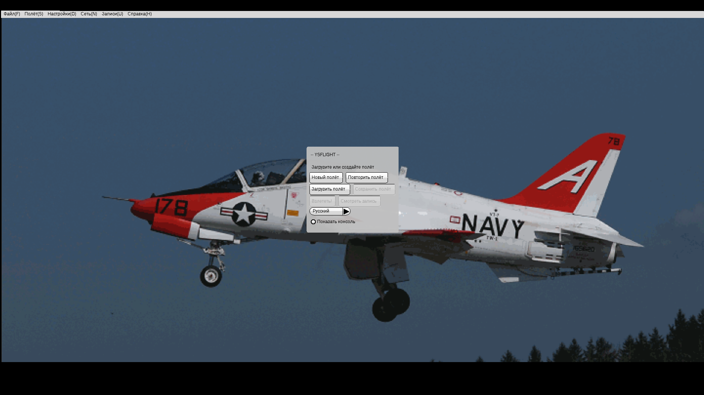
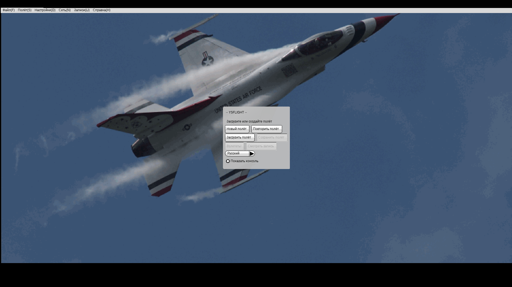
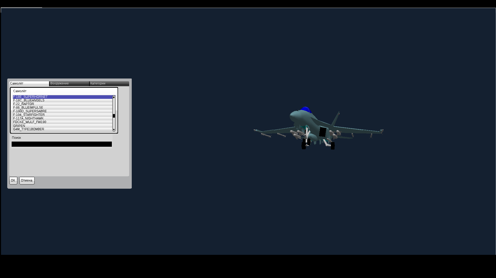

# YSFlight — обновление интерфейса v2

Для Windows 10, 32 бита. Тот же YSFlight, без перехода на другой движок.

**[Скачать игру v2 — ZIP](downloads/YSFlight_UI_v2_32bit.zip?raw=true)**

## Что изменилось

- Одна большая фоновая фотография без повторов, с сохранением пропорций.
- Главное меню по центру с подложкой для читаемости.
- В новом полёте настройки слева, самолёт и карта справа.
- При выборе самолёта отдельный экран показывает список слева и модель справа.
- На главном экране выпадающий список English / Русский; выбор сохраняется.

Переведены основные меню, создание полёта, выбор самолёта и основные настройки. Часть служебных надписей остаётся по-английски; названия моделей и карт сохранены.

## Запуск

1. Закройте игру и сохраните старую рабочую папку.
2. Полностью распакуйте ZIP в **новую папку**.
3. Откройте **YSFlight_UI_v2_32bit** и дважды нажмите **ysflight32_gl1.exe**.
4. Если начался демополёт, нажмите Esc для выхода в меню.
5. Нажмите English / стрелку рядом с ним и выберите Русский.
6. Проверьте Новый полёт, выбор карты и самолёта, затем Взлететь.

Не запускайте EXE внутри ZIP. Все необходимые файлы уже в архиве. Новые правки есть в GL1 и GL2; оригинальные D3D9/nownd оставлены без них.

## Откат и проверки

Оригинальные EXE лежат в `backup_original_exe`, предыдущая версия с центрированием — в `backup_previous_menu`. Перед откатом выберите English, закройте игру и скопируйте нужные EXE в основную папку с заменой. Ещё проще вернуться в сохранённую старую папку. Подробная инструкция находится в `READ_ME_RU.txt` внутри ZIP.

Оба конечных EXE — PE32 / Intel i386. Архив, оригинальные данные, резервные копии и разрядность проверены. Графические проверки (фон, расположение, переключение/сохранение языка, выбор карты/самолёта и запуск полёта) выполнены на отдельной 64-битной сборке с теми же изменениями в Wine. Конечную новую сборку необходимо проверить на Windows 10 32 бита. Работа GL2 с реальным GPU здесь не проверялась.

## Файлы

- [Исходники v2, инструкции сборки и результаты проверок](downloads/YSFlight_UI_v2_Sources.zip?raw=true).
- [Контрольные суммы v2](downloads/SHA256SUMS_v2.txt).
- [Предыдущая версия с меню по центру](downloads/YSFlight_Center_32bit_TEST.zip?raw=true).
- [Исходники предыдущей версии](downloads/YSFlight_Center_Sources.zip?raw=true).

## Скриншоты проверочной сборки

Это отдельная 64-битная сборка для графических проверок; в архиве игры только 32-битные EXE.

