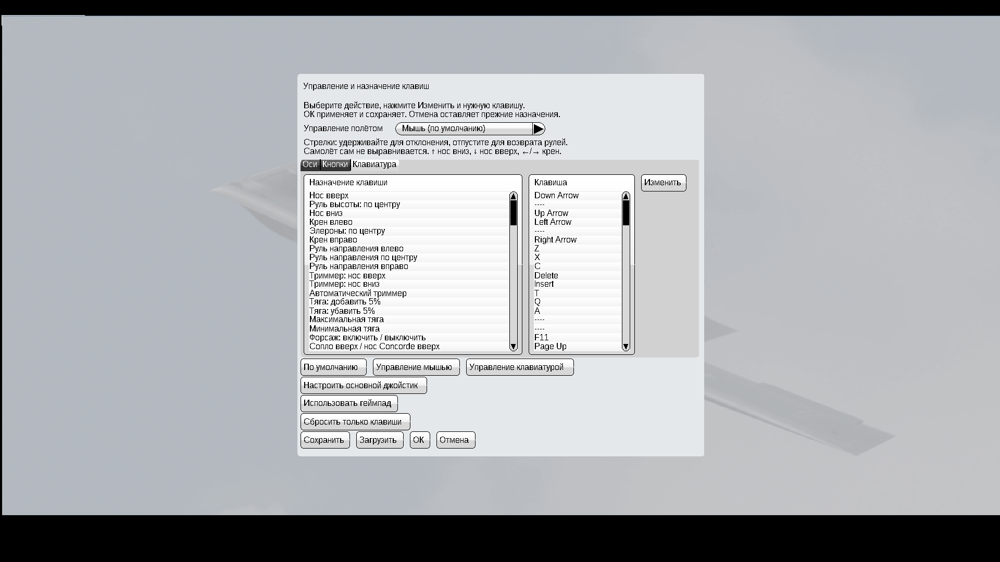
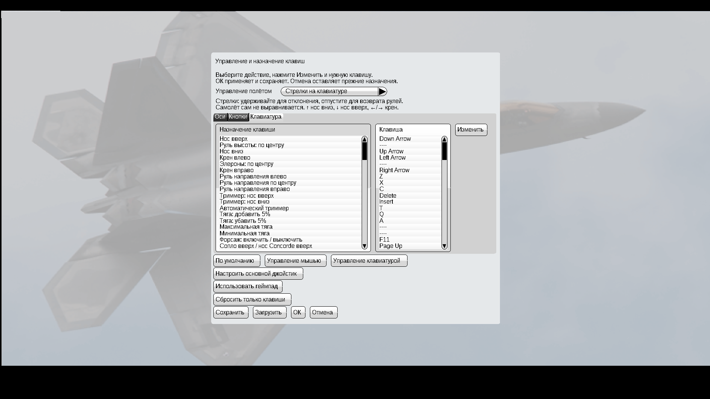

# YSFlight v5 — мышь и стрелки

Для **Windows 10, 32 бита**. Тот же YSFlight, обычный запуск двойным нажатием EXE.

**[Скачать игру v5 — ZIP](downloads/YSFlight_UI_v5_32bit.zip?raw=true)**

## Запуск

Полностью распакуйте ZIP в **новую папку**, откройте **YSFlight_UI_v5_32bit** и дважды нажмите **ysflight32_gl1.exe**. Старую рабочую папку сохраните. EXE внутри ZIP или папки backup не запускайте.

## Выбор управления

**Управление / Клавиши → Управление полётом → Мышь или Стрелки на клавиатуре → ОК.** Начните полёт заново.

- **Мышь** — режим по умолчанию. Движение мыши управляет креном и положением носа по прежнему принципу игры.
- **Стрелки** — удержание плавно отклоняет рули, отпускание возвращает их в нейтраль. Самолёт сам не выравнивается. Мышь в этом режиме креном и положением носа не управляет.
- Выбор запоминается после перезапуска. **Отмена** оставляет прежний сохранённый выбор. Другие назначенные клавиши сохраняются.

В режиме стрелок: **↑ — нос вниз**, **↓ — нос вверх**, **←/→ — крен**. Для небольших поправок используйте короткие нажатия. Противоположные стрелки одновременно дают нейтраль. Q/A — добавить/убавить тягу, F1 — кабина, F2 — внешняя камера, если эти кнопки не переназначены.

При первом открытии старых настроек без выбора режима включается мышь. Если вы уже сохранили режим в v5, сохраняется ваш выбор.

## Связь с «Ил-2»

Реализован подтверждённый пользователем принцип: отпускание возвращает рули в нейтраль без автоматического выравнивания самолёта. Версия «Ил-2» неизвестна, поэтому точное совпадение её настроек **1 в 1 не подтверждено**. Плавность настроена для YSFlight; его физика и характеристики самолётов сохраняются.

## Проверки и откат

Оба новых EXE собраны для **PE32 / i386**. Проверены архивы, резервные копии, сохранение и отмена выбора, сохранность другой назначенной клавиши, открытие сохранённого режима после перезапуска. В отдельных полётах на Win64 GL1 тестовой сборке в Wine записи подтвердили работу мыши и стрелок в обе стороны, возврат рулей в нейтраль и сохранение крена без автовыравнивания. Расчёт проверен при разных частотах обновления.

**Запуск готовой 32-битной версии на вашей Windows 10 нужно проверить вам.** GL2 собран, но здесь не запускался. Подробная инструкция — **READ_ME_RU.txt** внутри ZIP.

Все изменения v4 сохранены: один большой фон, русский/английский язык, масштаб карты, своя точка старта, пламя и ведомые. Сведения о них — **READ_ME_v4_RU.txt**. D3D9/nownd остаются оригинальными, без новых функций.

Простой откат — старая рабочая папка. В **backup_previous_menu** сохранены EXE и языки v4; после закрытия игры их можно вернуть с заменой. Настройки управления игра хранит также в общей пользовательской папке: после отката при необходимости выберите управление мышью в старой версии.

## Файлы

- [Исходники v5, сборка, проверки и оригиналы изменённых файлов](downloads/YSFlight_UI_v5_Sources.zip?raw=true).
- [Контрольные суммы v5](downloads/SHA256SUMS_v5.txt).
- [Предыдущая рабочая игра v4](downloads/YSFlight_UI_v4_32bit.zip?raw=true) · [Исходники v4](downloads/YSFlight_UI_v4_Sources.zip?raw=true).
- [Версия v3](downloads/YSFlight_UI_v3_32bit.zip?raw=true) · [Версия v2](downloads/YSFlight_UI_v2_32bit.zip?raw=true).

## Скриншоты тестовой Win64 сборки

