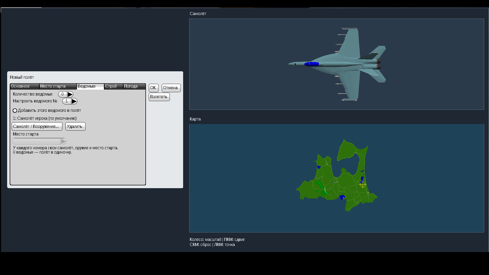
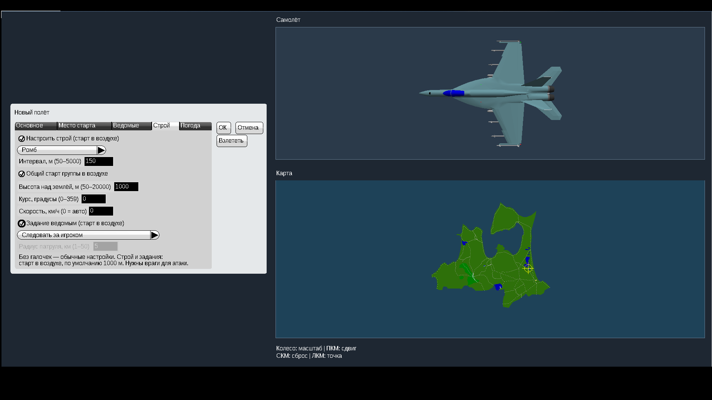
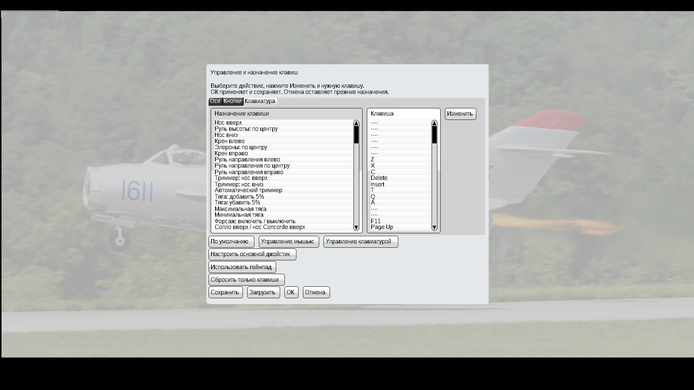

# YSFlight — управление, пламя и ведомые, v4

Для **Windows 10, 32 бита**. Тот же YSFlight; запуск двойным нажатием EXE.

**[Скачать игру v4 — ZIP](downloads/YSFlight_UI_v4_32bit.zip?raw=true)**

## Запуск

Полностью распакуйте ZIP в **новую отдельную папку**, откройте **YSFlight_UI_v4_32bit** и дважды нажмите **ysflight32_gl1.exe**. Старую рабочую папку сохраните. Ничего дополнительно устанавливать не требуется. EXE внутри ZIP и папок backup не запускайте.

## Что добавлено

- Кнопка **Управление / Клавиши** на главном экране: выберите действие → **Изменить** → нужная клавиша → **ОК** в обоих окнах. Названия действий переведены на русский.
- Верхняя строка меню и переключатель консоли скрыты. Графическая консоль заменена экраном загрузки.
- Пламя усиливается с тягой при включённом форсаже подходящего двигателя. Вертолётам и машинам без форсажа огонь не добавлен. Ошибка исходного AMX исправлена в отображении, его тяга сохранена.
- Во вкладке **Ведомые** — до восьми машин, отдельный выбор самолёта/вертолёта, оружия, топлива и места старта для каждого номера.
- Во вкладке **Строй** отдельные галочки включают семь вариантов строя и интервал, общий старт в воздухе с высотой/курсом/скоростью, задания: следовать, патрулировать, атаковать вражеские самолёты или наземные цели.
- Картинка с птицей и цветком убрана с AOMORI; остальные объекты карты сохранены.

По умолчанию дополнительные галочки выключены. Количество ведомых **0** — полёт в одиночку. Строй и задания предполагают старт в воздухе: с земли используется 1000 м, если другая высота не задана. Скорость **0** — автоматически; самолётам сохраняется безопасная начальная скорость. Для наземного старта выбирайте разные позиции.

Атаке нужны враги и подходящее оружие; используется штатный боевой ИИ YSFlight. Для первых групп лучше брать одинаковые машины. Автопилот игрока этими галочками не включается.

## Возможности предыдущих версий

Один большой фон, главное меню по центру, выбор Русский / English. Самолёт и карта имеют отдельные области просмотра. Над картой: **колесо** — масштаб, **ПКМ с перемещением** — сдвиг, **средняя кнопка** — сброс, **ЛКМ** — своя точка. Во вкладке **Место старта** высота **0 м** — стоять на земле; положительная высота задаётся над местностью. Стандартные готовые позиции сохранены.

## Проверки и откат

Оба новых EXE собраны для **PE32 / i386**. Проверены архивы, исходные данные, резервные копии и 88 моделей для показа пламени. На отдельной Win64 GL1 сборке с теми же исходниками в Wine проверены меню, сохранение клавиш, 17 сценариев создания полёта, полёт группы F-18E и вход в полёт AH-64 с патрулём. Все семь строев и назначения заданий сохраняются в полёт.

**Запуск готовых 32-битных EXE на вашей Windows 10 нужно проверить вам.** GL2 собран, но здесь не запускался. Долгие боевые полёты, атаки вертолётов, все сочетания машин и карт не проверены. Физика и ограничения штатного ИИ сохраняются. Другие EXE — D3D9 и nownd — оригинальные, без новых функций.

Простой откат — старая рабочая папка. В **backup_previous_menu** сохранены EXE v3, языки и AOMORI до v4. Закройте игру и скопируйте их в основную папку с заменой. Первоначальные EXE 2018 года также сохранены. Настройки клавиш хранятся отдельно самой игрой; подробности есть в **READ_ME_RU.txt**.

## Файлы

- [Исходники v4, сборка, проверки и резервные копии исходников](downloads/YSFlight_UI_v4_Sources.zip?raw=true).
- [Контрольные суммы v4](downloads/SHA256SUMS_v4.txt).
- [Предыдущая рабочая игра v3](downloads/YSFlight_UI_v3_32bit.zip?raw=true) · [Исходники v3](downloads/YSFlight_UI_v3_Sources.zip?raw=true).
- [Версия v2](downloads/YSFlight_UI_v2_32bit.zip?raw=true) · [Первое меню по центру](downloads/YSFlight_Center_32bit_TEST.zip?raw=true).

## Скриншоты тестовой Win64 сборки

