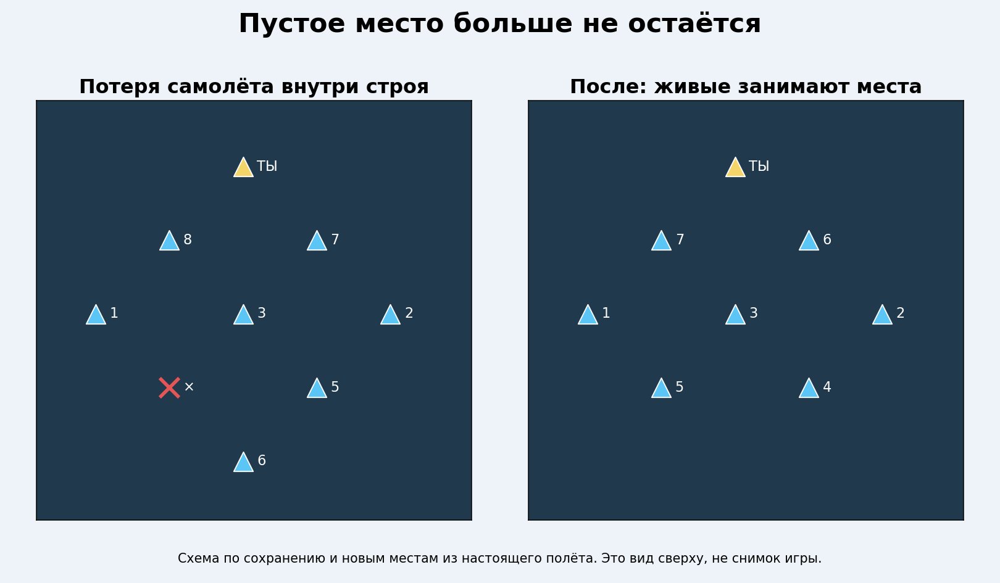
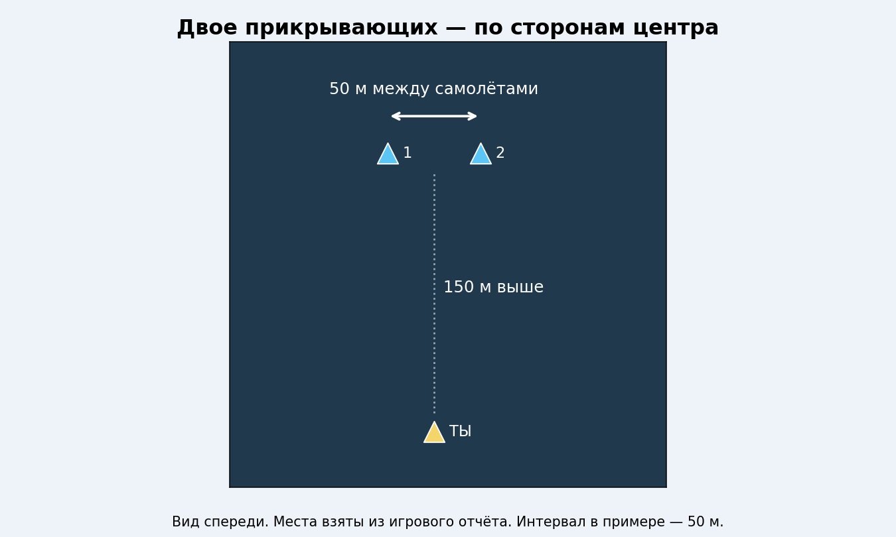
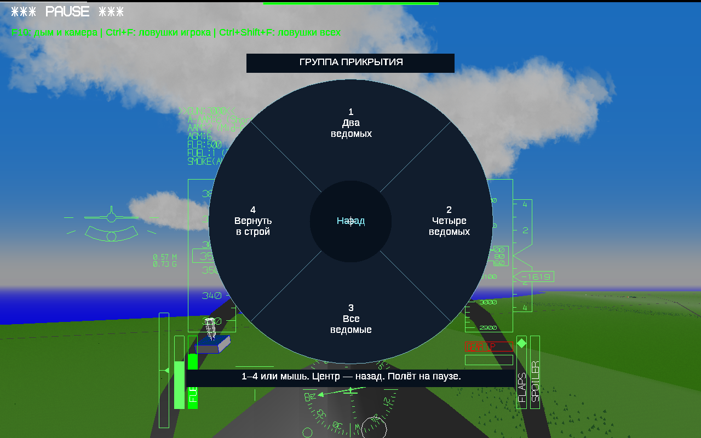
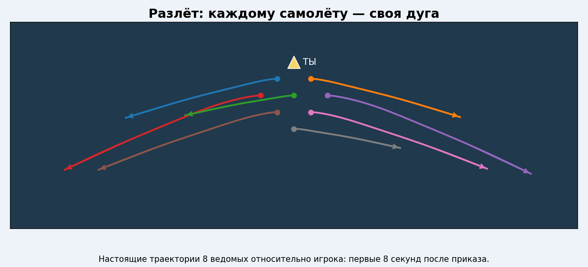
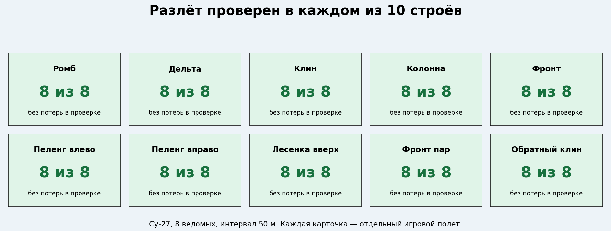

# YSFlight Airshow v8.7 — живой строй и отдельное прикрытие

**[Скачать полную игру — Windows 10, 32 бита](downloads/YSFlight_v8_7_32bit.zip?raw=true)**

Распакуйте целиком в новую папку `YSFlight_v8_7_32bit`, дважды нажмите **ysflight32_gl1.exe**. Альтернатива — **ysflight32_gl2.exe**. Рабочую v8.6 сохраните.

## Заполнение мест после потерь

Места пересчитываются по живым самолётам. Колонна сдвигается вперёд, симметричные строи сохраняют баланс сторон. Номера обновляются, цвет дыма остаётся у своего самолёта.

## Верхняя группа без пустого места в центре

Прикрытие уплотняется отдельно от группы рядом с игроком. **Enter → 6 → двое / четверо / все / вернуть.**

## Более выразительный разлёт

Отдельные дуги и разные углы ухода. В колонне — по очереди, в остальных строях — одновременно. Сохраняется защита от сближения и земли; возврат только по команде «Собраться».

**[Отчёт с картинками](reports/v8_7/ПРОВЕРКИ.md)** · [Отчёт ZIP](downloads/YSFlight_v8_7_Report.zip?raw=true) · [Исходники](downloads/YSFlight_v8_7_Sources.zip?raw=true) · [SHA256](downloads/SHA256SUMS_v8_7.txt) · [Патч](changes/v8_7.patch)

Проверены потери в основном строю и прикрытии, сбор после разлёта, смена состава прикрытия, перехват и возврат, настоящее меню и продолжение полёта после двух Esc. Геометрия: 5040 проверок расстояний для 10 строёв, 1–8 ведомых и трёх интервалов.

Полётные испытания — Win64-сборка тех же исходников под Wine. Выдаваемые EXE — PE32/i386, Windows GUI, без CMD/BAT. Запуск новой версии на настоящей Windows 10 32 бит проверяет пользователь. Проверки охватывают конкретные сценарии, а не любые модели и манёвры.

[Предыдущая рабочая v8.6](downloads/YSFlight_v8_6_32bit.zip?raw=true) · [Отчёт v8.6](reports/v8_6/ПРОВЕРКИ.md)
