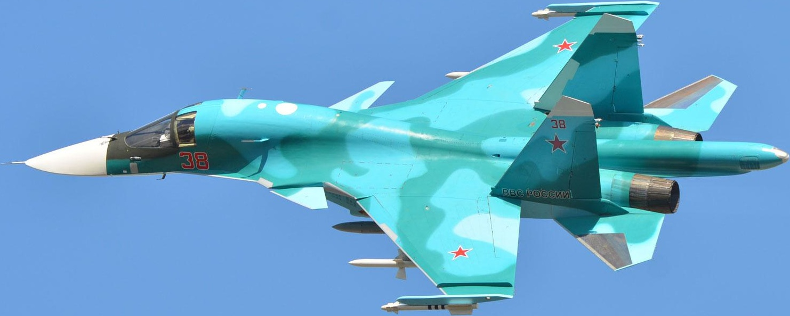
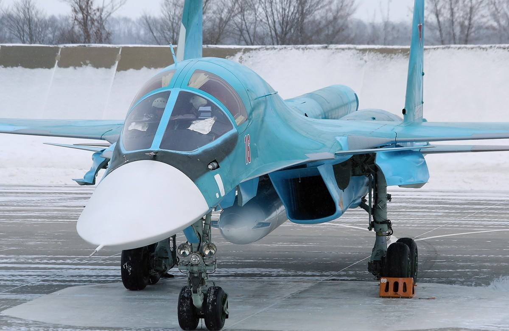
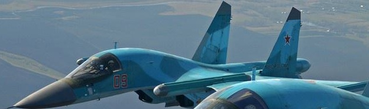
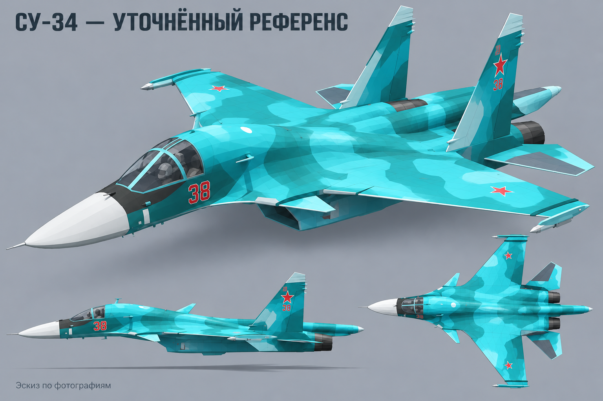
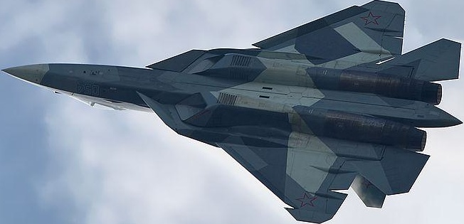
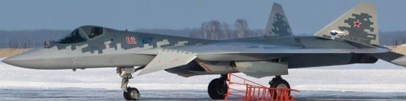
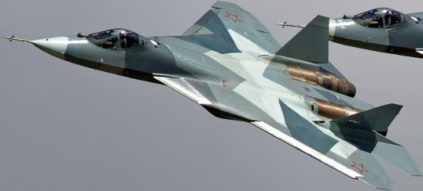
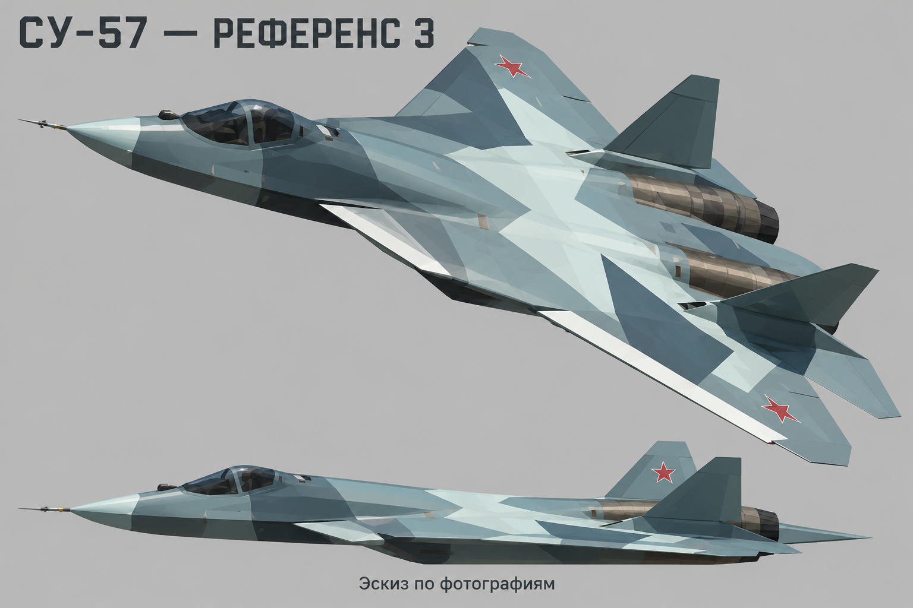

# Су-34 и Су-57 — новые ориентиры по фотографиям

[**Скачать все картинки ZIP**](../../downloads/Su34_Su57_References_v3.zip?raw=true) · [**Скачать PDF для просмотра**](../../downloads/Su34_Su57_References_v3.pdf?raw=true)

Итерация №3: Су-57 перерисован по другому ракурсу реального самолёта; Су-34 получил небольшие уточнения носа и остекления. Здесь реальные фотографии и новые сгенерированные эскизы по ним. Фото — основной ориентир; эскизы показывают предполагаемый стиль игровой модели и могут содержать неточности. Это не заводские чертежи. Игра пока не менялась.

## Су-34 «Утёнок» — настоящие фотографии

Широкая кабина с двумя местами рядом и выраженными рамками остекления; вытянутый приплюснутый нос; переднее горизонтальное оперение; длинная хвостовая балка между двигателями.

### Су-34 — новый игровой эскиз

[Открыть / скачать PNG](Su34_concept_v3.png?raw=true)

## Су-57 — настоящие фотографии

Плоский интегральный корпус; разнесённые мотогондолы; характерные кромки крыла; небольшие наклонные кили; одноместный фонарь. Отдельные передние крылышки как у Су-34 не добавляются.

### Су-57 — новый игровой эскиз

[Открыть / скачать PNG](Su57_concept_v3.png?raw=true)

## Источники

Фотографии найдены в открытой коллекции изображений самолётов; классы проверены визуально при отборе. Коллекция не является документацией производителя. Исходные фотографы в метаданных этих файлов не указаны.

- [Su34, фото 12](https://raw.githubusercontent.com/Naseeruddeen634/ML-FLIGHT-DETECTION-UG-PROJECT-2023-/3699d6fcb973cd2658a1f05151a1f262c2305e99/ITPDL05-FINAL%20CODING/datasets/test/Su34/8af0c67f361db5c81e08c03a57770001_0.jpg)
- [Su34, фото 13](https://raw.githubusercontent.com/Naseeruddeen634/ML-FLIGHT-DETECTION-UG-PROJECT-2023-/3699d6fcb973cd2658a1f05151a1f262c2305e99/ITPDL05-FINAL%20CODING/datasets/test/Su34/978c08810d56da4b6805498bd2e4b5bf_0.jpg)
- [Su34, фото 21](https://raw.githubusercontent.com/Naseeruddeen634/ML-FLIGHT-DETECTION-UG-PROJECT-2023-/3699d6fcb973cd2658a1f05151a1f262c2305e99/ITPDL05-FINAL%20CODING/datasets/test/Su34/eec0cdea36a8b39c60a581b6bbf5c519_0.jpg)
- [Su57, фото 8](https://raw.githubusercontent.com/Naseeruddeen634/ML-FLIGHT-DETECTION-UG-PROJECT-2023-/3699d6fcb973cd2658a1f05151a1f262c2305e99/ITPDL05-FINAL%20CODING/datasets/test/Su57/5a57dcdc3c5ad5756f0526ff9e1286ef_0.jpg)
- [Su57, фото 18](https://raw.githubusercontent.com/Naseeruddeen634/ML-FLIGHT-DETECTION-UG-PROJECT-2023-/3699d6fcb973cd2658a1f05151a1f262c2305e99/ITPDL05-FINAL%20CODING/datasets/test/Su57/cc4171f0fccdeca9445b86827b9f7903_0.jpg)
- [Su57, фото 19](https://raw.githubusercontent.com/Naseeruddeen634/ML-FLIGHT-DETECTION-UG-PROJECT-2023-/3699d6fcb973cd2658a1f05151a1f262c2305e99/ITPDL05-FINAL%20CODING/datasets/test/Su57/d0752ccd35ea873480ec6c263ca07fc8_2.jpg)
