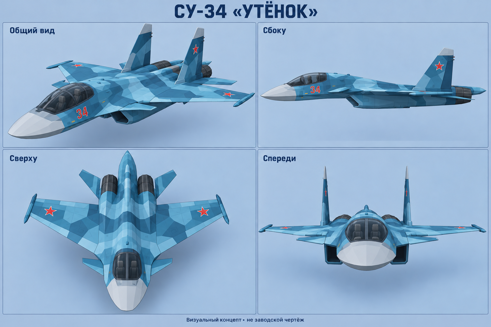

# Су-34 и Су-57 — визуальные концепты

[Скачать оба листа ZIP](../../downloads/Su34_Su57_References.zip?raw=true)

## Су-34 «Утёнок»

[Открыть / скачать PNG](Su34_reference.png?raw=true)

## Су-57

[Открыть / скачать PNG](Su57_reference.png?raw=true)

Это сгенерированные ориентиры внешнего вида в стиле low-poly, а не заводские чертежи и не снимки из игры. Отдельные детали и согласованность ракурсов ещё нужно сверять с фотографиями реальных самолётов перед моделированием. Модели в игру пока не добавлены.
