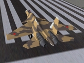
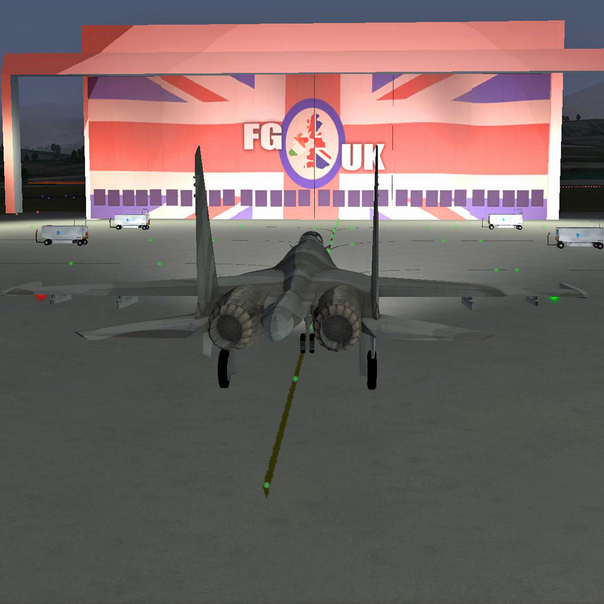
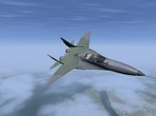

# Замена Су-27 и МиГ-29: источники и задание

Задание пользователя от 26 октября 2026 года. **Это подготовка следующей
тестовой версии, не объявление уже выполненной замены моделей.**

**[ВЫПОЛНЯТЬ ЭТО ЗАДАНИЕ — заменить две модели](TASK_PROMPT.md)** ·
[Отложенная задача по лицензиям](../THIRD_PARTY_LICENSE_PLAN.md)

Этот файл — справка об источниках. Короткое текущее задание находится по ссылке выше.

## Проверенные основы

| Самолёт | Репозиторий | Зафиксированная версия | Основная геометрия |
|---|---|---|---|
| Су-27 | [FGMEMBERS/Su-27](https://github.com/FGMEMBERS/Su-27) | a9c4863886a5835dfa4406698dd4557fbf72a3aa | Models/Su-27.ac |
| МиГ-29, вариант 9-12 | [FGMEMBERS/MiG-29](https://github.com/FGMEMBERS/MiG-29) | 646e9f9d6b958773e69cbde74602642c91fcfcaf | Models/Mig-29.ac |

Оба файла AC3D скачаны и прочитаны нашим парсером. В основном файле Су-27
6500 полигонов, в основном файле МиГ-29 — 4262; дополнительные узлы могут
загружаться отдельно из XML. Проверены силуэты сверху. Перенос в YSFlight,
окончательное качество и полные анимации этой новой адаптации **ещё не проверены**.
Скачивать весь upstream для изучения структуры, включать в игру только
выбранные проверенные ресурсы. Их динамику FlightGear переносить не требуется.

[Скачать Су-27.ac](https://raw.githubusercontent.com/FGMEMBERS/Su-27/a9c4863886a5835dfa4406698dd4557fbf72a3aa/Models/Su-27.ac) ·
[Скачать МиГ-29.ac](https://raw.githubusercontent.com/FGMEMBERS/MiG-29/646e9f9d6b958773e69cbde74602642c91fcfcaf/Models/Mig-29.ac)

## Как выглядят модели у авторов

Ниже **оригинальные изображения из репозиториев FlightGear**: это не наши
новые кадры YSFlight, не фотографии настоящих самолётов и не генерация.
Миниатюры маленькие; их не выдавать за подробное подтверждение качества.
Окраска и освещение после нашей адаптации будут зависеть от реализации.

### Су-27

### МиГ-29

Большого обзорного изображения МиГ-29 в выбранном репозитории не найдено.
До выводов о пригодности детально осмотреть саму геометрию и её реальные
кадры после конвертации. Не заменять отсутствующие доказательства рисунком.

## Повторная проверка лицензий

В обоих репозиториях опубликован текст GPL-2.0. У МиГ-29 автор дополнительно
прямо указал в README.txt, что модель распространяется под GNU GPL Version 2.
GPL разрешает коммерческое использование с выполнением её условий. Это
проверка опубликованных условий, не подтверждение всех прав первоначальных
авторов и не юридическая приёмка всего пакета для Steam.

- Су-27: [исходная лицензия](https://github.com/FGMEMBERS/Su-27/blob/a9c4863886a5835dfa4406698dd4557fbf72a3aa/COPYING), [сохранённая копия](su27-COPYING.txt).
- МиГ-29: [лицензия](https://github.com/FGMEMBERS/MiG-29/blob/646e9f9d6b958773e69cbde74602642c91fcfcaf/COPYING.txt), [пояснение автора](https://github.com/FGMEMBERS/MiG-29/blob/646e9f9d6b958773e69cbde74602642c91fcfcaf/README.txt), [сохранённая копия](mig29-COPYING.txt).
- У Су-27 `Models/Interior/pilot/pilotOLD.xml` содержит только фразу
  «This pilot is covered by CC licence», без вида CC. Не переносить этого
  пилота/HDpilot.ac без выяснения условий; использовать своего или оставить
  без него. Это не установленный запрет на основную геометрию самолёта.
- Эффекты МиГ-29 содержат отдельные GPL-уведомления, в том числе GPLv3+.
  Не копировать папку эффектов автоматически. Для текущей задачи достаточно
  геометрии и собственной окраски/штатных эффектов YSFlight.
- Перекрашивание и конвертация не снимают лицензию. Сохранять оригинал,
  исходники адаптации, инструменты и необходимые уведомления.

Изображения воспроизведены из указанных версий репозиториев с сохранением
ссылок на источник; лицензии пакетов приложены. Отдельного автора этих кадров
в проверенных файлах не установлено; не приписывать их нашей команде.

Точные версии и SHA-256 геометрии: [sources.json](sources.json).
