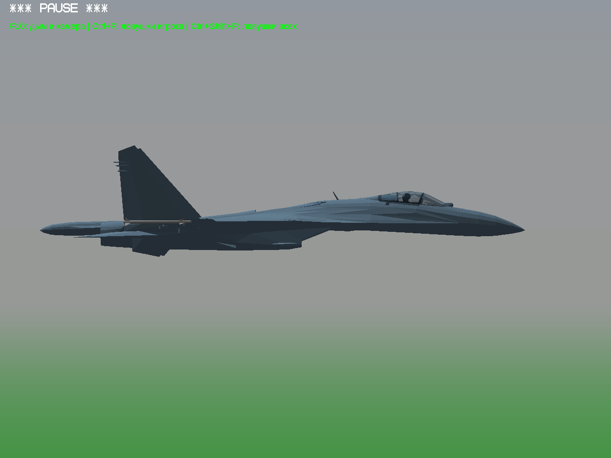
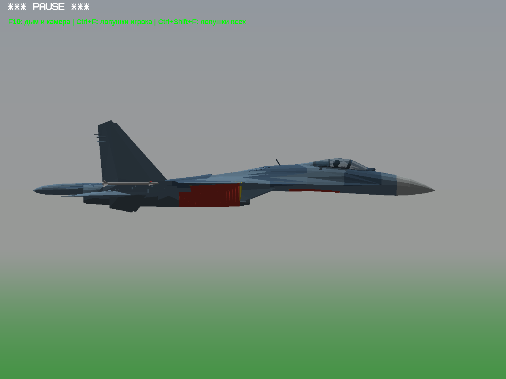
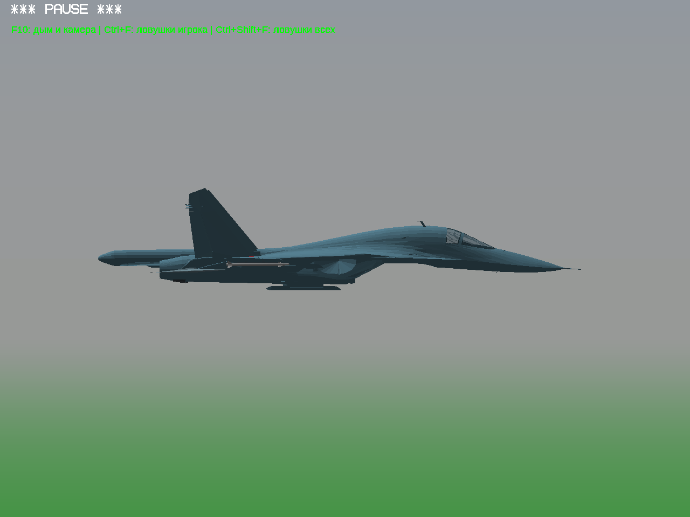
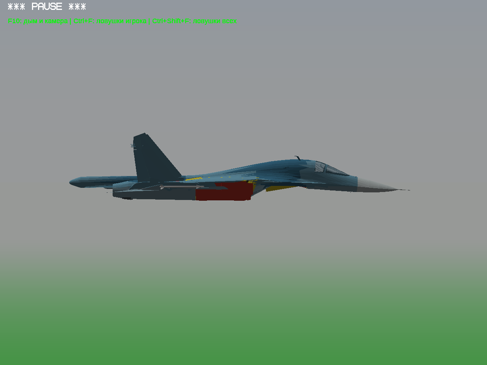

# Проверка замечания о наружных «коробках»

Замечание проверено сравнением с исходной геометрией в игре. На правых кадрах **красным выделены мои створки, жёлтым — мои стенки ниш**; это диагностическая окраска, не новая окраска самолёта. Слева — исходная обшивка без добавленных ниш и механизмов. Ракурс камеры одинаковый. Это промежуточная проверка, не готовая сборка.

| Исходная обшивка | Добавленные поверхности выделены цветом |
|---|---|
|  |  |
|  |  |

**Ошибка найдена:** у Су-34 добавленная передняя ниша/створки выходят ниже исходного носового корпуса. Неверно задан нижний контур закрытия исходного проёма. Исправление в работе.

У Су-27 в этом боковом сравнении нижний силуэт с добавленными панелями отличается от исходного не более чем примерно на 2 пикселя. Это говорит о сохранении бокового контура мотогондолы, **но не доказывает правильность всех панелей**: проверка под углом и устройства створок продолжается. Прямоугольные участки на предыдущих фотографиях действительно относятся к моим створкам; прежнее общее заявление об отсутствии дефектов было преждевременным.

Ракурсы под углом: [Су-27, исходник](su27/source-quarter-135.png), [Су-27, мои панели](su27/coloured-quarter-135.png), [Су-34, исходник](su34/source-quarter-135.png), [Су-34, мои панели](su34/coloured-quarter-135.png).

Все кадры реальные, Win64/Wine. Су-34: источник DEVBenSon/FiveM-Plane-Pack, автор указан как fantazer_rnd; [происхождение и статус прав](../aircraft-work-progress-4/REPORT.md). Геометрия и ZIP с Су-34 публично не распространяются.
