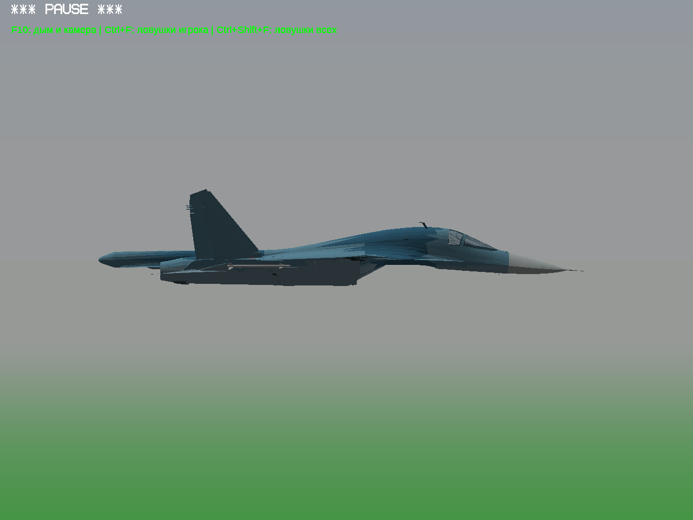

# Су-34: исправление выступа передней ниши

Нижний контур передней ниши восстановлен по соседней обшивке исходной модели. Убрана ошибочная низкая вставка; стойка заново уложена внутри корпуса. На одинаковом боковом ракурсе прежний выступ в зоне носа достигал примерно 13 пикселей, сейчас — не более 1 пикселя. Это проверка изображения, не точный размерный замер.

| До исправления | После |
|---|---|
|  |  |

[Новый кадр снизу](bottom.png) · [Сравнение и контрольная сумма модели](comparison.json).

Это исправление внешнего контура, **не готовность всего шасси**. Створки и внутренние пересечения ещё дорабатываются; Су-27 также остаётся на проверке. Реальные кадры Win64/Wine. Су-34 остаётся закрытой тестовой моделью: [источник и статус прав](../../aircraft-work-progress-4/REPORT.md).
