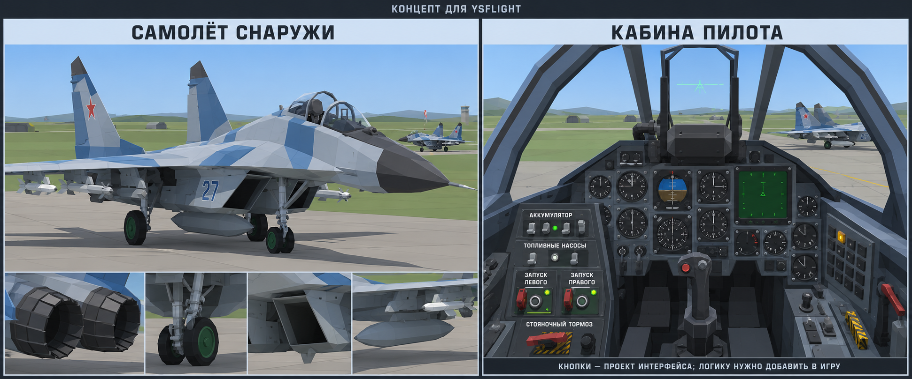

# Концепт самолёта и кабины

Сгенерированное предложение внешнего вида, не скриншот игры. Кнопки показаны как проект интерфейса; действующая логика запуска ещё не реализована. Это не подтверждённая схема кабины МиГ-29.

[Скачать PNG](https://raw.githubusercontent.com/i7885784-lang/igraYS-Flight-Simulator/ysflight-center-download/reports/aircraft-cockpit-concept/YSFlight_Aircraft_and_Cockpit_Concept.png)
