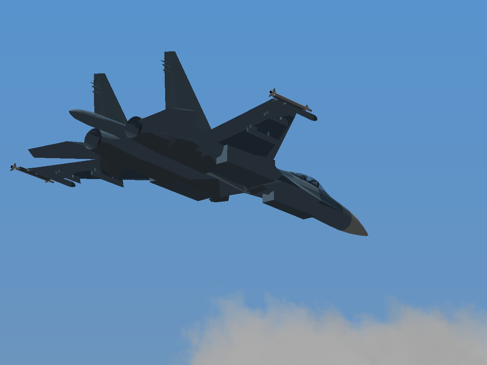
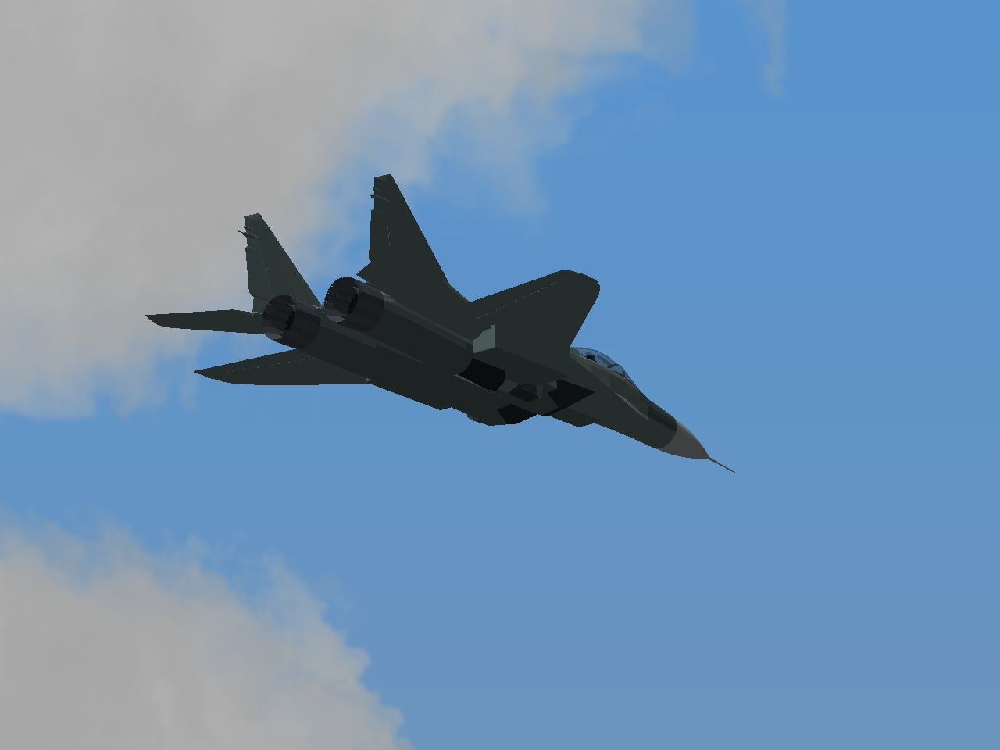

# Исправления самолётов — тест №2

[**Скачать игру Windows 32-bit**](../../downloads/YSFlight_Aircraft_Fixes_Test_2_32bit.zip?raw=true) · [Исходники](../../downloads/YSFlight_Aircraft_Fixes_Test_2_Sources.zip?raw=true)

Распаковать отдельно, запустить **ysflight32_gl1.exe**. Старые версии сохранены.

- **Су-27:** переделаны складывание стоек, поворот колёс, ниши и створки. Убранные детали находятся внутри закрытых ниш и не скрываются искусственно. Створки открываются перед движением стоек; большие крышки разделены на меньшие. Укорочены тормозной щиток и его привод. Ракеты на законцовках вынесены на боковые направляющие.
- **МиГ-29:** переделаны шасси и створки, колесо убирается внутрь. В полёте воздухозаборники открыты. На земле при малой скорости действуют защитные экраны и открываются верхние жалюзи — это отдельное наземное состояние.
- **Су-57:** в эту игру действительно включена поздняя ревизия с закрытой обшивкой за креслом и четырьмя пилонами. Дополнительно расширены стыки задней площадки и подогнаны опоры пилонов.

**Су-47 сохранён без изменения файлов модели.** Авторство и лицензии включены; нового раздела в интерфейсе нет.

| Су-27: шасси убраны | МиГ-29: шасси убраны |
|---|---|
|  |  |

**Видео реальных клавиш:** [шасси Су-27](su27/gear.mp4?raw=true) · [шасси МиГ-29](mig29/gear.mp4?raw=true) · [тормоз Су-27](su27/brake.mp4?raw=true) · [фонарь Су-57](su57/canopy.mp4?raw=true).

**Крупные планы:** [боковое крепление](su27/tip-rail.png) · [открытые воздухозаборники](mig29/intake.png) · [кабина Су-57](su57/cockpit-front.png) · [его пилоны](su57/pylons.png). На фото — штатные проверочные ракеты YSFlight.

В итоговый набор вошли общий осмотр каждого самолёта и целевые проверки исправленных мест. Выпуск/уборка и фонарь прошли **0 → 1 → 0**, включая промежуточные положения. Проверены размещение всех убранных узлов в нишах и проход колёс через проёмы; четыре видео декодированы. Все 15 файлов моделей независимо пересобраны с побайтным совпадением. ZIP проверен и отдельно распакован.

**Ограничения:** проверка игры — Win64/Wine; настоящая Windows 10 x86 здесь не проверена. Ниши, обтекатели и кинематика адаптированы для игры, заводская точность не заявляется. Повторы запросов к внешним сайтам и альтернативам дали HTTP 403; доступны авторские исходники FlightGear.

[Общие ракурсы](VIEWS.md) · [Геометрия](validation.json) · [Целевые проверки](evidence-checks.json) · [ZIP](package-checks.json) · [Исходники и лицензии](../../changes/aircraft-fixes-test-2/)
