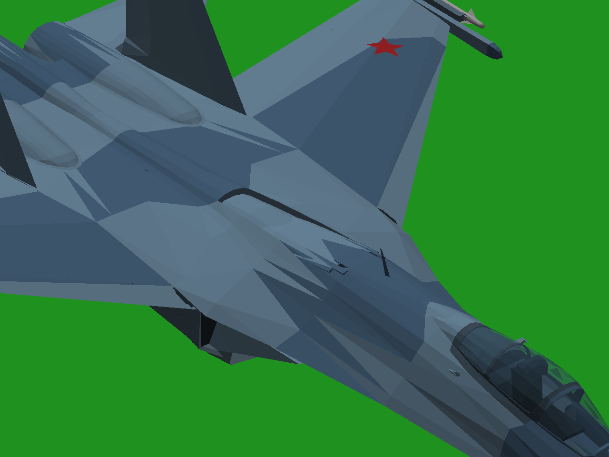
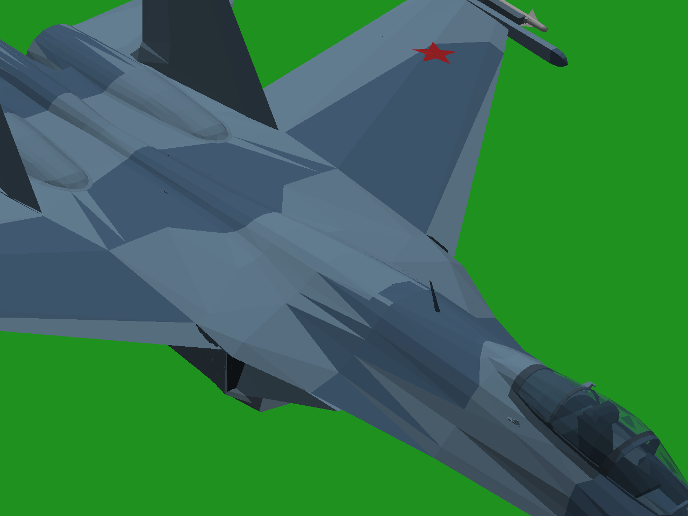

# Исправления после оценки теста №4 — работа продолжается

**Согласовано:** удачный вид стоек и качество их движения сохранить. Ошибка — расположение ниш и чрезмерные створки, раскрывающие обшивку мотогондол/воздушных каналов. У Су-34 также проверить просветы и посадку убранных поверхностей. Основная задача ещё не выполнена; нового готового ZIP здесь нет. Выданный тест №4 не перезаписан.

Нашла и исправила отдельный дефект Су-27: щиток был укорочен, а место под него оставалось исходного размера. Вернула исходный контур; проверила два реальных нажатия B — открытие и закрытие. Остальные 54 узла и все их состояния сохранены побайтно. [Видео](brake-B.mp4), [состояния игры](brake-native-states.json), [проверка](brake-checks.json), [код правки](../../changes/aircraft-test-5/).

| До, щиток убран | После, щиток убран |
|---|---|
|  |  |

Су-34: [текущий крупный план просветов](su34-gap-current.png), [диагностический кадр с исходной обшивкой без наших вырезов ниш](su34-original-skin-diagnostic.png). Часть видимых промежутков сохраняется и с исходной обшивкой: требуется различить настоящие отверстия и воздух между раздельными поверхностями. Попытка закрыть два открытых контура крыла не устранила показанный дефект и исключена из поставки. Просветы Су-34 **не объявляю исправленными**.

Прежние проверки пересечений проверяли обшивку после вырезов, но не физическую занятость объёма воздушным каналом. Они не доказывают правильное расположение ниш. Нужны ограничения по каналам и проверка по реальным материалам.

Запрошенные два реальных видео на каждый самолёт пока не просмотрены: прокси этой среды отклоняет поиск и доступ к YouTube/Wikimedia (`CONNECT 403`). GitHub доступен; исходные модели и XML разобраны, но они не заменяют видео настоящих самолётов. Для завершения нужны доступ к поисковику и YouTube, включая домены видеопотока, либо сами видео, доступные этой среде. Новое устройство ниш по догадке не утверждено. Проверки игры выполнены Win64/Wine; Windows 10 x86 не запускалась.
