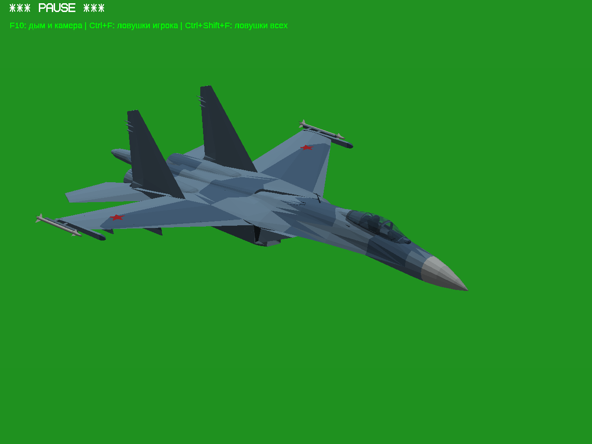
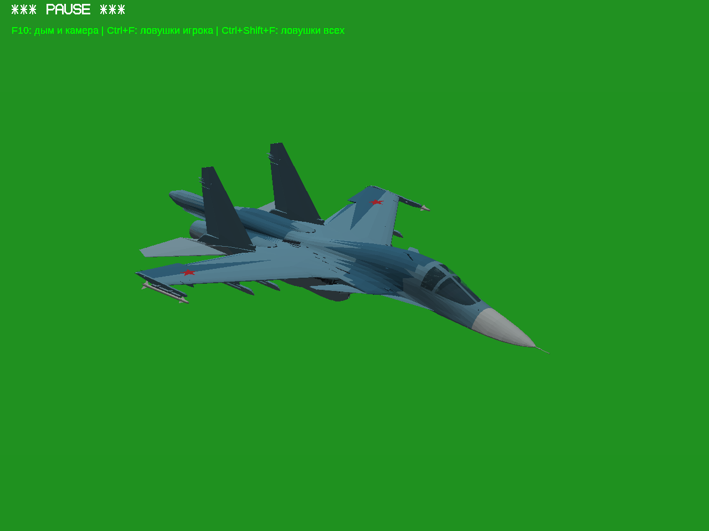
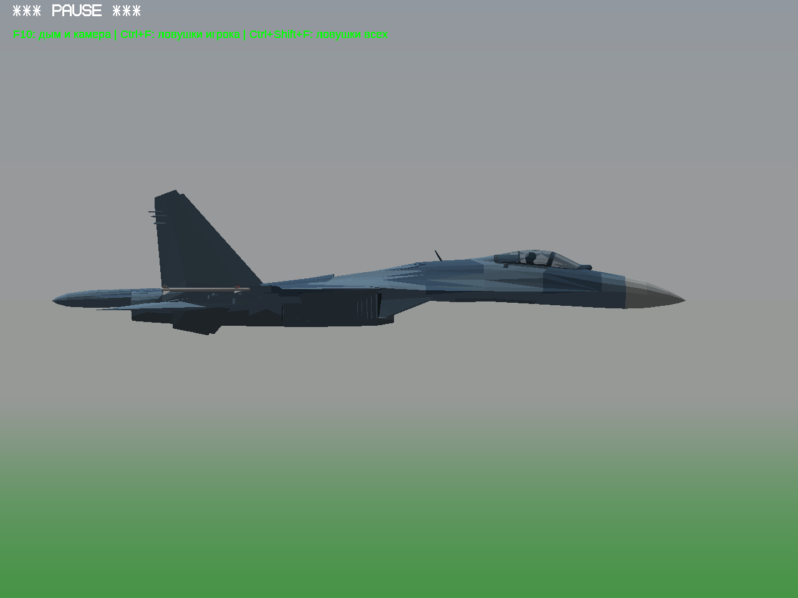
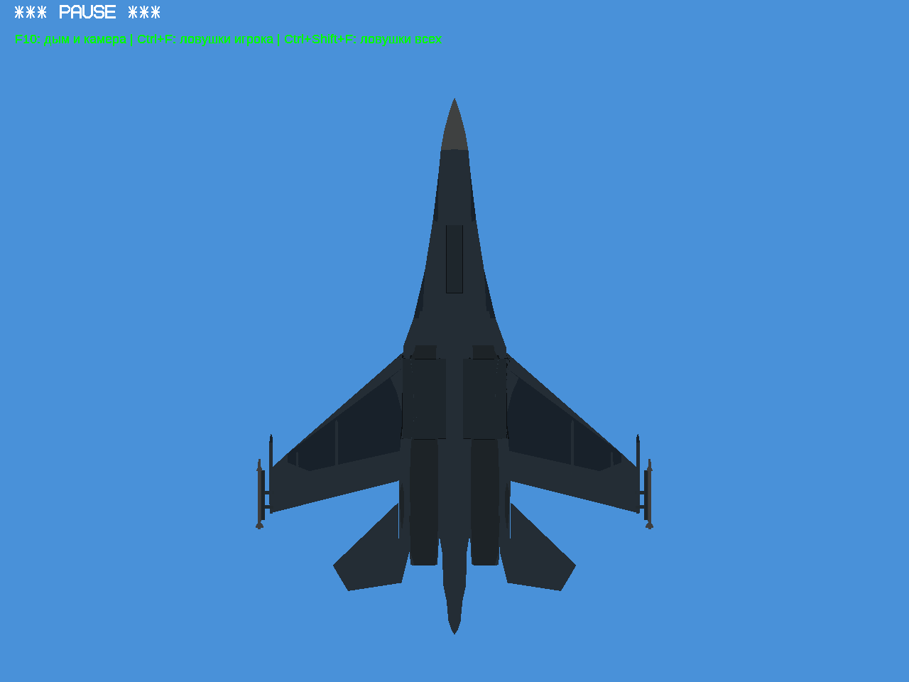
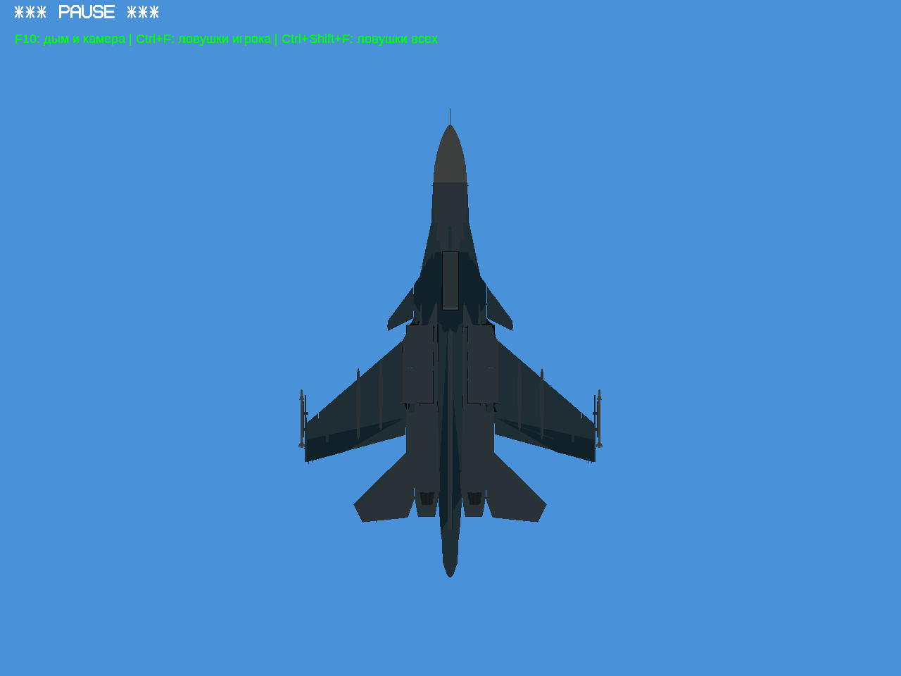

# Промежуточные игровые фотографии: Су-27 и Су-34

Работа продолжается. Это реальные кадры игры Win64/Wine, не рендер и не готовая приёмочная сборка. Снимки сделаны после последней доработки траекторий шасси.

| Су-27 | Су-34 |
|---|---|
|  |  |
|  |  |
|  |  |

Что ещё проверяю и исправляю:

- На Су-34 видны тёмные штрихи/неровные стыки на крыле и у задней части фонаря. Нужно устранить перекрытие поверхностей и проверить освещение.
- Прямоугольные участки снизу требуют отдельной проверки в профиль и при движении: вид сверху на низ сам по себе не доказывает отсутствие выступающих ниш. Уточняю замечание пользователя о «коробке» также на МиГ-29.
- Для Су-27 новая проверка движения колёс со створками прошла без обнаруженных пересечений; проверка реальными клавишами ещё впереди. Су-34 по механизмам пока не готов.

Су-34: геометрия из DEVBenSon/FiveM-Plane-Pack, commit db0191619fb3d1cefc225eb5b216a91267ad7740, указанный автор fantazer_rnd. Текстуры и звуки GTA не используются. Право распространять геометрию не подтверждено: здесь опубликованы только фотографии, модель и публичная игровая сборка с ней не публикуются.

[Контрольные суммы кадров и моделей](capture-provenance.json). Финальный отчёт и ZIP ещё не готовы; настоящая Windows 10 x86 не проверялась.
