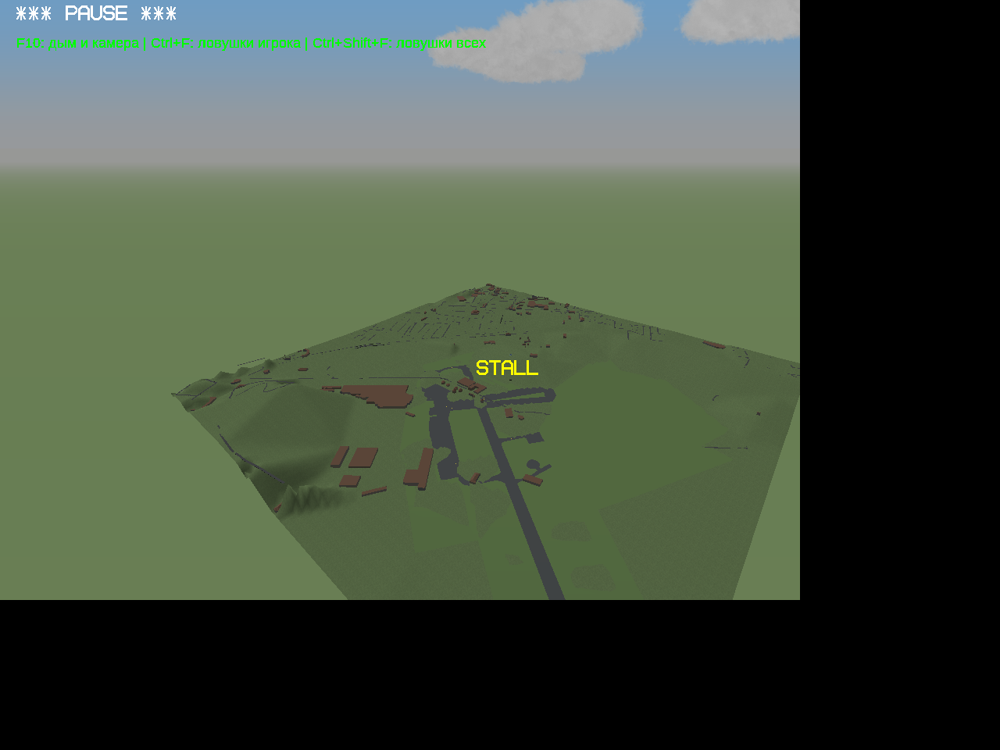
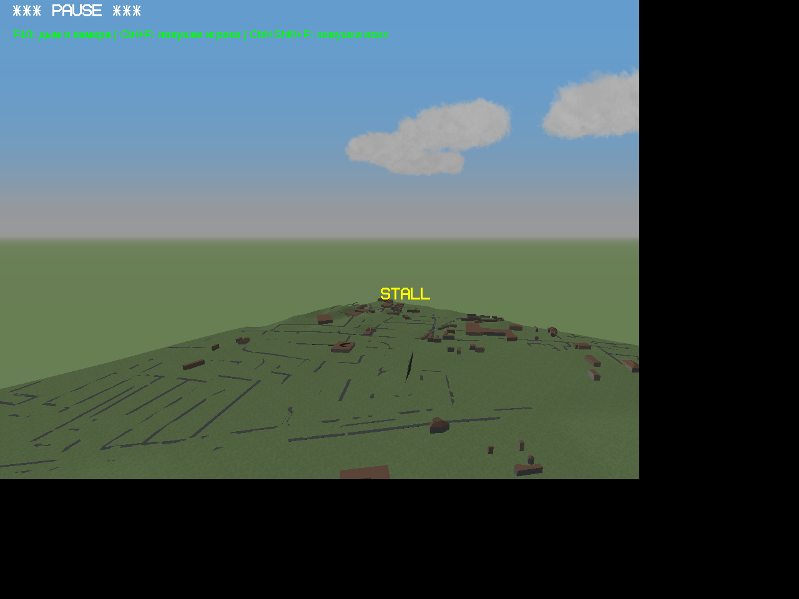
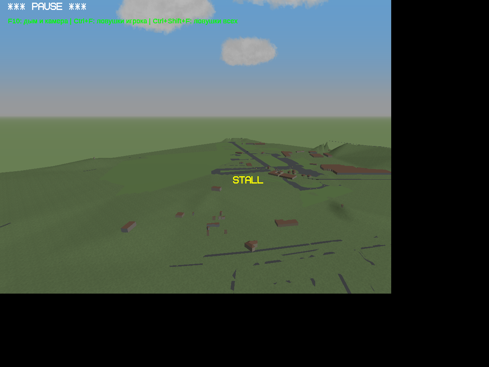
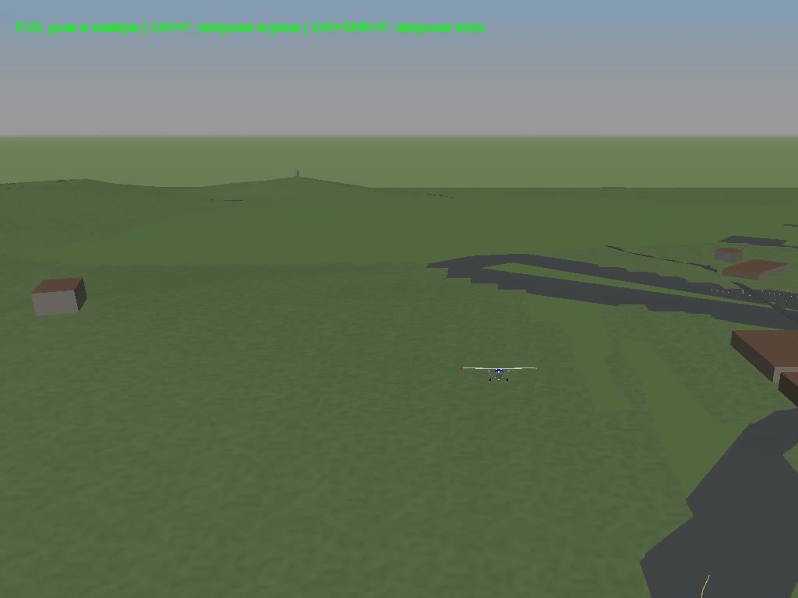

# Belfast City — тест конвертации №1

Участок 2,6 × 2,6 км вокруг Belfast City Airport (54.61423 N, 5.88141 W). Это небольшой технический прототип переноса FlightGear/OSM2City в существующий YSFlight. Он не заменяет основную сборку игры.

## Как посмотреть

1. Распакуйте архив в отдельную папку.
2. Скопируйте содержимое папки scenery в папку scenery установленной игры, сохранив остальные карты.
3. Скопируйте Belfast_City_Test_1.yfs в папку игры. В игре откройте этот файл через загрузку полёта. Нужен стандартный самолёт CESSNA_172R.
4. Либо выберите карту BELFAST_CITY_TEST в новом полёте. Сохранённый полёт начинает движение на высоте 180 м, со скоростью 50 м/с. Не летите далеко за границы небольшого участка.

## Что получилось и ограничения

Перенесены настоящая геометрия аэропорта BTG и здания/дороги AC3D с размещением STG. Здания объёмные, с простой собственной окраской без исходных текстур. Настоящий рельеф BTG имеется только у аэропорта. Остальной рельеф — приближённая интерполяция высот дорог и оснований зданий, сетка 25 м, а не полноценная модель высот. Есть видимые пересечения дорог с поверхностью и резкий край участка; застройка редкая, исходные данные примерно 2016 года. Водоёмы, деревья, достопримечательности и фасадные текстуры не добавлены.

Геометрия разделена на 116 блоков по 250 м, но движок загружает весь тест сразу: потоковой загрузки и нового LOD здесь ещё нет. Не обещается отсутствие ошибок или готовность к конвертации всей России.

Проверено: загрузка именно этой карты и три статичных ракурса в настоящей игре Win64 через Wine/OpenGL. Длительный полёт, сохранённый полёт Cessna и Windows x86 отдельно не проверялись. Надпись STALL на кадрах относится к неподвижному самолёту проверочной сцены.

## Источник и права

FGMEMBERS-SCENERY/EGAA-EGAC-fg-CustomScenery, commit 2ae5b8555ac38d69481b393d8791de4b8e357f4f:
https://github.com/FGMEMBERS-SCENERY/EGAA-EGAC-fg-CustomScenery

Исходная scenery и производная карта распространяются с GPL v2; текст приложен в licenses/LICENSE-GPL-2.0.txt. Исходники конвертации и исходные AC/BTG/STG опубликованы отдельным архивом Sources. Изменения: координаты и форматы YSFlight, обрезка участка, собственные цвета, приближённая поверхность.

Данные OpenStreetMap: © OpenStreetMap contributors, https://www.openstreetmap.org/copyright (ODbL). README оригинального автора приложен. Текстуры из стороннего атласа не распространяются.

## Скачать

- [Карта — Addon](../../downloads/Belfast_City_Test_1_Addon.zip)
- [Конвертер и исходные данные — Sources](../../downloads/Belfast_City_Test_1_Sources.zip)
- [Размеры и SHA256](DOWNLOADS.json)

## Реальные кадры игры

## Видео пролёта

[Смотреть или скачать MP4 — 14 секунд, 0,69 МБ](belfast-flyover.mp4)

Реальная запись из игры, Cessna 172R, внешняя камера; без ускорения и без дорисовки. Старт 185 м над уровнем моря, 50 м/с, южнее центра участка. Чёрные поля захвата обрезаны. Это короткий визуальный пролёт, а не проверка устойчивого автополёта: полная запись без управления закончилась столкновением примерно на 20-й секунде симуляции, поэтому длинная проверка active не прошла. В ролике показаны первые 14 секунд до столкновения. Исходный журнал сохранён в flyover-game.log.
