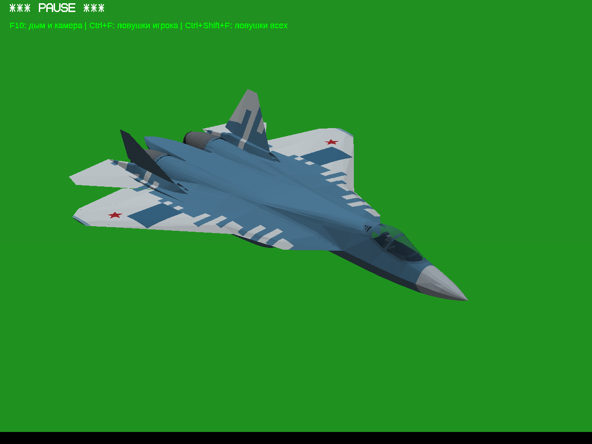
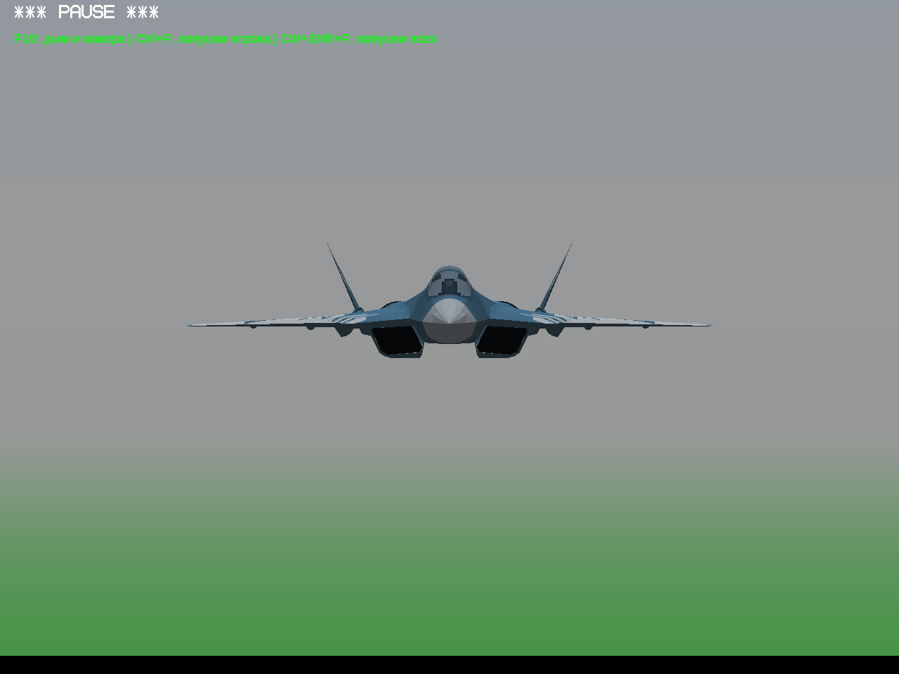
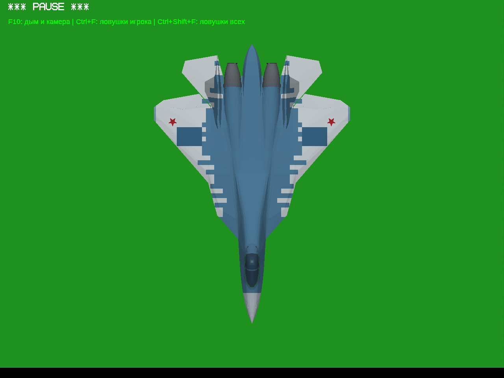
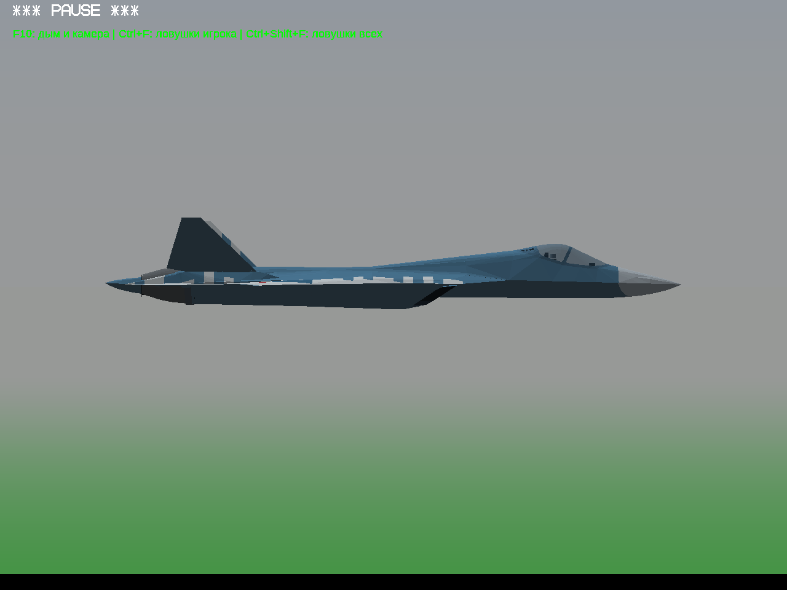

# Среда разработки восстановлена — 26 октября 2026

Это проверка инструментов на неизменённом Су-57 №2, не новая версия самолёта или геймплея. Текущая основа в CURRENT_VERSION.md сохранена. Старые архивы и отчёты не изменены.

[Скачать самостоятельный проверочный ZIP Windows 32-bit](../../downloads/YSFlight_Su57_Test_2_Environment_Check_32bit.zip?raw=true) · [Настоящее видео выпуска шасси](live-flight.mp4?raw=true) · [Журнал игры](capture.log)

Распаковать ZIP целиком в новую папку и запустить `ysflight32_gl1.exe`. В меню — «Су-57: тест модели». Су-27 и МиГ-29 сохранены.

## Что реально проверено

- Из сохранённого снимка C++ выполнены чистые сборки Win32 Release и отдельной Win64 с существующим флагом `V861_VALIDATION` для проверки/камеры. Win64 в ZIP не включён.
- Проверены все 1576 записей манифеста исходников: содержимое исходников и CMake не менялось.
- Win64/Wine 10/Xvfb загрузил Су-57 №2 и выполнил полёт. Четыре кадра ниже получены из окна работающей игры. Это не рисунки и не внешние рендеры.
- В шестисекундном видео — штатная команда выпуска шасси, без принудительных поз. Журнал подтверждает активный самолёт, движение игрового времени и переход шасси 0 → 1. MP4: 1280 × 960, 15 кадров/с, 90 кадров; полностью декодирован FFmpeg.
- Пересборка модели Python/NumPy/SciPy дала пять файлов, побайтно совпавших с поставкой.
- ZIP прошёл CRC и распаковку отдельно. Один GUI EXE PE32/i386 без диагностических команд; плагины также i386. Все импортируемые DLL — системные Windows, отдельная установка MinGW runtime не нужна. 1020 остальных записей совпали с исходной поставкой, включая модели, карты, настройки и лицензии.
- Установочный сценарий повторно выполнен успешно; повторные сборки завершились `ninja: no work to do`.



| Спереди | Сверху | Сбоку |
|---|---|---|
|  |  |  |

Эти четыре снимка сделаны на паузе для осмотра формы. Видео — продолжающаяся симуляция.

## Из чего продолжать проект

1. Полная игра: `downloads/YSFlight_Su57_Test_2_32bit.zip`, SHA-256 `ad8fa53419f06532e25d65669d83b785d6d4c5568ee6fbf0d530d00bab038697`. Брать её целиком, чтобы сохранить существующие Су-27, МиГ-29 и Су-57.
2. Движок и библиотеки: `downloads/YSFlight_Su57_Test_2_Engine_Source.zip`, SHA-256 `378c67577ae088fbe7b38cf3847d78f985639665ddebc4840e9db7b9ea78e6c5`. Изменения первого теста уже внутри: повторно патч не накладывать.
3. Конвертер и лицензированная геометрическая основа текущего Су-57: `changes/su57-test-2/model-source/`. Для другого самолёта искать подходящую самостоятельную модель с разрешённой адаптацией и распространением; Су-57 не растягивать под другой тип.

Следующие изменения — отдельная тестовая версия от текущей основы. Сначала геометрия, масштаб, окраска и освещение; сравнение с фотографиями строго сверху, спереди и сбоку, затем круговой осмотр в игре. До сложных механизмов публиковать реальные игровые снимки внешней модели через GitHub. Просветы, пропадающие поверхности и грубые пересечения исправлять сразу. Сохранять авторство и лицензии.

## Как устроено окружение

Рабочая папка `/workspace/ysflight-dev`, существующий checkout `/workspace/igraYS-Flight-Simulator`. Новые worktree не нужны. Компилятор MinGW GCC 14 POSIX, CMake 3.31.6, Ninja, Wine 10, Xvfb размещены в частном префиксе; root/sudo недоступны. Debian-пакеты скачаны APT с проверкой подписей индексов и контрольных сумм. Системная установка не использовалась.

В снимке отсутствовал `YSFLIGHT/scripts/runtime_timestamp.py`. Восстановлен оригинал из `downloads/YSFlight_v8_6_2_Sources.zip` — только служебный скрипт, не старый движок. Ресурсы взяты из текущей игры. Готовый EXE исключён из рабочей папки ресурсов перед сборкой: иначе CMake перезаписывает им новый собранный EXE.

Для MinGW добавлена библиотека `imm32` через параметр CMake; стандартные Windows-библиотеки сохранены. Компилятору ресурсов предоставлены штатные имена GCC POSIX. Плагины собраны со статическими библиотеками компилятора и размещаются под ожидаемыми игрой Windows-именами DLL. Ни одного изменения C++ для этого не потребовалось.

Старый GUI-helper заменён [capture.py](tools/capture.py): встроенный сценарий игры, управление размером окна через X11, снимки Pillow, запись FFmpeg. Для приватной установки Wine настроены пути данных, wineserver и zlib. Видео подаётся в FFmpeg кадрами Pillow, чтобы не зависеть от общей памяти X11 между песочницами.

Команды из `/workspace`:

```bash
bash /workspace/igraYS-Flight-Simulator/reports/environment-2026-10-26/tools/install.sh
source /workspace/ysflight-dev/env.sh
bash /workspace/ysflight-dev/start.sh
python3 /workspace/ysflight-dev/capture.py
python3 /workspace/ysflight-dev/package.py
```

Отдельная пересборка: `bash /workspace/ysflight-dev/build.sh 32` либо `64`. Установка не публикует GitHub и не меняет исходники. Съёмка пишет только в рабочую папку. Процессы после восстановления облачной среды нужно запускать заново.

## Ограничения

Прямой запуск нового Win32 ZIP на настоящей Windows 10 x86 здесь не проверен. Игровой запуск, снимки и видео подтверждены отдельной Win64-сборкой под Wine. Звук и полный набор старых игровых сценариев не проверялись; эта проверка среды не является полной регрессией или пользовательской приёмкой. Качество модели сейчас не дорабатывалось.

Сохранены черновые `install_script` и `start_skill` облачной среды. Их сохранение не публикует снимок среды: публикация выполняется пользователем в настройках. Восстановление новой облачной задачи пока отдельно не проверено.

[Проверка среды](environment-checks.json) · [Игра и состояния шасси](capture-checks.json) · [Проверка ZIP и DLL](package-checks.json) · [Повтор Win32](repeat32.log) · [Повтор Win64](repeat64.log) · [Повтор установки](install-verified.log) · [Сценарии](tools/)

Прямые скачивания отчёта, игрового снимка, видео и ZIP с опубликованной ветки проверены: HTTP 200, побайтное совпадение с локальными файлами; скачанный ZIP повторно прошёл CRC. [Результаты скачивания](download-checks.json).
