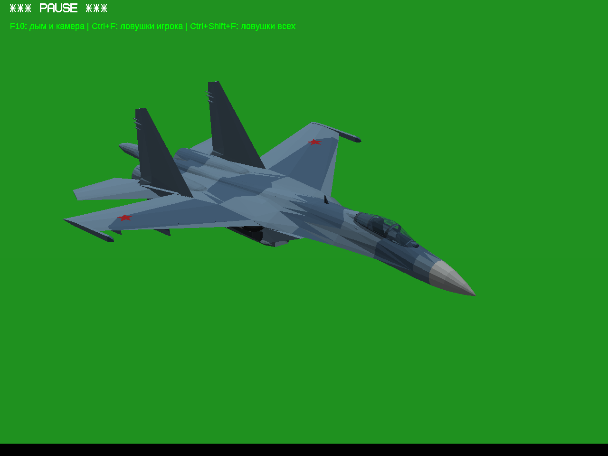
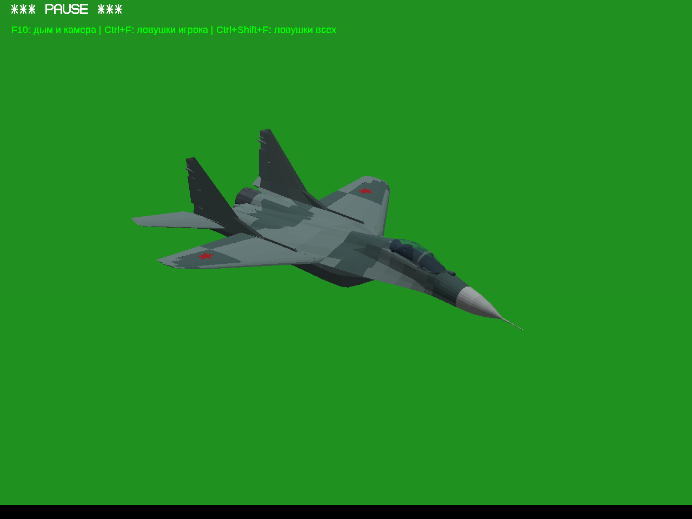

# Су-27 и МиГ-29 — новая геометрия, тест №1

[**Скачать игру — Windows 32-bit**](../../downloads/YSFlight_Fighters_FG_Test_1_32bit.zip?raw=true) · [**Полные исходники**](../../downloads/YSFlight_Fighters_FG_Test_1_Sources.zip?raw=true)

Распаковать всю папку отдельно, запустить **ysflight32_gl1.exe**. В «Новом полёте» выбрать **SU-27_FLANKER** или **MIG-29_FULCRUM**. Можно загрузить включённые `su27_Test.yfs` / `mig29_Test.yfs` для воздушного старта.

Заменены геометрия и внешние механизмы обоих самолётов. Основа этой отдельной версии — **Су-47 №1**, продолжающий **Су-57 №2**. Су-47 и Су-57 сохранены: их пять основных файлов совпали побайтно, оба отдельно загружены в полёт. Старые сборки и закреплённый указатель основы не перезаписаны. Раздел лицензий в интерфейс не добавлен.

| Су-27 в игре | МиГ-29 в игре |
|---|---|
|  |  |

Геометрия взята из **FGMEMBERS/Su-27** и **FGMEMBERS/MiG-29**, точные версии — в [реестре ресурсов](license-audit.json). Окраска, полигонные звёзды и материалы свои. Чужие текстуры, звуки, эффекты и игровые системы FlightGear не используются. Вариант МиГ-29 — **9-12A**: взят `mesh_airframe.ac`, который действительно подключён в `Mig-29.xml` выбранного репозитория; старый `Mig-29.ac` поверх него не накладывается.

Работают шасси и створки, фонари, рули и закрылки, воздушные тормоза, включение/выключение форсажа. У Су-27 подключены флапероны и цельноповоротные стабилизаторы, у МиГ-29 — отдельные элероны, закрылки, предкрылки и стабилизаторы. Су-27 имеет спинной щиток с связанной опорой, МиГ-29 — верхний и нижний тормозные щитки. Сопла обычные, без неподтверждённого отклонения.

Исправлены неподвижные дубликаты подвижных деталей Су-27, пропавшее стекло фонаря, положение сложенных основных стоек без отрыва от шарниров, обратный знак элеронов МиГ-29, сквозные участки кабины и сопел, расположение звёзд и ссылка на дальнюю модель Су-27. У Су-27 вырезаны реальные ниши и добавлены створки из снятой обшивки; у МиГ-29 использованы исходные отдельные ниши/створки. Низ освещается солнцем; светятся только факелы.

| Видео реальных клавиш | Су-27 | МиГ-29 |
|---|---|---|
| Шасси и створки, полный цикл **G** | [Смотреть](su27/gear.mp4?raw=true) | [Смотреть](mig29/gear.mp4?raw=true) |
| Фонарь, **Alt+5** на земле | [Смотреть](su27/canopy.mp4?raw=true) | [Смотреть](mig29/canopy.mp4?raw=true) |
| Рули и закрылки, стрелки / Z / C / F / R | [Смотреть](su27/controls.mp4?raw=true) | [Смотреть](mig29/controls.mp4?raw=true) |
| Воздушный тормоз, **B** | [Смотреть](su27/brake.mp4?raw=true) | [Смотреть](mig29/brake.mp4?raw=true) |
| Газ и форсаж, **Q / Tab / A** | [Смотреть](su27/engine.mp4?raw=true) | [Смотреть](mig29/engine.mp4?raw=true) |

[**Все ракурсы, сверху/спереди/сбоку, сравнение до/после и положения механизмов**](INSPECTION.md)

Проверены круговые виды сверху и снизу, крайние и промежуточные положения в обе стороны, реальные клавиши и стоянка на земле. Журналы подтвердили циклы **0 → 1 → 0**, оба знака рулей, включение и выключение форсажа. Видео полностью декодированы, десять файлов моделей независимо пересобраны с побайтным совпадением; ZIP прошёл CRC и отдельную распаковку.

**Границы проверки:** игровые проверки выполнены Win64 EXE под **Wine/Xvfb**. ZIP содержит производственный **Win32 GUI EXE**; запуск на настоящей **Windows 10 x86 здесь не подтверждён**. Кинематика, аэродинамика и форма столкновений — игровые приближения; осмотр не доказывает отсутствие любых пересечений во всех условиях. Сопла в этой версии имеют фиксированную геометрию; отдельная анимация раскрытия лепестков не заявляется. Первая персона использует штатные приборы, новой интерактивной кабины нет; дальняя геометрия совпадает с основной. Полный старый набор сценариев ИИ не повторялся.

**Авторство и GPL-2.0:** Су-27 — Lee Elliott, StuartC, VooDoo; МиГ-29 — Detlef Faber, Gary R. Neely. Лицензии, редактируемые оригиналы и конвертер включены в `aircraft/fighters-fg-source/` и [GitHub](../../changes/fighters-fg-test-1/model-source/NOTICE.txt). Неопределённый CC-пилот Су-27 исключён. Проверка происхождения опирается на опубликованные сведения авторов, без независимой экспертизы каждого элемента. Су-47/Су-57 сохраняют свои лицензии.

[Проверки геометрии](validation.json) · [Клавиши и видео](evidence-checks.json) · [ZIP](package-checks.json) · [Пересборка](source-rebuild-checks.json) · [Исходники движка](sources-checks.json) · [Как повторить](../../changes/fighters-fg-test-1/README.md)

После публикации проверены 22 прямых скачивания: отчёт, галерея, восемь снимков, десять видео и оба ZIP — HTTP 200 и побайтное совпадение. Скачанные ZIP повторно прошли CRC. [Подтверждение](download-checks.json) относится к публикации `6221deb`.
