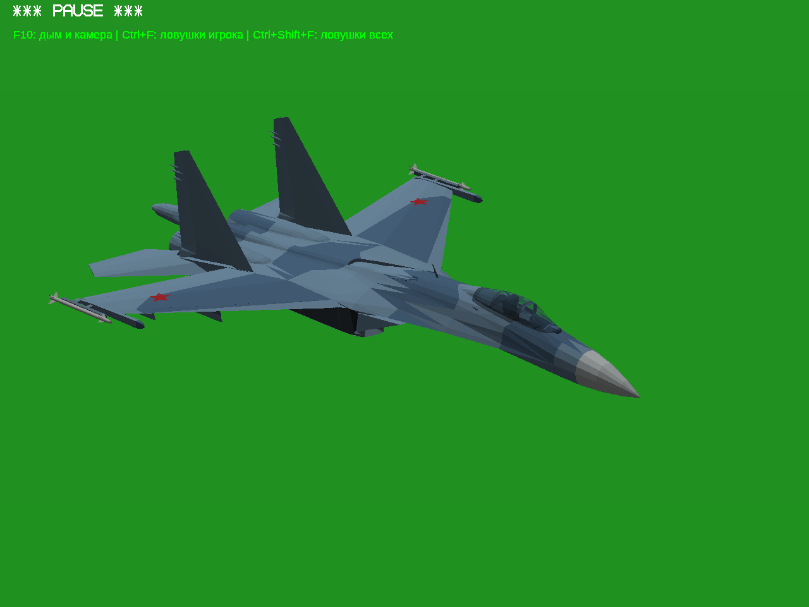
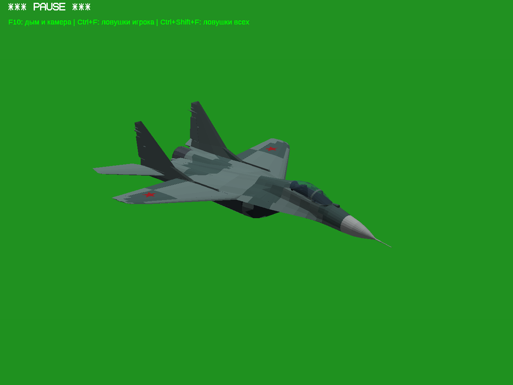
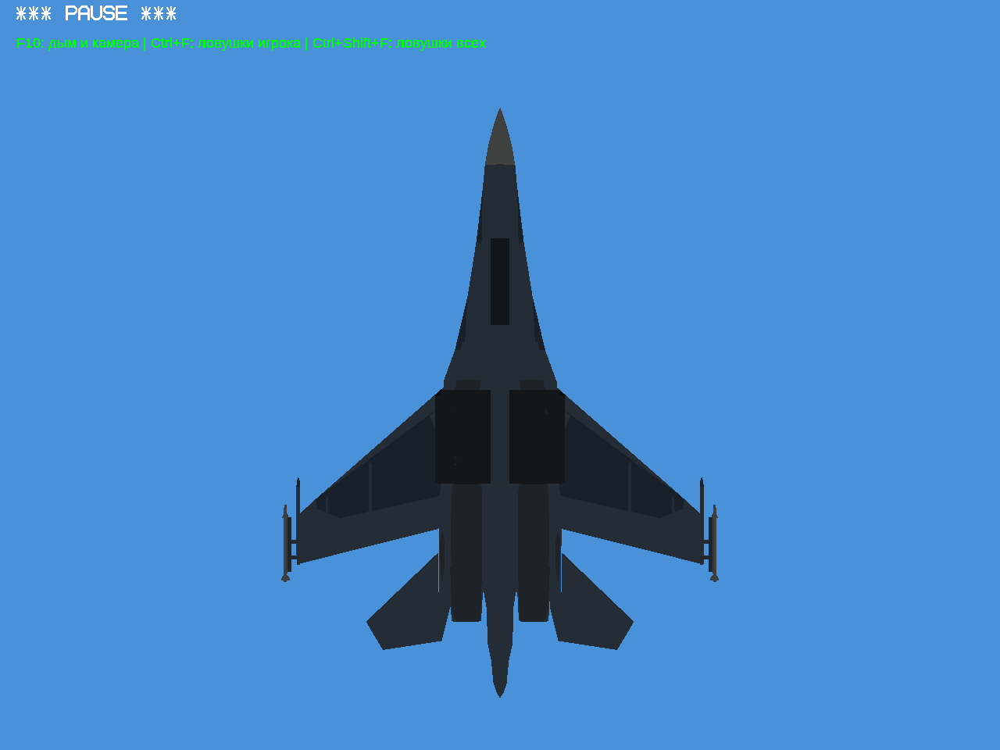
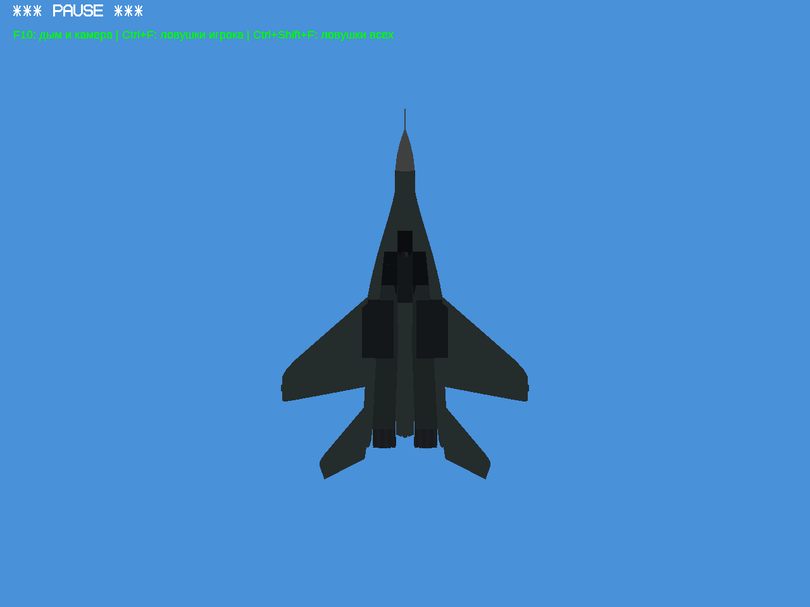

# Шасси внутри корпуса — тест №3

Убраны наружные «коробки» Су-27 и МиГ-29. Створки повторяют исходную
обшивку, колёса складываются внутрь корпуса с отдельным поворотом.
У Су-27 переделаны складывающиеся тяги и сжатие переднего амортизатора.
Су-47 и последняя ревизия Су-57 сохранены побайтно от теста исправлений №2.
Су-34 сюда не включён: его геометрия изучается отдельно, права не подтверждены.

[Полная игра — Windows 32-bit](https://raw.githubusercontent.com/i7885784-lang/igraYS-Flight-Simulator/ysflight-center-download/downloads/YSFlight_Internal_Gear_Test_3_32bit.zip) ·
[Все исходники](https://raw.githubusercontent.com/i7885784-lang/igraYS-Flight-Simulator/ysflight-center-download/downloads/YSFlight_Internal_Gear_Test_3_Sources.zip) ·
[Конвертер и авторы](../../changes/internal-gear-test-3/)

**Настоящие игровые кадры, Win64/Wine:**

| Су-27, убрано | МиГ-29, убрано |
|---|---|
|  |  |
|  |  |

**Видео живого выпуска и уборки клавишей G:**
[Су-27](https://raw.githubusercontent.com/i7885784-lang/igraYS-Flight-Simulator/ysflight-center-download/reports/internal-gear-test-3/su27-final-cycle/gear.mp4) ·
[МиГ-29](https://raw.githubusercontent.com/i7885784-lang/igraYS-Flight-Simulator/ysflight-center-download/reports/internal-gear-test-3/mig29-internal-cycle/gear.mp4).
Оба цикла: 0 → 1 → 0, промежуточные положения записаны; позы рендера не подменялись.

Проверено: один общий осмотр каждого самолёта сверху/спереди/сбоку/снизу и
четыре четвертных ракурса, цикл шасси у каждого, собранные детали относительно
исходного корпуса и 21 поза прохода через проёмы. Найденное пересечение тяги
Су-27 с крышей ниши устранено до итоговой записи.
[Живые проверки](final-live-checks.json) · [Исходная оболочка](source-skin-audit.json) ·
[Проход механизмов](sweep-audit.json) · [ZIP и сохранение самолётов](package-checks.json).

Ограничения: игровая кинематика, не заводской чертёж; геометрический аудит
оболочки использует сетку 25 мм с допуском 15 мм и не доказывает отсутствие
любых мелких пересечений. EXE Win32 унаследован без изменения от теста №2;
запуск и съёмка выполнены отдельным Win64 EXE под Wine. Настоящая Windows 10
x86 здесь не проверялась. ZIP распакован отдельно, CRC и состав проверены.
Старые архивы сохранены; указатель принятой основы не изменён.

SHA-256 игры: `ce7909c64596d705b8cc3e05715a7c84bebcdd27040f75f2a30b1215afc52b71`.
