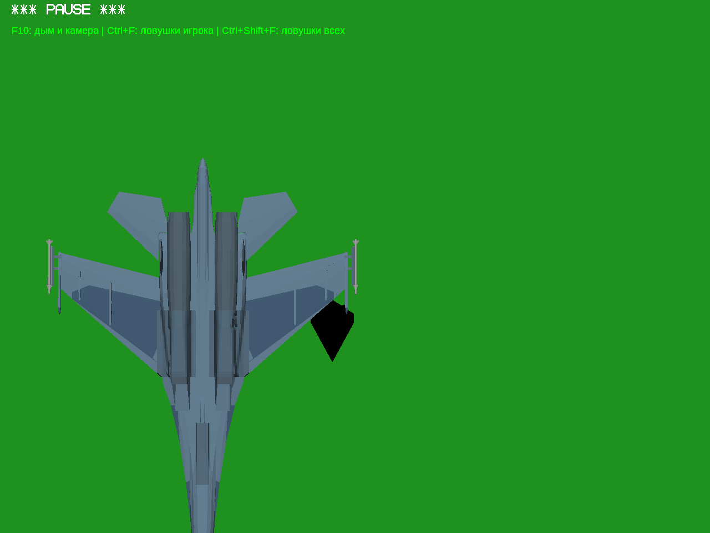
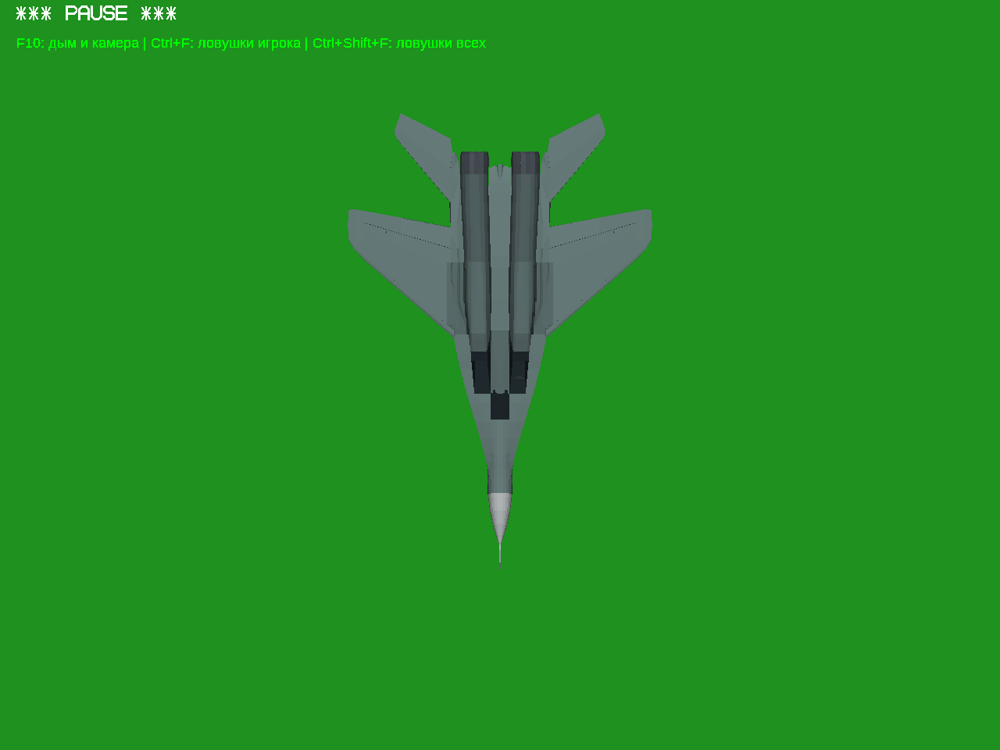

# Уточнение теста №3: освещение створок

У Су-27 и МиГ-29 исправлена ориентация наружных панелей ниш: снаружи теперь
видна внешняя окраска, внутри — тёмная внутренняя. Положение деталей и
движение шасси не менялись. Старые архивы сохранены.

[Полная игра Windows 32-bit](https://raw.githubusercontent.com/i7885784-lang/igraYS-Flight-Simulator/ysflight-center-download/downloads/YSFlight_Internal_Gear_Test_3a_32bit.zip) ·
[Все исходники](https://raw.githubusercontent.com/i7885784-lang/igraYS-Flight-Simulator/ysflight-center-download/downloads/YSFlight_Internal_Gear_Test_3a_Sources.zip) ·
[Механизмы и видео теста №3](../internal-gear-test-3/REPORT.md).

| Су-27, низ обращён к солнцу | МиГ-29, низ обращён к солнцу |
|---|---|
|  |  |

Проверено: один общий осмотр каждого самолёта и нижняя обшивка при перевороте;
[направление поверхностей и неизменность движения](lighting-checks.json),
[целостность архивов и сохранение остальных самолётов](package-checks.json).
Кадры реальные, Win64/Wine; настоящая Windows 10 x86 здесь не проверялась.
Су-34 в эту публичную сборку не включён.
