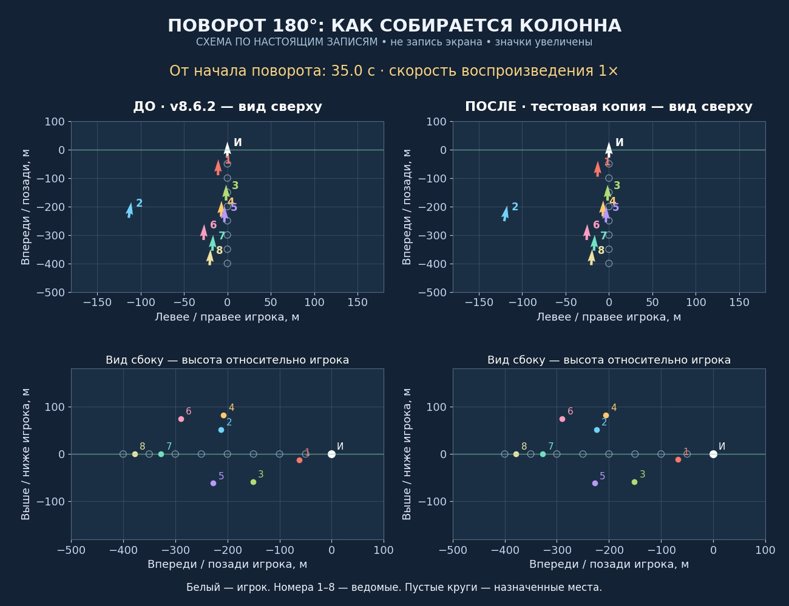
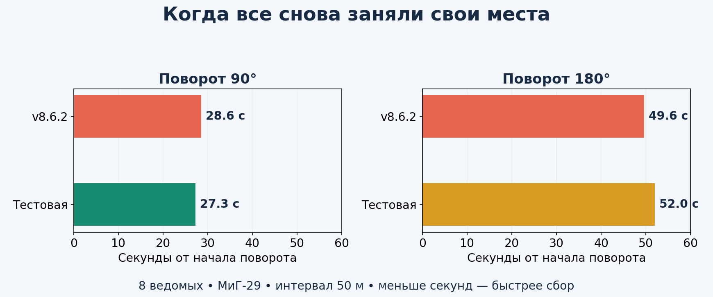
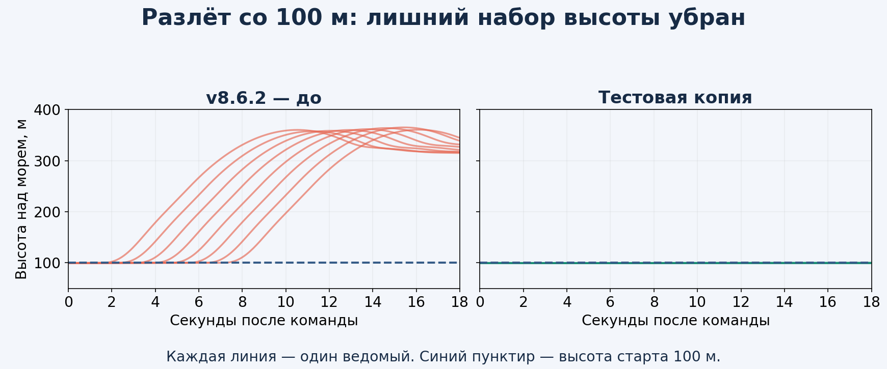
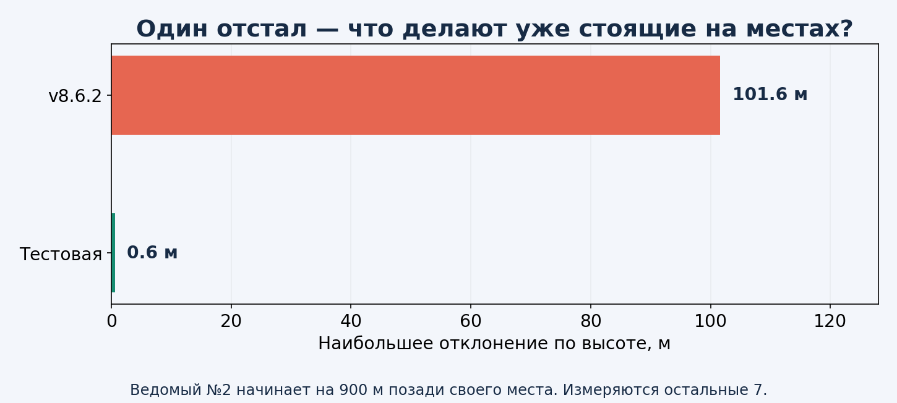
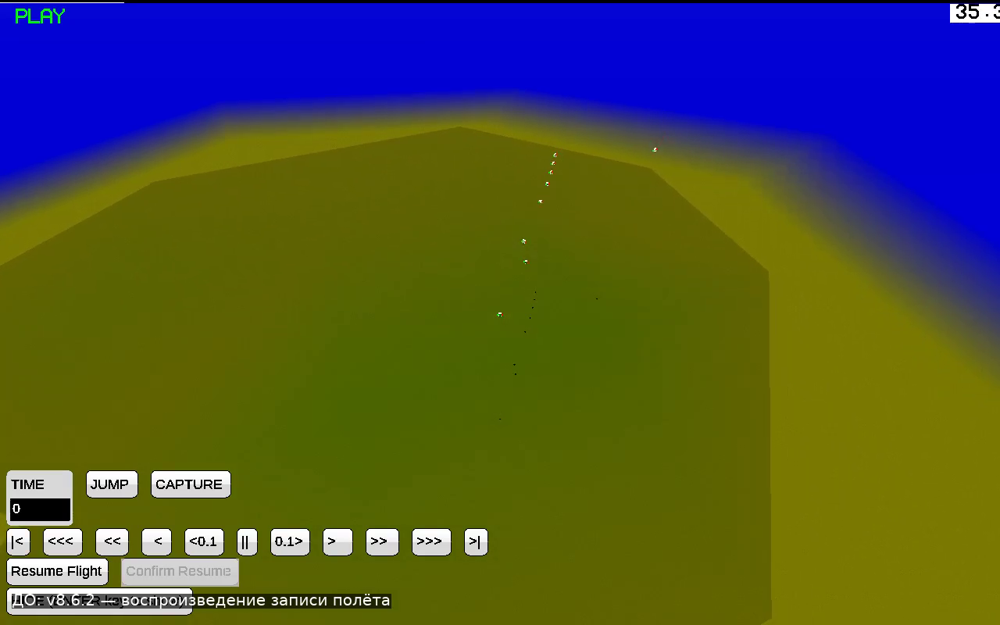
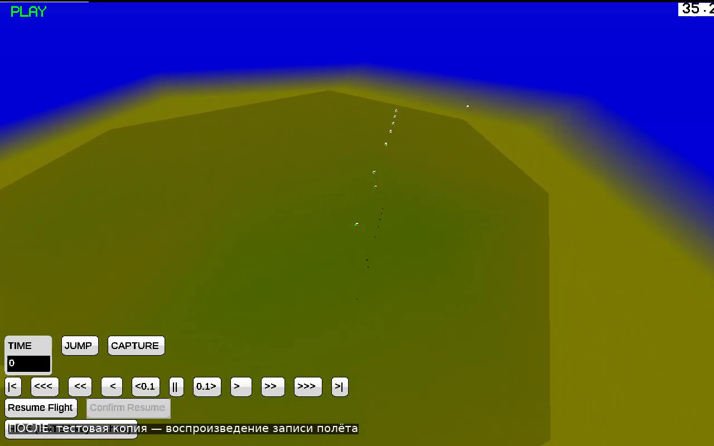
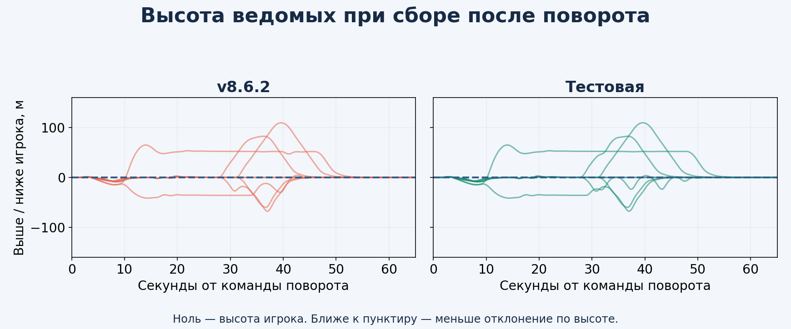

# Тестовая копия LAB863 — посмотри, как ведут себя ведомые

**Это отчёт о тестах. Новая игровая версия пока не выпущена. Твоя v8.6.2 сохранена.**

## Сначала видео

[Понятное сравнение с номерами ведомых — вид сверху и сбоку](clear-comparison.mp4). Это **схема по измерениям**, не запись экрана: игрок в центре, его курс направлен вверх, значки увеличены. Масштаб подстраивается одинаково в обеих панелях. Стрелки показывают фактическое направление самолётов.

Обычные игровые ролики:

- [Разлёт ДО — v8.6.2](before-scatter.mp4)
- [Разлёт ПОСЛЕ — тестовая копия](after-scatter.mp4)
- [Разворот ДО — настоящий полёт v8.6.2](before-flight.mp4)
- [Разворот ПОСЛЕ — тот же сценарий в тестовой копии](after-flight.mp4)

Это воспроизведение настоящих записей в самом YSFlight, не нарисованная анимация. Камера и начальные условия одинаковые. В начале несколько секунд паузы для настройки камеры. Самолёты не телепортируются: управление проходило через штатную физику игры. Если модели мелкие, открой видео на весь экран.

## Стало ли быстрее?

Здесь **полный сбор считается от начала поворота**, а не после его завершения. На 90°: **28.6 → 27.3 с**. На 180°: **49.6 → 52.0 с** — здесь тестовая копия пока медленнее. Главная задача ускорения сбора **ещё не решена**. Поэтому обновление игры для установки не выпускаю: сначала показываю результат тестов и видео.

## Разлёт больше не требует подъёма до 300 м

Раньше самолётам задавалась высота ухода не ниже 300 м над землёй. Из-за инерции они могли набрать ещё больше. Теперь ожидающие своей очереди держат свою линию и высоту; боковой уход начинается с текущей высоты. Защита от реальной угрозы столкновения и земли остаётся.

## Один догоняет, остальные держат места

В отдельном сценарии ведомый №2 начинает на 900 м позади своего места, остальные уже стоят в колонне. Уже занявший место самолёт не уступает заранее каждому догоняющему. При непосредственной опасности уклонение доступно обоим.

## Кадры из настоящей игры

До:

После:

## Что с уходами вверх после поворота

Догоняющему сохранено раннее предупреждение об опасном сближении. Уже стоящие на местах не начинают уступать ему заранее. Если путь свободен, ведомый может возвращаться к высоте строя ещё до полного выравнивания по горизонтали. Защитные манёвры не отключены: в сложных перестроениях уходы по высоте могут оставаться.

## Что проверено

- 37 полётов с поворотами: 1–8 ведомых, все 10 строёв с восемью ведомыми, 90°/180°, резкие смены курса, малая высота и F/A-18.
- 18 проверок прежних функций: прикрытие, потери, разлёт/сбор, уступление дороги, ESC и автопауза.
- 32 дополнительных полётов: очередность разлёта с 1–8 ведомыми в колонне и лесенке на 100/1000 м, одновременный разлёт в остальных строях, прикрытие для остальных количеств, ещё три проверки догоняющего самолёта с разными номерами.
- 6 проверок ровного старта и ещё 2 проверки окна/продолжения; 2 сравнительных полёта с отставшим ведомым.
- 1400 прежних проверок геометрии построений и переходов.

Все перечисленные наборы прошли. Минимальный записанный промежуток в серии поворотов — **21.0 м**. В тестах потерь один ведомый уничтожался намеренно: остальные должны были сохранить полёт и занять свободные места.

Проверки выполнены на стандартном интервале 50 м, главным образом на МиГ-29. Это не гарантия безопасности при любых моделях, интервалах и действиях игрока. Позиции сопоставлялись по синхронным записям примерно через 0,075 с; физика считалась с шагом 0,025 с. Полный сбор — все ближе 15 м к своим местам до конца записи не менее ещё двух секунд.

## Неудачный опыт тоже показан

[Видео: столкновение в отклонённом варианте](rejected-flight.mp4). Этот вариант не входит в выбранную тестовую копию. В нём позднее предупреждение привело к потере двух ведомых. После возвращения раннего уклонения догоняющего тот же сценарий прошёл без потерь.

## Что проверяла и отклонила

Более ранний разгон сам по себе ухудшил поворот на 90°. Отмена обязательного бокового обхода не дала устойчивого выигрыша. Следование по истории пройденной игроком дуги улучшило один поворот, но ухудшило 180°. Слишком позднее предупреждение об опасном сближении дало столкновение в проверке с отставшим ведомым. Оно тоже отклонено: догоняющему возвращено раннее уклонение. Эти варианты не включены в выбранную тестовую копию.

## Что осталось прежним

Исправление ровного старта, модели, карты, цвета дыма, лимит ведомых, управление и текущая рабочая игра. Программы для установки пока не выдаю. Тестовая Windows x64-сборка запускалась под Wine; новая сборка для настоящей Windows 10 x86 ещё не готовилась.

После твоего просмотра видео решим, устраивает ли поведение и что ещё менять перед следующей игровой версией.

Чтобы посмотреть всё локально, распакуй весь архив отчёта и открой **OPEN_REPORT.html**. Видеофайлы должны лежать рядом с ним.

[Исходники тестовой ветки](https://raw.githubusercontent.com/i7885784-lang/igraYS-Flight-Simulator/ysflight-center-download/downloads/Airshow_LAB863_Test_Sources.zip) · [Измерения и логи](https://raw.githubusercontent.com/i7885784-lang/igraYS-Flight-Simulator/ysflight-center-download/downloads/Airshow_LAB863_Measurements.zip) · [Контрольные суммы](https://raw.githubusercontent.com/i7885784-lang/igraYS-Flight-Simulator/ysflight-center-download/downloads/SHA256SUMS_LAB863.txt)
