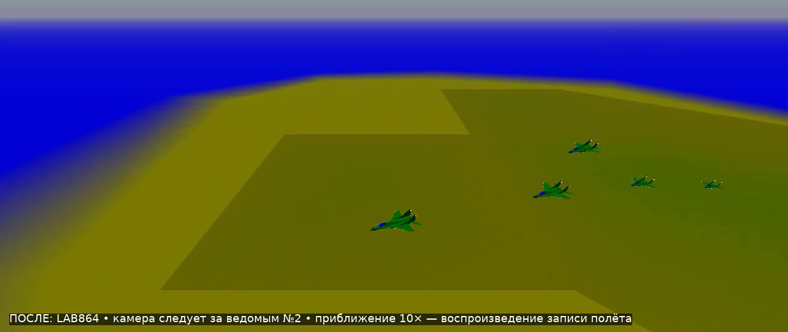
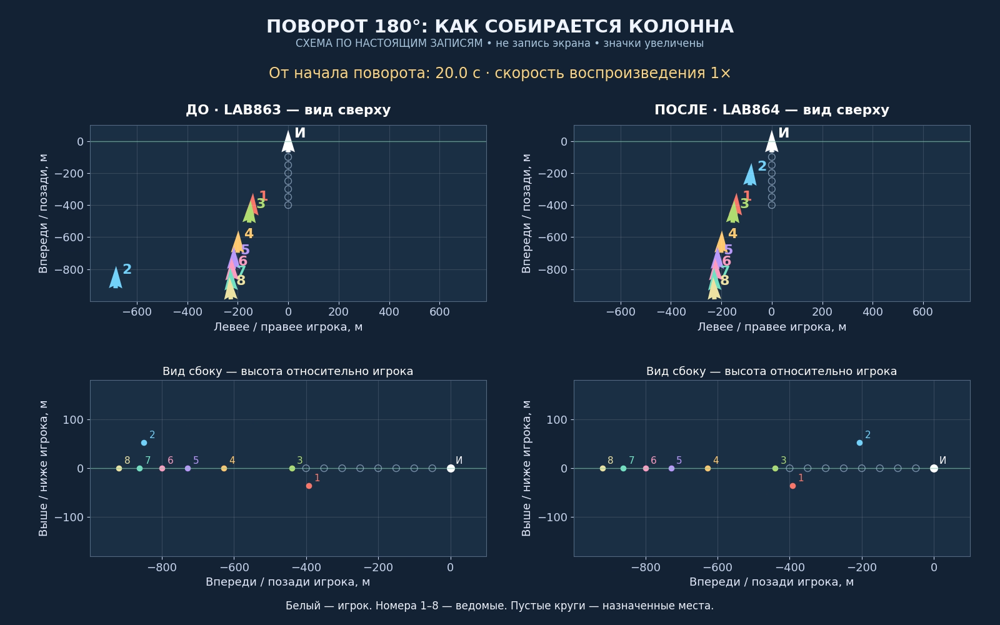
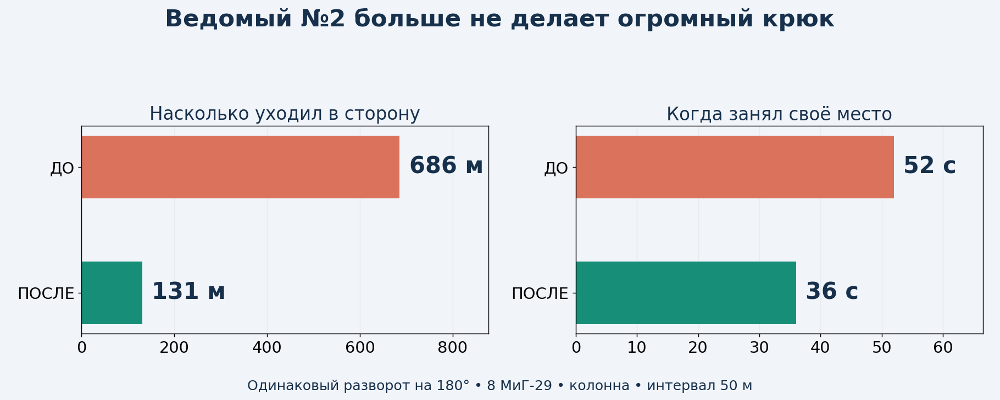
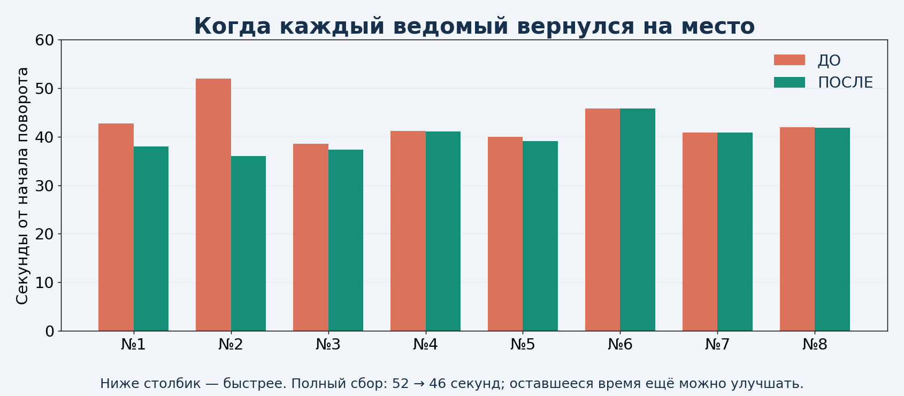

# LAB864 — исправление большого обхода после разворота

**Тестовая копия для просмотра. Рабочая v8.6.2 сохранена; это ещё не установочное обновление игры.**

## Видео: камера в десять раз ближе

- [ДО — ведомый №2 крупным планом](before-close.mp4)
- [ПОСЛЕ — тот же самолёт и тот же ракурс](after-close.mp4)
- [Весь строй с номерами: сравнение сверху и сбоку](clear-comparison.mp4)

Первые два ролика — настоящие записи полётов, воспроизведённые движком YSFlight. Камера следует за ведомым №2 с расстояния 90 м вместо прежних 900 м. Она показывает его крупнее; часть группы может выходить из кадра. Третий ролик — **схема по настоящим измерениям**, с увеличенными значками и номерами, а не запись экрана. Во всех сравнениях ДО — предыдущая LAB863, ПОСЛЕ — новая LAB864.

## Что изменилось

Ведомый №2 уходил вбок на **686 м**, теперь — на **131 м** в том же полёте. Это боковое смещение относительно курса игрока, а не общий пройденный путь. На своё место он вернулся за **36 с вместо 52 с**. Секунды считаются от начала разворота ведущего.

Причина: при активном защитном уходе по высоте код ограничивал крен истребителя до 45°. В таком режиме ведомый описывал слишком широкую дугу. Отдельный контрольный опыт с пределом 65° уменьшил задержку, но всё ещё оставлял большой обход. В выбранном варианте для узкой колонны этот особый предел поднят до штатных 75°. Если в группе есть боковые позиции, сохранён прежний запас для ухода по высоте; физические ограничения по подъёмной силе, скорости и перегрузке продолжают уменьшать разрешённый крен при необходимости. Самолёт не получает мгновенного разворота или новой физики.

**Защита от непосредственного сближения и земли сохранена.** При близком пересечении траекторий отдельное ограничение крена до 45°/60° всё ещё действует. Защитные высоты и проверка свободного коридора возвращения сохранены. Более ранний спуск при любом расстоянии был проверен отдельным опытом и отклонён: он ухудшал траекторию. Распространение предела 75° на все строи тоже отклонено: во «фронте пар» оно давало слишком близкое сближение, хотя потерь в тех полётах не было.

## Остальные ведомые

Полный сбор после 180°: **52.0 → 45.8 с**. После 90°: **27.3 → 27.3 с**. Исправление убрало конкретный большой обход; оно не делает сбор всей группы мгновенным. Некоторым ведомым ещё нужно больше времени для восстановления высоты.

## Как проверена защита от повторения ошибки

**94 проверочных полётов выбранного варианта прошли.** Сценарии включают 1–8 ведомых, повороты на 90°/180°, все 10 строёв с восемью ведомыми, повторные смены курса, малую высоту, F/A-18, разлёт и возврат, прикрытие, потери, паузу и отставший самолёт в разных местах колонны. Добавлены поворот в другую сторону, набор и снижение одновременно с разворотом.

- В этих сценариях не было неожиданных потерь. В тестах потерь самолёт повреждается намеренно.
- Проверена штатная геометрия построений: 1400 проверок.
- Добавлена отдельная автоматическая проверка именно обнаруженного дефекта: старое поведение она отклоняет, исправленное принимает. Она проверяет большой боковой уход и задержку ведомого №2, а не просто факт окончания полёта.
- Минимальный записанный промежуток в серии поворотов: **24.1 м**. Это измерение между центрами самолётов, не между концами крыльев.

В основных автоматических полётах физика считалась самой игрой с шагом 0,025 с, измерения записывались примерно через 0,075 с. Пауза и продолжение проверялись также в обычном цикле игры. Место считается занятым при ошибке меньше 15 м, сохраняющейся до конца записи не менее двух секунд. Проверки преимущественно выполнены на МиГ-29 с интервалом 50 м; они не доказывают отсутствие столкновений при любых возможных сочетаниях моделей, интервалов и действий игрока.

## Дополнительно исправлена перемотка записи

При подготовке видео обнаружен выход за конец списка событий при перемотке. Добавлена проверка границы: пустой список и момент после последнего события больше не вызывают такое чтение. Точная функция проверена на 45 сочетаниях событий и времени: прежний код отклонён, исправленный прошёл. После этой отдельной правки повторены три контрольных полёта: колонна, фронт пар и отставший ведомый. Основные 91 полёт выполнялись до правки перемотки; код управления ведомыми между этими сборками не менялся. Оба видео воспроизводятся сборкой с исправленной перемоткой.

## Что дальше

Посмотри приближённое видео ПОСЛЕ и сравнение с номерами. После твоей оценки можно собирать игровое обновление для Windows 10 **32 бит**, запускаемое двойным щелчком по EXE. Текущие проверки выполнялись на лабораторной 64-битной сборке под Wine; её нельзя выдавать за проверенный установочный выпуск для твоего компьютера.

Технические материалы для сохранения проекта: [исходники и сценарии проверок](https://raw.githubusercontent.com/i7885784-lang/igraYS-Flight-Simulator/ysflight-center-download/downloads/Airshow_LAB864_Test_Sources.zip), [подробные замеры и записи](https://raw.githubusercontent.com/i7885784-lang/igraYS-Flight-Simulator/ysflight-center-download/downloads/Airshow_LAB864_Measurements.zip). Это материалы разработки; для просмотра достаточно видео и картинок выше.

Технический отпечаток проверенного файла: `2470b26d5a07ca804ac51ddd7a191370386bf000b07944fef2b19e436b53f2af`. Итоги и замеры приложены в JSON; для просмотра они не нужны.
