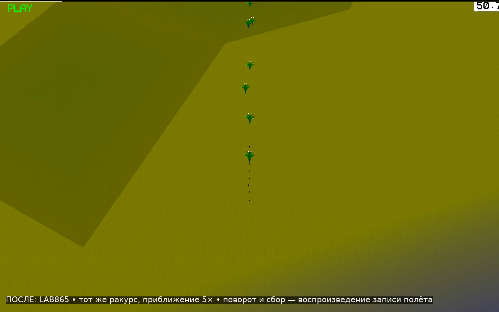
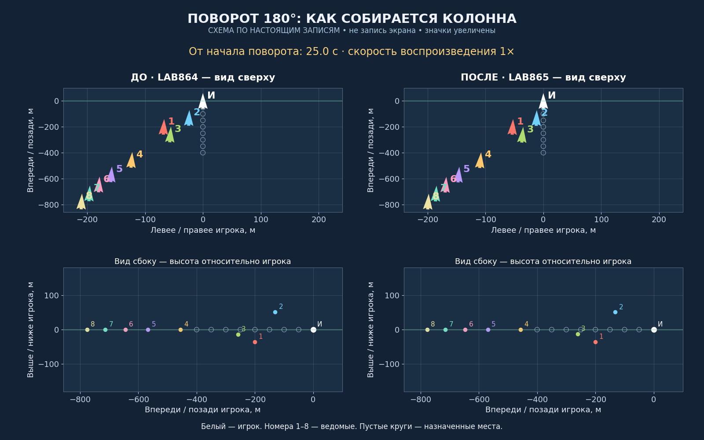
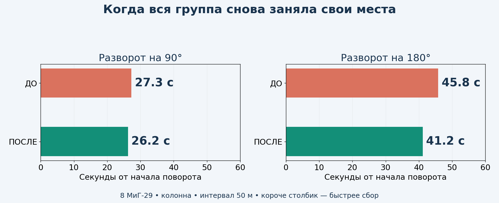
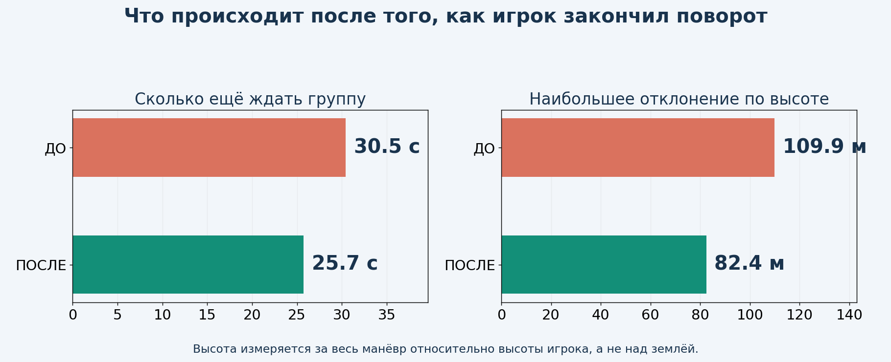
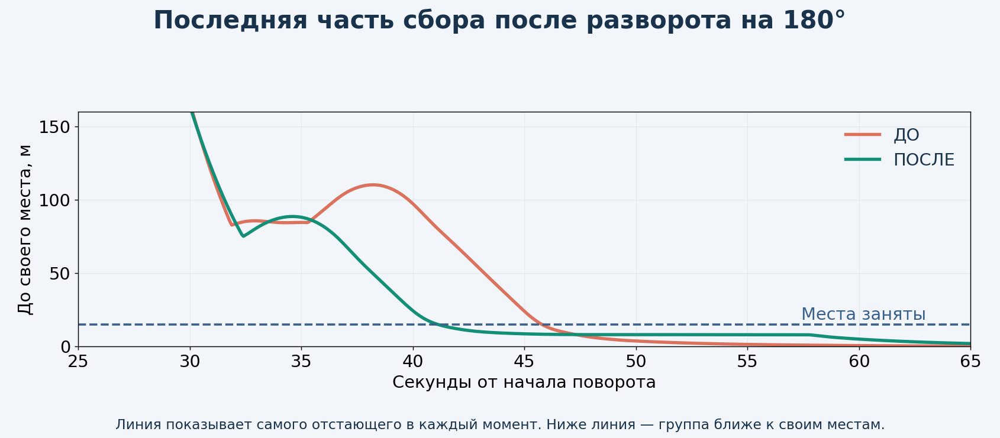
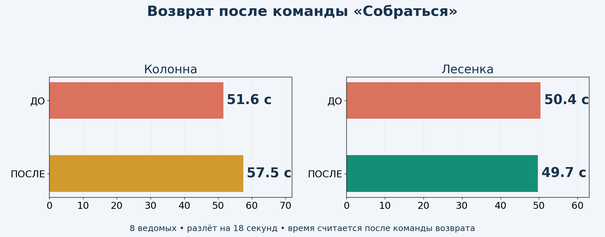

# LAB865 — быстрее возвращаться в строй

**Это проверенная тестовая копия для просмотра. Рабочая v8.6.2 сохранена. Установочное обновление пока не выпускается: скорость возврата после разлёта требует доработки.**

## Сначала видео

- [ПОСЛЕ: разворот и сбор группы](after-flight.mp4)
- [ДО: тот же сценарий и та же камера](before-flight.mp4)
- [Сравнение всего строя с номерами самолётов](clear-comparison.mp4)

В игровых роликах сохранён ракурс последнего общего видео и выполнено твоё пожелание: **камера приближена в 5 раз — 1100 → 220 м**. У сильно растянувшейся группы часть самолётов может выходить из кадра. Видео с номерами показывает всю группу: это схема по настоящим записям, а не запись экрана. Игровые ролики воспроизводят те же реальные полёты в YSFlight.

## Быстрее ли стало?

После 180°: **45.8 → 41.2 с**. После 90°: **27.3 → 26.2 с** — здесь улучшение небольшое. Счёт начинается с начала поворота игрока и включает сам разворот.

Игрок закончил разворот на 180° — ждать полного сбора осталось **30.5 → 25.7 с**. Максимальное отклонение по высоте в том же полёте: **110 → 82 м**.

## Возврат после «Разлёта»

Колонна в основном сравнительном полёте: **51.6 → 57.5 с**. Лесенка: **50.4 → 49.7 с**. Эти цифры считаются после команды возврата. Здесь итоговый выигрыш нужно оценивать отдельно от разворота: новая логика не гарантирует ускорения каждого вида сбора.

Повторное сравнение возврата колонны — по три полёта на каждой копии: ДО **51.5–51.6 с**, ПОСЛЕ **51.7–57.8 с**. Все отдельные результаты приложены в замерах. Это проверка устойчивости времени, а не выбор одного удачного полёта.

## Что сделано

1. **Энергичнее догонять.** Вдали от места ведомый сохраняет энергию для перехвата. После сближения и снижения относительной скорости переходит к точному входу; после обычного манёвра быстрее запрашивает скорость для восстановления позиции. Разгон выполняют штатные двигатели самолёта.
2. **Заранее тормозить.** Скорость сближения ограничивается с учётом расстояния до движущегося места, текущего сближения и оценки доступного торможения. Проверка записала применение обычного газа и воздушного тормоза самой игры.
3. **Быстрее завершать сбор.** Когда самолёт уже рядом, выровнял высоту и снизил относительную скорость, включается более быстрое занятие последних метров. Во время быстрого пересечения траекторий это усиление не применяется.
4. **Возвращать высоту по свободному пути.** Добавлен досрочный выход с защитной высоты при свободном прогнозируемом коридоре и выровненных самолётах. Рядом с группой сохраняется проверка прохода между соседями. Курс и высота корректируются одновременно там, где это допускает проверка.
5. **Сохранять занятые места.** Уже собравшиеся самолёты продолжают удерживать строй. Уклонение включается при прогнозируемом опасном сближении; раннее торможение уменьшает потребность в дополнительных защитных уходах.

Движения выполняются через штатную физику YSFlight. Защита от земли, ограничения самолёта и предотвращение столкновений сохранены.

## Что проверено

**В итоговой серии не было неожиданных потерь самолётов. Всего запусков: 104.** 1–8 ведомых в колонне, все 10 строёв с восемью ведомыми, повороты на 90°/180°, резкие смены курса, малая высота, МиГ-29 и F/A-18, прикрытие, потери, разлёт/сбор и отставшие самолёты. Дополнительно: разгон и торможение ведущего, изменение скорости прямо во время сбора, смешанная группа МиГ-29/F/A-18, полёт в обычном времени, запись работы газа/тормоза и сохранение/загрузка нового режима перехвата. Ещё два контрольных полёта выполнены на прежней LAB864 для повторного сравнения. Также прошли 1400 проверок геометрии построений.

При проверках потерь один ведомый намеренно уничтожается. Минимальное измеренное расстояние в серии поворотов — **24.1 м между центрами самолётов**.

## Какие опыты не вошли

Слишком резкие настройки дали сближение до 17 м. Другой опыт разрешал раньше снижаться, но не учитывал достаточно надёжно дальнейшие манёвры соседей: четыре сценария не прошли порог безопасной дистанции. Они отклонены. Исправленный коридор прошёл эти сценарии повторно. Ещё один опыт замедлил возврат колонны после разлёта примерно на 10 секунд. Разделение дальнего перехвата и точного входа помогло в короткой проверке, но полная серия показала, что ускорение возврата после разлёта пока неустойчиво. Это остаётся незавершённой частью задачи. Поэтому предварительный результат с отклонением по высоте около 53 м не относится к выбранной копии.

## Что ещё не закончено

Возврат после разлёта не даёт устойчивого ускорения во всех проверках. В обычном полёте у одного ведомого сохранилось около 8 м ошибки позиции; точный вход в последние метры также нужно дорабатывать. Эти результаты относятся к тестовой копии, поэтому установочный выпуск не подготовлен.

## Как читать результаты

«Место занято»: все ведомые ближе 15 м к своим назначенным местам, и это сохраняется до конца записи минимум две секунды. Основные сравнительные полёты: 8 МиГ-29, колонна, 50 м между местами, высота 1000 м. Это улучшение ещё не делает сбор мгновенным; после тяжёлых манёвров ожидание остаётся.

Основные автоматические полёты считаются самой игрой с шагом 0,025 с; измерения примерно через 0,075 с. Отдельно проверен обычный цикл игры. Тесты выполнены на лабораторной 64-битной сборке под Wine. Windows 10 x86 требует отдельной будущей сборки и проверки запуска. Испытания не гарантируют отсутствие столкновений при любых моделях, интервалах и действиях игрока.

[Сохранить исходники и проверки](https://raw.githubusercontent.com/i7885784-lang/igraYS-Flight-Simulator/ysflight-center-download/downloads/Airshow_LAB865_Test_Sources.zip) · [Подробные замеры и записи](https://raw.githubusercontent.com/i7885784-lang/igraYS-Flight-Simulator/ysflight-center-download/downloads/Airshow_LAB865_Measurements.zip)
