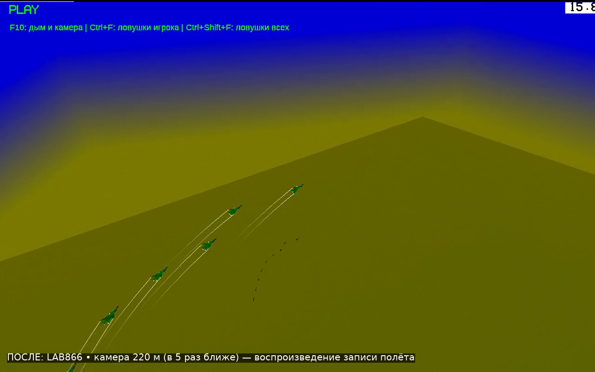
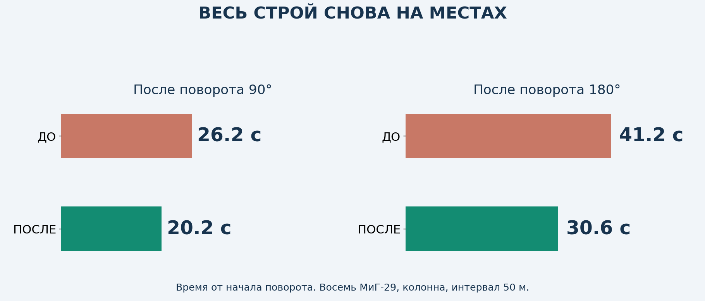
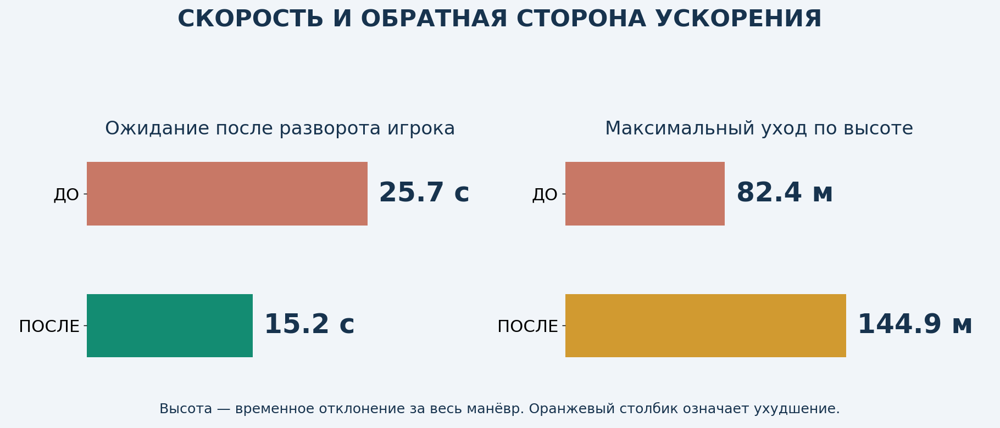
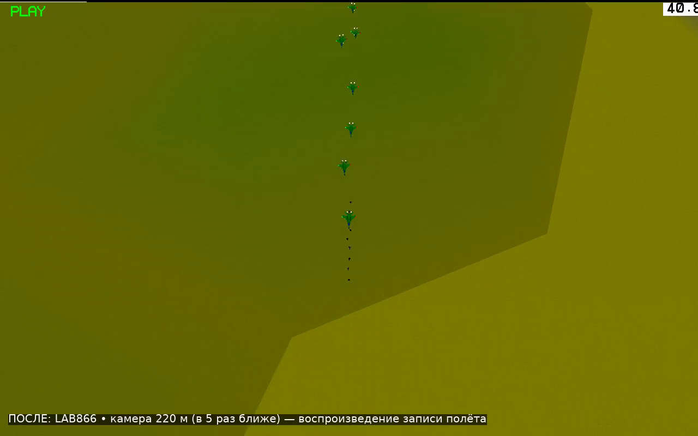
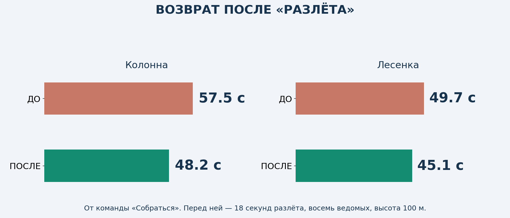
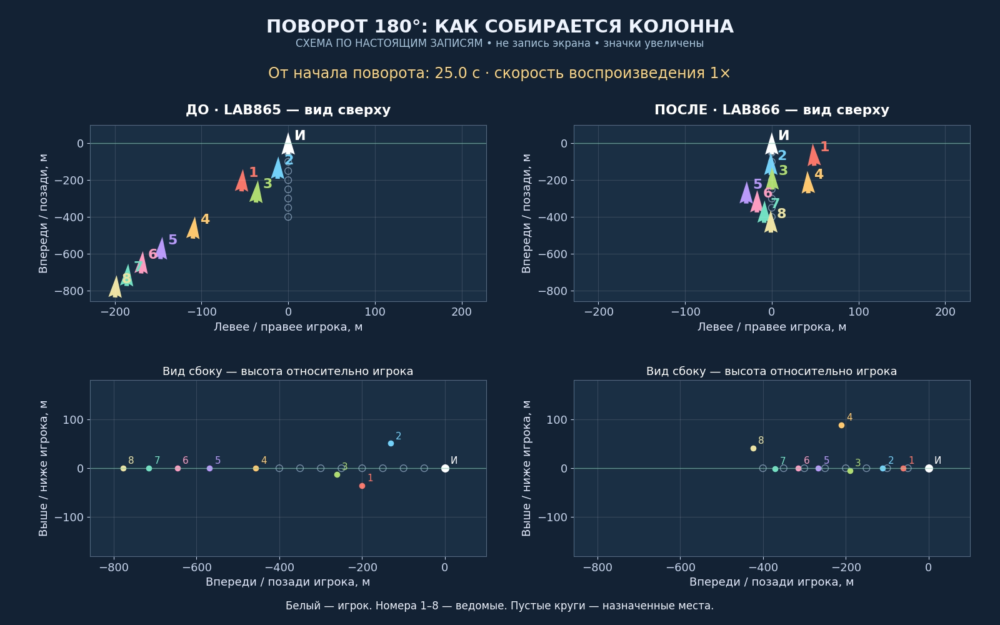
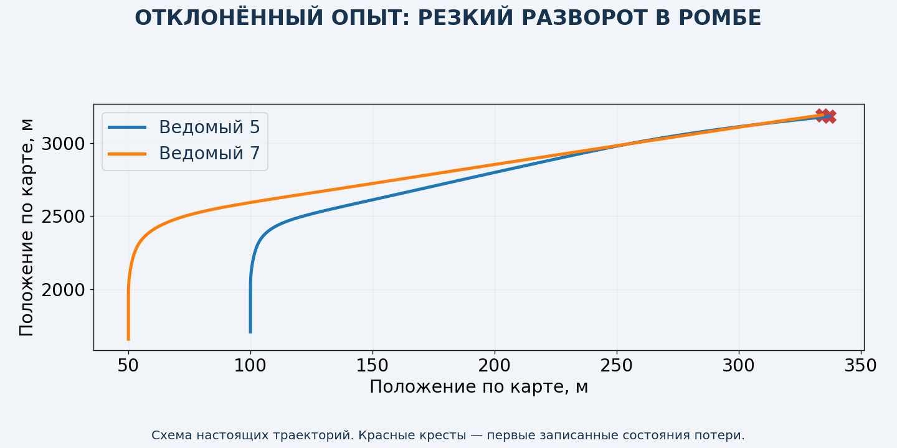

# LAB866 — энергичнее собираться в строй

**Тестовая копия для оценки. Рабочая игра v8.6.2 не изменена. Это отчёт с видео, а не установочное обновление.**

[▶ ПОСЛЕ — настоящий полёт в игре](after-flight.mp4) · [▶ ДО — прежняя LAB865](before-flight.mp4) · [▶ Вся группа с номерами](clear-comparison.mp4)

Камера одинаковая: тот же ракурс, **220 м — в пять раз ближе прежнего общего видео**. Часть растянутого строя может выходить из кадра. Ролик с номерами — отдельная схема по настоящим записям; он показывает всех самолётов. Игровые ролики воспроизводят записи полётов, выполненных на соответствующих сборках.

## Главное: стало ли быстрее?

После поворота 90°: **26.2 → 20.2 с**. После 180°: **41.2 → 30.6 с**. Время включает сам поворот игрока.

Когда игрок закончил разворот 180°, ждать группу осталось **25.7 → 15.2 с**. Но максимальный временный уход по высоте в этом опыте **82 → 145 м** — это недостаток выбранной настройки, который ещё нужно уменьшать.

**Повторы:** по три сравнительных полёта на каждой копии. Разворот 180°: ДО 41.1–41.2 с; ПОСЛЕ 30.6–30.8 с. Разлёт/сбор колонны: ДО 51.6–57.8 с; ПОСЛЕ 47.2–48.2 с. Отдельные замеры приложены — результат не выбран из одного самого удачного повтора.

## За счёт чего быстрее

- **Теснее разворот в колонне:** у истребителей разрешена команда до 80° крена вместо 75°, до 7 g вместо общего ограничения 5 g. Реально доступная подъёмная сила и ограничение угла атаки продолжают ограничивать манёвр. Защита от земли сохраняет прежний запас.
- **Дальний возврат сбоку:** ведомый проходит рядом с занятой колонной и смещается внутрь ближе к своему месту. Для этого временный боковой коридор расширен с 40 до 85 м; заданный интервал строя остаётся прежним. Режим перехвата сохраняется до сближения менее 35 м. Широкие строи сохраняют прежний заход.
- **Последние метры без остановки:** исправлена зона около восьми метров, где бот мог перестать догонять своё место. Небольшое доведение включается только при малой относительной скорости и выровненной высоте.
- Газ и воздушный тормоз по-прежнему применяет сама физика YSFlight. Их работа записана в контрольном полёте. Телепортации самолётов нет.

**Ограничение:** усиленный крен действует только для узкой колонны, включая строи с вертикальным смещением. Для широких построений сохранены прежние пределы; их такое ускорение пока не касается. Простое усиление скорости и резкости для всех строёв оказалось неудачным.

## Что не прошло проверку

Первый общий вариант ускорения вызвал реальные потери в ромбе и во фронте пар; ещё один поворот фронта пар дал опасное сближение. **Он отклонён.** Итоговая копия ограничивает усиление геометрией строя; эти сценарии проверены заново. Исправлен также отчёт тестировщика: обрыв записи погибшего самолёта теперь отмечается как потеря, а не скрывается за пустой ошибкой сравнения записей.

## Проверки итоговой копии

**Итоговая серия: 109 полётов. Дополнительно — 5 контрольных полётов на прежней LAB865 (четыре сравнительных и один для проверки исходной сцены).** Все итоговые серии прошли установленные проверки. Повороты с 1–8 ведомыми; десять построений; МиГ-29/F/A-18; малая высота; повторные смены курса; разлёт/сбор; прикрытие; намеренная потеря ведомого; отставшие самолёты; изменение скорости; обычный цикл игры и работа газа/тормоза. Дополнительный возврат над чистой водой проверен на абсолютных высотах 10, 40 и 200 м. Первые низкие пробы попадали в авианосец в начале карты; такую же потерю до команды подтвердили на прежней сборке. Эти некорректные старты сохранены отдельно, затем начальная точка теста перенесена на 20 км над чистую воду без изменения кода игры. Минимальный измеренный интервал в серии поворотов — **23.3 м между центрами**. Потери в специальных проверках наносятся намеренно и оцениваются отдельно.

«Строй собран»: все ведомые ближе 15 м к своим местам и остаются там до конца записи минимум две секунды. Основной опыт: восемь МиГ-29, колонна, интервал 50 м, высота 1000 м. После разлёта — высота 100 м. Основные тесты выполняются самой игрой с шагом 0,025 с, отдельно проверен полёт в обычном времени. Самолёт игрока в сравнительных тестах выполняет манёвр штатным автопилотом: так можно сравнить одинаковое задание. Между командами тестового сценария тоже проходит немного игрового времени, поэтому показаны повторы.

Лабораторная сборка 64-битная, проверена под Wine. Запуск будущего выпуска на Windows 10 x86 требует отдельной проверки; новый установочный ZIP пока не выдаётся. Проверенные сценарии не гарантируют отсутствия столкновений при любых интервалах, самолётах и действиях игрока.

[Исходники и тесты](https://raw.githubusercontent.com/i7885784-lang/igraYS-Flight-Simulator/ysflight-center-download/downloads/Airshow_LAB866_Test_Sources.zip) · [Подробные замеры и записи](https://raw.githubusercontent.com/i7885784-lang/igraYS-Flight-Simulator/ysflight-center-download/downloads/Airshow_LAB866_Measurements.zip)
