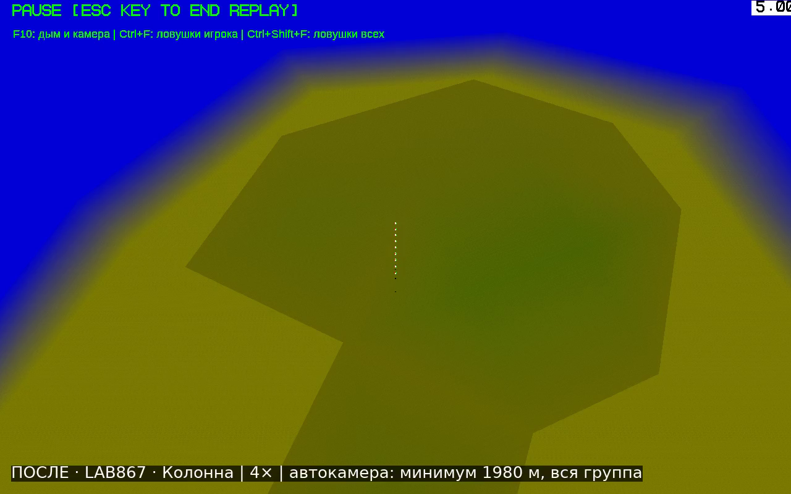
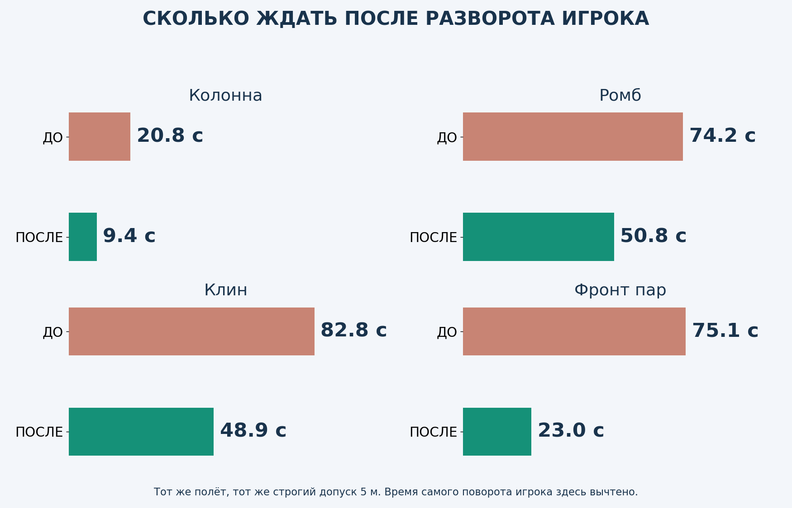
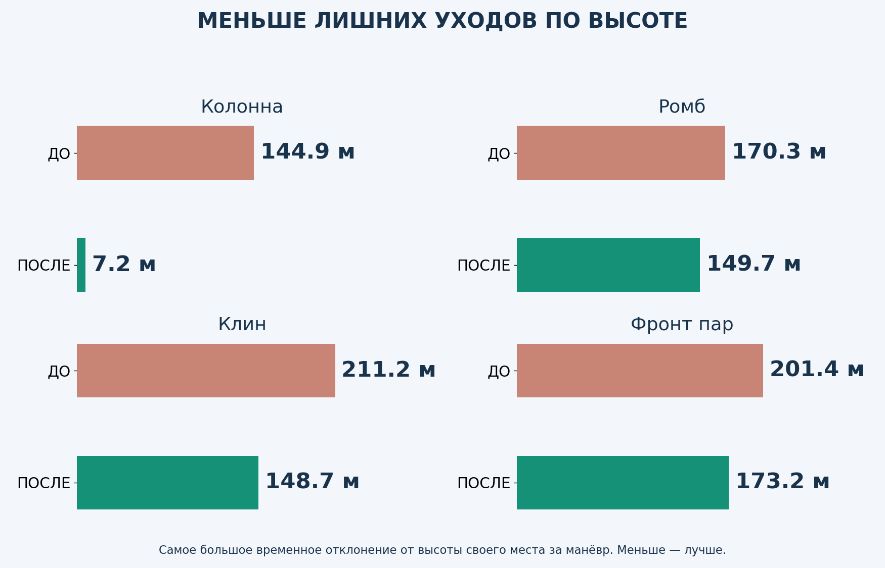
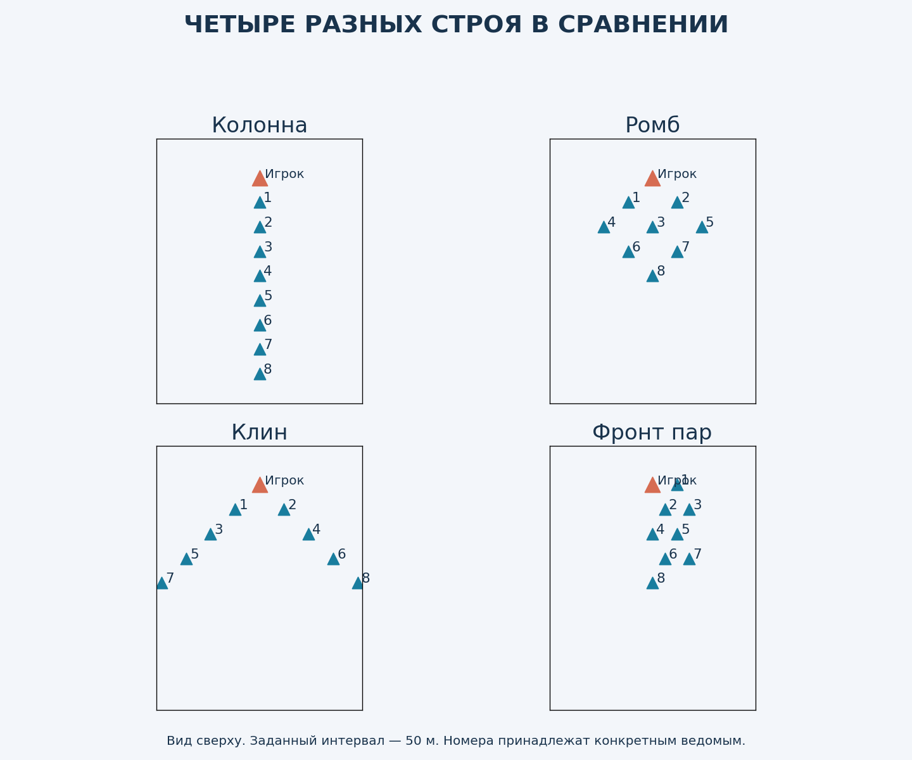
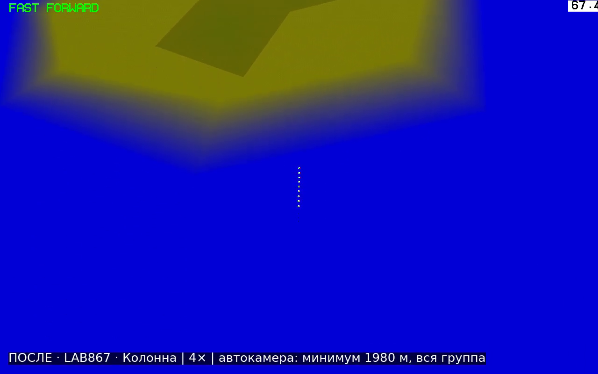
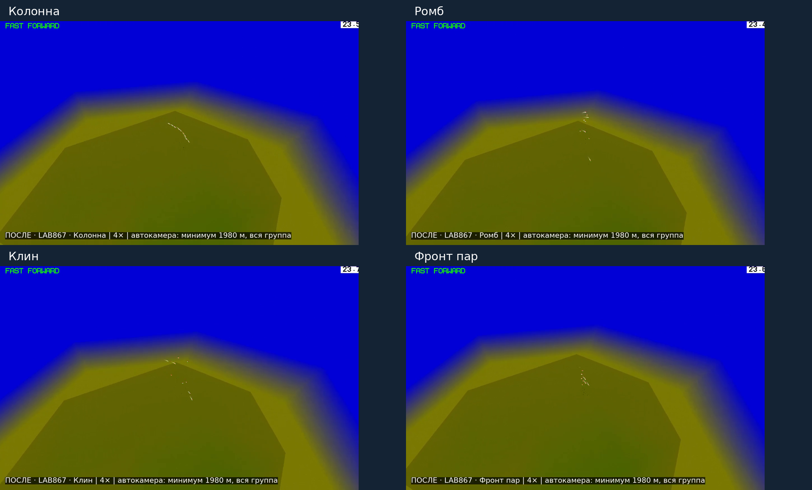
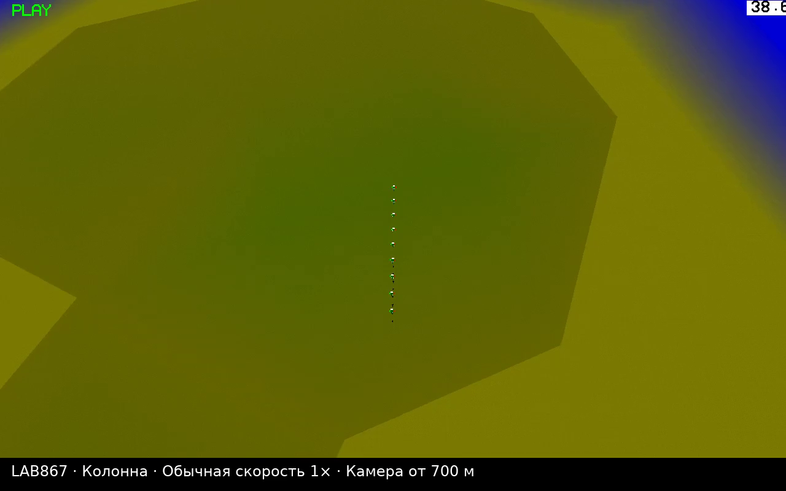
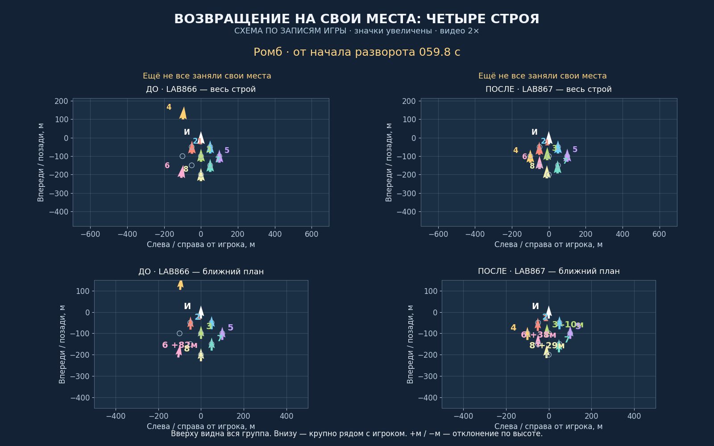
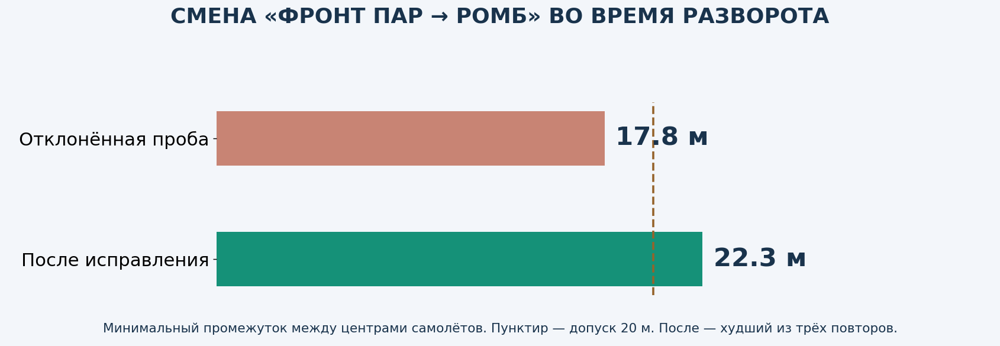

# LAB867 — быстрее занимать свои места

**Тестовая версия для просмотра. Рабочая v8.6.2 и предыдущая LAB866 сохранены. Установочного обновления здесь нет.**

[▶ ПОСЛЕ: четыре строя, общий вид](after-flight.mp4) · [▶ ДО: LAB866, те же задания](before-flight.mp4)  
[▶ Схема с крупными номерами](clear-comparison.mp4) · [▶ Колонна в обычном времени, ближе](detail-column.mp4)

## Насколько быстрее?

Здесь измеряется именно **занятие своих мест**, а не только завершение поворота: **все восемь ведомых ближе 5 метров к назначенным позициям** и остаются там до конца записи, минимум две секунды. Отсчёт начинается с поворота игрока. Раньше в отчётах использовался более мягкий допуск 15 м; здесь обе версии пересчитаны с одинаковым допуском 5 м.

**Не каждый манёвр ускорился заметно:** колонна после поворота 90° с прежним допуском 15 м: **20.2 → 20.0 с**. Здесь изменение небольшое. Обещать одинаковое ускорение любых манёвров нельзя.

После «Разлёта» колонна точно заняла места за **55.3 → 42.8 с** от команды «Собраться». Перед этим — 18 секунд разлёта, высота 100 м.

## Теперь видно разные строи

В старом LAB866 строй №11 ошибочно подписали «Фронт пар». Правильное название №11 — **обратный клин**, а фронт пар — **№10**. В этом сравнении используются правильные названия и реальные позиции.

Общие игровые ролики идут **4×**, ракурс одинаковый. Оба сняты одним проигрывателем: «до» воспроизводит запись полёта LAB866, «после» — запись LAB867. Минимальная дистанция камеры — **1980 м, в девять раз дальше прежних 220 м**. Камера дополнительно отдаляется и смещает центр, чтобы вместить всю группу. Для прямого сравнения расстояний используй схему: там у обеих версий общий масштаб. Если строй растянут на километры, самолёты становятся мелкими — для этого рядом есть схема с увеличенными значками и номерами.

Отдельный близкий ролик колонны идёт **1×**, без ускорения. Схема ниже идёт **2×** и построена по настоящим записям координат: это схема, не съёмка игрового экрана. Верхние окна показывают всех, нижние — увеличенный участок возле игрока.

## Что изменено

- **Колонна и фронт пар:** согласованы крен и подъёмная сила. Самолёт одновременно поворачивает и исправляет высоту, вместо лишнего выравнивания между этими действиями.
- **Ромб и клин:** отдельные настройки. Широкому строю нужен другой запас на развороте; для клина энергичное доведение включается постепенно, когда направление уже подходит.
- **Прибытие по высоте:** торможение начинается заранее, чтобы самолёт не пролетал выше своего места и не возвращался второй раз.
- **Смена строя в полёте:** сохранены данные текущего манёвра. Новая назначенная точка перемещается плавно в течение перехода. Сам самолёт не переносится и не ждёт, пока соберётся сосед.

Физика, ограничение угла атаки, доступная тяга, предотвращение опасного сближения и защита от земли сохранены. Изменения сопровождения предназначены для истребителей; гражданская авиация и вертолёты не переведены на этот режим.

## Проверки без сложных таблиц

**147 полётных проверок новой сборки**, плюс **10 свежих сравнительных полётов сохранённой LAB866**. Все предусмотренные проверки пройдены. Отдельно: 1400 проверок геометрии.

Проверены 1–8 ведомых, повороты 90° и 180°, разные строи, смена курса без паузы, набор и снижение, разлёт и сбор, прикрытие, уступление игроку, намеренные потери, отставший ведомый, скорость и торможение, МиГ-29 и F-18, смешанная группа, сохранение состояния и пауза. Есть полёт в обычном времени; основная автоматизация использует штатную физику с шагом 0,025 с. Интервалы измерены по сохранённым координатам примерно раз в 0,075 с; это не непрерывная математическая гарантия.

При первой проверке перехода «фронт пар → ромб» все выжили, но сблизились до **17,8 м между центрами**, ниже нашего допуска 20 м. Этот вариант отклонён. После исправления переход проверен заново и повторён три раза; минимальный интервал в повторах **22.3 м**. Это не гарантия для любых самолётов и любых интервалов.

На старте с абсолютной высотой 10 м штатный автопилот ведущего сам начинает спасательный набор — то же наблюдается в неизменённой LAB866. Поэтому там проверены безопасность всей фазы и последующий сбор после явного вывода ведущего на 100 м. На 40 и 200 м — возврат к исходной высоте. Неправильные и неудачные пробы сохранены отдельно.

**По три замера точного сбора после 180°**, включая основной полёт:

- Колонна: 36.2–36.2 с → 24.9–24.9 с.
- Ромб: 89.6–93.2 с → 66.2–66.3 с.
- Клин: 98.1–98.2 с → 64.3–65.6 с.
- Фронт пар: 87.5–90.5 с → 38.2–39.1 с.

Сравнительные задания задаёт штатный автопилот ведущего: восемь МиГ-29, карта OCEAN, 180 м/с, интервал 50 м, высота 1000 м. Числа относятся к этим условиям. Проверено под Wine на лабораторной 64-битной сборке; запуск будущего выпуска на твоей Windows 10 x86 ещё предстоит проверить отдельно.

[Скачать отчёт со всеми видео](https://raw.githubusercontent.com/i7885784-lang/igraYS-Flight-Simulator/ysflight-center-download/downloads/Airshow_LAB867_Report_and_Video.zip) · [Исходники и сохранённая LAB866](https://raw.githubusercontent.com/i7885784-lang/igraYS-Flight-Simulator/ysflight-center-download/downloads/Airshow_LAB867_Test_Sources.zip) · [Замеры и записи](https://raw.githubusercontent.com/i7885784-lang/igraYS-Flight-Simulator/ysflight-center-download/downloads/Airshow_LAB867_Measurements.zip)
