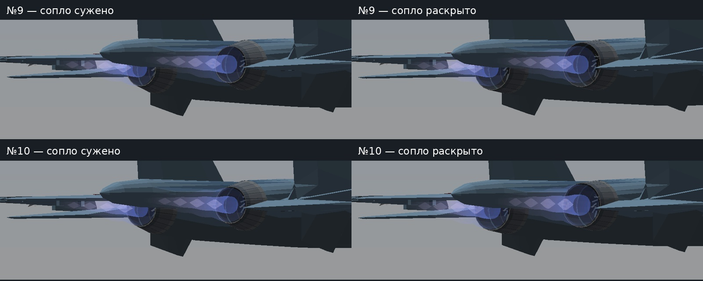
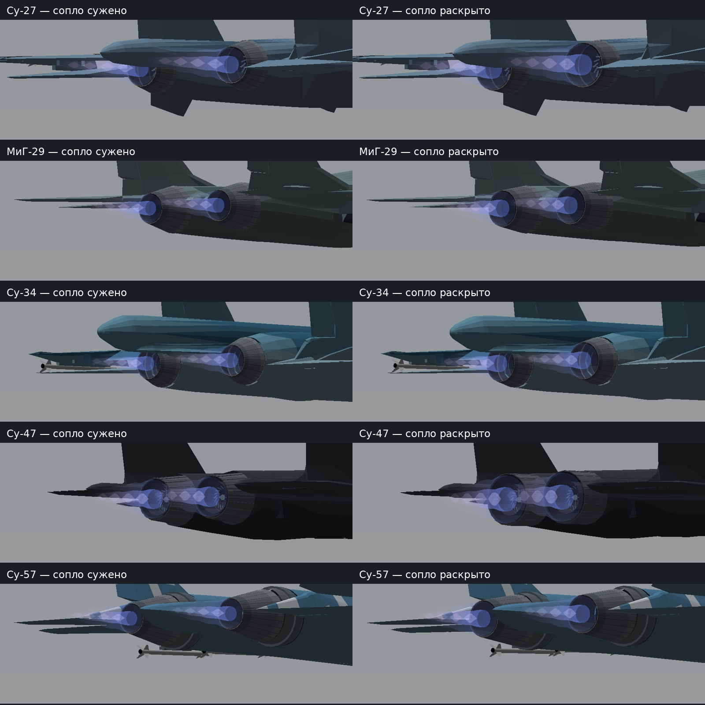
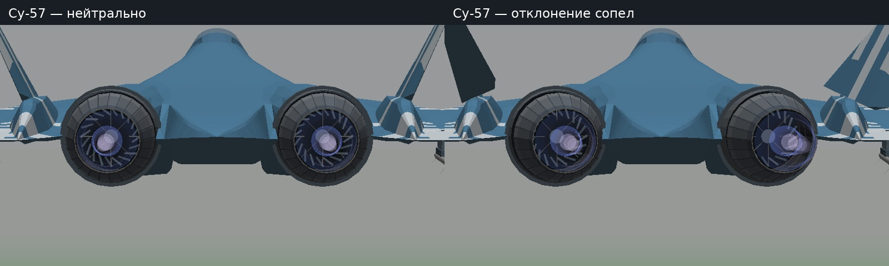

# Личный тест №10 — струя следует за соплом

**[Скачать всё одним ZIP — игра, PDF, фотографии и видео, 39 МБ](https://github.com/i7885784-lang/igraYS-Flight-Simulator/releases/download/untagged-82304e90ed8acb5e8e10/YSFlight_Test_10_All_In_One.zip).** Для скачивания нужен вход в GitHub владельца: сборка остаётся в закрытом черновике.

Распакуйте архив. На телефоне откройте `REPORT.pdf`, фотографии из `Photos` и видео из `Video`. На компьютере запустите `Play.bat` или `Game/ysflight32_gl1.exe`. Материалы работают без интернета и без страницы GitHub.

[Полные исходники, отдельный ZIP](https://github.com/i7885784-lang/igraYS-Flight-Simulator/releases/download/untagged-82304e90ed8acb5e8e10/YSFlight_Personal_Test_10_Sources.zip). [Хеши и проверки скачивания](DOWNLOADED.json).

Исправлена ширина и точка начала струи обоих двигателей на Су-27, МиГ-29, Су-34, Су-47 и Су-57. У Су-57 сохраняется отклонение вместе с соплом. Остальные поверхности и все узлы анимации сохранены из №9.

[Двухстраничный PDF](mobile/REPORT.pdf) · [отчёт HTML](mobile/OPEN_REPORT.html) · [видео, 48 с](mobile/Video/Nozzle_Coupling.mp4) · [результаты проверок](mobile/CHECKS.json).

Сверху №9, снизу №10; настройки камеры и обрезка одинаковые:

Все пять самолётов, узкое и широкое сопло:

Су-57 — нейтральное положение и отклонение:

Игровые проверки — Win64/Wine. Поставляемый EXE — Win32 GUI; непосредственно на Windows x86 здесь не проверялся. Геометрическая привязка, не CFD. Авторство и исходники сохранены. Полная игра остаётся в закрытом черновике из-за невыясненных прав на Су-34.

Hosted-проверка [41047289638](https://github.com/i7885784-lang/igraYS-Flight-Simulator/actions/runs/41047289638) прошла: десять DNM и заголовок воспроизведены точно, полный патч исходников применён, оба архива скачаны обратно и проверены по SHA-256/CRC. Состав игры, отчёт и все медиа также проверены локально после скачивания.
