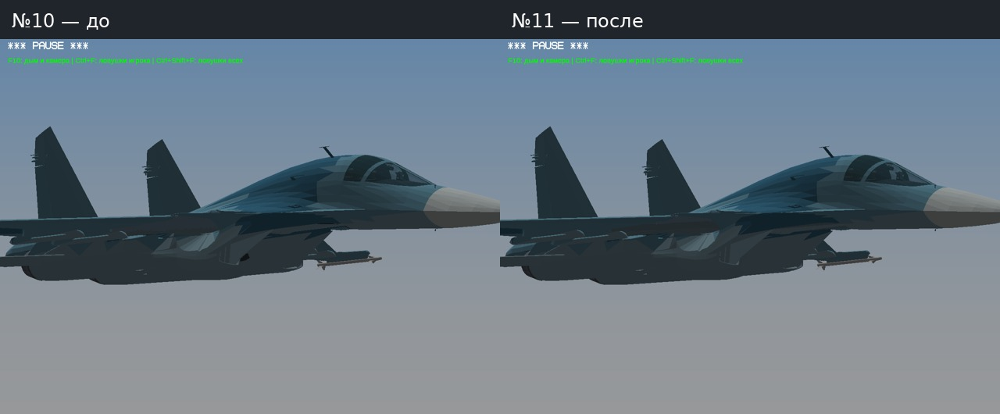
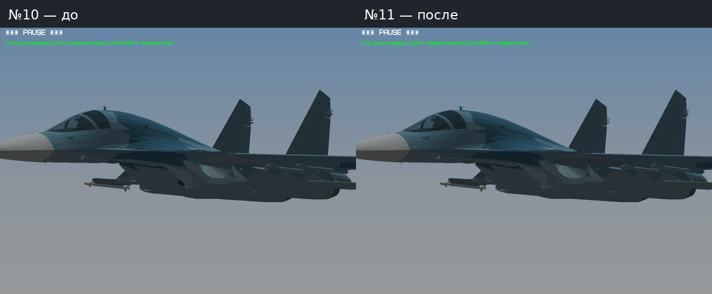
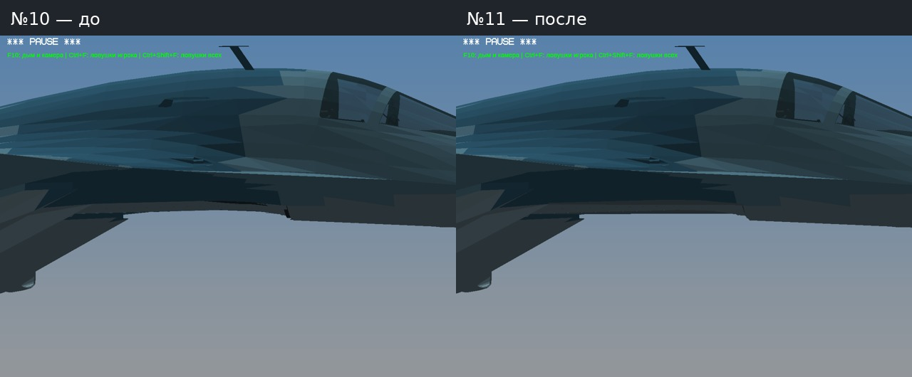
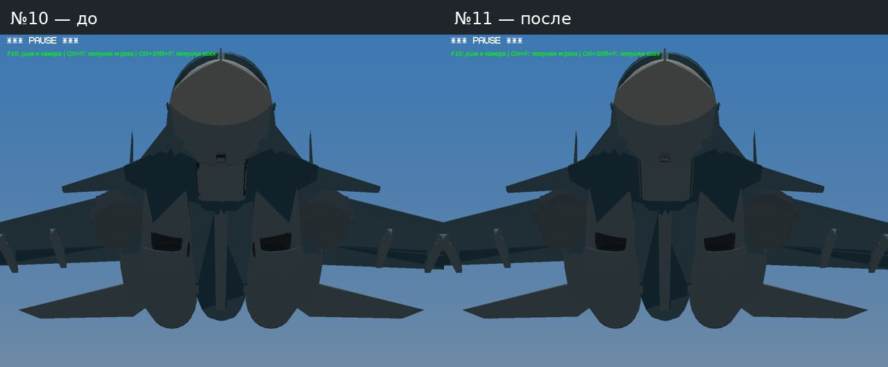
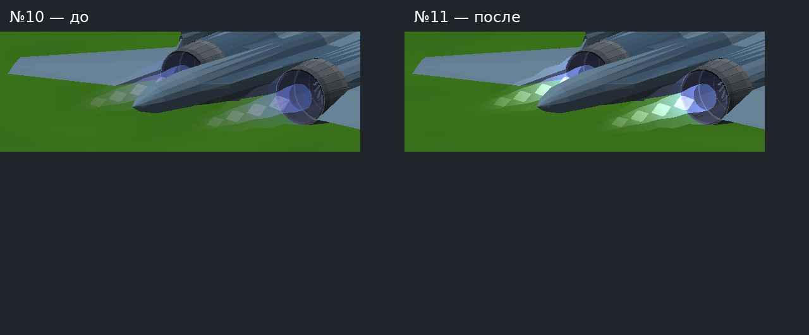
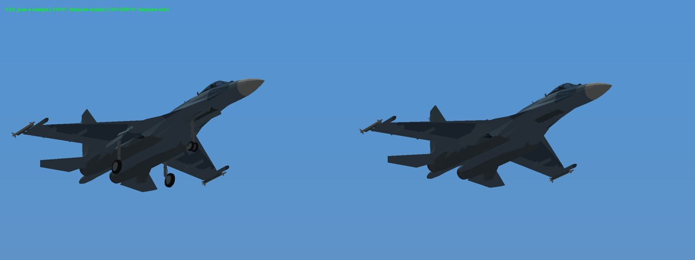
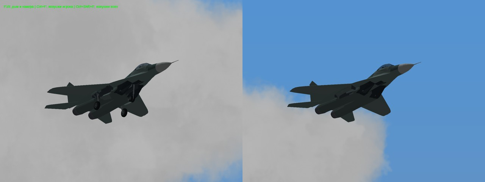
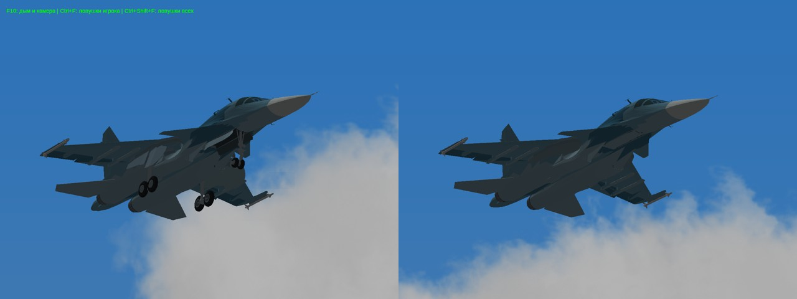
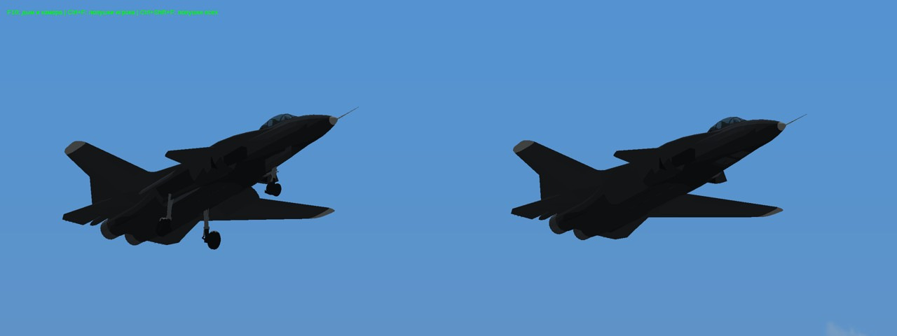
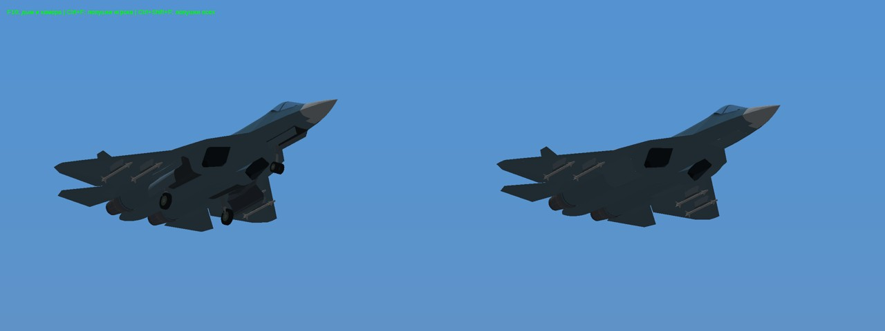

# Личный тест №11 — Су-34 и свечение струи

- [Игра Windows 32-bit — 34,7 МБ](https://github.com/i7885784-lang/igraYS-Flight-Simulator/releases/download/untagged-52ab2f27ba02f856cddb/YSFlight_Test_11_Game_32bit.zip).
- [Отчёт, фото и видео — 2,1 МБ](https://github.com/i7885784-lang/igraYS-Flight-Simulator/releases/download/untagged-52ab2f27ba02f856cddb/YSFlight_Test_11_Report.zip).
- [Полные исходники — 84,7 МБ](https://github.com/i7885784-lang/igraYS-Flight-Simulator/releases/download/untagged-52ab2f27ba02f856cddb/YSFlight_Personal_Test_11_Sources.zip).

Для закрытых архивов требуется вход в GitHub владельца. Игру распаковать и запустить `ysflight32_gl1.exe`.

Основа — полная №10. Игра остаётся в закрытом черновике: права геометрии Су-34 не выяснены. Автор fantazer_rnd / DEVBenSon/FiveM-Plane-Pack сохранён. Новых чужих текстур/звуков нет.

Су-34: внутренняя облицовка воздухозаборников утоплена в обшивку, устранён выступ на обеих сторонах. Подогнаны внутренние опорные кромки стыков ниш и передних створок. Нижняя кромка передней ниши поднята над закрытой створкой, чтобы не торчала сквозь неё. Наружная исходная обшивка и анимация сохранены.

Струя всех пяти самолётов рисуется как свечение, без непрозрачной наземной тени. Глубина проверяется по корпусу; запись прозрачной струи в глубину отключена, состояние смешивания восстанавливается. Сохраняется связь с раскрытием сопла из №10. Цвет свечения всё равно смешивается с фоном — это не непрозрачная фигура.

Проверки: игровые циклы шасси на пяти самолётах, выпуск/уборка и промежуточные положения; пять циклов газа/форсажа; Су-34 — 401 положение точных треугольных пересечений с нулём найденных столкновений. Первоначальная внутренняя кромка пересекала переднюю стойку, поэтому исправлена до итоговой проверки. Дополнительно сверена неизменность остальных четырёх моделей, обшивки и узлов Су-34. Результаты: [CHECKS.json](CHECKS.json).

Игровые кадры — Win64/Wine. Поставляемый EXE — Win32; непосредственно Windows x86 здесь не запускался. Эти проверки не гарантируют отсутствие любых возможных ошибок.

## До / после — одинаковые ракурсы

## Выпущено / убрано

## Видео

[Выпуск и уборка Су-34](Video/Su34_Gear.mp4) · [Струя на фоне земли](Video/Exhaust_Ground.mp4).

[Архивы и SHA-256](STATUS.json). [Проверки скачанных файлов](DOWNLOADED.json). Hosted-пересборка 41089660611 и локальная проверка всех трёх скачанных архивов прошли.
