# Тест №12 — тень самолёта больше не закрашивает струю

Исправлен именно дефект со скриншотов пользователя: тень самолёта рисовалась после прозрачного газа и закрашивала его. В №11 менялись свечение и тень самого газа, что не устраняло этот порядок отрисовки. Теперь наземная тень рисуется перед прозрачными самолётами и эффектами. Самолёт продолжает отбрасывать тень; глубина корпуса остаётся включённой. Геометрия всех самолётов точно сохранена из №11.

Проверка: Су-27, МиГ-29, Су-34, Су-47 и Су-57, по три одинаковых камеры до/после. Двигатель разогрет настоящими клавишами, после чего самолёт остановлен в диагностической паузе на высоте 3 м над AOMORI, чтобы струя пересекала тень. Это проверка отрисовки, не посадка и не полёт на этой высоте.

Автоматическая проверка требует, чтобы на каждом самолёте минимум в двух ракурсах на бывших чёрных пикселях тени появилось свечение. Одновременно проверяет сохранение тени вне струи и неизменность видимой синей обшивки. Су-34 дополнительно проверен с прежней настройкой TRSPLATER FALSE. [Численные результаты](CHECKS.json). Сценарий и проверка сохранены [в исходниках](../../changes/aircraft-personal-test12/README.md) для следующих версий.

Игровые кадры Win64/Wine, OpenGL 1. Собран Windows 32-bit GUI EXE; Windows x86 напрямую не запускался. Нового самолёта нет, форма/механизмы и все файлы самолётов сохранены из №11.

Полная игра остаётся в закрытом черновике: права Су-34 пока не выяснены. Автор fantazer_rnd / DEVBenSon/FiveM-Plane-Pack и полные исходники сохранены.

## Парные кадры

Слева №11, справа №12. Все полные PNG без обрезки лежат в Originals.

### su34

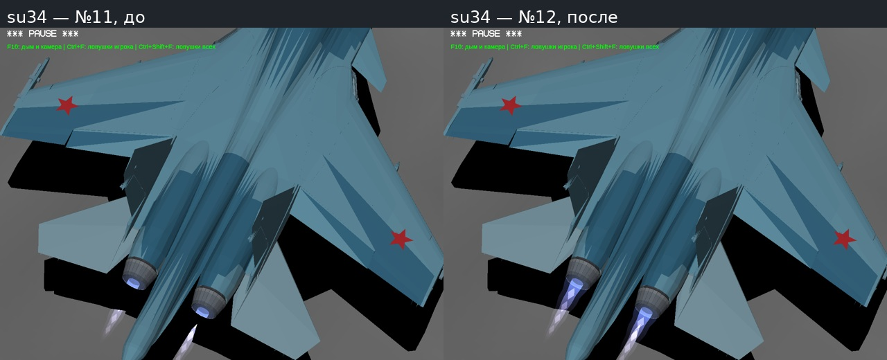

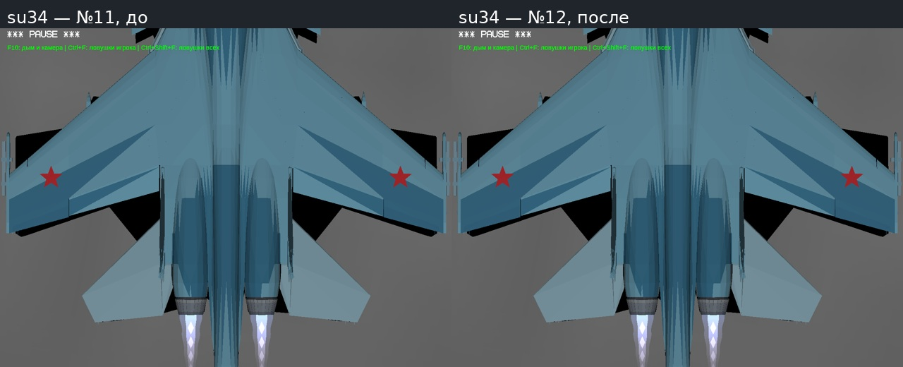

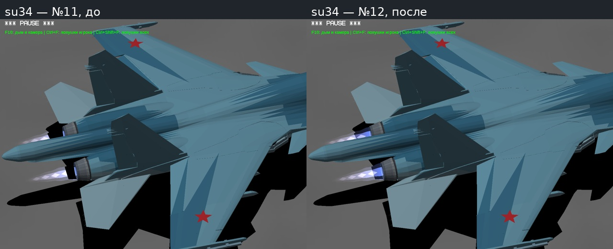

### su27

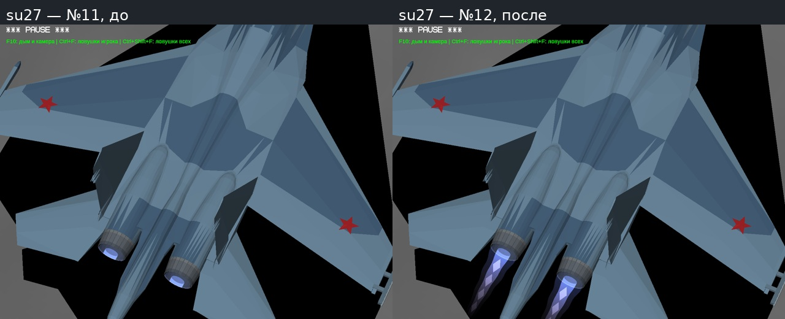

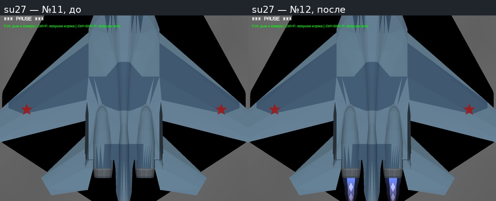

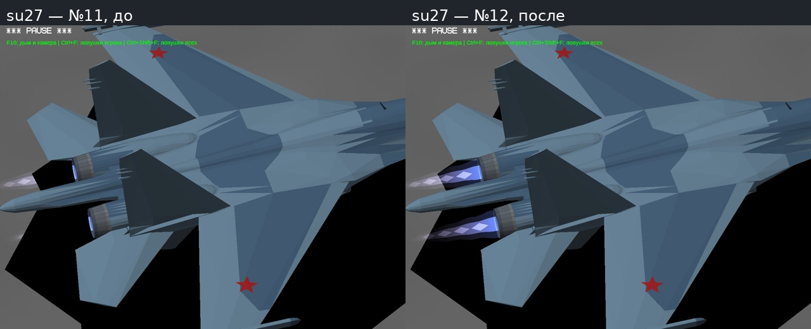

### mig29

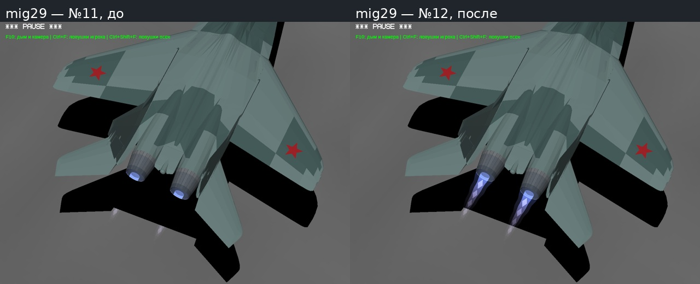

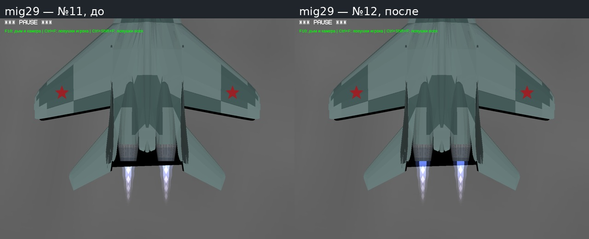

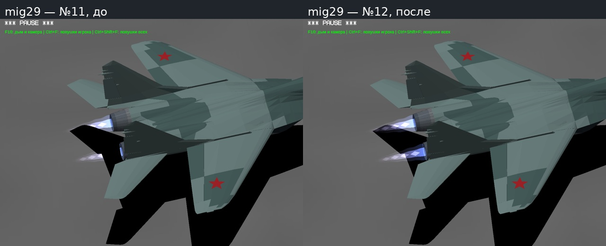

### su47

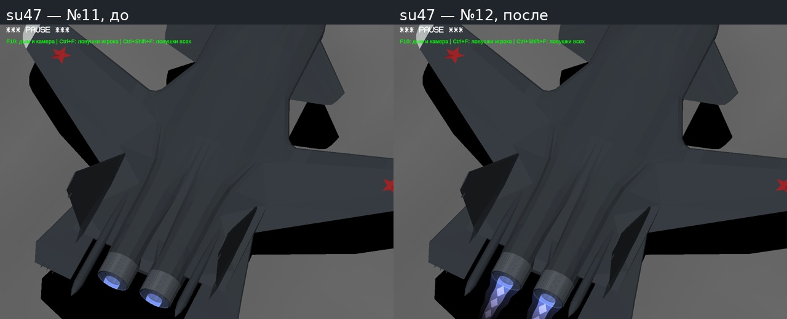

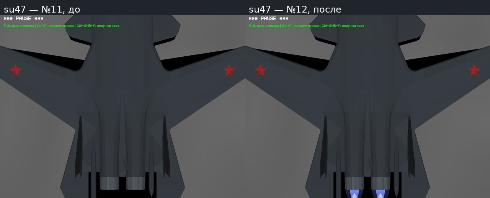

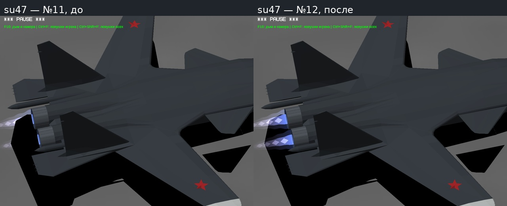

### su57

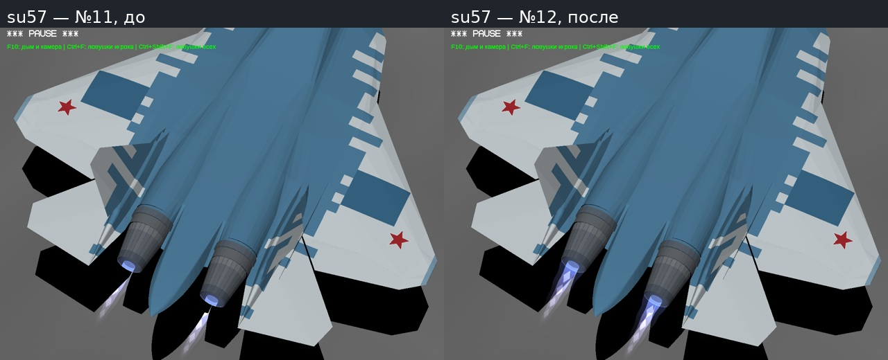

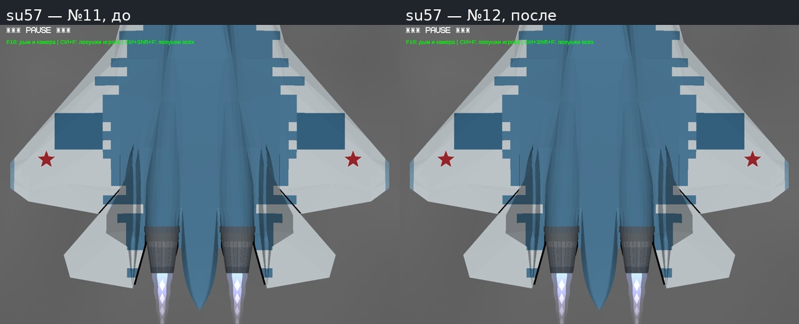

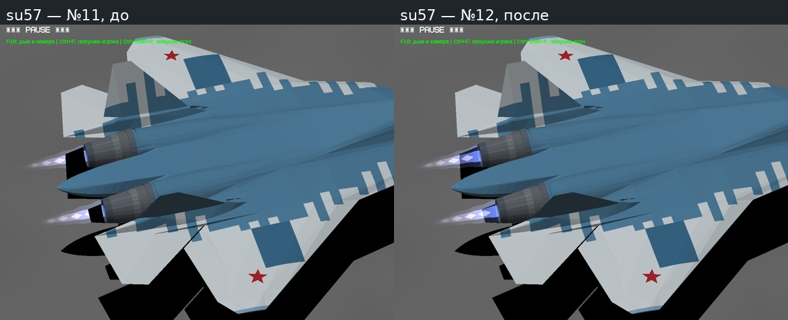

Отдельные архивы игры, отчёта и полных исходников будут записаны в STATUS.json после проверки скачивания.
