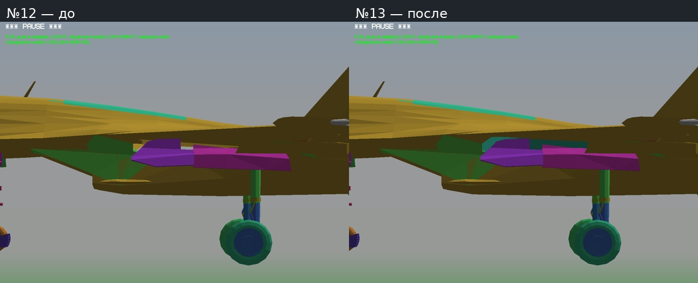
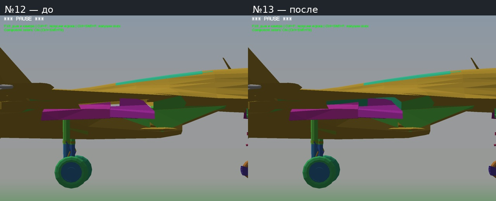
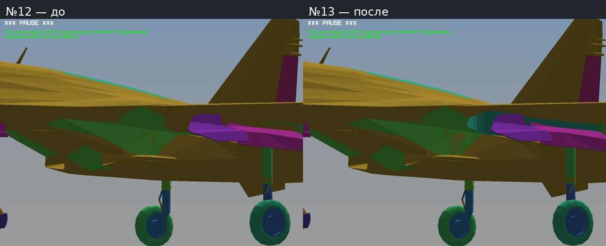
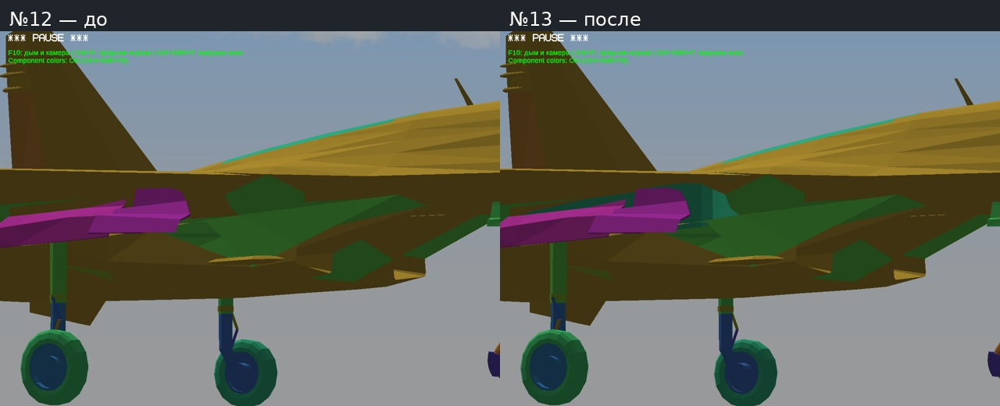
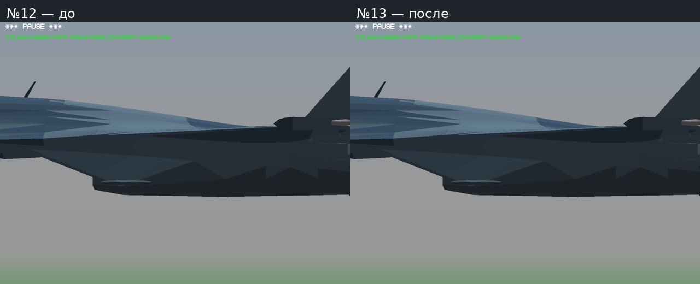
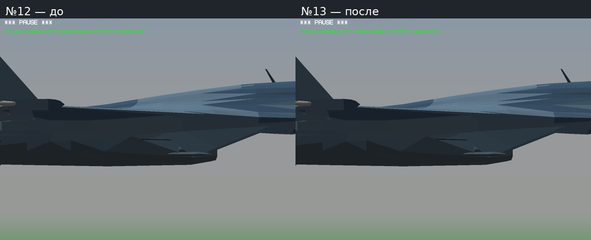

# Тест №13 — просвет над основными створками Су-27

- [Игра Windows 32-bit — 34,7 МБ](https://github.com/i7885784-lang/igraYS-Flight-Simulator/releases/download/untagged-d4944aec3c81dac10f55/YSFlight_Test_13_Game_32bit.zip).
- [Отчёт, фото и видео — 1,2 МБ](https://github.com/i7885784-lang/igraYS-Flight-Simulator/releases/download/untagged-d4944aec3c81dac10f55/YSFlight_Test_13_Report.zip).
- [Полные исходники — 85,8 МБ](https://github.com/i7885784-lang/igraYS-Flight-Simulator/releases/download/untagged-d4944aec3c81dac10f55/YSFlight_Personal_Test_13_Sources.zip).

Для закрытых ZIP нужен вход в GitHub владельца. Распаковать игру отдельно и запустить `ysflight32_gl1.exe`.

Исправлен сквозной просвет над фиолетово-розовыми створками на скриншоте пользователя. В нишах Су-27 не было подходящей внутренней стенки: при выпущенных шасси через корпус просматривался фон. Добавлены две собственные внутренние стенки по контуру исходного корпуса и объёму движения механизма. Внешний короб не добавлен.

Сохранены все прежние поверхности Су-27 и все узлы/состояния анимации; меняются только добавленные внутренние стенки. Движок, исправление перекрытия струи тенью №12 и остальные самолёты неизменны.

Проверки: 28 подвижных узлов против новых стенок на401 промежуточном положении — пересечений0. Проверены отсчёты вершин и центров граней в верхней/нижней оболочке исходного корпуса: выступов за неё не обнаружено. Настоящий игровой цикл выпуска/уборки и крупные планы обоих бортов, с диагностикой и без. В отмеченных областях серый фон исчез: справа471→0 пикселей, слева477→0. [Численные результаты](CHECKS.json).

Кадры и видео — Win64/Wine. Поставляемый Windows 32-bit EXE не менялся с №12; Windows x86 напрямую здесь не запускался. Проверка пересечений касается добавленных стенок, не является гарантией отсутствия любых ошибок модели.

## Выпущенные шасси — диагностические цвета

Слева №12, справа №13; одинаковая камера. Полные исходные PNG в Originals.

## Убранные шасси — обычная окраска

[Видео выпуска и уборки Су-27](Video/Su27_Gear.mp4).

[Конвертер и проверки](../../changes/aircraft-personal-test13/README.md). Авторство Су-27: FGUK/FGMEMBERS, исходная геометрия AC и GPL-уведомления сохранены. Новые стенки — собственная адаптация. Полная сборка остаётся в закрытом черновике из-за невыясненных прав Су-34; источник fantazer_rnd / DEVBenSon/FiveM-Plane-Pack сохранён.

[Архивы и SHA-256](STATUS.json). [Проверки скачанных файлов](DOWNLOADED.json). Hosted-пересборка 41101247106 воспроизвела обе DNM точно и повторила проверку401 положения без пересечений. Все три ZIP скачаны обратно и проверены локально.
