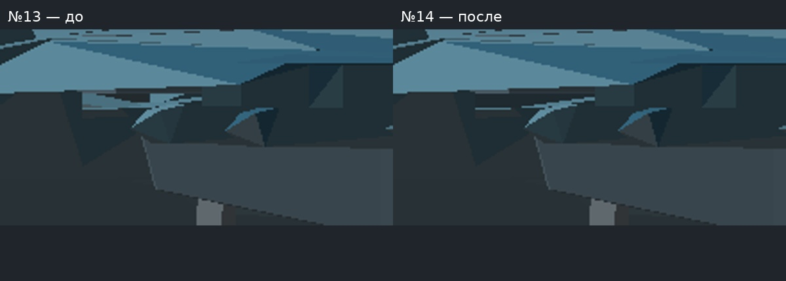
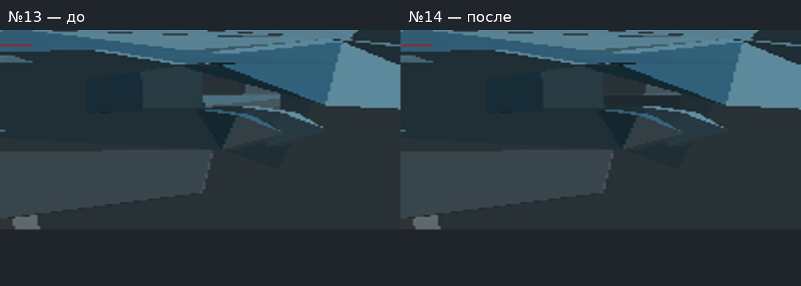
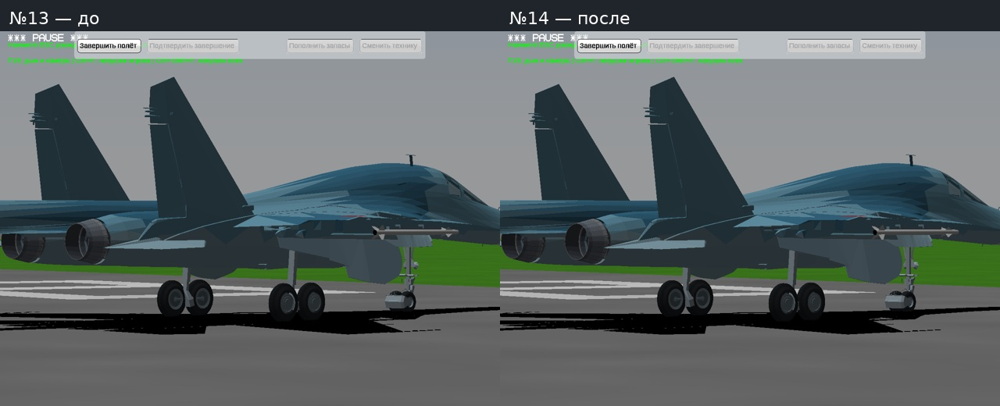
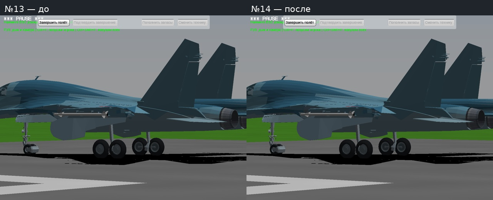
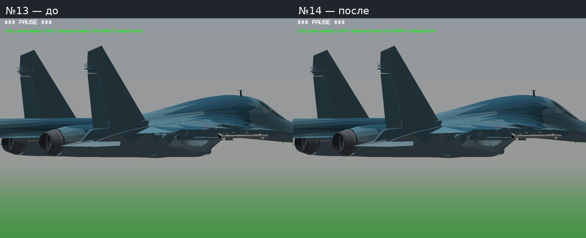
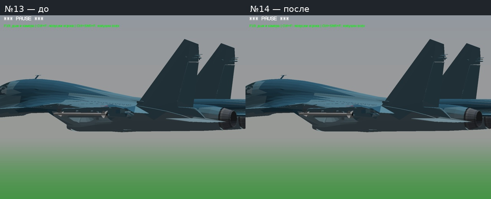

# Тест №14 — отмеченный просвет Су-34

Закрыт сквозной вид за стыком задней части основных ниш с мотогондолами. Добавлены две внутренние перегородки. Кромки, крепления и створки сохранены; видимые штатные элементы не удалялись. Наружная форма воздухозаборников и все прежние поверхности Су-34 сохранены точно. Это исправление участка из отметки пользователя, не переделка всего самолёта.

Проверки:401 положение всех узлов класса210 против новых перегородок — пересечений0. Пересечений с внутренними каналами и исходными компрессорами нет. Все прежние mesh packs и состояния анимации сохранены. Настоящий игровой цикл выпуска/уборки прошёл. Сняты одинаковые задние боковые ракурсы с выпущенными и убранными шасси на обоих бортах; кадры просмотрены. Контрольные области внутри просвета:96→0 и70→0 пикселей светлой обратной стороны. Вне контрольного участка кромки и опоры остаются видимыми. [Результаты](CHECKS.json).

Движок, исправление струи/тени №12 и Су-27 из №13 сохранены; другие самолёты не менялись. Игровые проверки Win64/Wine. Win32 EXE взят неизменным из №13; Windows x86 напрямую не запускался.

## Сам участок — до и после

Слева №13, справа №14. Полные PNG без обрезки в Originals.

## Общие кадры

[Видео выпуска и уборки](Video/Su34_Gear.mp4). [Конвертер и проверки](../../changes/aircraft-personal-test14/README.md).

Авторство fantazer_rnd / DEVBenSon/FiveM-Plane-Pack, исходная геометрия и предыдущие исходники сохранены. Новых чужих текстур/звуков нет. Права на публичное распространение геометрии Су-34 не выяснены: полная игра только в закрытом черновике.

Ссылки на отдельные ZIP игры, отчёта и исходников будут добавлены после проверки скачивания.
