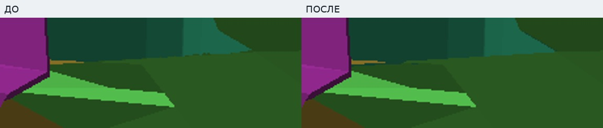
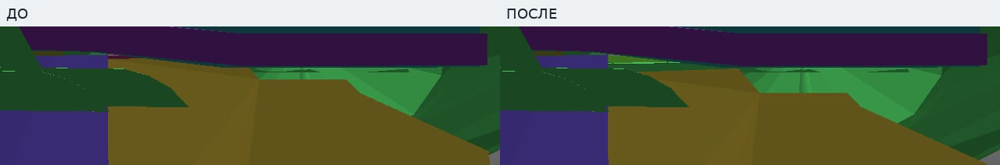
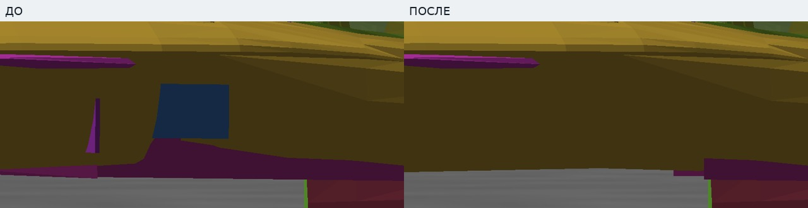
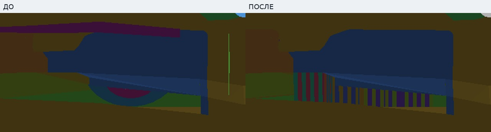
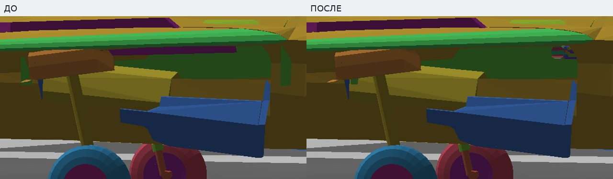
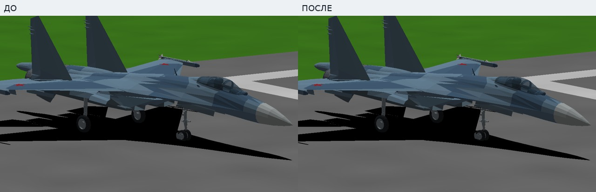
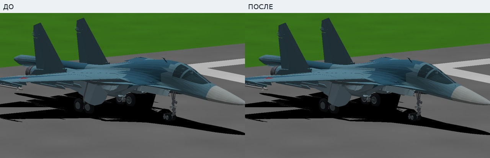
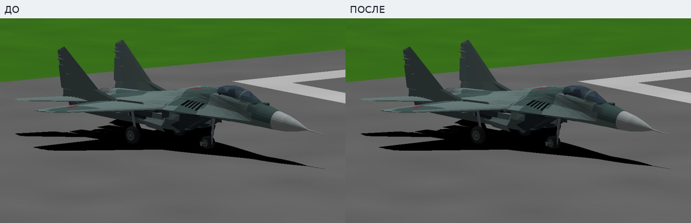
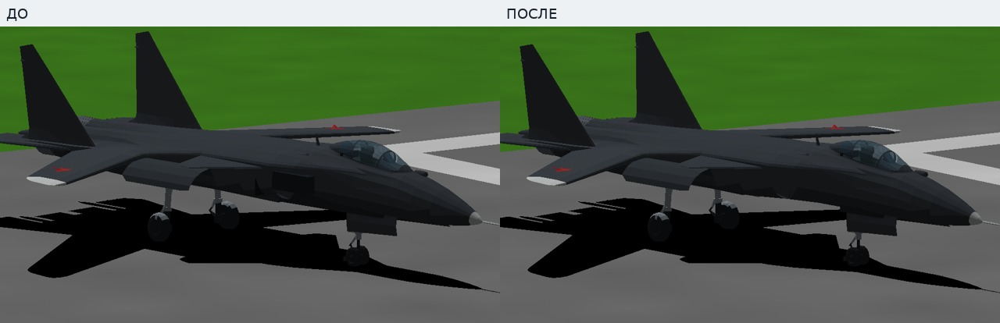

# Личный тест №15

31 октября 2026. От полной версии №14, без переключения принятой основной сборки.

- [**Скачать игру Windows 32-bit**](https://github.com/i7885784-lang/igraYS-Flight-Simulator/releases/download/untagged-a573322757d8a83a3f62/YSFlight_Test_15_Game_32bit.zip)
- [Отдельный архив отчёта, фото и двух видео](https://github.com/i7885784-lang/igraYS-Flight-Simulator/releases/download/untagged-a573322757d8a83a3f62/YSFlight_Test_15_Report.zip)
- [Полные соответствующие исходники](https://github.com/i7885784-lang/igraYS-Flight-Simulator/releases/download/untagged-a573322757d8a83a3f62/YSFlight_Personal_Test_15_Sources.zip)

Полная сборка остаётся личным черновиком, как №14. Для скачивания нужен вход в аккаунт владельца GitHub.

## Что изменилось

- **Су‑27:** подогнан тонкий внутренний стык у мотогондолы и ниши. Наружная обшивка сохранена.
- **Су‑34:** ось расширенной основной створки совмещена с её настоящей кромкой. Форма закрытой створки сохранена. Оси закрылков и предкрылков подогнаны к наклонным кромкам крыла.
- **Су‑47:** убраны выступавшие прямоугольная заглушка и треугольник внутренней оболочки; проверены оба борта. Исправлено направление осей предкрылков.
- **МиГ‑29:** подогнаны края ниш и лишняя передняя внутренняя перегородка. Внутреннее перекрытие закрывает вид на убранное колесо и уходит до движения стойки. Это собственная игровая адаптация внутреннего механизма; исходные наружные створки, стойки и движение шин сохранены.

У Су‑27 и МиГ‑29 исправлены плавающие оси управляющих поверхностей, фонарей и воздушных тормозов. Нейтральная форма **60 движущихся поверхностей** сохранена. Су‑57 проверен и оставлен без изменений. Наружные исходные оболочки, сопла, струя и производственный движок сохранены.

## Парные снимки

Слева **до**, справа **после**: одинаковые камера и поза самолёта. Диагностические цвета обозначают отдельные детали; обычная окраска показана ниже. Полные кадры лежат в [Originals](Originals).

Су‑27 — небольшой стык, без перестройки воздухозаборника:

Су‑34 — соединение створки:

Су‑47 — выступы внутренней геометрии:

МиГ‑29 — колесо, которое было видно при полностью убранных шасси:

МиГ‑29 — передняя перегородка:

Другие борта: [Су‑27](Photos/Su27-other-side.jpg), [Су‑34](Photos/Su34-other-side.jpg), [Су‑47](Photos/Su47-other-side.jpg), [МиГ‑29](Photos/MiG29-other-side.jpg).

Обычная окраска, тот же общий ракурс до/после:

## Видео и проверки

- [Выпуск и уборка шасси Су‑27, Су‑34 и МиГ‑29](Video/Landing_Gear.mp4).
- [Управляющие поверхности пяти самолётов, фонари и воздушные тормоза](Video/Controls.mp4).

Это записи настоящих нажатий клавиш. Кадры циклов и совпадающие ракурсы просмотрены. Дополнительно проверены 401 положение механизмов, сохранность исходной обшивки и материалов, а у МиГ‑29 — 2 816 точек шин с 25 направлений: видимых точек убранных колёс **0**. Контакты сомкнутых стыков учитываются отдельно; новых событий пересечения створок Су‑34 относительно №14 нет.

[Результаты проверок](CHECKS.json) · [конвертеры и проверки](../../changes/aircraft-personal-test15) · [авторство и состав](../../changes/aircraft-personal-test15/NOTICE.txt).

Игровые проверки выполнены в Win64/Wine/OpenGL1. Архив содержит Windows 32-bit с неизменным EXE №14; непосредственно Windows x86 здесь не запускалась. Проверки не заменяют пользовательскую приёмку.
