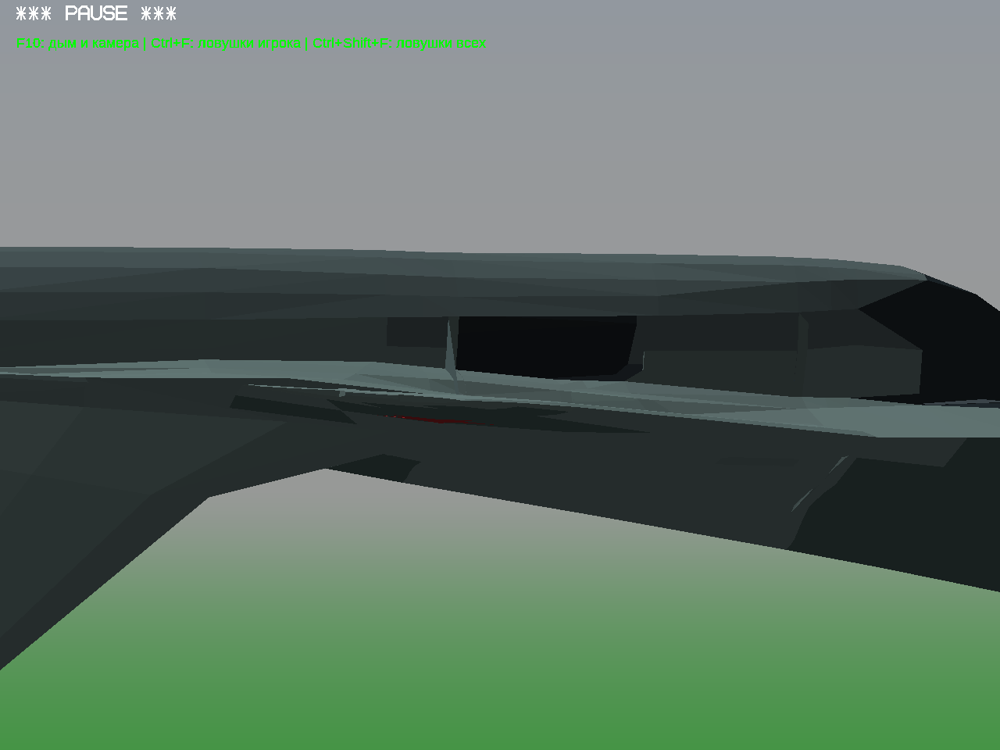
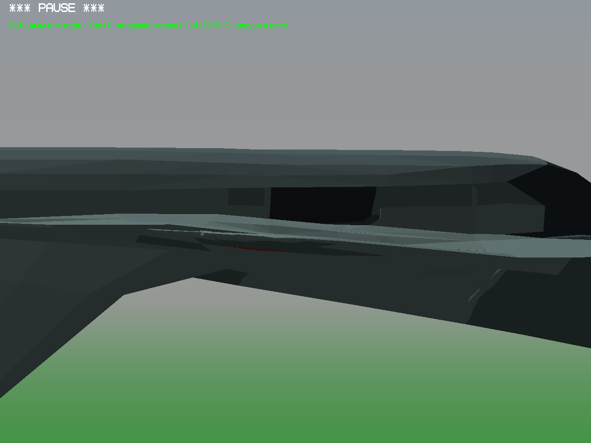
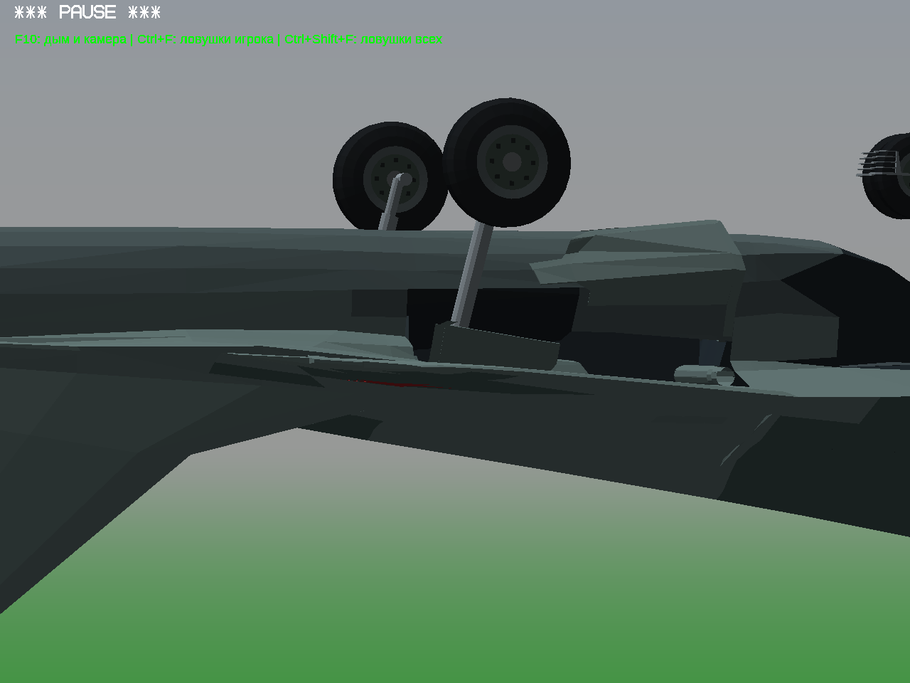
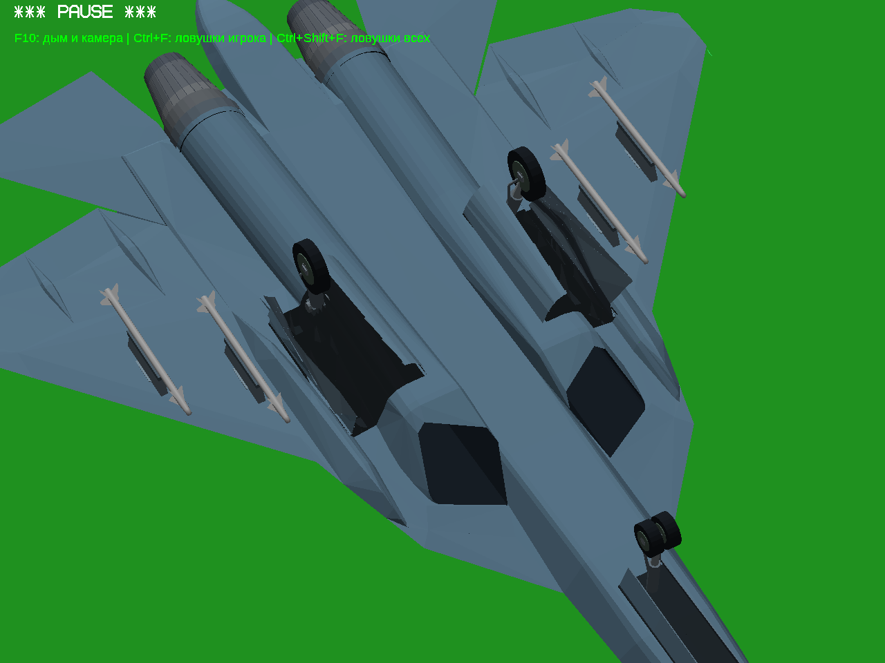
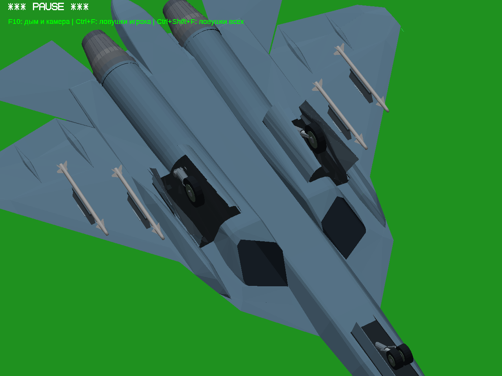
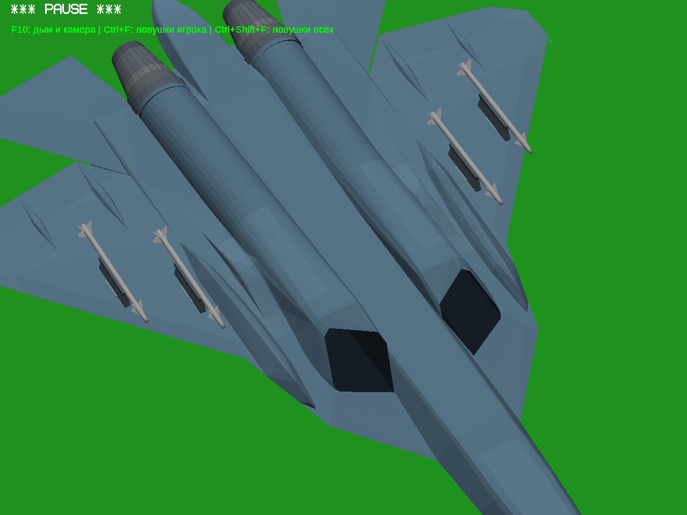

# Личный тест №16 — ниша МиГ-29 и промежуточный Су-57

МиГ-29: подогнано сопряжение неподвижной стенки ниши с обшивкой и створкой; убран выступающий нижний треугольник торцевой заглушки. Исходная наружная оболочка и движения шасси/створок сохранены. Тёмная поверхность внутри ниши сама по себе не является сквозным отверстием: контроль скрытия убранных колёс выполнен отдельно. Приёмка отмеченного пользователем места ещё предстоит.

## МиГ-29, перевёрнутый полёт — до и после

До:

После:

## Су-57 — только промежуточный вариант

По две половины основной створки на каждой стороне. Это экспериментальная игровая адаптация. В игровую сборку №16 не включена: контакты с корпусом и движение ещё требуют проверки. Передняя ниша уже имела две створки.

Все изображения получены в настоящей игре Win64/Wine/OpenGL, самолёт перевёрнут для освещения нижней поверхности. Это не рендер-концепт. Windows x86 напрямую не запускалась; в поставке сохранён её прежний executable.

## Проверки МиГ-29

401 положение шасси: пересечений с проверяемыми препятствиями0. Проверка внутренних возвратных полосок: новых пересечений0; штатное сопряжение в закрытом положении учитывается отдельно. Убранные колёса:0 видимых образцов по25 направлениям. Численные проверки ограничены перечисленными деталями и не доказывают отсутствие любых дефектов самолёта.

[Видео полного цикла шасси МиГ-29](mig-gear-cycle.mp4). Настоящие нажатия G, выпуск и уборка; проверка active прошла.

## Скачать

- [Полная игра №16 — Windows32](https://github.com/i7885784-lang/igraYS-Flight-Simulator/releases/download/untagged-bc9294b1fed8fd086a57/YSFlight_Test_16_Game_32bit.zip)
- [Полные исходники №16](https://github.com/i7885784-lang/igraYS-Flight-Simulator/releases/download/untagged-bc9294b1fed8fd086a57/YSFlight_Test_16_Sources.zip)

Архивы сохранены в черновике GitHub: прежний статус прав Су-34 не изменился. Для скачивания нужен вход в аккаунт с доступом к черновику. [Страница черновика](https://github.com/i7885784-lang/igraYS-Flight-Simulator/releases/tag/untagged-bc9294b1fed8fd086a57).
