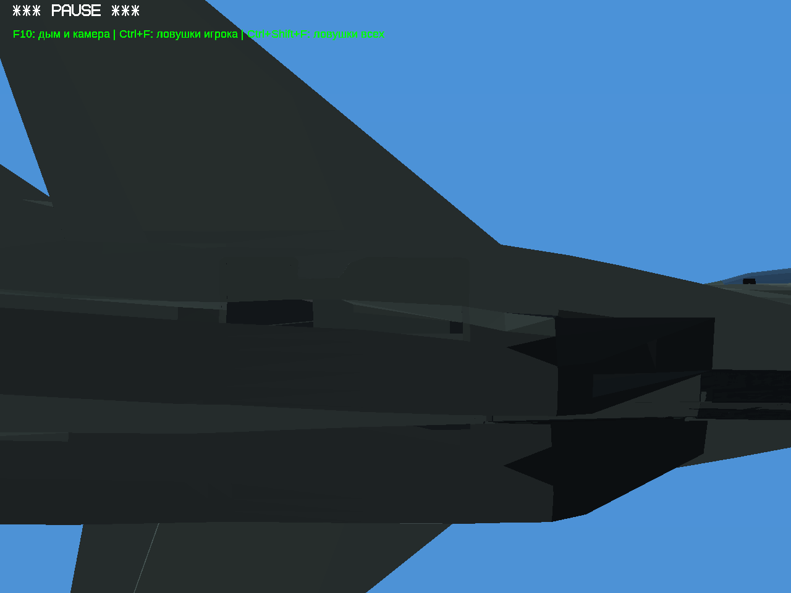
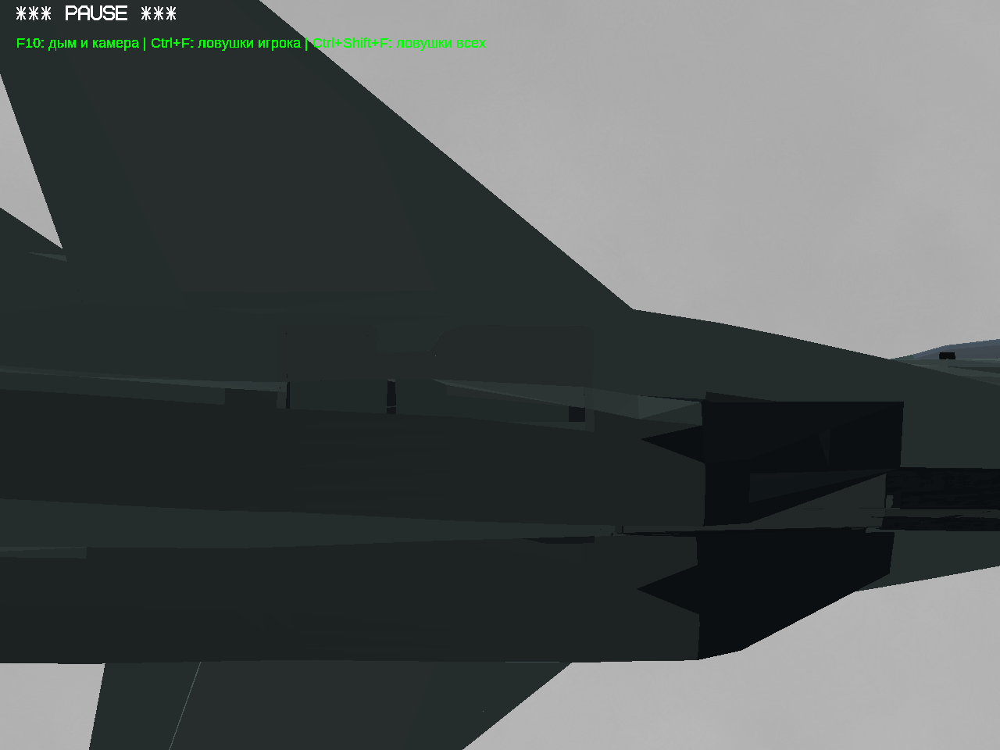
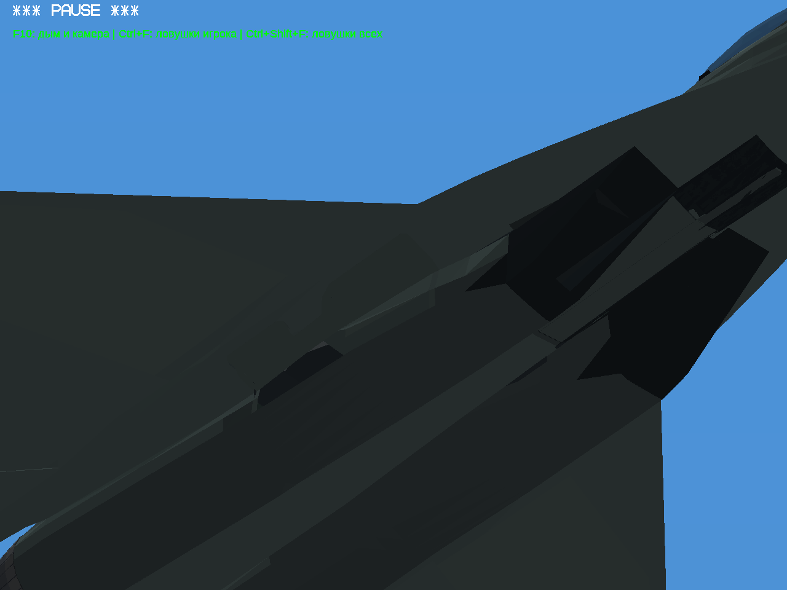
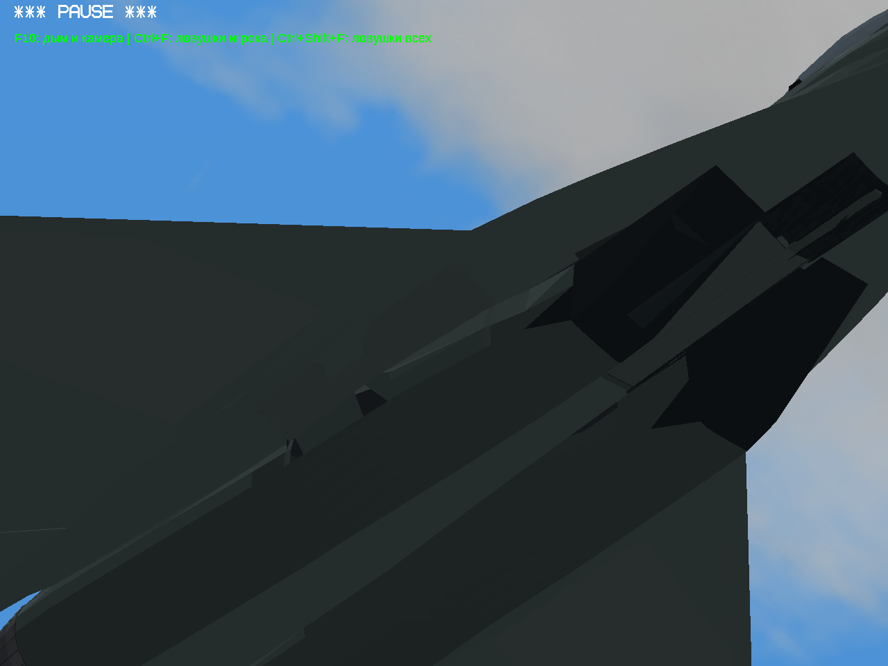
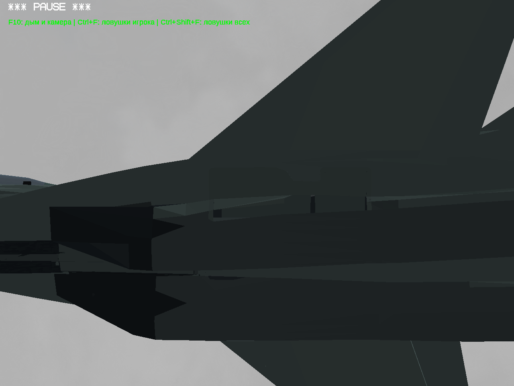
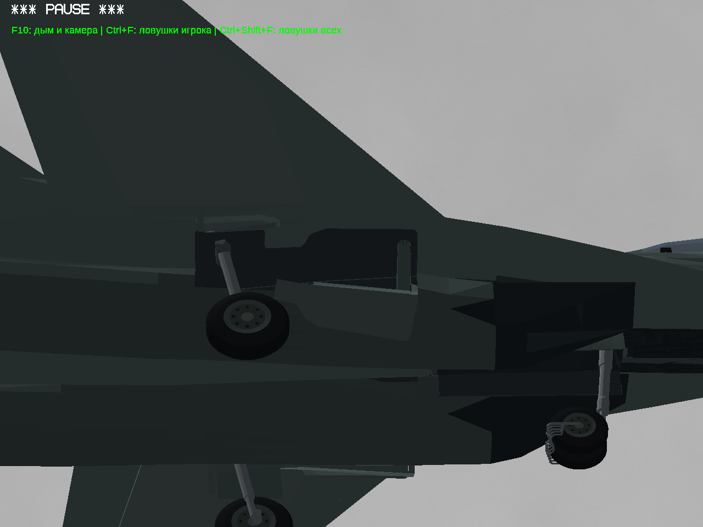

# Личный тест №17 — оставшаяся прорезь МиГ-29

В №16 остался незакрытый участок позади основного колеса: из низкого бокового ракурса была видна внутренняя поверхность ниши. Теперь добавлены две небольшие детали по контурам мотогондол и исходных задних створок. Это собственная игровая адаптация. Они движутся вместе со створками, с небольшим дополнительным смещением в начале открытия для зазоров.

Существующие меши, исходные створки, стойки, колёса, их анимации и двигатель сохранены побайтно по данным DNM. Изменён только МиГ-29. Су-57 не менялся.

## Один ракурс до и после

До:

После:

Другой ракурс:

Противоположный борт:

Выпущенные шасси:

Настоящие кадры игры Win64/Wine/OpenGL. Это не концепт и не рисунок. Windows x86 напрямую не запускалась; её прежний EXE сохранён.

## Проверки

401 положение: новые детали против корпуса, мотогондол, соседних створок, внутренних стенок и возвратных полосок — пересечений0. Стойки, колёса и ступицы против проверяемых деталей — пересечений0. Внутренние области новых деталей против парных задних створок — пересечений0; общая кромка сопряжения исключена из этой проверки уменьшением каждого малого фасета на1%. Это ограниченная геометрическая проверка, не гарантия отсутствия любых ошибок самолёта. Все прежние поверхности, закрывавшие колёса, сохранены, добавлены только непрозрачные детали.

[Видео цикла шасси](gear-cycle.mp4). Нажатия G, реальный выпуск и уборка, active=true.

## Скачать

- [Полная игра №17 — Windows32](https://github.com/i7885784-lang/igraYS-Flight-Simulator/releases/download/untagged-df24eb96e3e9d1eebca9/YSFlight_Test_17_Game_32bit.zip)
- [Полные исходники №17](https://github.com/i7885784-lang/igraYS-Flight-Simulator/releases/download/untagged-df24eb96e3e9d1eebca9/YSFlight_Test_17_Sources.zip)

Архивы остаются в черновике: прежний статус прав Су-34 сохранён. Нужен вход в аккаунт GitHub с доступом к черновику. [Страница черновика](https://github.com/i7885784-lang/igraYS-Flight-Simulator/releases/tag/untagged-df24eb96e3e9d1eebca9).
