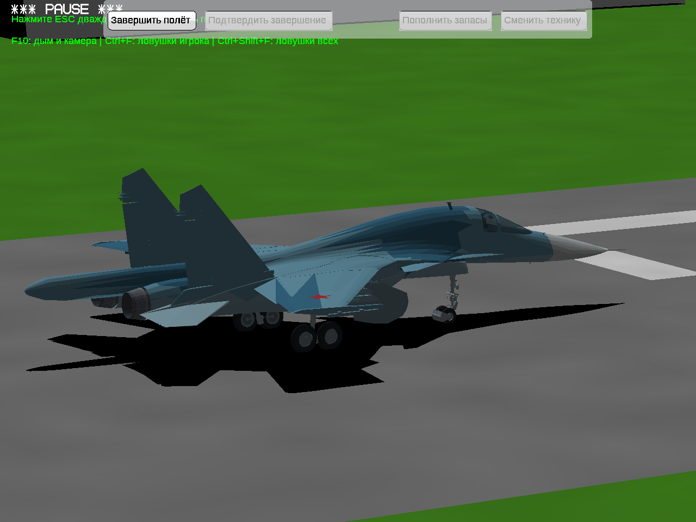
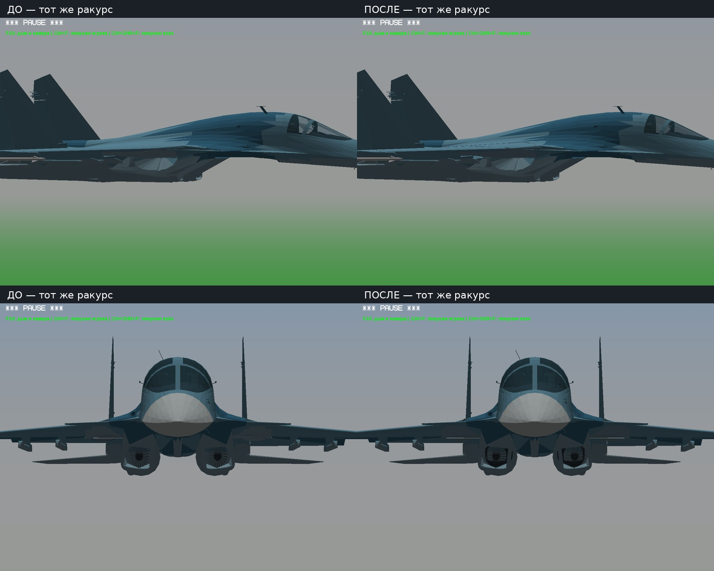
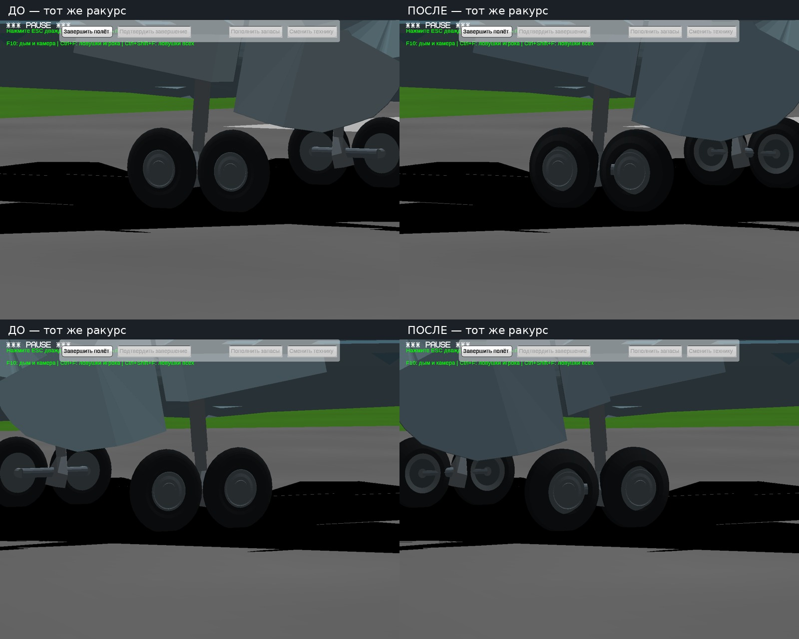
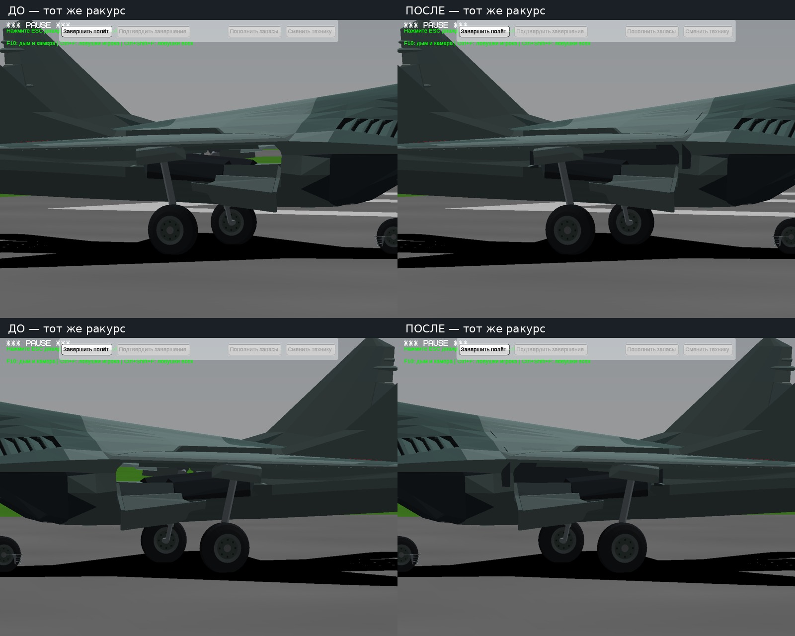
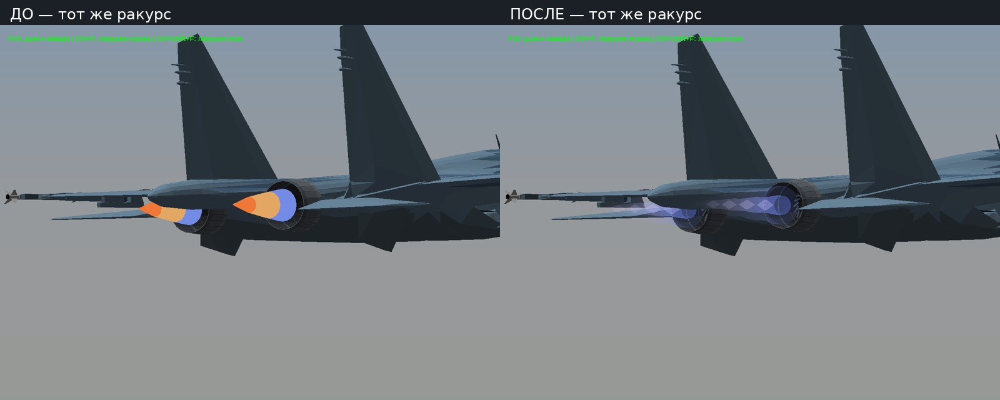
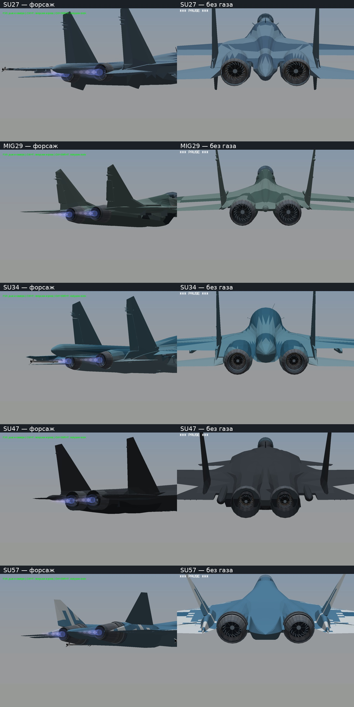
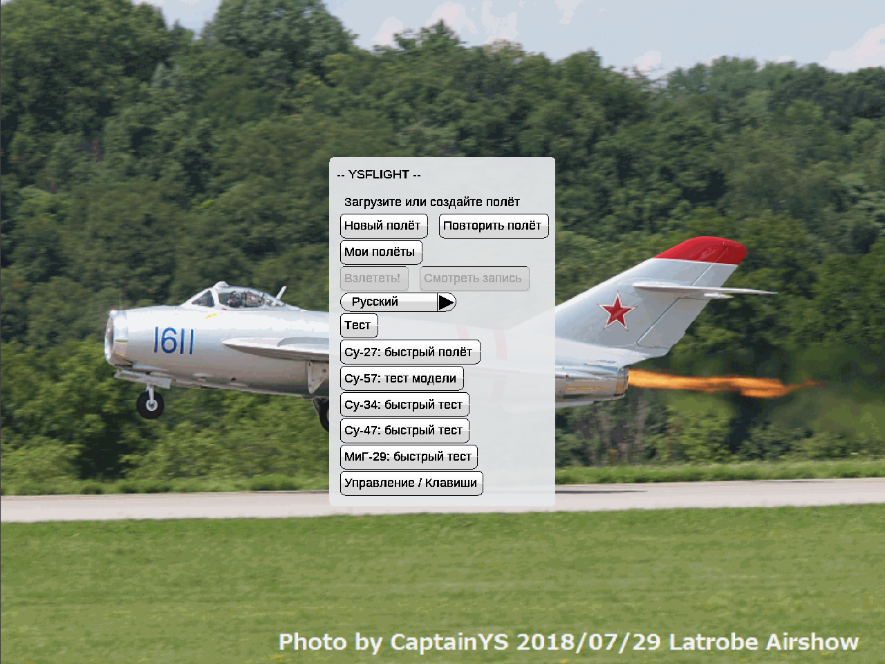

# Личный самолётный тест №9

[Скачать полную тестовую игру — Windows 32-bit](https://github.com/i7885784-lang/igraYS-Flight-Simulator/releases/download/untagged-ccc806bb5a1a6e04336f/YSFlight_Personal_Test_9_32bit.zip) · [полные исходники](https://github.com/i7885784-lang/igraYS-Flight-Simulator/releases/download/untagged-ccc806bb5a1a6e04336f/YSFlight_Personal_Test_9_Sources.zip).

Су‑34 включён. Для скачивания войдите в GitHub владельца: ZIP остаётся закрытым черновиком до выяснения прав на геометрию. Распаковать в новую папку, запустить `ysflight32_gl1.exe` и выбрать самолёт на главном экране.

[Контрольные суммы и проверка закрытого доступа](STATUS.json) · [проверка скачанных архивов](DOWNLOADED.json).

- Су‑34: объёмные основные шины с исходными наружными дисками; подогнана уборка. Входы воздухозаборников снаружи сохранены, облицовка добавлена глубже внутри. Неудачный промежуточный вариант с выступающими трубами исключён.
- МиГ‑29: внутренние стенки и потолок ниш закрывают вид насквозь.
- Все пять самолётов: собственная полупрозрачная струя, детали внутри сопел без газа и более плавное, уменьшенное раскрытие на форсаже.
- Главное меню: быстрые тесты Су‑27, Су‑34, МиГ‑29, Су‑47 и Су‑57. **Ctrl+Shift+F9** по-прежнему включает диагностику и повторным нажатием выключает.

Су‑34 целиком после быстрого запуска:

В каждой паре слева «до», справа «после». Настройки камеры одинаковые. Это реальные игровые кадры; добавлены только подписи.

Воздухозаборники Су‑34: сохранён наружный контур, изменения находятся внутри.

Шины Су‑34: ширина резины примерно 13 → 30 см; исходные размеры по высоте и длине, оси и наружные диски сохранены. Между колёсами тележки остаётся зазор.

Ниши МиГ‑29: через открытые отсеки больше не видно землю с противоположной стороны.

Струя Су‑27 в прежнем и новом варианте:

Сопла пяти самолётов: форсаж и вид внутрь без газа.

Быстрый запуск с главного экрана:

Видео: [выпуск и уборка шасси Су‑34 и МиГ‑29, 32 с](Mechanisms.mp4) · [режимы двигателя пяти самолётов, 80 с](Nozzles.mp4). Управление настоящими клавишами, без принудительных поз модели.

Проверены движения шасси между конечными положениями, зазоры, сохранность передней обшивки, сопла и новые кнопки меню; записи просмотрены. [Численные результаты](CHECKS.json) · [конвертер и изменения движка](../../changes/aircraft-personal-test9/).

Игровые проверки — Win64/Wine. Поставляется Win32 GUI; прямой запуск на Windows 10 x86 здесь не выполнен. Механизмы и регулирование сопел остаются игровым приближением. Авторство и исходники сохранены; коммерческие права на Су‑34 пока не подтверждены.
