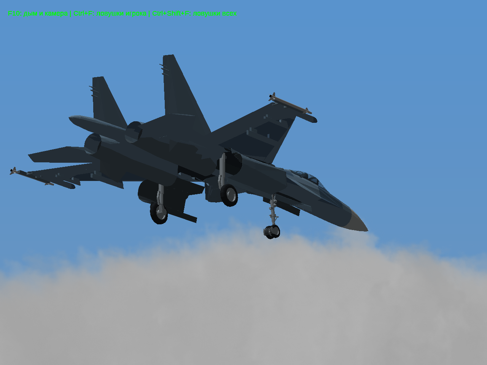
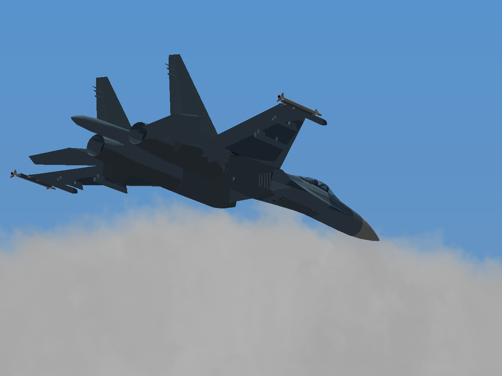

# Игровой тест №4 — Су-27 и МиГ-29

[Скачать всю игру, Windows 32-bit](https://raw.githubusercontent.com/i7885784-lang/igraYS-Flight-Simulator/ysflight-center-download/downloads/YSFlight_Playtest_4_32bit.zip) · [Полные исходники](https://raw.githubusercontent.com/i7885784-lang/igraYS-Flight-Simulator/ysflight-center-download/downloads/YSFlight_Playtest_4_Sources.zip).

Распаковать в новую папку, запустить **Play_Su27.bat** для быстрого полёта или **ysflight32_gl1.exe** для обычного меню. G — шасси, стрелки — управление, Q/A — газ, Tab — форсаж, F/R — закрылки, B — воздушный тормоз.

Изменены укладка стоек и последовательность движения створок, увеличено число положений механизма для плавного движения. Су-47 и последняя встроенная модель Су-57 сохранены побайтно; прежние архивы и указатель основы не изменены. Прямоугольные участки снизу — створки ниш; их внешний вид остаётся предметом тестирования. [Проверка замечания о «коробках»](../aircraft-box-diagnosis-4/REPORT.md).

| Выпущенные шасси Су-27 | Убранные шасси Су-27 |
|---|---|
|  |  |

Основные проверки: реальный запуск, два нажатия G с выпуском и уборкой, осмотр самолётов и проверка пересечений колёс/створок на траектории. [Видео Су-27](su27/gear.mp4), [видео МиГ-29](mig29/gear.mp4). [Состояния Су-27](su27/results.json), [состояния МиГ-29](mig29/results.json), [проверка ZIP и сохранения самолётов](package-checks.json).

Игра проверена в Win64/Wine. В ZIP — самостоятельный Win32 EXE; настоящая Windows 10 x86 здесь не запускалась. Это экспериментальная сборка, не окончательная приёмка моделей. Су-34 в этот **публичный** ZIP не включён: право публичного распространения геометрии пока не подтверждено; личная тестовая копия готовится отдельно.
