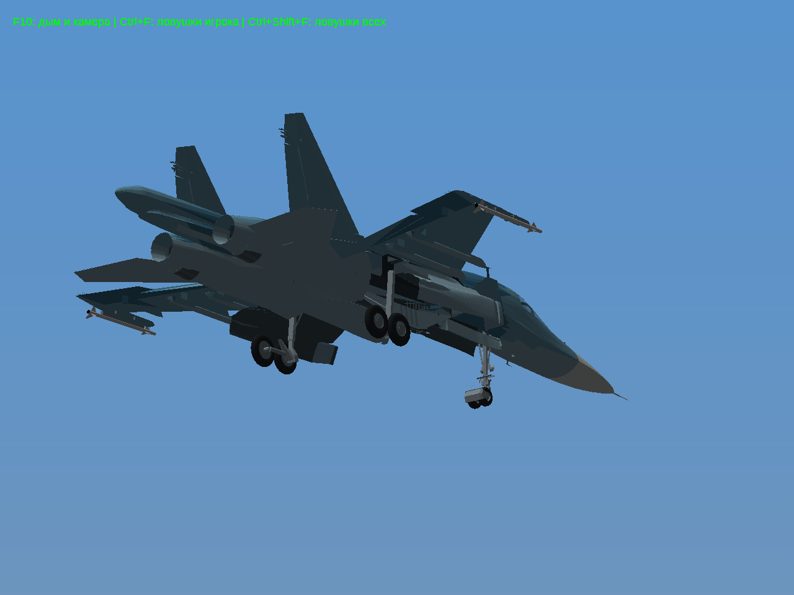
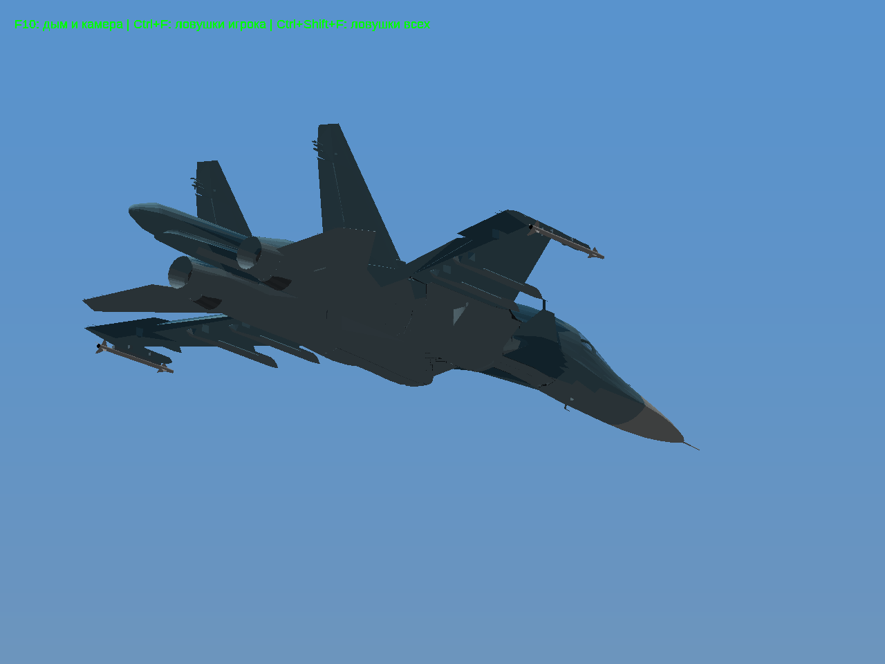

# Личный тест №4: Су-34

Публичная игра с Су-27 уже доступна: [ZIP Windows 32-bit](https://raw.githubusercontent.com/i7885784-lang/igraYS-Flight-Simulator/5e5aa0a/downloads/YSFlight_Playtest_4_32bit.zip). [Отчёт Су-27 / МиГ-29](../playtest-4/REPORT.md).

Су-34 — личный прототип на геометрии fantazer_rnd из DEVBenSon/FiveM-Plane-Pack, commit db0191619fb3d1cefc225eb5b216a91267ad7740. Текстуры YTD, звуки и системы GTA не перенесены. Разрешение на распространение геометрии не подтверждено: сборка с Су-34 не публикуется; готовится закрытый черновик релиза для владельца репозитория.

Исправлены выступавшая нижняя панель носа, укладка колёс, согласование стоек и створок. Основные проверки на 101 положении: [колёса против корпуса, ниш и створок](gear-clearances.json), [стойки/створки и створки/корпус](door-clearances.json) — пересечений не обнаружено; допускаются контакты в зоне шарниров до 5 см. Это проверка дискретных положений, а не доказательство отсутствия всех дефектов между ними.

Ограничения: основные створки выглядят слишком массивными, на части поверхностей заметны тёмные полосы — требуют доработки. Остекление Су-34 фиксированное; вымышленный откидной фонарь не добавлен, входной люк не анимирован. Аэродинамика игровая. Проверки запуска выполняются в Win64/Wine; настоящая Windows 10 x86 недоступна. Архив содержит отдельный Win32 EXE. Старые самолёты и архивы сохранены.

[Настоящая клавиша G: видео выпуска и уборки](su34/gear.mp4), [состояния игры](su34/results.json), [проверка личного ZIP и сохранения 74 файлов самолётов](local-package-checks.json). Локальная личная копия собрана; способ закрытого скачивания через GitHub проверяется отдельно.

| Шасси выпущены | Шасси убраны |
|---|---|
|  |  |

[Осмотр 360° в игре](su34/orbit.mp4) · [вид сверху](su34/top.png) · [спереди](su34/front.png) · [сбоку](su34/side.png) · [снизу](su34/bottom.png).
