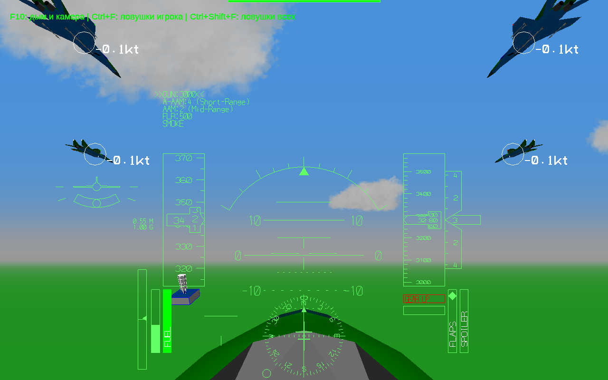
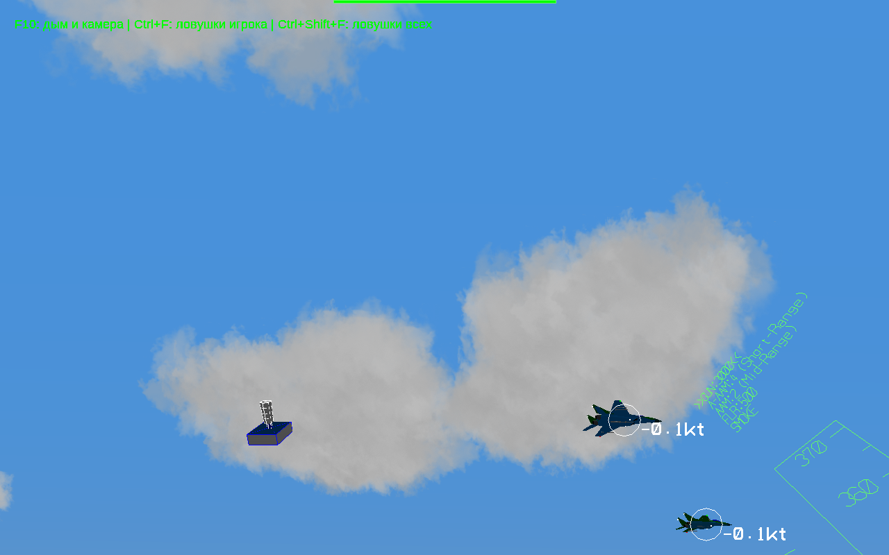

# Тест свободного полёта рядом с группой

[Скачать полную тестовую игру — Windows 10, 32 бита](https://raw.githubusercontent.com/i7885784-lang/igraYS-Flight-Simulator/ysflight-center-download/downloads/YSFlight_Straight_Test_32bit.zip)

Распакуй в новую папку и запусти **ysflight32_gl1.exe** двойным щелчком. На главном экране нажми **Тест**. Выбери самолёт, 0–4 ведомых, высоту, превышение и начальный строй, затем **Полететь**. По умолчанию — обратный клин.

Ведомые того же типа, что и твой самолёт, держат прямой курс, собственную скорость и высоту. На тебя и команды не реагируют. Можно пристроиться рядом; столкновения возможны. Список этого режима содержит самолёты, без вертолётов. Для крупных моделей интервал увеличивается автоматически.

Карта — зелёная ровная поверхность без объектов и видимого края; технические ограничения координат YSFlight сохраняются. Обычный режим содержит улучшения сопровождения LAB867.

## Камера

Полёт начинается из кабины. **Зажми ПКМ и двигай мышь**, чтобы осмотреться. **Нажатие колёсика** возвращает взгляд вперёд. Управление самолётом — с клавиатуры.

## Проверки

Пройдены 10 коротких игровых сценариев на 64-битной сборке из тех же исходников под Wine: разное число ведомых, пять строев, несколько высот, два самолёта, снижение газа игроком и осмотр мышью. Отклонение высоты ведомых — меньше метра; курс в проверках не менялся. Группа не повторяла снижение скорости игрока.

В ZIP находится **32-битный GUI exe**, с системными зависимостями. В этой среде Wine не запускает и прежнюю рабочую 32-битную игру; запуск итогового ZIP на Windows 10 x86 здесь не подтверждён. Его нужно проверить на компьютере пользователя. Рабочая v8.6.2 и предыдущая LAB867 сохранены.
