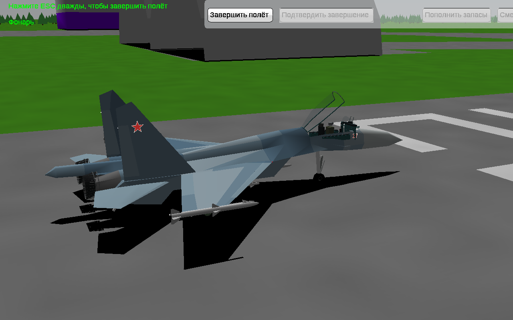
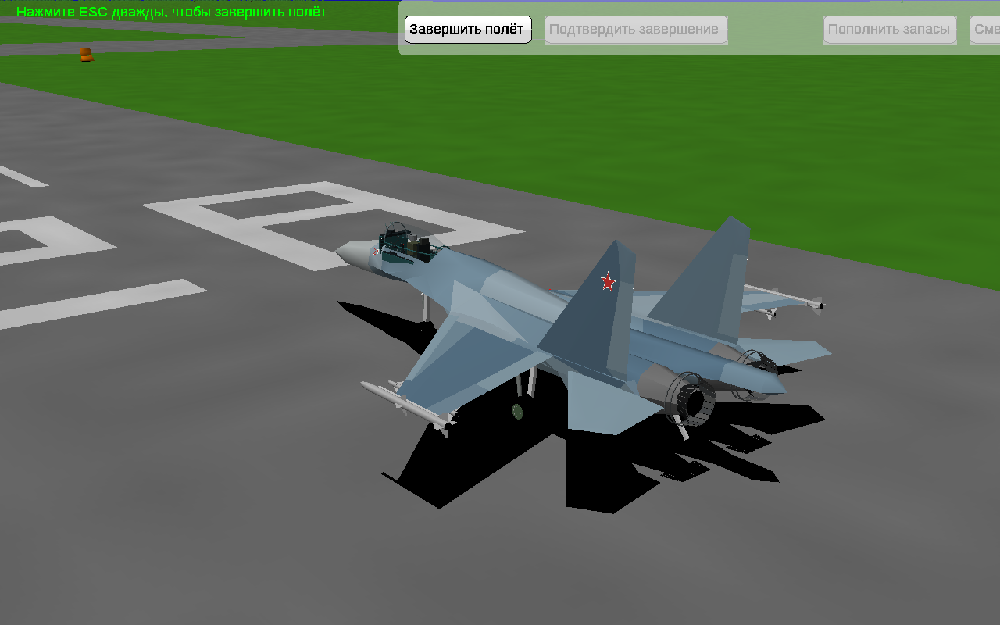
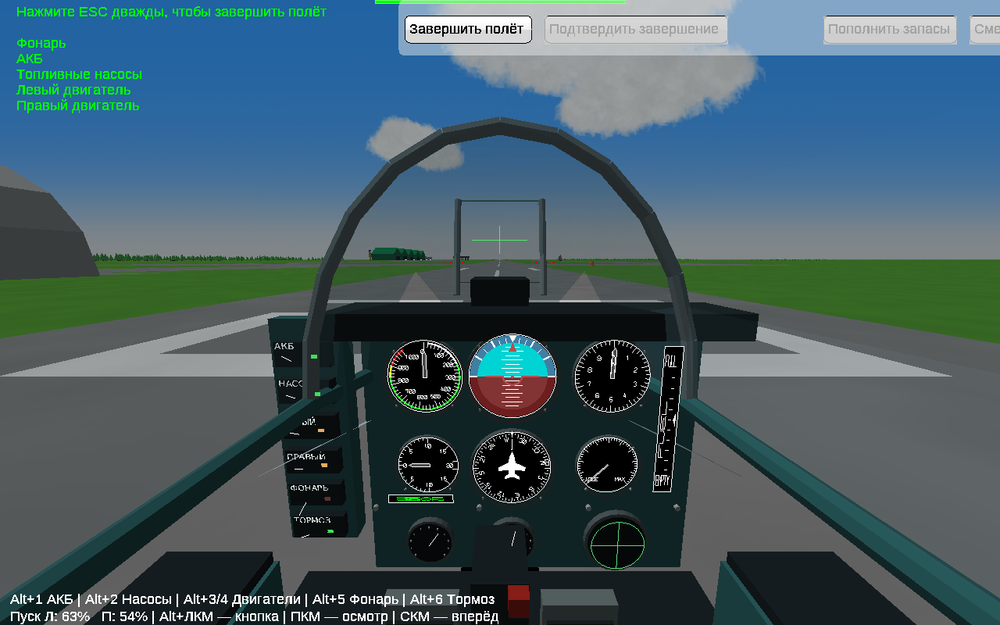
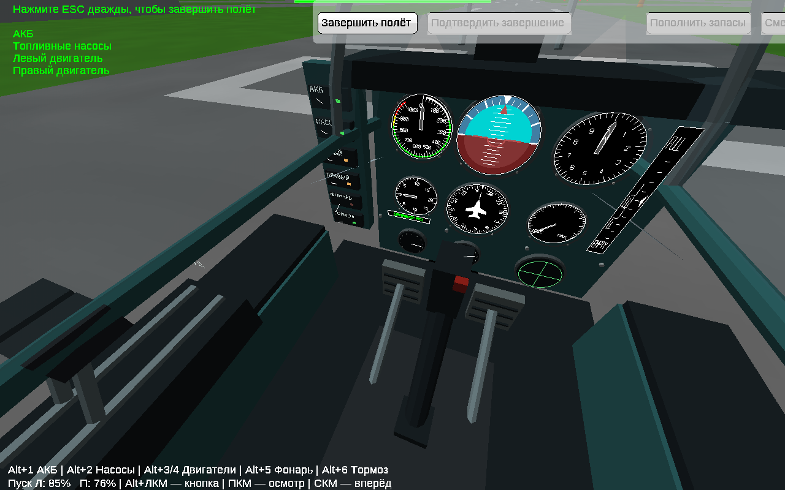

# Су-27: модель, кабина и запуск

[**Скачать полную игру для Windows 10, 32 бита**](../../downloads/YSFlight_Su27_32bit.zip?raw=true) · [**Видео из игры, 28 секунд**](Su27_Gameplay.mp4?raw=true)

Распакуй целиком в новую папку → **ysflight32_gl1.exe** → **«Су-27: кабина и запуск»**.

## Снаружи

Голубой камуфляж, борт 27, звёзды, детализированные сопла, стойки и ступицы шасси. Фонарь открывается с анимацией; кабина видна снаружи.

## Внутри

Объёмная панель и консоли, приборы YSFlight с текущими показаниями, ручка и рычаги тяги с анимацией, педали, рамка HUD. Лампы двигателей меняют цвет по мере запуска.

## Как запустить

1. **Alt+1**, затем **Alt+2** — питание и насосы.
2. **Alt+3**, **Alt+4** — двигатели. Подождать примерно **8 секунд**, до 100% и зелёных ламп.
3. **Alt+5** — фонарь. **Alt+6** — снять стояночный тормоз.
4. **Q** — добавить газ, **A** — уменьшить. Для взлёта плавно тяни ручку на себя после разгона.

Эти шесть переключателей работают и через **Alt+ЛКМ по рычажку**. **ПКМ + движение мыши** — осмотр; **нажатие колёсика** — взгляд вперёд; **Ctrl+колесо** — масштаб. **F1** — кабина, **F2** — внешний вид.

На старте в воздухе системы уже включены. Обычный выбор Су-27 тоже использует новую модель. Остальная игра и режим «Тест» доступны.

## Что проверено

✅ Холодный старт без тяги; запрет запуска без питания/насосов.  
✅ Раздельный запуск и остановка; остановка двигателей без насосов.  
✅ Фонарь, ограничение открытия на скорости, стояночный тормоз и движение от тяги.  
✅ Настоящий Alt+ЛКМ; осмотр на стоянке, F2 → F1, сброс взгляда.  
✅ Семь переходов по записи вперёд и назад с восстановлением фонаря и систем.  
✅ 30 секунд с четырьмя Су-27 и отдельный полёт F-18: ведомые выжили, отклонение высоты менее метра. Это проверки прямого полёта, не новая проверка всех манёвров.  
✅ Структура моделей, ссылки на поверхности, индексы граней, неизменённая модель столкновений; x86 GUI без стороннего C++ runtime.

Два помощника Luna отдельно просмотрели код, результаты и реальные кадры. По замечаниям исправлены перемотка, блокировка мыши верхней панелью и скачок взгляда после диалога; увеличены подписи и обозначено стекло HUD.

**Практические ограничения:** это детализация в прежнем low-poly движке, визуально проще концепта. Системы запуска упрощённые, тяга двигателей суммируется без отдельного моделирования асимметрии. Работают шесть описанных переключателей; прочие мелкие органы декоративные. Экран «Обзор» показывает союзников до 1 км, это не настоящий боевой радар. Тени остаются штатными.

**Проверки в этой среде — Win64 под Wine.** Итоговый ZIP собран отдельно для Win32/i386 с GUI-подсистемой. Запуск именно на Windows 10 x86 здесь не подтверждён: доступный Wine не запускает и прежнюю рабочую x86-игру. Старые выпуски сохранены без изменений. [Данные проверок](checks.json).

[Исходники и генератор модели](../../downloads/YSFlight_Su27_Sources.zip?raw=true)
