# Су-27 — внешний вид, тест №1

[**Скачать фотоотчёт PDF — все ракурсы**](../../downloads/Su27_Exterior_Photo_Report_1.pdf?raw=true)

Это реальные кадры из тестовой копии игры. Убраны торчащая наружу панель и лишние кольца сопел; подогнан фонарь, переработан нос. Low-poly стиль сохранён. Внутреннюю панель сейчас не дорабатывала.

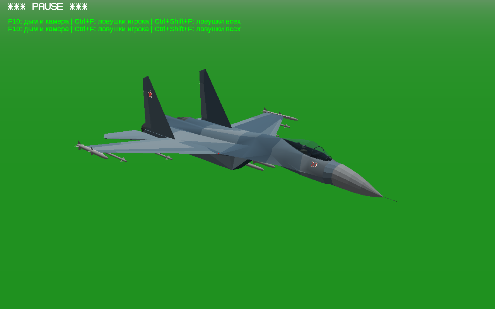

## До → после

Нажми на картинку, чтобы открыть её крупнее.

| Ракурс | До | После |
|---|---|---|
| Борт: панель и фонарь | 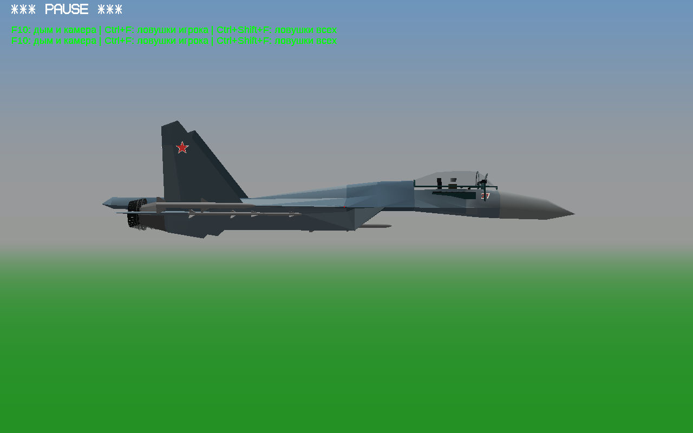 | 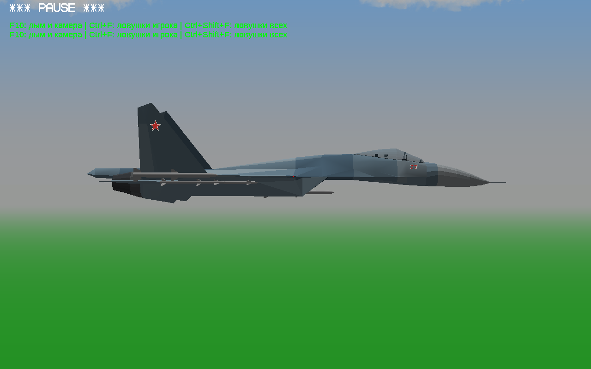 |
| Спереди: нос и выступающие детали | 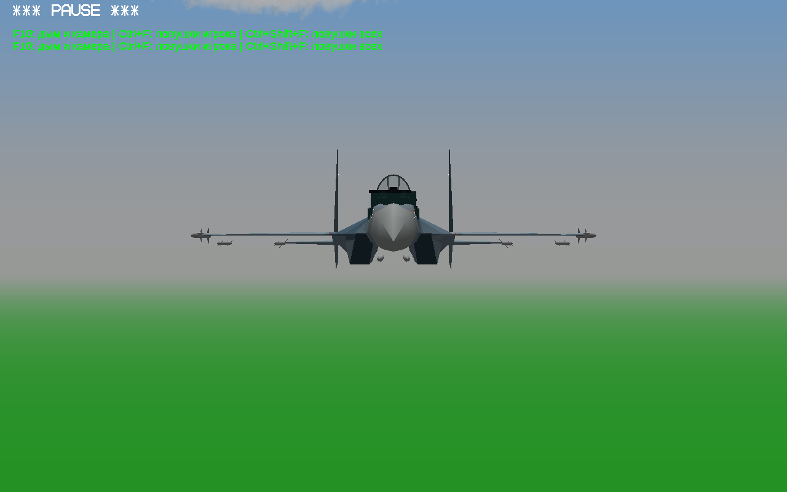 | 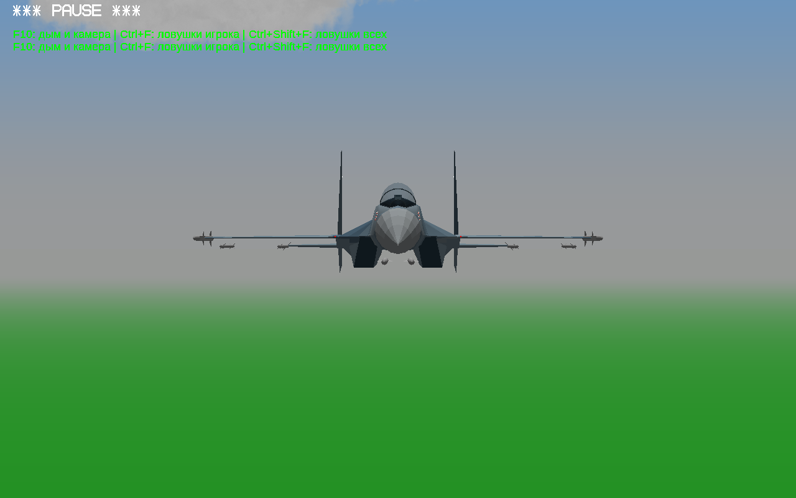 |
| Сзади: сопла | 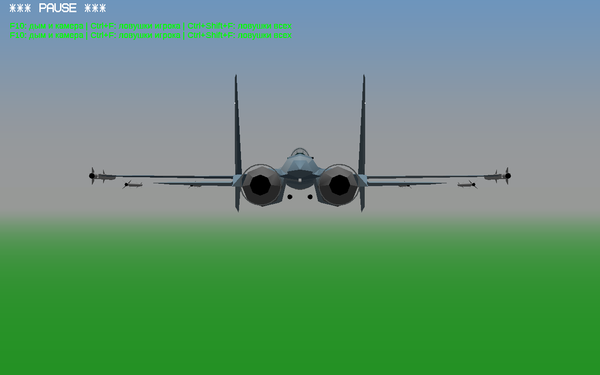 | 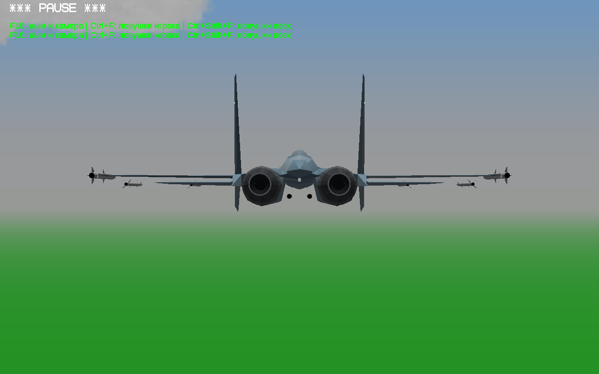 |
| Сверху: проём фонаря | 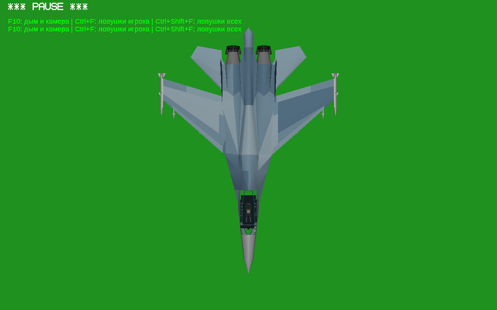 | 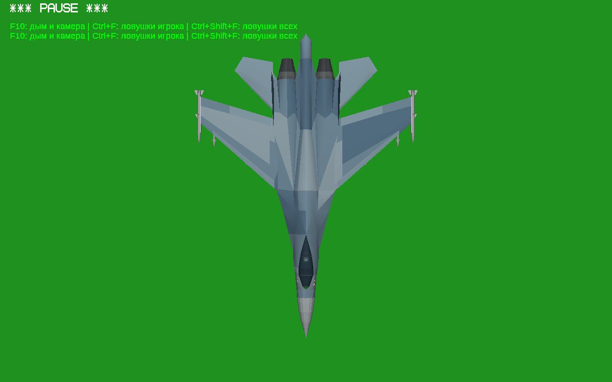 |

## После — все основные ракурсы

### Спереди

### Правый борт

### Левый борт

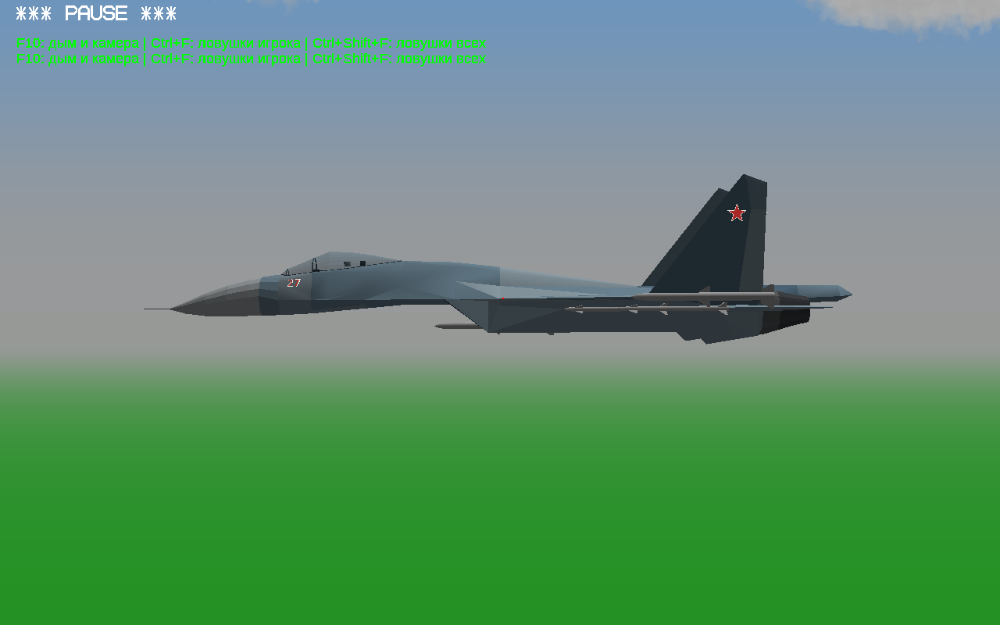

### Сзади под углом

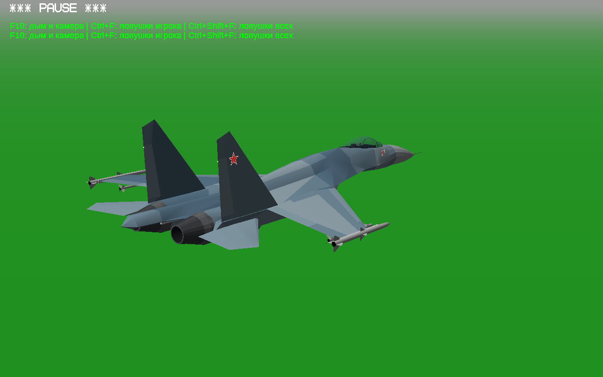

### Сзади

### Сверху

### Снизу

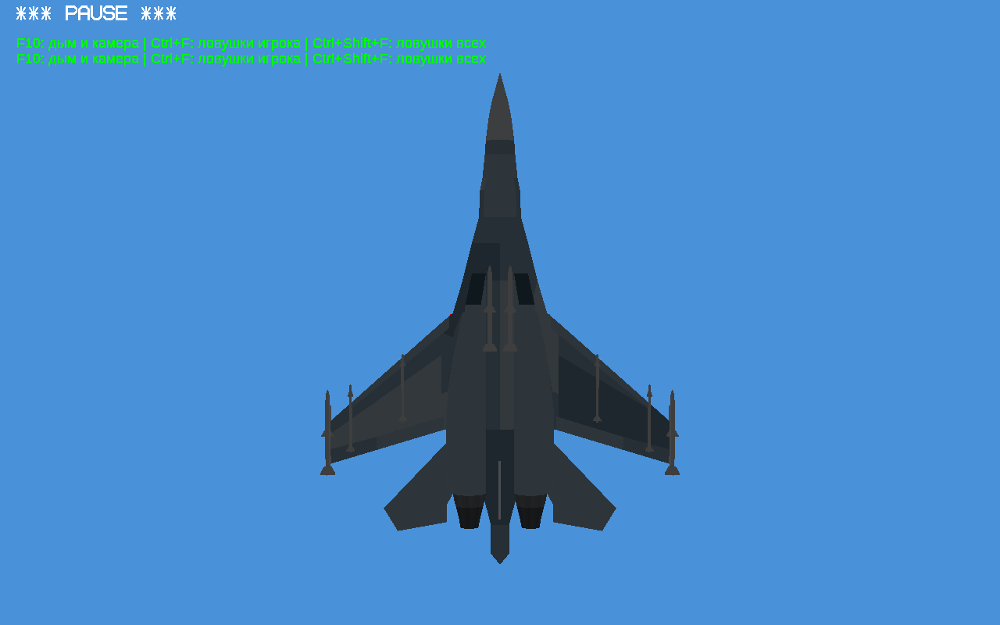

## Ближе к деталям

### Нос и фонарь крупнее

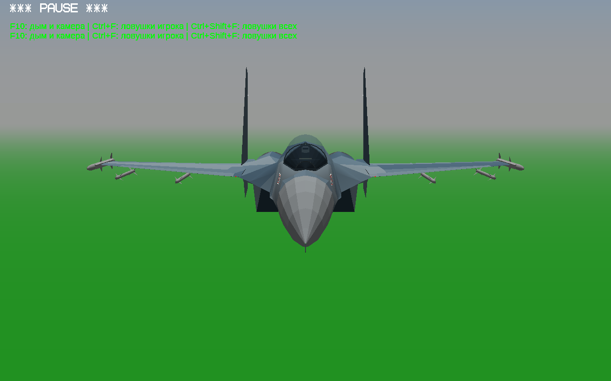

### Сопла крупнее

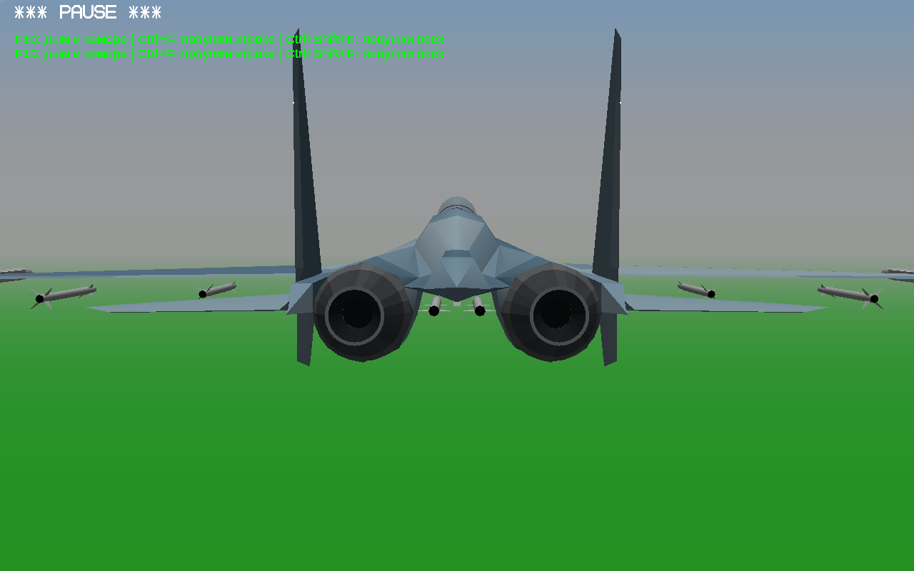

### Открытый фонарь на стоянке

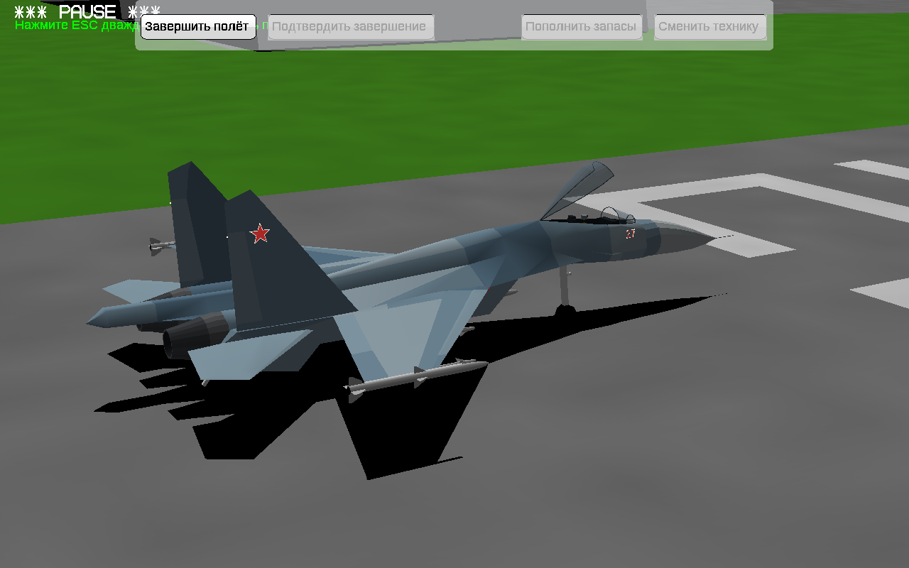

### Закрытый фонарь и выпущенные шасси

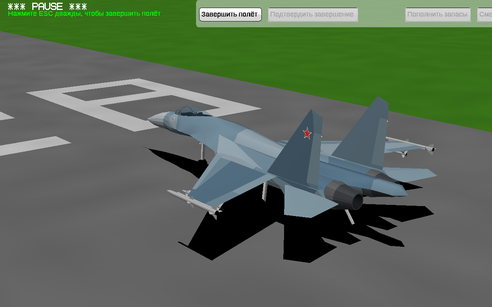

Проверены загрузка моделей в игре, положение внешней начинки под закрытым фонарём, открытое положение и ориентация граней сопел. Физика, характеристики и выпущенная игра сохранены. Это первая правка внешнего вида, не окончательная модель: корпус и оперение ещё сохраняют простую геометрию YSFlight. [Технические проверки](checks.json).
