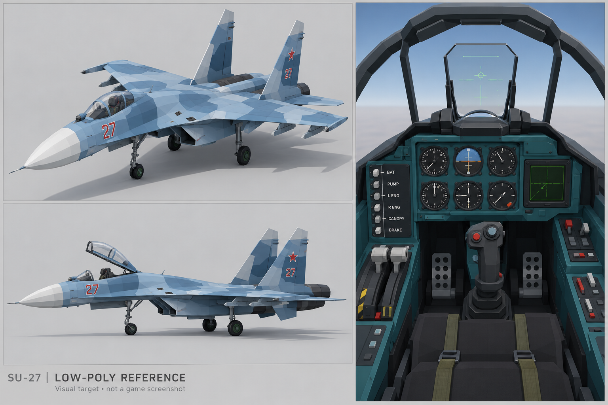

# Су-27: low-poly референс

[Скачать оригинальный PNG](Su27_LowPoly_Reference.png?raw=true) · [Текст задания](PROMPT_RU.txt) · [PNG и задание одним ZIP](../../downloads/Su27_LowPoly_Reference.zip?raw=true)

Это сгенерированный визуальный ориентир для процедурной модели без Blender, не исходник 3D-модели, не игровой скриншот и не точный технический чертёж. Пропорции между ракурсами могут различаться. Функции кнопок и анимацию необходимо отдельно подключать в игре.

