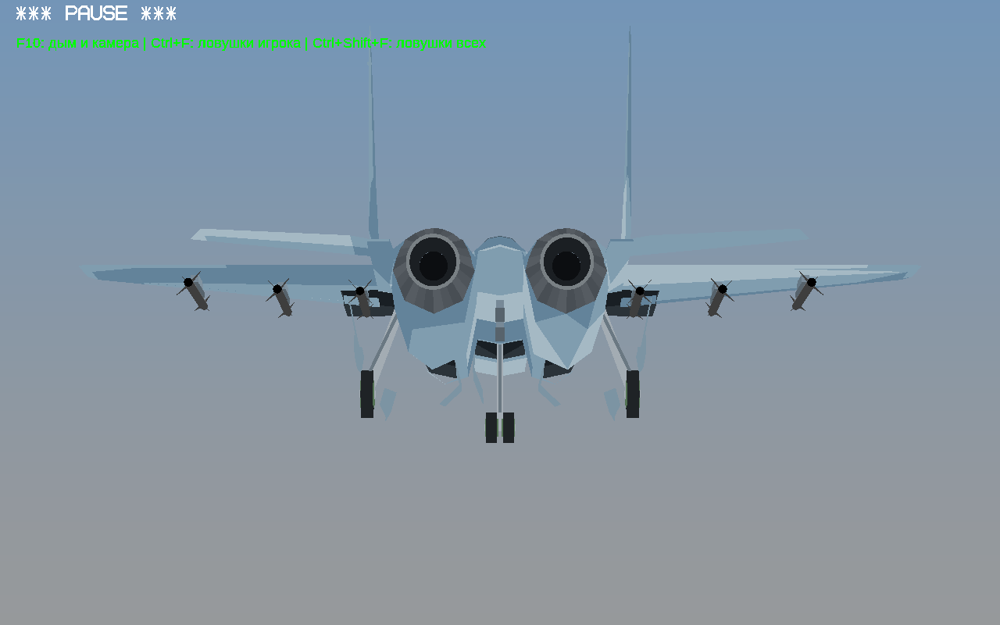
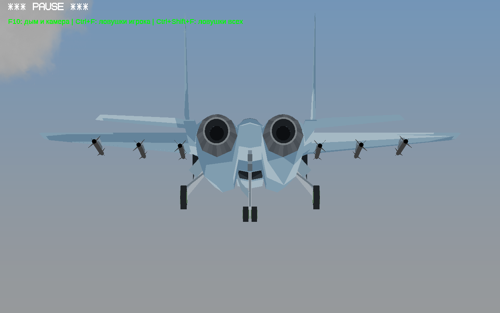
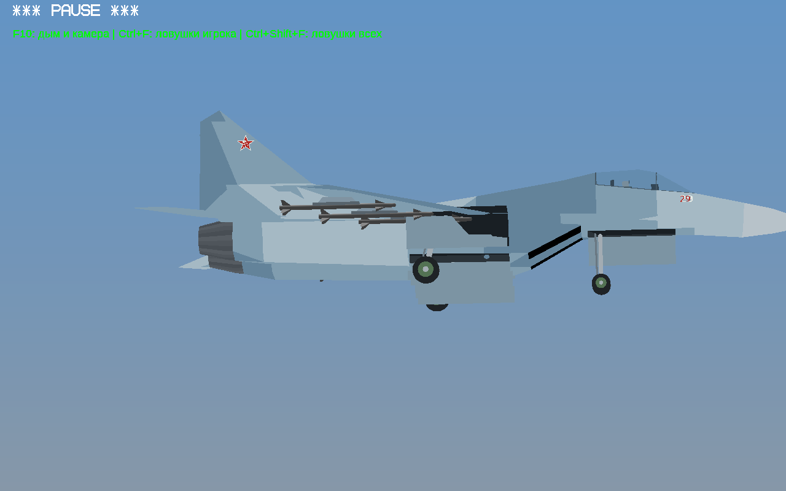
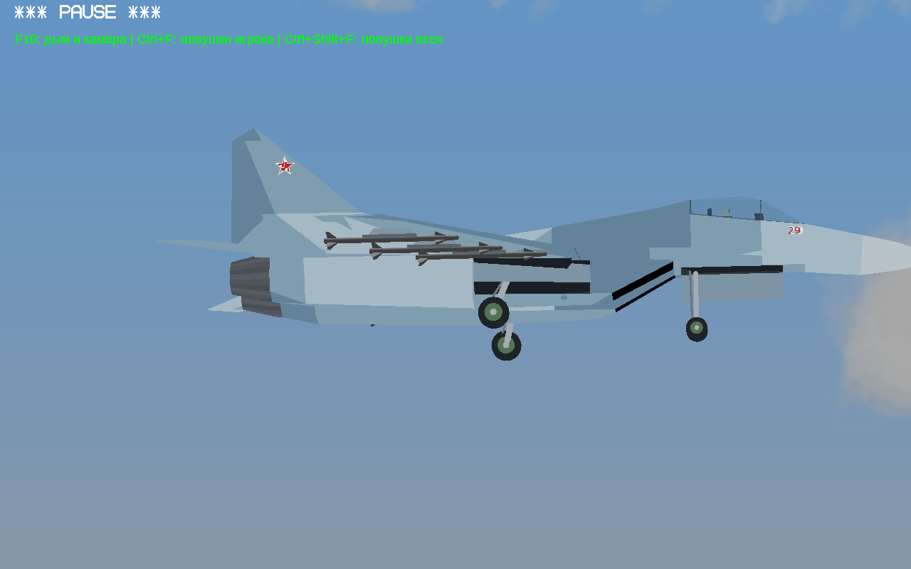
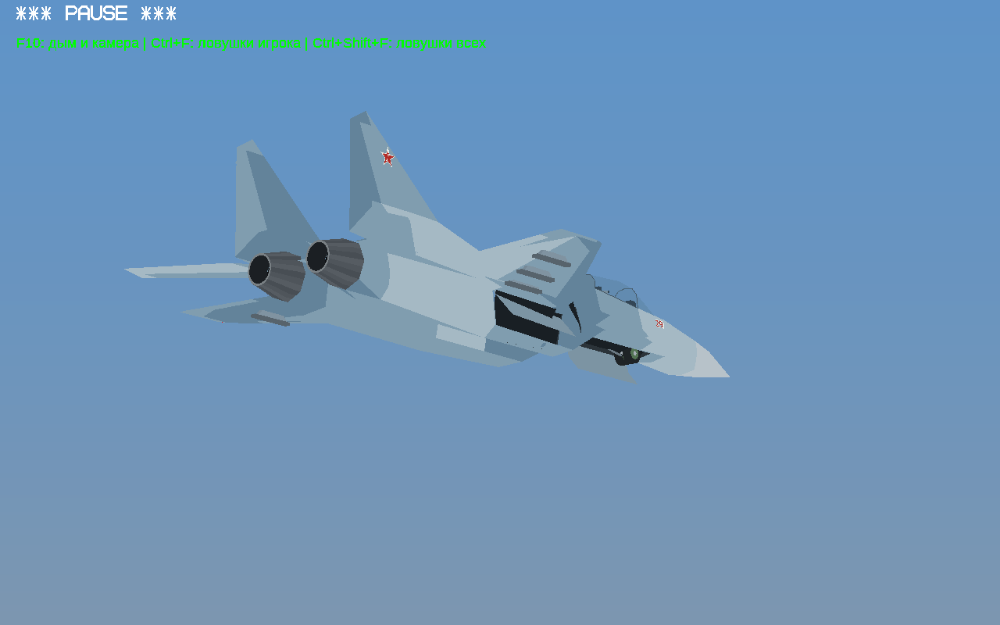
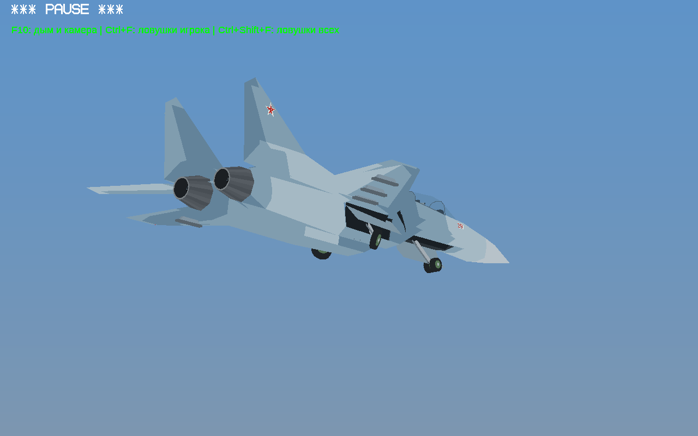
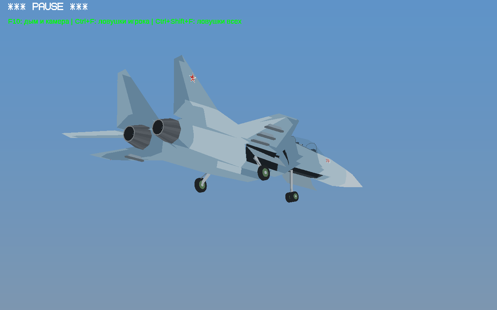
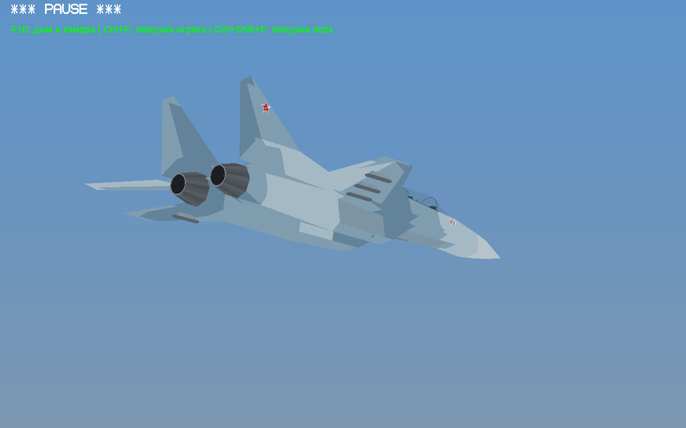
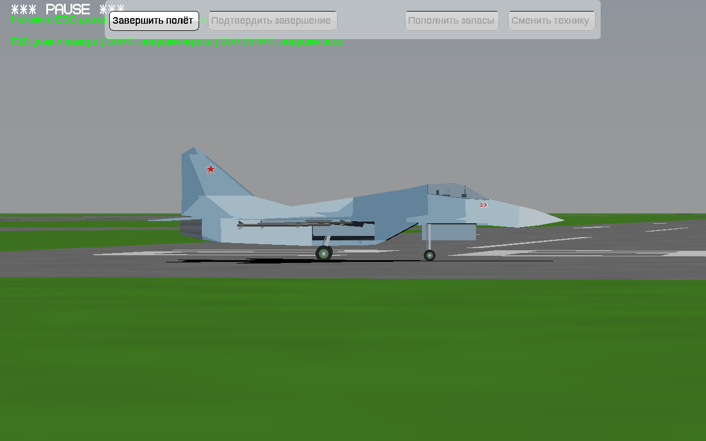

# МиГ-29 — исправление шасси, тест №4

[**Скачать игру, Windows 32-бит**](../../downloads/YSFlight_Su27_MiG29_Test_4_32bit.zip?raw=true) · [**Видео выпуска и уборки**](mig29-gear.mp4?raw=true)

Убраны куски обшивки крыла и воздухозаборника, ошибочно попавшие в подвижные створки. Основные створки построены по боковым нишам; оси вращения проходят по верхнему краю. Крепление стоек перенесено внутрь корпуса. Су-27 и EXE сохранены прежними.

| Раньше | Сейчас |
|---|---|
|  |  |
|  |  |

## Выпуск и уборка

| Начало | Половина | Выпущены | Снова убраны |
|---|---|---|---|
|  |  |  |  |

Проверены полный цикл, обратное движение на половине хода, состояние на земле и непрерывная видеозапись с настоящей клавишей G. [Результаты](checks.json). Игровые проверки — Win64/Wine; в архиве прежний Win32 GUI EXE и новые модели МиГ-29. Механизмы упрощены для игры.

Распакуй весь ZIP в новую папку, запусти **ysflight32_gl1.exe**. **G** — шасси.
