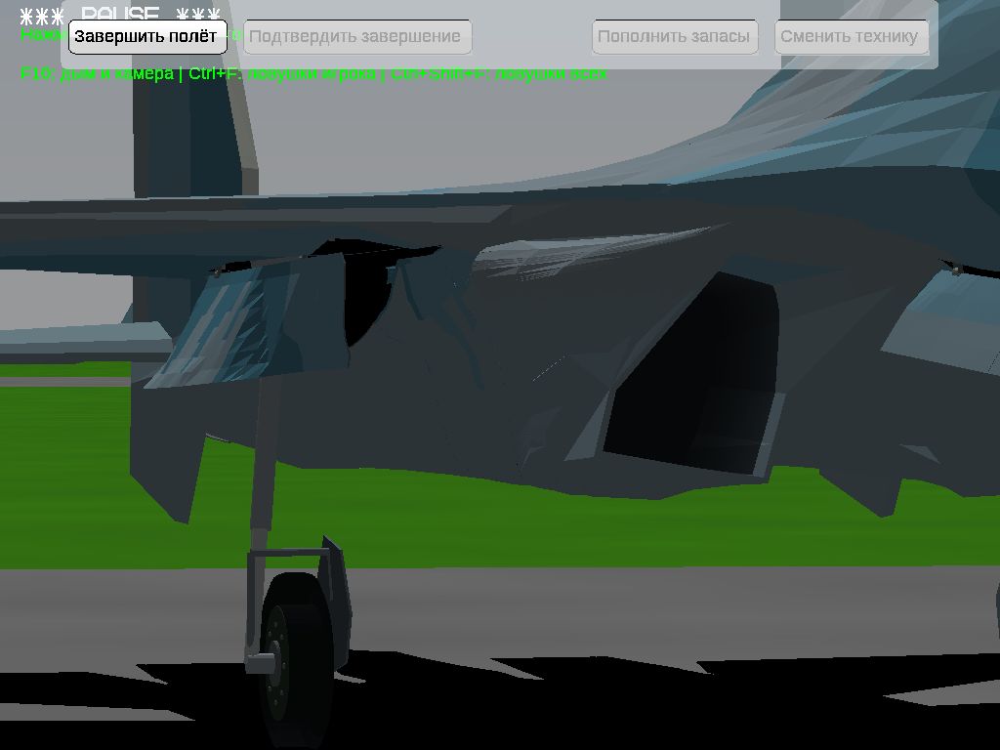

# Су-30СМ: локальное исправление подтверждённых дефектов

Исправлены только MainBayFixedSkin_Left.srf, MainBayFixedSkin_Right.srf и участки Fuselage_0_4.srf около основных ниш. Основа — предыдущая версия LargePanels, SHA256 `91a201f3ca02d7c69345d197827b1567cedcc87edb51409ffc0006b8cc0ae61c`. Итоговая модель: `dd9c29fd7e555be4ba1b7257adb91bcc63f7a7d3943b1b3421c865daa529ada7`.

## Что было неправильно

1. Нижний «зуб» и складки возле воздухозаборника создавал передний переход неподвижной обшивки. Алгоритм искал одну высоту Y для каждого X,Z, хотя реальный нависающий край корпуса имеет несколько высот в одном X. Получались потеря части контура, перекрученные грани и щель. Исправление использует настоящий связанный пространственный контур корпуса; вогнутый торец триангулируется с ограничениями. Форма не заменена плоскостью, нормали соответствуют настоящим граням.
2. Чёрные полосы и просвет в проёме при выпущенном шасси: там оставались полигоны исходного Fuselage_0_4. Ранее генератор пропускал почти вертикальные поверхности и поверхности выше нижней огибающей. Теперь исходная обшивка локально отсечена в проёме; потолок неизменённой ниши служит верхним ограничением с запасом 12 мм. Новые части отсечённых граней — подмножества исходных треугольников, с прежним цветом. Изменены 6669 face-блоков F4, остальные 113208 сохранены буквально; исходные вершины F4 сохранены.
3. Дополнительная тонкая чёрная линия при убранном шасси была видимой стенкой GearWell через настоящий зазор по высоте. Диагностическая окраска позволила определить конкретную поверхность; сама ниша находится внутри корпуса с запасом около 10 мм. Ошибочна кромка неподвижной обшивки: её прямая хорда была выше настоящего края корпуса на 5–18,2 мм. Исправлена только полоса шириной 20 мм, край со створкой сохранён. Ниша не менялась. На финальном крупном кадре с закрытым шасси линия исчезла.
4. Предположение об оторванном креплении стойки не подтвердилось: GearUpper и GearBearing имеют общую точку крепления, опора перекрывает крышу ниши. Стойка не поднята и механизм не переделан.

Накладки для скрытия дефектов, перекраска и удаление створок не применялись. Исправные треугольники не объявлялись ошибкой.

## Изменённые исходники

Все новые файлы находятся в `changes/su30sm-confirmed-defects/`:

- `repair.py`: `build_panel`, `Field._base/positions`, `run` — пространственный переход передней полосы и локальная подгонка внутренней кромки.
- `front_profile.py`: `extract`, `inboard_floor` — реальный контур F4 с нависанием и фактическая нижняя кромка корпуса.
- `bay_cut.py` — локальное отсечение подтверждённых остатков F4.
- `check.py`, `check_self.py` — проверка разрешённого состава изменений, замкнутости, нормалей и самопересечений сериализованной модели.
- `freeze.py`, `package.py` — точные три патча и упаковка двух настоящих архитектур, с проверкой исходных ZIP, PE, CRC и неизменённых ресурсов.
- `windows_prepare.py`, `windows_check.py`, `windows-start.yfs`, `previous-packages.json`, `README.md` — подготовка и документирование воспроизводимой проверки Windows.

Замороженные патчи и их хеши: `dist/su30sm-confirmed-defects/`. Протоколы и изображения: эта папка. Дополнительно добавлены отдельные workflow для нативной проверки и публикации. Старые исходники генераторов используются как зависимости без несвязанного рефакторинга. В архиве ModelSources находятся точная база и итоговая DNM, необходимые исходники и команды пересборки. Исполняемый движок не изменён и не перекомпилирован.

## Сохранность модели

Побайтово неизменны все 159 остальных PCK, включая ВСЕ створки, стойки, колёса, ниши и воздухозаборники. Все 162 записи узлов неизменны: оси, родители, POS/STA, видимость и параметры анимаций. Хеши защищённых PCK опубликованы в [quality.json](quality.json). Палитра и окраска сохранены; локальные отсечённые треугольники F4 сохраняют исходные атрибуты. Зазоры и внешний край у створок не двигались. Исправления ограничены неподвижной обшивкой и подтверждёнными остатками корпуса.

## Проверки

- Обе исправленные оболочки: замкнуты по реальным индексам, одна компонента, Euler=2, согласованные нормали, ноль вырожденных и дублирующихся треугольников. Самопересечения фактически записанных координат: 0 с допуском 2 мкм.
- Генератор повторно воспроизвёл итоговую DNM побайтово.
- 201 положение шасси, 618 пар деталей: не добавлено новых ключей контактов по сравнению с базой. 808 унаследованных ключей — контакты пар/положений, а не число новых дефектов. Эта проверка не доказывает отсутствия всех возможных пересечений внутри уже контактировавших пар.
- Настоящая игра под Wine x64: 11 одинаковых камер до/после, выпущенное, промежуточное и убранное шасси; вид сверху, сбоку, снизу, обе стороны. Финальные изображения открыты и визуально сопоставлены. Выполнен обычный цикл клавишей G, записано 51 состояние и видео; видео целиком покадрово не просматривалось.
- Настоящая Windows: обе архитектуры успешно запущены с итоговой DNM. [Actions 43569980672](https://github.com/i7885784-lang/igraYS-Flight-Simulator/actions/runs/43569980672). x86 использует обычные команды шасси; x64 дополнительно диагностические камеры и положения. Репрезентативные финальные PNG открыты. Нативные протоколы: [32-bit](native-32-results.json), [64-bit](native-64-results.json).
- x86 PE Machine `0x14c`, OptionalHeader `0x10b`; x64 `0x8664`, `0x20b`. EXE разные и сохранены из соответствующих предыдущих архивов. Упаковщик сверяет модель и EXE с нативными протоколами, проверяет CRC и побайтово все прежние ресурсы, кроме новой DNM и паспорта.

## Снимки

Одинаковая камера, до слева / после справа в сравнительных листах архива доказательств. Исходные полные PNG и параметры камеры также приложены.

[До](before.png) · [После](after.png)

Полный комплект: `Su30SM_LocalDefects_VisualReport.zip` в GitHub Release — 11 пар снимков, дополнительные финальные кадры Windows x86/x64, результаты геометрических проверок и запись цикла шасси. Для просмотра локально откройте `index.html`.

## Ограничения и откат

Область проверки — отмеченная обшивка и соседнее сопряжение с нишами. Полный аудит всего самолёта не проводился. Унаследованные детали интерьера, верхняя светлая мелкая полосатость исходной поверхности и характер затенения других мешей не переделывались. На просмотренных ракурсах новых крупных дыр, зубьев и наложенных полос в исправленной области не выявлено; это не обещание отсутствия любого дефекта при любой камере.

Предыдущие релизы сохранены. В каждом игровом ZIP есть `runtime/rollback-local-defects/su30sm.dnm`: для отката заменить им `runtime/aircraft/su30sm.dnm`. Использованная ветка: `fix/su30sm-confirmed-defects-20261114`.
