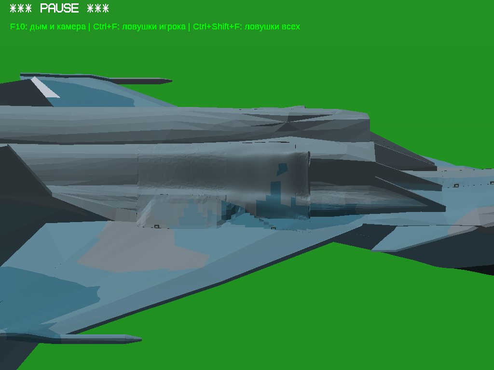

# Су-30СМ: фасеточная неподвижная обшивка слева

Исправлен только **MainBayFixedSkin_Left.srf**. База — публичная поставка `su30sm-local-skin-20261111`, коммит `0b1efe6896d3b02580cbeb0d014f4a267bf1ffe9`. Работа выполнена в отдельной ветке `fix/su30sm-facets-20261113`, предыдущая версия сохранена.

Выделение захватывает также `MainWheelBayShutter_Left`. Поскольку пользователь повторил запрет на створки, эта часть осталась неизменной и визуально более гладкой. Правая обшивка, все створки, стойки, колёса, ниши и анимации сохранены. Результат относится к разрешённой неподвижной части выделения.

## Причина и исправление

Специальное сглаживание и вершинные R-нормали отсутствовали уже в исходной модели. Визуальная гладкость возникала из-за плотной триангуляции непрерывной кривой поверхности после предыдущего устранения складок.

[facet.py, run()](../../changes/su30sm-facets/facet.py) строит локальную адаптивную кусочно-плоскую аппроксимацию существующей поверхности. Все исходные граничные опорные точки фиксируются. Разбиение по цветовым областям сохраняет проекции камуфляжа на микрометровой решётке. Нормали рассчитаны по настоящим окончательным граням существующей функцией `make_panel()`; искусственные нормали и накладки не применяются. Толщина задней оболочки по Y остаётся 8 мм.

Количество внешних треугольников уменьшено **22 244 → 3 286**. В контрольных вершинах исходной и новой сеток максимальное измеренное отклонение по Y — **6,294 мм**, RMS на новых вершинах — 0,286 мм. Краевые высоты до окончательного округления совпали с погрешностью 2,49e-12 м; итоговая запись координат округляется до 1e-10 м. Общий контур сохранён. Эти измерения не являются математическим доказательством максимума расстояния между каждой парой точек двух поверхностей.

Проба с более строгим отклонением 2 мм была отклонена по игровым кадрам: эффект гранёности оставался слишком слабым. В поставку вошёл только окончательный вариант. Глобальная реконструкция самолёта и прежняя QP-подгонка повторно не выполнялись.

## Что сохранено и проверено

[Аудит генератора](generator.json), [геометрия и SHA защищённых PCK](quality.json), [самопересечения](self.json), [контакты](contacts.json).

- Только один PCK изменён; **161 прочий PCK и все 162 записи узлов DNM совпали дословно**. Оси, родители, POS/STA, последовательности анимаций не менялись.
- Палитра и проекции цветовых областей сохранены с точностью используемой решётки 1 мкм. Перекраски нет.
- Сетка замкнута и имеет одну связную оболочку, согласованный обход. Вырожденных треугольников, нулевых нормалей и дубликатов полигонов не найдено; минимальный normal/winding dot >0,99999931.
- Проверка реальных записанных координат не нашла самопересечений и копланарных наложений при допуске 2 мкм. Общие индексированные вершины считаются штатным соединением.
- Только изменённая обшивка проверена против 156 соседей в **201 положении шасси**. До/после по 404 прежних контактных ключа, **0 добавленных, 0 удалённых**. Это сохранённые исходные стыковые контакты и прежние локальные контакты механизма; отсутствие всех контактов самолёта не заявляется. Дискретная проверка не доказывает отсутствие контакта при любом вещественном значении времени.

Глобальная сварка совпадающих вершин повторно сливает намеренно разделённый граничный веер исходной модели и нарушает его топологию. Отрицательный контроль сварки из прежнего валидатора к поставляемой сетке не применяется.

## Реальная игровая проверка

Запускался штатный Windows x64 OpenGL EXE под Wine в Linux. Сделаны и **открыты для просмотра** шесть пар настоящих PNG: основной ракурс, три близких угла, промежуточное и выпущенное положения шасси. Параметры камеры до/после одинаковы: [capture-used.sh](../../changes/su30sm-facets/capture-used.sh). Для освещения нижней поверхности использована одинаковая перевёрнутая поза самолёта. Основной ракурс приближен к пользовательскому снимку; точные исходные параметры камеры неизвестны. Скриншоты не ретушировались.

В просмотренных ракурсах фасетки неподвижной обшивки заметны; новых дыр, выступов и наложений не обнаружено. Прежняя рваная геометрия не возвращена. Наиболее гладкая передняя часть выделения — защищённая створка — сохранена по ограничению пользователя. Прежние неровности соседних деталей остаются вне этого изменения.

Статические положения шасси заданы диагностической командой для сопоставимости. Новый живой цикл клавишей G не выполнялся: анимационные записи побайтово сохранены, а пространственная проверка ограничена изменённой неподвижной деталью. Нативная Windows и текущая x86-версия в игре заново не запускались.

| Ракурс / поза | До | После |
|---|---|---|
| Основной, убрано | [PNG](before/match.png) | [PNG](after/match.png) |
| Близкий угол A | [PNG](before/near-a.png) | [PNG](after/near-a.png) |
| Близкий угол B | [PNG](before/near-b.png) | [PNG](after/near-b.png) |
| Ниже | [PNG](before/lower.png) | [PNG](after/lower.png) |
| Промежуточное | [PNG](before/mid.png) | [PNG](after/mid.png) |
| Выпущено | [PNG](before/down.png) | [PNG](after/down.png) |

До:

После:

## Изменённые файлы и воспроизведение

- `changes/su30sm-facets/facet.py` — локальный генератор одного PCK.
- `check.py`, `check_self.py`, `check_motion.py` — узкие проверки с использованием существующих валидаторов.
- `package.py` — две подлинные архитектурные упаковки и архив исходников модели.
- `README.md`, `capture-used.sh`, `.gitignore` — команды, параметры снятых кадров и исключение временных файлов.
- `dist/su30sm-facets/ModelUpdate.zip` — замороженный проверенный единственный PCK и SHA модели.
- `TASK_CONTEXT.md` — краткое рабочее состояние; `reports/su30sm-facets/` — этот отчёт, проверки и парные игровые PNG.
- `.github/workflows/su30sm-facets-publish.yml` — публикация готовых проверяемых ресурсов в отдельный GitHub Release.

Существующие генераторы, движок и физика не изменялись. Команды воспроизведения: [README](../../changes/su30sm-facets/README.md).

Базовый DNM: `6f8e20b21990820dcc3aa49f91e92ef4a1771047951671f61732d111256b30c6`.

Итоговый DNM: `04f7d3c0b823b53990a010fcc29009d032e648b9c781fd02f44c8a86b3dfb129`.

## Архивы и ограничения платформ

Это две отдельные полные Windows-сборки с обновлённым ресурсом модели; EXE не пересобирались. x86 содержит прежний настоящий PE32 Machine=0x14c, x64 — PE32+ Machine=0x8664. SHA EXE различаются. В каждом ZIP меняются только DNM и паспорт; добавлены инструкция и точная предыдущая модель в `runtime/rollback-facets/` для отката. Прочие исходные записи ZIP сверяются побайтово.

CRC, SHA, PE и воспроизводимость патча проверяются упаковщиком. Новый ModelSources.zip содержит генератор, базовую и итоговую модели и локальные зависимости. Полные неизменные исходники движка с лицензиями доступны в [предыдущем FullSources.zip](https://github.com/i7885784-lang/igraYS-Flight-Simulator/releases/download/su30sm-local-skin-20261111/Su30SM_LocalSkin_FullSources.zip).

Игровая проверка относится к **x64 под Wine**. x86 поддерживается имеющимся подлинным EXE; проверка PE/ресурсов/архива не заменяет новый игровой запуск x86 или нативной Windows. Ограничение отражено в паспортах сборок.

## Контроль GitHub-публикации

[Actions43446236303](https://github.com/i7885784-lang/igraYS-Flight-Simulator/actions/runs/43446236303) завершился успешно. [Release](https://github.com/i7885784-lang/igraYS-Flight-Simulator/releases/tag/su30sm-facets-20261113) публичный. Оба игровых ZIP и ModelSources скачаны обратно по прямым публичным ссылкам: SHA256 и CRC совпали; в обоих игровых архивах повторно проверены PE, SHA модели, откат и побайтовая сохранность1160 прочих прежних файлов. Генератор из скачанного ModelSources заново создал **побайтово тот же** DNM04f7d3c0… . [Протокол публикации](publication-check.json), [паспорта архивов](packages.json).

Старый GH_TOKEN в локальном gh истёк, поэтому запись исходников выполнена действующим подключённым GitHub, публикация ZIP — штатным токеном GitHub Actions. Доступ пользователя не изменялся.
